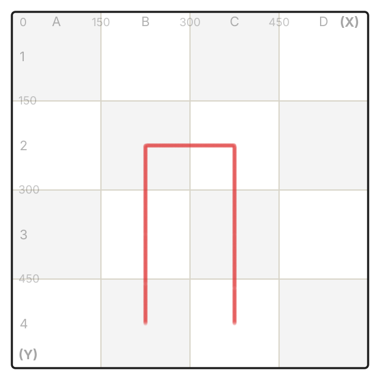

## はじめに

PrimaSTEM は、プログラム可能なロボット、コントローラー、コマンドチップのセットで構成されます。高齢者の認知障害の予防と矯正に使えます。

### 対象となる方

- 軽度の認知障害を持つ高齢者
- 神経疾患を患ったことのある方
- 神経変性疾患の初期段階の患者

### 禁忌

- 重度の視覚障害
- 腕や手の顕著な運動障害
- 重度の認知症
- 急性の精神障害

## 最初のセッション

所要時間は約35分です。始める前に、上の禁忌を読んでください。まだ本体がない場合は、すべての手順を[シミュレーター](https://simulator.primastem.com)で行えます。

<Steps>
  <Step title="慣れる、10分">
    ロボット、コントローラー、「前進」「右」「左」のチップを見せます。参加者はコントローラーに「前進」のチップを1枚置き、**▶ スタート** を押して、ロボットが動く様子を見ます。コントローラーとロボットのしくみは[クイックスタート](/jp/quickstart)にあります。
  </Step>
  <Step title="最初のルート、10分">
    ロボットから2〜3マス先にゴールを決めます。参加者はチップを並べ、プログラムを実行し、ロボットがゴールに着いたか確かめます。シミュレーターでは[やさしい迷路](https://simulator.primastem.com/#s=l1144402&r=75-525-0&m=2101)を使います。
  </Step>
  <Step title="休憩、5分">
    15〜20分作業したら休みます。
  </Step>
  <Step title="図形、10分">
    参加者は、ロボットが正方形をなぞるプログラムを作ります。シミュレーターで[正方形の課題](https://simulator.primastem.com/#sh=square)を開きます。ロボットは点線の輪郭をたどります。
  </Step>
</Steps>

最後に、何がやさしく、何が難しかったかを聞きます。その答えで次のセッションの始め方が決まります。

## 一般原則

加齢や神経変性疾患により、記憶力が落ちることがあります。抽象的に考えること、学ぶこと、新しいものを生み出すことも難しくなります。PrimaSTEM のセッションは、ゲーム形式でさまざまな認知機能を鍛え、こうした変化を遅らせるのに役立ちます。

### セッションの組み立て方

- 1回のセッションは30〜45分です。
- セッションは週2〜3回行います。
- 1人で、または2〜4人の小グループで行います。
- 15〜20分作業するごとに、5〜10分休みます。

### セッションの進め方

1. 課題の難易度を少しずつ上げます。
2. 参加者一人ひとりの特性と制限を考えます。
3. 明るい雰囲気を作ります。
4. 種類の違うエクササイズを交互に行います。
5. 毎回、できたことを参加者に伝えて褒めます。

## セッションで鍛えるもの

### 認知機能

- 知的活動
- 空間的思考と記憶
- 視覚的記憶と聴覚的言語記憶
- 論理的思考と暗算
- 計画と自分の行動の管理
- 周辺視野

### コミュニケーションと気分

- セッションは、本人の可能性と社会的な活動を保ちます。
- 参加者は自分を表現できます。
- 参加者は他の人と話しやすくなります。
- セッションは気分を明るくします。

## トレーニングとゲーム

### 1. 最初のエクササイズ（慣れる期間）

- コマンドチップに慣れる。
- ロボットをまっすぐ進める。
- 基本的な方向転換をする。
- 短いコマンドの並びを作る。

**教材**

- [クイックスタート](/jp/quickstart)
- [ブック1](/jp/book-1/book-1)、活動2

### 2. 空間的思考のトレーニング

#### ルート

- 最短経路を見つける。
- 障害物をよける。
- ランダムなコマンドチップの組み合わせでルートを作る。
- 指定されたアルゴリズムに従って進む。
- いくつかのルートから正しいものを選ぶ。
- 逆向きのルートを作る。

#### 難易度レベル

1. 指定されたルートから終点を見つける。
2. リストから正しいルートを選ぶ。
3. 既知の終点から始点を見つける。

#### 身近な部屋

- 家の部屋や廊下など、身近な部屋のモデルを作る。
- 部屋の中のルートを計画する。
- 迷路を進む。

**教材**

- シミュレーターの迷路：[やさしい](https://simulator.primastem.com/#s=l1144402&r=75-525-0&m=2101)、[ふつう](https://simulator.primastem.com/#s=l1144502&r=75-675-0&m=400113232131)、[むずかしい](https://simulator.primastem.com/#s=l1144602&r=75-825-0&m=0014243444540212223242)。ロボットは角に置かれ、旗がゴールです。
- [付録1. マップ上の移動](/jp/book-1/attachment-1)
- [付録2. ミッションカード](/jp/book-1/attachment-2)
- [ブック1](/jp/book-1/book-1)、活動4：ロボットがどこで止まるか予想する。
- [付録3. プログラムに従って経路を描く](/jp/book-1/attachment-3)

### 3. 計画のトレーニング

- 日常の行動のアルゴリズムを作る：
    - 「お店にいる：リストに従って購入」
    - 「外出する準備：何をするか」
- 物や行動の絵が描かれたカードを使う。

**教材**

- [付録2. ミッションカード](/jp/book-1/attachment-2)
- [付録4. プログラム内のエラーを見つけて修正する](/jp/book-1/attachment-4)

### 4. 空間記憶のトレーニング

- ルートを覚えて、もう一度たどる。ルートは見せても、声に出して伝えてもかまいません。
- 記憶術を使う。たとえばキケロ法があります。
- 「MEMO」で遊ぶ：ペアのカードを探して覚える。

**教材**

- [シミュレーターの階段](https://simulator.primastem.com/#top=cfun.r004&fn=cfor,crig,cfor,clef&s=l1144502&r=75-675-0&run)：ロボットの動きを見て、ウィンドウを閉じ、記憶をたよりにコントローラーでルートを再現します。

### 5. 数学ゲーム

- 数学迷路：ロボットは例題のあるマス目を進みます。
- 算術ルート：1歩ごとに同じ数を足すか引く。

**教材**

- [教師向けガイド](/jp/teachersguide)、「8. 算術」の節。
- [描画例](/jp/mathdrawings)、「スパイラル」グループ：一歩ごとに同じ数だけ長くなります。

### 6. 言葉遊び

- 場の上でことわざを探す。
- 散らばった文字から単語を作る。
- 特定の音を含む絵を見て、ルートを作る。

**教材**

- [オーディオファイル参照](/jp/sounds_reference)：コントローラーがチップ、文字、場所の名前を21言語で読み上げます。

### 7. 鉛筆ゲーム（描画）

#### 図形ディクテーション

- 絵を見てアルゴリズムを作る。
- 対称の残り半分を描き足す。
- アルゴリズムの誤りを見つけて直す。
- 鏡に映した絵を描く。
- 図形を 90° 回転させる。
- ループを使って模様や飾りを描く。

**教材**

- シミュレーターで図形の輪郭をなぞる：[正方形](https://simulator.primastem.com/#sh=square)、[三角形](https://simulator.primastem.com/#sh=triangle)、[おうち](https://simulator.primastem.com/#sh=house)、[星](https://simulator.primastem.com/#sh=star)。
- [描画例](/jp/mathdrawings)：各プログラムの横に完成した絵があります。

### 8. コミュニケーションゲーム

#### 競争

- ボーナストークンをできるだけ多く集める。
- ロボットと「モノポリー」風のゲームで遊ぶ。
- 文字探しの言葉遊びをする。
- 2人用のボードゲーム「迷路」で遊ぶ。

**教材**

- ペアやグループ向けのパズルは、下の「パズル」の節にあります。

## パズル

テーブルでペアや少人数のグループで取り組む課題です。大きな紙の上にロボットを置き、マーカーを差し込みます。ロボットは1歩で15 cm進み、90°回転します。答えは各課題の下に隠してあります。シミュレーターのリンクは、進行役が事前に課題を確かめるためのものです。

### 絵当てゲーム

進行役はコントローラーにプログラムを並べますが、何が描かれるかは言いません。ロボットが描くあいだ、参加者は誰よりも先に絵を当てようとします。当てた人に1点。ほかのプログラムは[描画例](/jp/mathdrawings)にあります。

[シミュレーターで実行](https://simulator.primastem.com/#top=cfor.n300,crig.n120,cfor,crig,cfor,cfun.r003&fn=clef,cfor&s=l1047602&r=338-397-30&run)

<Columns cols={2}>
  <Frame caption="コントローラー上のプログラム">
    
  </Frame>
</Columns>

<Accordion title="答え">
  おうち。

  <Columns cols={2}>
    <Frame caption="ロボットが描く図形">
      
    </Frame>
  </Columns>
</Accordion>

### チップを1枚かえる

ロボットは階段を描きます。チップを1枚だけかえて、正方形を描くようにしてください。

[シミュレーターで実行](https://simulator.primastem.com/#top=cfun.r004&fn=cfor,crig,cfor,clef&s=l1144502&r=75-675-0&run)

<Columns cols={2}>
  <Frame caption="コントローラー上のプログラム">
    
  </Frame>
  <Frame caption="ロボットが描く図形">
    
  </Frame>
</Columns>

<Accordion title="答え">
  下段の「左」を「右」にかえます。ロボットは正方形を2周します。

  [シミュレーターで実行](https://simulator.primastem.com/#top=cfun.r004&fn=cfor,crig,cfor,crig&s=l1144502&r=75-675-0&run)

  <Columns cols={2}>
    <Frame caption="コントローラー上のプログラム">
      
    </Frame>
    <Frame caption="ロボットが描く図形">
      
    </Frame>
  </Columns>
</Accordion>

### プログラム当て

進行役は、参加者にコントローラーが見えないようにプログラムを並べます。ロボットは左下の点から上を向いて出発し、逆さのU字を描きます。参加者は同じ形を描くプログラムを作り、ロボットで確かめます。

<Columns cols={2}>
  <Frame caption="ロボットが描く図形">
    
  </Frame>
</Columns>

<Accordion title="答え">
  「前進」 ×2、「右」、「前進」、「右」、「前進」 ×2。同じ絵になるプログラムなら、どれでも正解です。

  [シミュレーターで実行](https://simulator.primastem.com/#top=cfor.r002,crig,cfor,crig,cfor.r002&s=l1144402&r=225-525-0&run)

  <Columns cols={2}>
    <Frame caption="コントローラー上のプログラム">
      
    </Frame>
  </Columns>
</Accordion>

### 同じ

2つのプログラムがあります。どちらでもロボットは同じ絵を描くでしょうか。まず参加者で話し合い、それから同じ場所から両方のプログラムを実行して確かめます。

<Columns cols={2}>
  <Frame caption="プログラム 1">
    
  </Frame>
  <Frame caption="プログラム 2">
    
  </Frame>
</Columns>

<Accordion title="答え">
  はい。「右」を3回まわると、「左」を1回まわったのと同じ向きになります。

  [シミュレーターで実行: プログラム 1](https://simulator.primastem.com/#top=cfor.r002,crig.r003,cfor&s=l1144402&r=375-525-0&run) · [シミュレーターで実行: プログラム 2](https://simulator.primastem.com/#top=cfor.r002,clef,cfor&s=l1144402&r=375-525-0&run)

  <Columns cols={2}>
    <Frame caption="ロボットが描く図形">
      
    </Frame>
  </Columns>
</Accordion>

### おうちに帰ろう

出発点に鉛筆で印をつけます。ロボットはこのプログラムで出発点から離れました。ロボットを出発点に戻すプログラムを作ってください。

[シミュレーターで実行](https://simulator.primastem.com/#top=cfor.r002,crig,cfor&s=l1144402&r=75-525-0&run)

<Columns cols={2}>
  <Frame caption="コントローラー上のプログラム">
    
  </Frame>
  <Frame caption="ロボットが描く図形">
    
  </Frame>
</Columns>

<Accordion title="答え">
  「右」 ×2、「前進」、「左」、「前進」 ×2。別の解き方：「後退」、「右」、「前進」 ×2。

  [シミュレーターで実行](https://simulator.primastem.com/#top=crig.r002,cfor,clef,cfor.r002&s=l1144402&r=225-225-90&m=03&run)

  <Columns cols={2}>
    <Frame caption="コントローラー上のプログラム">
      
    </Frame>
    <Frame caption="ロボットが描く図形">
      
    </Frame>
  </Columns>
</Accordion>

## 結果の見方

### 見るポイント

- 認知機能を定期的にテストで確かめます。
- セッションごとに、参加者が課題をどうこなすかを見ます。
- 参加者に、よかった点と合わなかった点を聞きます。
- セッションの日記をつけます。

### うまくいっているサイン

- 参加者が課題をうまくこなせるようになります。
- 参加者が、より難しいエクササイズをこなせるようになります。
- 参加者が、セッションを良いものだと感じています。
- 参加者が、身につけた力を日常生活で使っています。

## プログラムの調整

### 参加者に合わせる

- 身体的な制限を考えます。
- セッションのペースを合わせます。
- 参加者の興味に合わせて課題を変えます。
- 参加者ごとに、少しずつ難しくしていく計画を立てます。

### グループでの活動

- 力の近い人どうしでグループを作ります。
- セッションに競争の要素を入れます。
- 助け合いを促します。
- 話しやすい雰囲気を作ります。