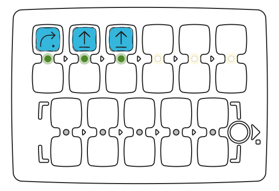

---
## Programma A

Volg de weg die de robot met dit programma aflegt.

<Columns cols={2}>
  <Frame>
    
  </Frame>
  <Frame>
    
  </Frame>
  <Frame>
    
  </Frame>
</Columns>

---
## Programma B

Volg de weg die de robot met dit programma aflegt.

<Columns cols={2}>
  <Frame>
    
  </Frame>
  <Frame>
    
  </Frame>
</Columns>

<Columns cols={2}>
  <Frame>
    
  </Frame>
  <Frame>
    
  </Frame>
</Columns>

