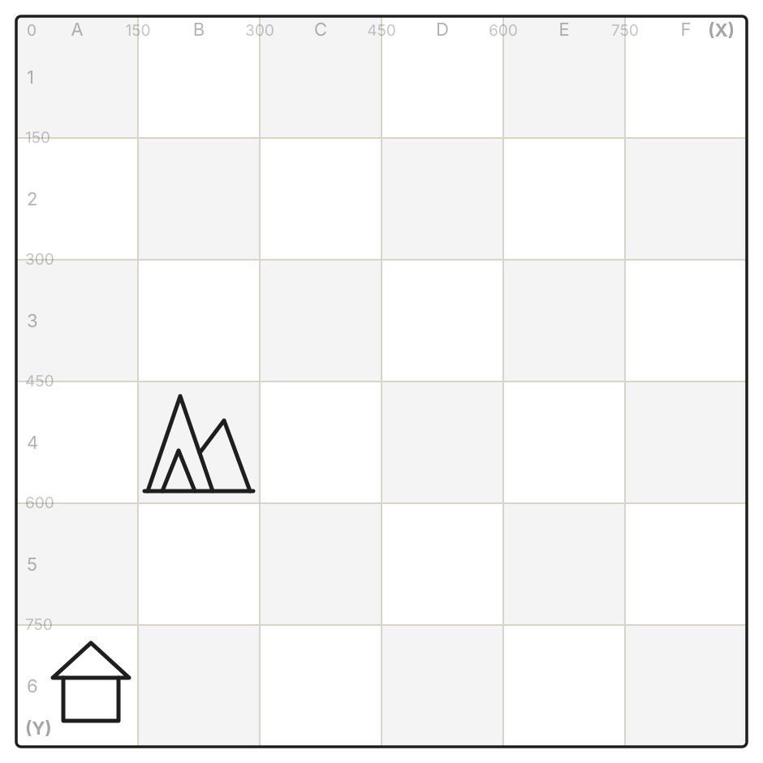
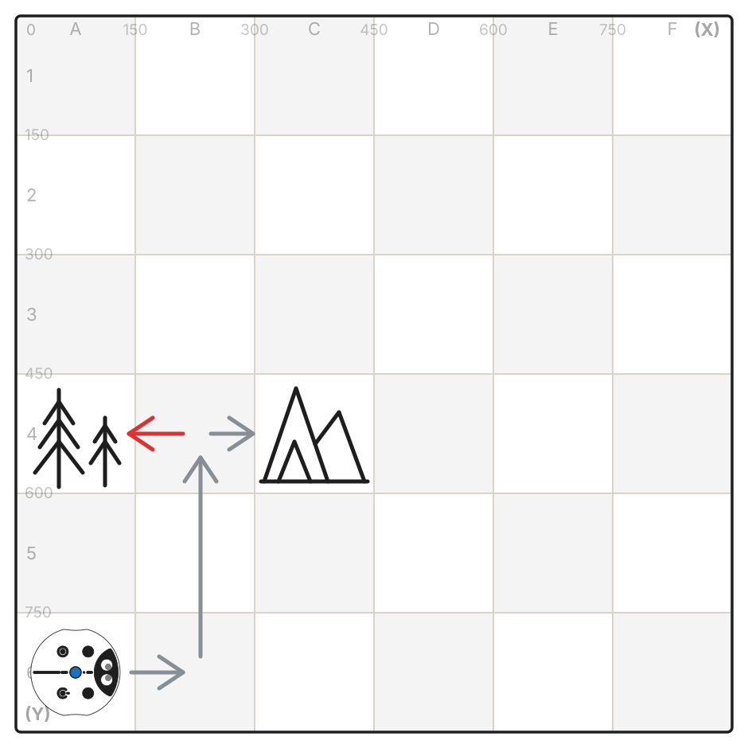

## Handleiding voor het geven van lessen aan kinderen vanaf 4 jaar

PrimaSTEM helpt kinderen stap voor stap logisch denken, de basis van programmeren en wiskunde onder de knie te krijgen. Deze handleiding helpt u bij het geven van lessen aan kinderen vanaf 4 jaar.

### Hoe het werkt

De kinderen programmeren de bewegingen van een kleine lieveheersbeestje-robot. Daarvoor leggen ze commandokaartjes op de bediening.

- **"Vooruit"**: de robot rijdt rechtuit.
- **"Links"**: de robot draait naar links.
- **"Rechts"**: de robot draait naar rechts.
- **"Functie"** (kaartje "[ ]"): vervangt een reeks commando's.
- **"Herhaal"**: herhaalt een commando of functie meerdere keren.

U legt de kaartjes op de bediening en maakt zo een bewegingsprogramma voor de robot. Als het programma klaar is, drukt u op de knop en de robot voert de commando's uit.

### Inhoud van de handleiding

- Waarom lessen in robotica en programmeren geven
- Hoe u de lessen organiseert in verschillende omstandigheden
- Activiteiten en leerdoelen
- Gedetailleerde gebruiksinstructies
- Beschrijving van de activiteiten
- Bijlagen
- Over het project en de auteurs

### Wat PrimaSTEM leert

- Programmeren met de handen, zonder scherm
- Begrijpen dat machines werken volgens algoritmen
- Acties vooraf plannen
- Logisch denken
- Reeksen commando's en functies maken
- Begrijpen wat een "bug" is (fout in de code) en fouten opsporen
- Getallen, rekenen en meetkunde op een zichtbare manier leren

## Waaruit bestaat PrimaSTEM

### Wat zit er in de doos

- Lieveheersbeestje-robot
- Bediening
- Commandokaartjes *
- Handleiding voor activiteiten *

(*) De samenstelling kan verschillen per uitvoering.

## Waarom lessen in programmeren en wiskunde geven

Code, programmeren en automatisering maken deel uit van ons dagelijks leven.

In de afgelopen jaren hebben mensen geleerd machines te maken die dingen doen waar ze voorheen niet toe in staat waren: begrijpen, spreken, horen, zien, antwoorden, schrijven.

Er zijn veel voorbeelden: zelfrijdende auto's, robotassistenten voor ouderen, bezorgrobots en andere.

### Waarom programmeren en robotica leren

Als een kind leert programmeren, leert het de machines om ons heen te begrijpen. Het leert kleine en gedurfde ideeën om te zetten in echte projecten. Het splitst een moeilijke taak op in eenvoudige stappen. Het werkt samen met anderen en lost gezamenlijke problemen op.

### Geboren in het digitale tijdperk

Het lijkt misschien alsof kinderen en jongeren goed overweg kunnen met technologie, omdat ze veel digitaal entertainment gebruiken.

Maar kunnen ze met deze tools ook zelf iets maken en zichzelf uitdrukken? Wat doen ze als ze tegen een technisch probleem aanlopen?

## Hoe u de lessen organiseert

De activiteiten passen bij verschillende doelen en onderwijssituaties. Alle activiteiten in de handleiding zijn genummerd. Hieronder staat welke activiteiten bij uw situatie passen.

### Voor wie

- Kinderen van 4 tot 8 jaar.
- Kleutergroepen en de eerste en tweede klas van de basisschool.

### Activiteiten voor naschools werk

Activiteiten 1, 2, 4, 5, 6, 7, 8, 9, 10.

### Activiteiten voor school

Activiteiten 2, 3, 4, 5, 6, 7, 8, 9, 11, 12.

### Naschools werk

Het is het best om een groep van maximaal 12 kinderen te vormen, zodat iedereen actief kan deelnemen.

We raden één apparaat per 2-3 leerlingen aan. Zo leren de kinderen samenwerken en met elkaar praten.

### Werken op school

In de klas is het ideaal om kleine groepen van 4-6 kinderen te vormen met één leraar.
Intussen doen de andere leerlingen een andere opdracht met een onderwijsassistent. Leerlingen van de eerste en tweede klas kunnen bijvoorbeeld oefenen met het tekenen van de weg van de robot volgens het programma.
In beide gevallen werkt u het best met PrimaSTEM in een multifunctionele ruimte, direct op de vloer. U kunt ook tafels en stoelen opzij schuiven om ruimte te maken.

**Let op.** Laad de accu's van de bediening en de robot vooraf op.

## Activiteiten en leerdoelen

| Activiteit | Algoritme en programma | Route in fasen | Beweging voorzien | Problemen oplossen, debuggen | Teamwerk |
| --- | :---: | :---: | :---: | :---: | :---: |
| 1 |   | X |   | X |   |
| 2 |   |   | X |   | X |
| 3 | X | X |   |   |   |
| 4 | X | X | X |   |   |
| 5 | X | X | X |   | X |
| 6 | X | X | X | X | X |
| 7 | X | X | X | X | X |
| 8 | X |   | X | X |   |
| 9 | X | X | X | X | X |
| 10 | X |   | X | X |   |
| 11 | X | X | X | X | X |
| 12 | X | X | X | X | X |

## Gebruiksinstructies

### Inhoud van de instructies

- Kennismaking met de materialen
- Programmeren van een functie
- Kaarten
- Technische uitleg

## Kennismaking met de materialen

### Robot

Een kleine houten lieveheersbeestje-robot met twee ogen.

Hij heeft drie steunpunten: twee wielen en een steun aan de achterkant. Daarop houdt hij zijn evenwicht.

### Basiscommando's

| Commando | Tekening                            | Beschrijving                                                                                 |
| -------- | ----------------------------------- | -------------------------------------------------------------------------------------------- |
| Vooruit  |   | De robot gaat één vakje vooruit. Dat is een logische stap, standaard 15 cm.             |
| Links    |      | De robot draait 90° naar links                                                               |
| Rechts   |     | De robot draait 90° naar rechts                                                              |
| Achteruit|      | De robot rijdt één vakje achteruit, dus een standaard logische stap                          |
| Functie  |  | De robot voert de commando's van de functieregel uit                          |
| Herhaal N|   | De robot herhaalt het commando van hetzelfde dubbele vakje N keer |

### Bediening

Met de bediening stuurt u de robot: u legt de commandokaartjes in de vrije vakjes (D).

De bovenste rij (A) heeft 6 dubbele vakjes, verbonden door een uitvoeringslijn (E), en is het hoofdprogramma. Het programma begint in het vakje links (D) en eindigt boven de **▶ Start**-knop (B). Deze knop stuurt de commando's naar de robot en start het programma.

De onderste rij (C) heeft 5 dubbele vakjes en legt de bewegingen vast voor het kaartje "Functie" ("[ ]"). Elk dubbel vakje heeft een led (F). Die licht op als u een kaartje legt en knippert terwijl de robot dat commando uitvoert.

#### Kleuren van de leds

Ligt het kaartje goed in het vakje, dan licht de led groen op.
Legt u bij een bewegingscommando in hetzelfde dubbele vakje een herhaalcommando, dan licht de led blauw op.
Liggen de kaartjes verkeerd, bijvoorbeeld twee bewegingskaartjes in één dubbel vakje, dan brandt een rode led. De robot slaat dat commando over.

### Accu en aan/uit-knop

De robot en de bediening werken op ingebouwde accu's. Ze worden opgeladen via een USB-C poort. De aan/uit-knop (ON/OFF) zit bovenop de robot en aan de voorkant van de bediening, links.

Als u de robot of de bediening aanzet, klinkt een kort geluidssignaal.
Bij een ingeschakelde bediening brandt de led op het voorpaneel groen. Bij een ingeschakelde robot brandt de led bij de USB-C aansluiting groen.

### Draadloze verbinding

De robot en de bediening zijn verbonden via Bluetooth, met een bereik van ongeveer 5 m. Na de eerste verbinding van de robot met de bediening werkt de verbinding vanzelf en hoeft u niets in te stellen.

> U kunt de bediening koppelen met een andere robot (apparaten koppelen).
> 1. Schakel de robot in die niet is gekoppeld met de bediening.
> 2. Schakel de bediening in.
> 3. Houd de **▶ Start**-knop op de bediening 10 seconden ingedrukt, tot het geluids- en lichtsignaal.

### Hoe u een programma maakt en start

Het programma ("reeks bewegingen") begint links op de bediening. Het volgt de gegraveerde pijlen ">". Dat is de uitvoeringslijn, die de dubbele vakjes horizontaal verbindt.

Als er voor een kaartje een leeg vakje ligt, slaat de robot het lege vakje over en voert het commando van dat kaartje uit.

Als een kaartje verkeerd ligt, brandt de led rood en slaat de robot dat deel van het programma over. Dat gebeurt bijvoorbeeld als "Herhaal" in een dubbel vakje zonder commando ligt, of als er twee commandokaartjes in één dubbel vakje liggen.

Als het programma klaar is, drukt u op de knop **▶ Start**.

Terwijl de robot het programma uitvoert, gaan de leds op de bediening een voor een uit. De led van het huidige commando knippert.

## Programmeren van een functie

### Hoe u een functie maakt

Het kaartje "Functie" ("[ ]") vervangt een reeks commando's.

Daarmee maakt u langere programma's en lost u moeilijkere taken op. Om een functie te maken, legt u de bewegingen in de onderste rij van de bediening: dat zijn 5 dubbele vakjes. De robot voert die rij van links naar rechts uit, telkens als hij in het hoofdprogramma (bovenaan) een kaartje "Functie" tegenkomt.

In het voorbeeld hieronder bestaat de functie uit rechtuit gaan en naar rechts draaien. Het hoofdprogramma roept de functie 2 keer aan. Daarna herhaalt het kaartje "Herhaal 2" de functie nog 2 keer.

[Start in de simulator](https://simulator.primastem.com/#top=cfun,cfun,cfun.r002&fn=cfor,crig&s=l1144602&r=225-675-0&run)

Resultaat van de beweging:

## Kaarten

### Welke kaarten geschikt zijn

In de eerste activiteiten leren de kinderen algoritmen, programmeren en getallen. Daarvoor rijdt de robot over een kaart met een raster. Het best werkt een kaart met vakjes van 15 cm: dat is de afstand die de robot standaard in één stap aflegt.

Kaarten voor andere robots kunnen ook, als de vakgrootte bij deze robot past.

> U kunt de standaardstap van 15 cm veranderen naar de grootte van de vakjes op uw kaart, bijvoorbeeld 10 cm, 12,5 cm of 20 cm. Leg daarvoor het speciale kaartje "Standaardstap" met een getal in millimeters: 100 voor 10 cm, 125 voor 12,5 cm, 200 voor 20 cm.

Als u geen kaart heeft, maak er dan zelf een. Plak schilderstape op een vlakke tafel of vloer. U kunt ook een vel tekenpapier (of stevig bannermateriaal) en een marker gebruiken.

Een schaakbordkaart, of een lege kaart met vakjes, dient om te oefenen met het verplaatsen van het ene punt naar het andere. De kleuren leiden niet af.

Een gekleurde kaart helpt bij het vertellen van korte verhalen over de reizen van de robot. Bijvoorbeeld: "Het lieveheersbeestje verlaat het huis en gaat naar de bergen door het bos". De klas kan een nieuwe kaart maken en nieuwe verhalen verzinnen over de reizen van het lieveheersbeestje.

#### Voorbeelden van kaarten

Schaakbordkaart

Gekleurde kaart

## Technische uitleg

### Hoe het is gebouwd

De bediening en de robot hebben microcontrollers en Li-Ion accu's. Ze zijn via radio verbonden met het standaardprotocol Bluetooth.

De printplaat van de robot regelt al zijn gedrag. Hij bestuurt twee 5V gelijkstroommotoren en twee meerkleurige leds, speelt geluiden af, communiceert met de bediening, enz.

De printplaat van de bediening herkent de kaartjes in de vakjes, speelt geluiden af en bestuurt 11 meerkleurige leds, één voor elk dubbel vakje.

In elk kaartje zit een NFC-sticker met de code van het commando. De bediening leest die code als u het kaartje in een vakje legt.

Als de bediening de kaartjes heeft herkend en u het programma start, stuurt de bediening de commando's draadloos naar de robot.

### Eigen commandokaartjes

U kunt extra commandokaartjes maken, bijvoorbeeld "Herhaal 12" of meer bewegingskaartjes. Daarvoor heeft u "lege" kaartjes met NFC-stickers nodig en een telefoon met NFC. De meeste types met een frequentie van 13,56 MHz werken.

Een video-instructie staat op ons YouTube-kanaal: https://www.youtube.com/@primastem

---

## Activiteiten

### Gedetailleerde beschrijving van de activiteiten

- **Activiteit 1**: de weg over het schaakbord van punt A naar punt B
- **Activiteit 2**: kennismaking met PrimaSTEM
- **Activiteit 3**: een kind speelt robot, oriëntatie en algoritme
- **Activiteit 4**: de weg van de robot voorspellen met een programma
- **Activiteit 5**: reeks commando's in een willekeurig programma
- **Activiteit 6**: de robot met de bediening naar de bergen leiden
- **Activiteit 7**: kennismaking met het kaartje "Functie"
- **Activiteit 8**: route naar het doel met een functie
- **Activiteit 9**: een programma met een fout debuggen
- **Activiteit 10**: de fout in een programma op papier vinden
- **Activiteit 11 en 12**: de bewegingen van de robot voorspellen (in 12 met het kaartje "Functie")

---

## Activiteit 1. De weg over het schaakbord van punt A naar punt B

- **individueel**
- **15 min**
- **op papier**
- **documenten om te printen**

### Doel

- De weg over de vakjes plannen van punt A naar punt B op de kaart.

De oefening duurt 10 minuten inclusief de afsluiting.

### Om te printen

Print voor elke leerling het blad "[Bijlage 1. Verplaatsen over de kaart](/nl/book-1/attachment-1)".

### Oefening

De kinderen tekenen op het raster de weg waarlangs de muis bij de kaas komt. Begin met de linker oefening, die is eenvoudiger. Ga daarna door met de rechter.

#### Verplaatsen over vakjes

De muis verplaatst zich over de vakjes van het raster. Diagonaal bewegen mag niet. De kinderen moeten begrijpen dat de weg van de muis in fasen is verdeeld: hij gaat telkens één vakje verder. Men zegt dat hij stap voor stap beweegt.

In het voorbeeld hierboven is alleen de blauwe weg correct. De korte rode weg is onjuist, omdat hij diagonaal loopt. De lange rode weg is onjuist, omdat hij niet naar het gewenste punt leidt.

### Groepsdiscussie

In het voorbeeld hierboven zijn alle wegen correct: via elke weg komt de muis bij de kaas.

Laat de kinderen zien dat ieder een eigen weg kan bedenken en dat meerdere wegen correct kunnen zijn.

#### Sommige wegen zijn langer dan andere

Tel hoeveel vakjes de muis aflegt tot het vakje met de kaas:
- 3 vakjes voor de groene route
- 3 vakjes voor de grijze route
- 3 vakjes voor de blauwe route
- 13 vakjes voor de gele route

#### De kortste weg

Al deze wegen zijn correct, maar de muis kiest de kortste.

Vraag de kinderen: "Waarom heeft de muis de kortste weg gekozen?"

De antwoorden kunnen verschillen. De muis wil energie besparen: hij is erg moe en wil zo min mogelijk lopen. Of de muis heeft haast: hij heeft grote honger en wil zo snel mogelijk bij de kaas zijn.

**Opmerking voor de begeleider.** Bij robots is het precies hetzelfde. We kiezen altijd de kortste weg, omdat die efficiënter is.

#### Meerdere wegen zijn mogelijk

Vraag de leerlingen na afloop van de oefening om hun weg te laten zien. Er zijn altijd meerdere wegen mogelijk, dus de leerlingen stellen waarschijnlijk verschillende antwoorden voor, en alle zijn correct.

---

## Activiteit 2. Kennismaking met PrimaSTEM

- **15 min**
- **in de groep**
- **demonstratie**
- **praktijk**

### Doelen

- Begrijpen hoe de robot kan bewegen.
- Leren dat de bediening de robot bestuurt.
- Begrijpen wat de commandokaartjes doen.

Vorm kleine groepjes leerlingen. Ga aan een lage tafel of op de vloer zitten. Pak de kaart met raster, de bediening, de robot en de kaartjes erbij. Laat PrimaSTEM aan alle leerlingen zien, groepje voor groepje.

### Presentatie

Laat elk voorwerp op de tafel zien en noem de woorden die de kinderen nodig hebben.

Eerst de **kaart**. Dat is hetzelfde raster als bij activiteit 1, maar groter.

Dan de **lieveheersbeestje-robot**. Hij kan rijden.

De robot wordt bestuurd met de **bediening**. Hij doet wat de kaartjes in de vakjes van de bediening aangeven.

De **kaartjes** zijn commando's: vooruit gaan, naar links draaien of naar rechts draaien.

### 1e fase: demonstratie

Als de kinderen de woorden kennen, doet u het zelf voor. Leg een kaartje op de bediening en de kinderen zien wat er gebeurt.

| Afbeelding                                         | Beschrijving                                                                 |
| -------------------------------------------------- | ---------------------------------------------------------------------------- |
|  | Het kaartje **"Vooruit"** laat de robot één vakje vooruit gaan |

Zet de robot op een willekeurig vakje van de kaart. Leg het kaartje in het eerste vakje van het programma, zoals in het schema hieronder. Druk daarna op de witte knop **▶ Start**.

De robot gaat één vakje vooruit.

### 2e fase: geef de besturing uit handen

| Afbeelding                                      | Beschrijving                                                                                                                                                                            |
| ----------------------------------------------- | --------------------------------------------------------------------------------------------------------------------------------------------------------------------------------------- |
|  | Het kaartje **"Links"**, met een pijl in een boog, laat de robot naar links draaien, tegen de klok in. De standaard draaistap is 90 graden. |

Haal het kaartje "Vooruit" van de bediening en geef het kaartje "Links". Laat een kind het in het eerste vakje van het programma leggen en op de witte knop **▶ Start** drukken. De robot blijft op zijn plaats en maakt een kwartslag naar links.

| Afbeelding                                       | Beschrijving                                                 |
| ------------------------------------------------ | ------------------------------------------------------------ |
|  | Het kaartje **"Rechts"** laat de robot naar rechts draaien. |

Vraag een ander kind om het kaartje "Links" te vervangen door het kaartje "Rechts" en op de witte knop **▶ Start** te drukken. De robot blijft op zijn plaats en maakt een kwartslag naar rechts.

Daarna werken de kinderen om de beurt met de bediening. Geef hen alleen 3 kaartjes: **"Vooruit"**, **"Links"** en **"Rechts"**.

Als de robot klaar is met bewegen, kunnen de kinderen nogmaals op **▶ Start** drukken en hun programma herhalen.

Laat hen zien dat de kaartjes in elk vakje kunnen liggen, behalve twee commando's in één dubbel vakje. De robot voert ze een voor een uit, van links naar rechts.

> Om het programma te stoppen, drukt u nogmaals op **▶ Start / Stop** terwijl de robot rijdt.

---

## Activiteit 3. Een kind speelt robot: oriëntatie en algoritme

- **45 min**
- **in de groep**
- **spel**
- **kaart**

### Doelen

- Rekening houden met waar de robot naartoe kijkt aan het begin van het programma.
- De bewegingen van de robot voorspellen met het programma.

### Om te printen

Print voor elke leerling de kaarten "[Bijlage 2. Missiekaarten](/nl/book-1/attachment-2)".

### Principe van het spel

Dit is een rollenspel in een open ruimte. De kinderen beelden de robot uit op een zwart-wit veld.

### Spelregels

Eén leerling speelt de robot op de kaart. In plaats van een kaart kan ook een vloer met een vierkant patroon dienen: een tekening, tegels of vierkanten van schilderstape. De andere leerlingen programmeren hem met de opdrachtkaarten.

Het robot-kind krijgt niet te horen waar het naartoe kijkt.
De leerlingen bepalen zelf welke kant de robot op moet kijken om de missie te voltooien.

1. Het robot-kind gaat op het rode vakje 1 staan. Het moet het groene vakje 2 bereiken.
2. Het robot-kind gaat op het rode vakje 1 staan. Het moet het paarse vakje 3 bereiken.
3. Het robot-kind gaat op het rode vakje 1 staan. Het moet het blauwe vakje 4 bereiken.

> Zodat de kaart langer meegaat, vraagt u het kind zijn schoenen uit te trekken.

### Einde van het spel

Het kind begrijpt nu dat u bij het programmeren van een verplaatsing rekening moet houden met waar de robot staat en waar hij naartoe kijkt.

De robot voert het commando uit afhankelijk van hoe hij gedraaid staat. Hij gaat rechtuit, draait naar links of draait naar rechts, **maar altijd vanuit zijn begin-oriëntatie.**

---

## Activiteit 4. De weg van de robot voorspellen met een programma

- **45 min**
- **individueel**
- **op papier**
- **documenten om te printen**

### Doelen

- Rekening houden met waar de robot naartoe kijkt aan het begin.
- De commando's van het programma begrijpen.
- De bewegingen van de robot voorspellen met het programma.

### Om te printen

Print voor elke leerling de kaarten "[Bijlage 3. Teken de weg van het programma](/nl/book-1/attachment-3)".

De kinderen krijgen een blad met een programma van enkele commando's. Ze tekenen de weg die de robot met dit programma aflegt.

Met dit programma gaat de robot drie keer rechtuit:

<Columns cols={2}>
  <Frame>
    
  </Frame>
  <Frame>
    
  </Frame>
</Columns>

[Start in de simulator](https://simulator.primastem.com/#top=cfor,cfor,cfor&s=l1144602&r=75-825-0&m=02&run)

Hier is het programma hetzelfde en de robot gaat ook drie keer rechtuit.
Maar aan het begin kijkt hij naar rechts. Daarom gaat hij drie vakjes naar rechts:

<Columns cols={2}>
  <Frame>
    
  </Frame>
  <Frame>
    
  </Frame>
</Columns>

[Start in de simulator](https://simulator.primastem.com/#top=cfor,cfor,cfor&s=l1144602&r=75-825-90&m=35&run)

In dit programma draait de robot. Eerst draait hij naar rechts en daarna gaat hij twee vakjes vooruit:

<Columns cols={2}>
  <Frame>
    
  </Frame>
  <Frame>
    
  </Frame>
</Columns>

[Start in de simulator](https://simulator.primastem.com/#top=crig,cfor,cfor&s=l1144602&r=75-825-0&m=25&run)

De laatste oefening is moeilijker: de robot verandert twee keer van richting. Hij gaat één vakje rechtuit, draait naar rechts en gaat één vakje vooruit. Daarna draait hij naar links en gaat twee vakjes vooruit:

<Columns cols={2}>
  <Frame>
    
  </Frame>
  <Frame>
    
  </Frame>
</Columns>

[Start in de simulator](https://simulator.primastem.com/#top=cfor,crig,cfor,clef,cfor,cfor&s=l1144602&r=75-825-0&m=12&run)

### Opmerking voor de begeleider

Deze oefening op papier kan moeilijk blijken te zijn.
Heeft een kind moeite met de draaiingen van de robot en de volgorde van de bewegingen, pak dan de PrimaSTEM-set erbij. Vraag het kind de programma's van de bladen op de bediening te leggen.
Door aan te raken en te kijken begrijpt u het beter.

---

## Activiteit 5. Reeks commando's in een willekeurig programma

- **45 min**
- **in de groep**
- **spel**

### Doelen

- Commando's koppelen aan de bewegingen van de robot.
- De grenzen van de kaart zien.
- Leren commando's over te zetten op de bediening.

### Verloop van het spel

1. Zet de robot op een willekeurig vakje van de kaart, het liefst bij de rand. Kies zelf de richting.
2. Gooi met de dobbelsteen. Verplaats de robot met de hand en noteer het programma op papier of op een bord: teken de pijl van het commando "Vooruit". Als de robot buiten de kaart komt, gooi dan nogmaals.

3. Herhaal dit tot u 2 programma's na elkaar heeft. De robot mag niet buiten de kaart komen, dus gooi indien nodig opnieuw.

Uiteindelijk heeft u op het blad 2 programma's van "Vooruit"-commando's. Voert u ze na elkaar uit, dan rijdt de robot het benodigde aantal vakjes naar de rand van de kaart.

Voorbeeld:

<Columns cols={2}>
  <Frame>
    
  </Frame>
  <Frame>
    

      
      
    

  </Frame>
</Columns>

**Voer de genoteerde programma's uit op een echte PrimaSTEM.**

---

## Activiteit 6. De robot met de bediening naar de bergen leiden

- **45 min**
- **in de groep**
- **praktijk**

### Doelen

- De route opsplitsen in fasen.
- Een programma maken voor een bepaald doel.

Voor deze activiteit heeft u nodig:
- de bediening;
- bewegingskaartjes: 4 "Vooruit", 4 "Links" en 4 "Rechts" per groep, leg de overige kaartjes opzij;
- de kaart en de robot.

Verdeel de kinderen in groepjes van 3 of 4. Geef elke groep een bediening en een set kaartjes.

### 1e fase: nadenken

De lieveheersbeestje-robot is thuis en we willen hem naar de bergen leiden. Er moet een programma op het bord komen waarmee hij daar aankomt.

> Als u niet de juiste kaart heeft, teken de plekken dan op papier, eventueel samen met de kinderen. Plak ze met tape op de kaart.

Vraag de kinderen eerst over welke vakjes ze de robot naar de berg willen leiden. Ook hier zijn er veel mogelijkheden. We kiezen de kortste routes om energie en tijd te besparen.

Als de weg is gekozen, loopt u met de kinderen de bewegingen van de robot door, vakje voor vakje.

Moet hij rechtuit gaan, naar links draaien of naar rechts draaien?
Verplaats de robot met de hand over de kaart en laat zien hoe elk commando hem beweegt.

### 2e fase: programmeren

Vraag de kinderen om de bewegingen van de robot op volgorde met kaartjes op de bediening te leggen. Dit programma moet de robot naar het doel brengen.

**Dit is het verwachte programma:**

### 3e fase: controle

Elke zichzelf respecterende programmeur controleert of zijn programma werkt. Vraag de kinderen hun programma op de bediening te leggen en te starten.

<Columns cols={2}>
  <Frame>
    
  </Frame>
  <Frame>
    
  </Frame>
</Columns>

[Start in de simulator](https://simulator.primastem.com/#top=cfor,cfor,crig,cfor&s=l1144602&r=75-825-0&m=13&run)

Is de robot bij de berg aangekomen? Zo niet, waarom? Laat de kinderen zelf de fouten in het programma verbeteren, als die er zijn.

---

## Activiteit 7. Kennismaking met het kaartje "Functie"

- **15 min**
- **in de groep**
- **demonstratie**

### Doelen

- Begrijpen dat het kaartje "Functie" andere commando's kan vervangen.
- Kennismaken met het herhalen van een reeks commando's.

Vorm kleine groepjes leerlingen. Ga aan een lage tafel of op de vloer zitten. Pak de kaart, de bediening, de robot en de commandokaartjes erbij. De groepjes maken om de beurt kennis met het kaartje "Functie".

### 1e fase: demonstratie

Laat de kinderen het kaartje "Functie" zien.

Het vervangt meerdere bewegingscommando's: "Vooruit", "Links", "Rechts" of "Achteruit". Daarmee kunt u hetzelfde korte stukje van het programma meerdere keren herhalen.

Doe het eerst zelf voor. Maak een programma zoals in de afbeelding hieronder.

Als de robot het kaartje "Functie" tegenkomt, voert hij de commando's uit het kader [-----] onderaan de bediening uit. Het is hetzelfde alsof die commando's op de plaats van het kaartje "Functie" stonden.
In ons voorbeeld rijdt de robot twee keer rechtuit.

### 2e fase: raadsels

Voeg nu het kaartje "Rechts" toe aan het einde van het hoofdprogramma, zoals in de afbeelding hieronder.

Vraag de kinderen vóór het starten wat er gaat gebeuren. Het programma werkt alsof er twee rode kaartjes "Vooruit" en één kaartje "Rechts" in staan. De robot gaat twee vakjes vooruit en draait een kwartslag naar rechts.

Laat tot slot de **lus** zien.
Leg een programma van vier kaartjes "Functie", zoals in de afbeelding hieronder.

[Start in de simulator](https://simulator.primastem.com/#top=cfun,cfun,cfun,cfun&fn=cfor,crig&s=l1144602&r=225-675-0&run)

Vraag de kinderen vóór het starten wat er gaat gebeuren. Start dan het programma en controleer het.

**De robot voert een lus uit:**

**Opmerking voor de begeleider.** Als de kinderen kennismaken met de functie, is het nuttig om naar de leds te kijken. Ze knipperen tijdens de uitvoering van het programma. Zo ziet u welk commando de robot uitvoert en hoe hij tegelijk beweegt.

---

## Activiteit 8. Route naar het doel met een functie

- **45 min**
- **in de groep**
- **praktijk**

### Doelen

- De route opsplitsen in fasen.
- Een programma maken voor een bepaald doel.
- Het kaartje "Functie" gebruiken in het programma.

Voor deze activiteit heeft u nodig:
- kaartjes of zelfgemaakte kaarten met tekeningen van de commando's: 4 "Vooruit", 4 "Links", 4 "Rechts" en 4 "Functie" per groep;
- de kaart en de robot, zonder bediening.

Als er veel kinderen zijn, verdeel hen dan in groepjes van 3 of 4. Geef elke groep de kaarten met tekeningen van de commando's of de kaartjes uit de set, precies 4 van elk soort.

### 1e fase: nadenken

> Heeft uw kaart andere afbeeldingen of geen, pas de opdracht dan aan. Markeer 2 punten (Start en Finish) op een afstand van 4 vakjes onder een hoek van 90 graden.

De robot staat bij de vlag en we willen hem naar het vakje "nacht" met de wolken leiden. Er moet een programma komen met het kaartje "Functie": leg de kaartjes of tekeningen van de commando's op de tafel.

Vraag de kinderen eerst over welke vakjes ze de robot naar de berg willen leiden. De berg staat ongeveer halverwege. Er zijn veel mogelijkheden. Dit keer kiezen we routes waarin commando's zich herhalen, zodat het kaartje "Functie" van pas komt.

Als de weg is gekozen, loopt u met de kinderen de bewegingen van de robot door, vakje voor vakje. Verplaats de robot met de hand en controleer het programma.

### 2e fase: te weinig kaartjes

Vraag de kinderen om de bewegingen van de robot op volgorde met kaarten of kaartjes op de tafel te leggen.

Let streng op het aantal kaartjes van elke groep: 4 "Vooruit", 4 "Links", 4 "Rechts" en 4 "Functie".

Oei, er zijn te weinig kaartjes! We hebben meer "Vooruit"-commando's nodig. Digitale paniek! :)

Herinner de kinderen aan het kaartje "Functie": het vervangt meerdere andere kaartjes.

Het kan bijvoorbeeld meerdere "Vooruit"-commando's vervangen, en de robot rijdt meerdere keren vooruit.

Help de kinderen een programma te maken met het kaartje "Functie", zoals in de afbeelding hieronder.

Voorbeeld van een route en het bijbehorende programma:

### 3e fase: controle

Help de kinderen hun programma op de bediening te leggen en te controleren, zoals in de afbeelding:

[Start in de simulator](https://simulator.primastem.com/#top=cfun,clef,cfun&fn=cfor,cfor,cfor,cfor&s=l1144602&r=825-825-0&run)

Is de robot bij het vakje "Nacht" aangekomen? Zo niet, waarom?
Laat de kinderen zelf de fouten in het programma verbeteren, als die er zijn.

---

## Activiteit 9. Een programma met een fout debuggen

- **20 min**
- **in de groep**
- **praktijk**

### Doelen

- Een fout in het programma vinden door de uitvoering te bekijken.
- De fout in het programma verbeteren.

Vorm kleine groepjes leerlingen. Ga aan een lage tafel of op de vloer zitten. Zet de kaart met raster, de bediening, de robot en de kaartjes klaar.
De groepjes debuggen het programma om de beurt.

De robot moet via de grijze weg bij de berg komen.

Laat de kinderen op de bediening het programma met een fout zien:

[Start in de simulator](https://simulator.primastem.com/#top=cfor,clef,cfor,cfor,clef,cfor&s=l1144602&r=75-825-90&run)

Met dit programma gaat de robot naar het bos. De kinderen starten het programma, zoeken de fout en verbeteren die.

Voorbeeld van een verbeterd programma:

[Start in de simulator](https://simulator.primastem.com/#top=cfor,clef,cfor,cfor,crig,cfor&s=l1144602&r=75-825-90&run)

---

## Activiteit 10. De fout in een programma op papier vinden

- **20 min**
- **individueel**
- **op papier**
- **documenten om te printen**

### Doelen

- De bewegingen van de robot voorspellen om een fout in het programma te vinden.
- Begrijpen hoe een fout in het programma verbeterd wordt.

De kinderen krijgen een blad met een programma dat de robot van punt A naar punt B moet brengen. Het programma bevat een fout. De kinderen zoeken die en proberen hem te verbeteren.

### Om te printen

Print voor elke leerling de kaarten "[Bijlage 4. Vind en verbeter de fout in het programma](/nl/book-1/attachment-4)".

### 1e fase: het programma lezen

Vraag de kinderen eerst de weg van de robot met dit programma te tekenen. Op het raster is in het blauw de weg getekend die de robot hoort af te leggen, met het gewenste eindpunt.

### 2e fase: de fout vinden

Als de weg getekend is, zie je dat de robot niet bij de finish (de zwarte vlag) komt. Hij komt bij de rode vlag.
Vraag de kinderen waar de robot de fout in ging. Zoek het vakje met de fout. In de oplossing is het rood omcirkeld.

Er zijn 3 soorten fouten:
- we hebben ons vergist in het commando
- we zijn een commando vergeten
- we hebben een overbodig commando toegevoegd

### 3e fase: de fout verbeteren

Vraag de kinderen tot slot de fout te verbeteren: een programma schrijven dat de robot naar de zwarte vlag brengt.

**Opmerking.** Deze oefening op papier kan moeilijk blijken te zijn. Heeft een kind moeite de fout te zien, pak dan PrimaSTEM erbij. Vraag het kind het programma van het blad op de bediening te leggen en te starten. Laat de kinderen bijvoorbeeld "O, nee!" zeggen als de robot de verkeerde kant op gaat. Zo zie je de fout makkelijker.

#### Voorbeeld 1
In dit voorbeeld is het commando aan het einde onjuist.

<Columns cols={2}>
  <Frame>
    
  </Frame>
  <Frame>
    

      
      
    

  </Frame>
</Columns>

#### Voorbeeld 2
In dit voorbeeld staat aan het begin een overbodig commando.

<Columns cols={2}>
  <Frame>
    
  </Frame>
  <Frame>
    

      
      
    

  </Frame>
</Columns>

#### Voorbeeld 3
In dit voorbeeld ontbreekt aan het begin een commando.

<Columns cols={2}>
  <Frame>
    
  </Frame>
  <Frame>
    

      
      
    

  </Frame>
</Columns>

---

## Activiteit 11. De bewegingen van de robot voorspellen

- **45 min**
- **in de groep**
- **praktijk**

### Doelen

- De bewegingen van de robot voorspellen met een programma zonder functie.

Pak de PrimaSTEM-set erbij zonder de kaartjes "Functie". Alle kinderen spelen tegelijk, maar slechts één kind werkt met de bediening.

### 1. We programmeren in stilte

Om de beurt zetten de kinderen de robot in een hoek van de kaart en leggen ze op de bediening een programma van maximaal 5 commando's.

Als het programma klaar is, vraagt u het kind te wachten en nog niet op de knop te drukken.

### 2. We nemen weddenschappen aan

Vraag de andere kinderen te raden of de robot van de kaart af rijdt.

### 3. We controleren

Als iedereen heeft gewed, start u het programma en kijkt u wat er gebeurt.
Zet daarna de robot weer in de hoek en het volgende kind maakt zijn programma.

---

## Activiteit 12. De bewegingen van de robot voorspellen met een functie

### Doelen

- De bewegingen van de robot voorspellen met een programma met functie.

Herhaal activiteit 11, maar voeg de kaartjes "Functie" toe aan de set.

Zo programmeren de kinderen ook de functie. Alle kinderen spelen tegelijk, maar slechts één kind werkt met de bediening.

---

## Over het project en de auteurs

### Wie zijn wij

PrimaSTEM is een bedrijf dat het gelijknamige apparaat heeft bedacht en maakt. Daarmee leren kinderen vanaf 4 jaar programmeren en wiskunde zonder scherm. We zitten in Zuid-Frankrijk.

Onze materialen zijn open. Ze helpen de creativiteit te ontwikkelen van kinderen en van de volwassenen die met hen werken.

Meer over het PrimaSTEM-apparaat vindt u op de documentatiesite, beschikbaar in 13 talen: https://docs.primastem.com

### Contact

Schrijf ons: info@primastem.com

Onze website met informatie en links naar sociale media: https://primastem.com

### Auteurs

**Adaptatie, tekst, illustraties:** Andrei Chanov, 2026.

**Auteurs van het concept**: Julie Borgeot / Dorie Bruyas van Fréquence écoles

#### Licentie van deze handleiding

Dit werk is gelicentieerd onder CC BY-SA 4.0. Om een kopie van deze licentie te bekijken, bezoek https://creativecommons.org/licenses/by-sa/4.0/

**Creative Commons Naamsvermelding-GelijkDelen 4.0 Internationaal**

Deze licentie vereist dat hergebruikers de maker vermelden. Het staat hergebruikers toe het materiaal te verspreiden, te remixen, aan te passen en erop voort te bouwen in elk medium of formaat, zelfs voor commerciële doeleinden. Als anderen het materiaal remixen, aanpassen of erop voortbouwen, moeten ze het gewijzigde materiaal onder identieke voorwaarden licentiëren.

---

## Bijlagen

- [Bijlage 1. Verplaatsen over de kaart](/nl/book-1/attachment-1)
- [Bijlage 2. Missiekaarten](/nl/book-1/attachment-2)
- [Bijlage 3. Teken de weg van het programma](/nl/book-1/attachment-3)
- [Bijlage 4. Vind en verbeter de fout in het programma](/nl/book-1/attachment-4)
