## Inleiding

PrimaSTEM is een robotisch complex bestaande uit een programmeerbare robot en een bediening met een set commandokaartjes. Het complex kan worden gebruikt voor preventie en correctie van cognitieve stoornissen bij ouderen.

### Doelgroep

- Ouderen met lichte cognitieve stoornissen
- Personen na neurologische aandoeningen
- Patiënten in vroege stadia van neurodegeneratieve ziekten

### Contra-indicaties

- Ernstige visuele stoornissen
- Uitgesproken motorische stoornissen van de bovenste ledematen
- Ernstige dementie
- Acute psychische stoornissen

## Eerste sessie

Duurt ongeveer 35 minuten. Lees vooraf de contra-indicaties hierboven. Heb je het apparaat nog niet, dan kun je alle stappen in de [simulator](https://simulator.primastem.com) doen.

<Steps>
  <Step title="Kennismaking, 10 minuten">
    Laat de robot, de bediening en de kaartjes Vooruit, Rechts en Links zien. De deelnemer legt één kaartje Vooruit op de bediening, drukt op **▶ Start** en kijkt hoe de robot rijdt. In [Snelstart](/nl/quickstart) staat hoe de bediening en de robot werken.
  </Step>
  <Step title="Eerste route, 10 minuten">
    Zet een doel twee of drie vakjes van de robot. De deelnemer legt de kaartjes, start het programma en kijkt of de robot is aangekomen. In de simulator gebruik je het [makkelijke doolhof](https://simulator.primastem.com/#s=l1144402&r=75-525-0&m=2101).
  </Step>
  <Step title="Pauze, 5 minuten">
    Na 15–20 minuten werken is rust nodig.
  </Step>
  <Step title="Een figuur, 10 minuten">
    De deelnemer maakt een programma waarmee de robot een vierkant rijdt. Open in de simulator de [opdracht met het vierkant](https://simulator.primastem.com/#sh=square): de robot moet de stippellijn volgen.
  </Step>
</Steps>

Vraag aan het eind wat makkelijk ging en wat moeilijk was. Het antwoord bepaalt waarmee je de volgende keer begint.

## Algemene principes

Met de leeftijd en bij neurodegeneratieve ziekten kunnen geheugenverslechtering, verminderd vermogen tot abstract denken, leren en creatieve ontwikkeling optreden. Sessies met de PrimaSTEM-set helpen deze processen te vertragen door verschillende cognitieve functies op speelse wijze te trainen.

### Organisatie van sessies

- Duur van één sessie: 30-45 minuten
- Frequentie van sessies: 2-3 keer per week
- Formaat: individueel of in kleine groepen (2-4 personen)
- Vereiste pauzes: 5-10 minuten na elke 15-20 minuten werk

### Principes voor het uitvoeren van sessies

1. Geleidelijke verhoging van taakcomplexiteit
2. Rekening houden met individuele kenmerken en beperkingen
3. Creëren van een positieve emotionele sfeer
4. Afwisseling van verschillende soorten oefeningen
5. Verplichte feedback en aanmoediging

## Hoofdgebieden van correctie

### Cognitieve functies

- Stimulering van intellectuele activiteit
- Ontwikkeling van ruimtelijk denken en geheugen
- Verbetering van visueel en auditief-verbaal geheugen
- Training van logisch denken en hoofdrekenen
- Ontwikkeling van plannings- en controlevaardigheden
- Training van perifeer zicht

### Sociaal-emotionele aspecten

- Behoud van persoonlijk potentieel en sociale activiteit
- Creëren van mogelijkheden voor zelfexpressie
- Overwinnen van communicatiebarrières
- Vormen van een positieve emotionele achtergrond

## Trainingsopties en spelende oefeningen

### 1. Basisoefeningen (aanpassingsperiode)

- Kennismaking met commandokaartjes
- Eenvoudige robotbewegingen in rechte lijn
- Uitvoeren van basisdraaiingen
- Maken van eenvoudige commandosequenties

**Materiaal**

- [Snelstart](/nl/quickstart)
- [Boek 1](/nl/book-1/book-1), activiteit 2

### 2. Training van ruimtelijk denken

#### Routebouw

- Kortste weg
- Met obstakels
- Met gebruik van willekeurige set commandotokens
- Volgens gegeven algoritme
- Kiezen van de juiste route uit voorgestelde opties
- Bouwen van een omgekeerde route

#### Moeilijkheidsgraden

1. Bepalen van eindpunt bij gegeven route
2. Kiezen van de juiste route uit een lijst
3. Bepalen van startpunt vanuit bekend eindpunt

#### Werken met echte ruimtes

- Modelleren van bekende ruimtes (kamers, gangen in huis)
- Plannen van binnenroutes
- Doorlopen van doolhoven

**Materiaal**

- Doolhoven in de simulator: [makkelijk](https://simulator.primastem.com/#s=l1144402&r=75-525-0&m=2101), [gemiddeld](https://simulator.primastem.com/#s=l1144502&r=75-675-0&m=400113232131), [moeilijk](https://simulator.primastem.com/#s=l1144602&r=75-825-0&m=0014243444540212223242). De robot staat in een hoek, de vlag is het doel.
- [Bijlage 1 - Verplaatsen over de kaart](/nl/book-1/attachment-1)
- [Bijlage 2 - Missiekaarten](/nl/book-1/attachment-2)
- [Boek 1](/nl/book-1/book-1), activiteit 4: voorspellen waar de robot stopt.
- [Bijlage 3 - De weg tekenen voor een gegeven reeks](/nl/book-1/attachment-3)

### 3. Training van planningsvaardigheden

- Bouwen van algoritmen voor dagelijkse handelingen:
    - "Ik ben in de winkel – kopen volgens lijst"
    - "Ik bereid me voor om naar buiten te gaan – wat zijn mijn acties?"
- Gebruik van kaarten met afbeeldingen van objecten en acties

**Materiaal**

- [Bijlage 2 - Missiekaarten](/nl/book-1/attachment-2)
- [Bijlage 4 - De fout in het programma vinden en verbeteren](/nl/book-1/attachment-4)

### 4. Training van ruimtelijk geheugen

- Onthouden en reproduceren van routes (visueel, auditief)
- Gebruik van mnemotechnieken (Cicero-methode)
- "MEMO"-type spel:
    - Zoeken en onthouden van gepaarde kaarten

**Materiaal**

- [Trap in de simulator](https://simulator.primastem.com/#top=cfun.r004&fn=cfor,crig,cfor,clef&s=l1144502&r=75-675-0&run): kijk hoe de robot rijdt, sluit het venster en leg de route uit je hoofd op de bediening.

### 5. Wiskundige spellen

- Wiskundige doolhoven – verplaatsen over vakken met voorbeelden
- Rekenroute – optellen/aftrekken van hetzelfde getal

**Materiaal**

- [Leerkrachtengids](/nl/teachersguide), onderdeel “8 – Rekenkunde”.
- [Tekenvoorbeelden](/nl/mathdrawings), groep “Spiralen”: elke stap groeit met hetzelfde getal.

### 6. Woordspellen

- Zoeken van spreekwoorden op het veld
- Samenstellen van woorden uit verspreide letters
- Maken van routes gebaseerd op afbeeldingen met specifieke klanken

**Materiaal**

- [Audiobestandenreferentie](/nl/sounds_reference): de bediening spreekt kaartjes, letters en plaatsnamen uit in 20 talen.

### 7. Potloodspellen (tekenen)

#### Grafische dictaten

- Bouwen van een algoritme gebaseerd op een tekening
- Aanvullen van de symmetrische helft
- Corrigeren van fouten in het algoritme
- Tekenen van een spiegelbeeld
- Draaien van een figuur met 90 graden
- Maken van patronen en ornamenten met behulp van lussen

**Materiaal**

- Een figuur in de simulator langs de omtrek rijden: [vierkant](https://simulator.primastem.com/#sh=square), [driehoek](https://simulator.primastem.com/#sh=triangle), [huisje](https://simulator.primastem.com/#sh=house), [ster](https://simulator.primastem.com/#sh=star).
- [Tekenvoorbeelden](/nl/mathdrawings): elk programma staat naast de tekening die het maakt.

### 8. Communicatiespellen

#### Competitieve oefeningen

- Verzamelen van maximaal aantal bonuskaartjes
- "Monopoly"-achtig spel met de robot
- Woordspel met letterzoekopdracht
- Bordspel "Doolhof" voor twee spelers

**Materiaal**

- Puzzels voor tweetallen en groepen staan hieronder, in het onderdeel “Puzzels”.

## Puzzels

Opdrachten voor aan tafel, in tweetallen of kleine groepen. Zet de robot op een groot vel papier en steek er een stift in. De robot rijdt 15 cm per stap en draait 90°. Het antwoord zit verborgen onder elke opdracht. De link naar de simulator is voor de begeleider, om de opdracht vooraf te controleren.

### Raad de tekening

De begeleider legt een programma op de bediening en zegt niet wat het wordt. De robot tekent en de deelnemers proberen als eerste de tekening te raden. Wie het raadt, krijgt een punt. Meer programma's staan bij [Tekenvoorbeelden](/nl/mathdrawings).

[Start in de simulator](https://simulator.primastem.com/#top=cfor.n300,crig.n120,cfor,crig,cfor,cfun.r003&fn=clef,cfor&s=l1047602&r=338-397-30&run)

<Columns cols={2}>
  <Frame caption="Programma op de bediening">
    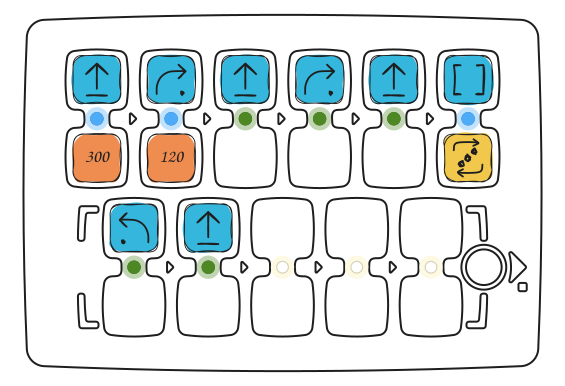
  </Frame>
</Columns>

<Accordion title="Antwoord">
  Huisje.

  <Columns cols={2}>
    <Frame caption="Wat de robot tekent">
      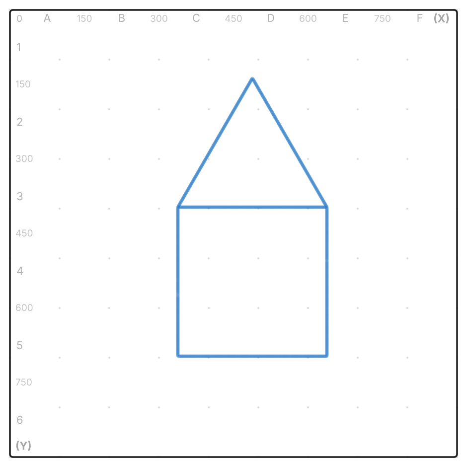
    </Frame>
  </Columns>
</Accordion>

### Verwissel één kaartje

De robot tekent een trap. Verwissel één kaartje zodat hij een vierkant tekent.

[Start in de simulator](https://simulator.primastem.com/#top=cfun.r004&fn=cfor,crig,cfor,clef&s=l1144502&r=75-675-0&run)

<Columns cols={2}>
  <Frame caption="Programma op de bediening">
    
  </Frame>
  <Frame caption="Wat de robot tekent">
    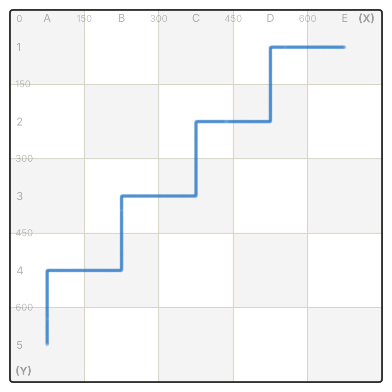
  </Frame>
</Columns>

<Accordion title="Antwoord">
  Vervang in de onderste rij “Links” door “Rechts”. De robot rijdt het vierkant twee keer rond.

  [Start in de simulator](https://simulator.primastem.com/#top=cfun.r004&fn=cfor,crig,cfor,crig&s=l1144502&r=75-675-0&run)

  <Columns cols={2}>
    <Frame caption="Programma op de bediening">
      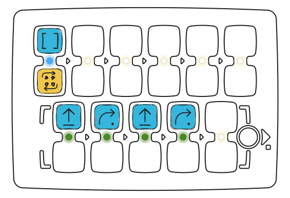
    </Frame>
    <Frame caption="Wat de robot tekent">
      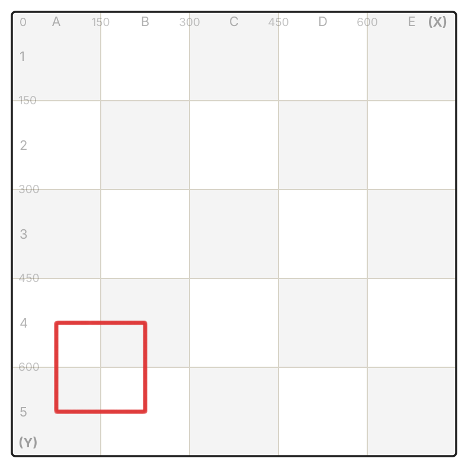
    </Frame>
  </Columns>
</Accordion>

### Raad het programma

De begeleider legt een programma zonder dat de deelnemers de bediening zien. De robot begint linksonder, kijkt naar boven en tekent een omgekeerde U. De deelnemers maken een programma dat dezelfde vorm tekent en testen het op de robot.

<Columns cols={2}>
  <Frame caption="Wat de robot tekent">
    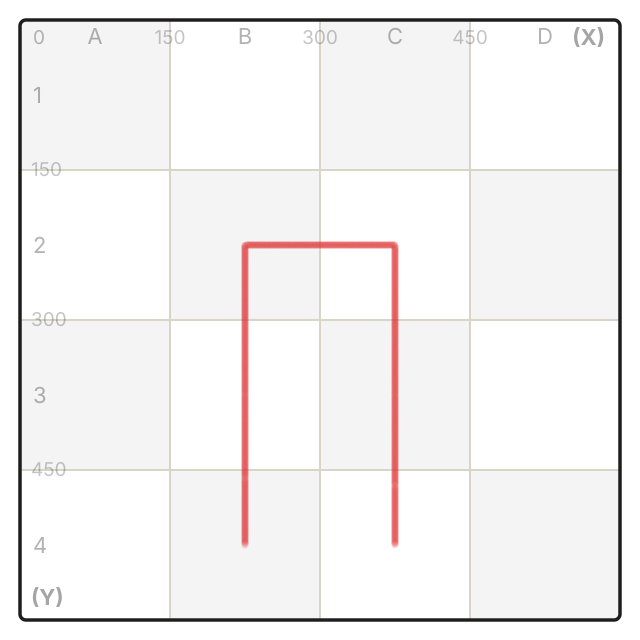
  </Frame>
</Columns>

<Accordion title="Antwoord">
  “Vooruit” ×2, “Rechts”, “Vooruit”, “Rechts”, “Vooruit” ×2. Elk programma dat dezelfde tekening geeft, is goed.

  [Start in de simulator](https://simulator.primastem.com/#top=cfor.r002,crig,cfor,crig,cfor.r002&s=l1144402&r=225-525-0&run)

  <Columns cols={2}>
    <Frame caption="Programma op de bediening">
      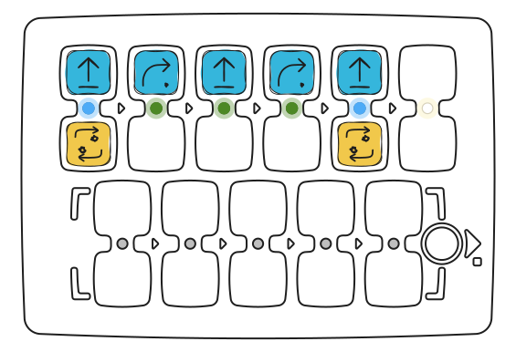
    </Frame>
  </Columns>
</Accordion>

### Hetzelfde of niet?

Hier zijn twee programma's. Tekent de robot met allebei hetzelfde? Eerst discussiëren de deelnemers, dan controleren ze: ze starten beide programma's vanaf dezelfde plek.

<Columns cols={2}>
  <Frame caption="Programma 1">
    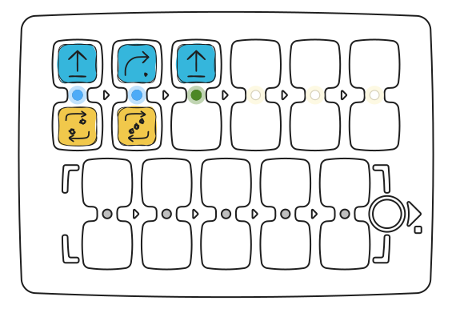
  </Frame>
  <Frame caption="Programma 2">
    
  </Frame>
</Columns>

<Accordion title="Antwoord">
  Ja. Drie keer “Rechts” draaien zet de robot dezelfde kant op als één keer “Links”.

  [Start in de simulator: Programma 1](https://simulator.primastem.com/#top=cfor.r002,crig.r003,cfor&s=l1144402&r=375-525-0&run) · [Start in de simulator: Programma 2](https://simulator.primastem.com/#top=cfor.r002,clef,cfor&s=l1144402&r=375-525-0&run)

  <Columns cols={2}>
    <Frame caption="Wat de robot tekent">
      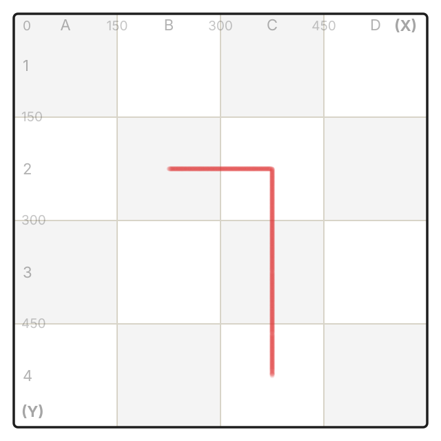
    </Frame>
  </Columns>
</Accordion>

### Naar huis

Zet met potlood een stip op het startpunt. De robot is er met dit programma vandaan gereden. Maak een programma dat hem terugbrengt naar de start.

[Start in de simulator](https://simulator.primastem.com/#top=cfor.r002,crig,cfor&s=l1144402&r=75-525-0&run)

<Columns cols={2}>
  <Frame caption="Programma op de bediening">
    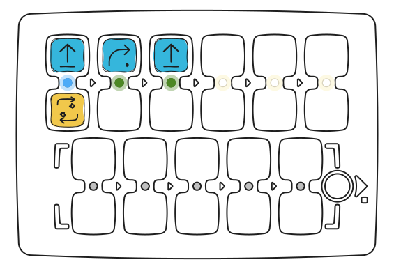
  </Frame>
  <Frame caption="Wat de robot tekent">
    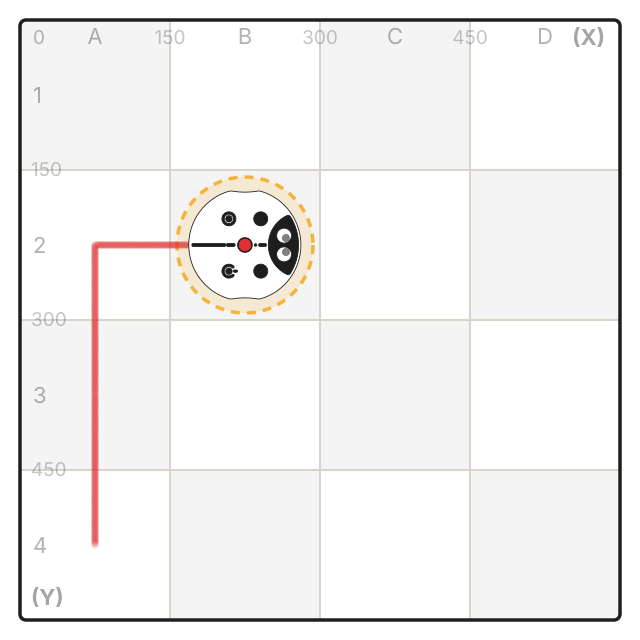
  </Frame>
</Columns>

<Accordion title="Antwoord">
  “Rechts” ×2, “Vooruit”, “Links”, “Vooruit” ×2. Een andere oplossing: “Achteruit”, “Rechts”, “Vooruit” ×2.

  [Start in de simulator](https://simulator.primastem.com/#top=crig.r002,cfor,clef,cfor.r002&s=l1144402&r=225-225-90&m=03&run)

  <Columns cols={2}>
    <Frame caption="Programma op de bediening">
      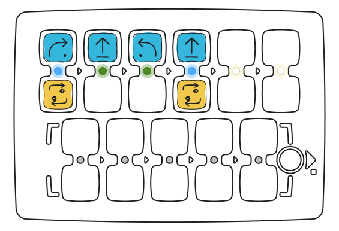
    </Frame>
    <Frame caption="Wat de robot tekent">
      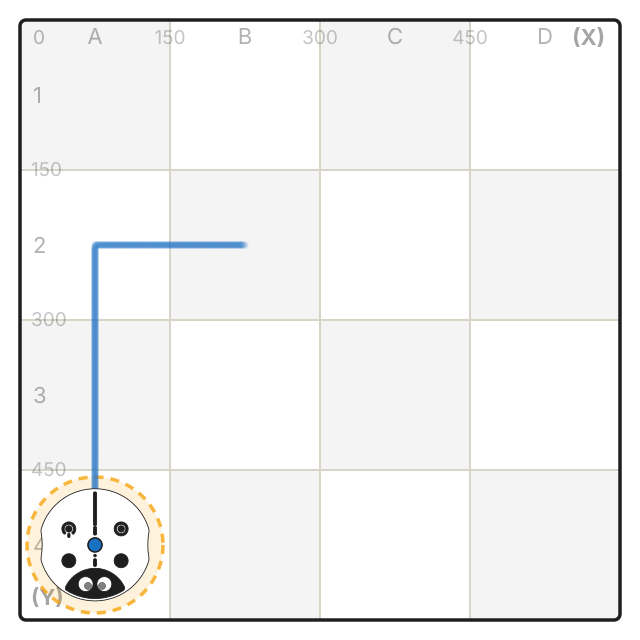
    </Frame>
  </Columns>
</Accordion>

## Evaluatie van effectiviteit

### Controlemethoden

- Regelmatig testen van cognitieve functies
- Observeren van dynamiek in taakuitvoering
- Verzamelen van feedback van deelnemers
- Bijhouden van een sessiedagboek

### Succescriteria

- Verbetering van taakuitvoeringsprestaties
- Verhoging van moeilijkheidsgraad van uitgevoerde oefeningen
- Positieve subjectieve evaluatie van deelnemers
- Overdracht van vaardigheden naar dagelijks leven

## Aanbevelingen voor programma-aanpassing

### Individualisering

- Rekening houden met fysieke beperkingen
- Aanpassen van sessietempo
- Aanpassen van taken aan interesses van deelnemer
- Maken van een individueel progressieplan

### Groepswerk

- Vormen van groepen naar vaardigheidsniveau
- Organiseren van competitieve elementen
- Ondersteunen van wederzijdse hulp
- Creëren van een comfortabele sociale omgeving