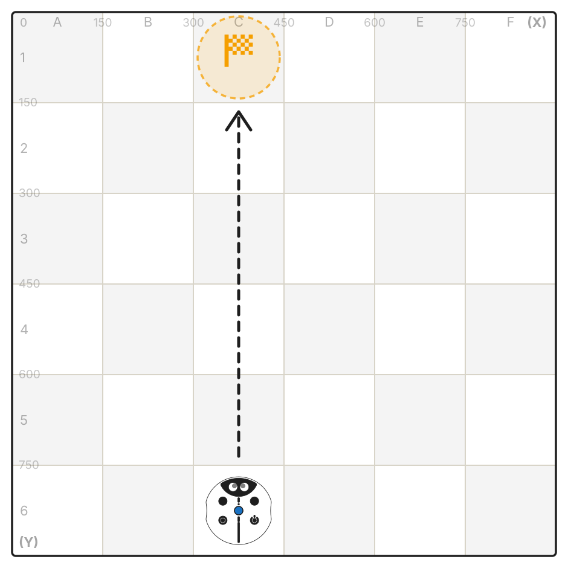
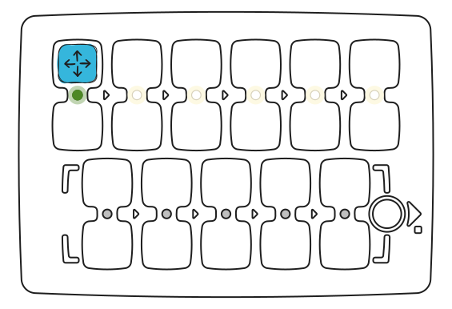

PrimaSTEM leert kinderen van 4 tot 12 jaar programmeren zonder computers, tablets of telefoons. De set ontwikkelt logica, programmeervaardigheden en wiskunde.

Met PrimaSTEM wordt programmeren eenvoudig en visueel. Zelfs jonge kinderen begrijpen wat er gebeurt: ze raken de kaartjes met hun handen aan en leren al spelend de basis van programmeren, logica en wiskunde.

Spelen met PrimaSTEM ontwikkelt logisch denken, algoritmiek, programmeren, wiskunde en meetkunde. Het ontwikkelt ook creativiteit en sociaal-emotionele vaardigheden. De set bereidt het kind voor op blokgebaseerde programmeertalen, bijvoorbeeld [Scratch](https://en.wikipedia.org/wiki/Scratch_(programming_language)) of [LOGO](https://en.wikipedia.org/wiki/Logo_(programming_language)).

## Kennismaking met de educatieve set

### Waar kan PrimaSTEM worden gebruikt

PrimaSTEM past bij deze lessen en activiteiten:

- Voorschoolse educatiecentra
- Kleuterscholen met Montessori-methodiek
- Basisschool
- Thuisonderwijs
- Speciale ontwikkelingscentra
- Buitenschoolse opvanggroepen
- Programmeerclubs voor beginners
- Educatieve kampen voor kinderen

### Wat moet u weten om te beginnen

Lees voordat u met de set werkt de pagina [Apparaat en instellingen](/nl/usermanual) en deze gids. U hebt geen programmeervaardigheden nodig: de materialen bevatten alles om te beginnen.

## Onderzoek en waarde van de set

PrimaSTEM is geïnspireerd door de programmeertaal [LOGO](https://en.wikipedia.org/wiki/Logo_(programming_language)), gemaakt door [Seymour Papert](https://en.wikipedia.org/wiki/Seymour_Papert), en door de Montessori-pedagogiek. LOGO en de schildpaddrobot maakten programmeren visueel en toegankelijk voor kinderen.

De PrimaSTEM-commandokaartjes zetten deze aanpak voort. Het kind bestuurt de robot met zijn handen, zonder scherm of tekst, en begrijpt meteen wat het doet.

Kinderen kijken naar de robot, begrijpen elk commando en leren algoritmen in de praktijk.

De robot heeft een belangrijke eigenschap: hij heeft een richting. Het kind kan zich makkelijk in de plaats van de robot denken en begrijpt daardoor sneller de logica van het programma.

Alle commando's zijn eenvoudig: ze zeggen in welke richting de robot moet bewegen. Wanneer kinderen de robot leren "handelen" en "denken", gaan ze nadenken over hun eigen acties en gedachten. Daardoor leren ze makkelijker programmeren.

PrimaSTEM-kaartjes laten visueel en vereenvoudigd zien hoe programmeertalen werken. Aan het begin zijn er geen teksten of cijfers, alleen basiscommando's.

### Waarom hout

🌱 De bediening en de robot zijn gemaakt van hout (multiplex). Kinderen spelen liever met houten speelgoed. Het is veilig, gaat lang mee en elk stuk krijgt zijn eigen geschiedenis.

## Programmeren met PrimaSTEM

PrimaSTEM-kaartjes werken als instructies in echte programmeertalen. Ze laten belangrijke programmeerconcepten zien.

### Algoritmen

Een **algoritme** bestaat uit precieze commando's (kaartjes) die samen een programma vormen.

### Wachtrij

De bediening voert de commando's strikt van links naar rechts uit. Zo zien kinderen dat de commando's na elkaar worden uitgevoerd.

### Foutcorrectie (debuggen)

Een fout is gemakkelijk te verhelpen: vervang gewoon het kaartje. Zo leert het kind zelf fouten in een programma te vinden en te verbeteren.

### Functie

Een functie (subroutine) bestaat uit commando's in de onderste rij van de bediening. Het hoofdprogramma roept haar aan met het "**Functie**"-kaartje.

### Variabele

De bediening onthoudt het laatste getal van elk commando. Vooruit, Achteruit, Links, Rechts en Pauze bewaren elk hun eigen waarde. Een commando zonder getal gebruikt de opgeslagen waarde. Dat is een variabele: die heeft een naam (het commando) en een waarde (het getal), en de waarde kan veranderen.

## Toepassing in andere vakken

PrimaSTEM helpt ook andere vaardigheden te ontwikkelen:

- Communicatie. In groepsspel leren kinderen samenwerken.
- Motoriek. Werken met kaartjes verbetert de coördinatie.
- Sociale vaardigheden. Kinderen krijgen zelfvertrouwen en leren samen problemen op te lossen.
- Wiskunde. Kinderen leren wiskundige basisbegrippen.
- Logica. Kinderen leren reeksen bouwen en resultaten voorspellen.

> Het kind legt een rij kaartjes en leert programmeren met zijn handen, ogen en hoofd. Het drukt op **▶ Start**, de robot rijdt en het kind vergelijkt het resultaat met wat het verwachtte. Zo'n ervaring versnelt het leren.

## Kennismaking met de robot en bediening

### De robot

Vertel kinderen dat de robot hun vriend is en dat ze hem kunnen programmeren. Leg uit dat hij geen eigen gedachten heeft. Hij voert alleen hun instructies uit, zoals een huishoudelijk apparaat dat u moet aanzetten.

### De bediening

Leg uit dat de bediening de commando's naar de robot stuurt. Laat zien hoe u commandokaartjes neerlegt en de robot programmeert.

> Het hoofdprogramma bouwt u in de bovenste rij van de bediening (6 paren). De onderste rij (5 paren) is voor de subroutine. Het "**Functie**"-commando roept die aan.

### Commandokaartjes

Kaartjes geven commando's aan de robot. U legt ze op de bediening. Na een druk op **▶ Start** voert de robot het programma uit. Elk kaartje geeft één commando. Zo leren kinderen computationeel denken en leren ze programma's opbouwen. Het is belangrijk dat kinderen begrijpen wat de robot bij elk commando doet. Dan kunnen ze het programma plannen en de acties van de robot voorspellen. Leg kinderen uit dat ze kaartjes niet mogen verliezen of beschadigen: zonder kaartjes kan de robot niet bewegen.

## 1. Eerste programma

### Oorzaak en gevolg

Het hoofddoel: kinderen het verband tussen commando en actie laten zien. Laat het kind het "Vooruit"-kaartje in de eerste cel van de bediening leggen en op **▶ Start** drukken. Het kind moet zien dat het kaartje en de actie bij elkaar horen.

### Eenduidige instructies

Herhaal dit met elke richting (**vooruit**, draai **links**, draai **rechts**) totdat het kind elk kaartje herkent.

### Eerste taak

Leg het speelbord neer of maak een raster met vakken van 15 × 15 cm met tape of een marker. Zet de robot op het startvak. Vraag het kind een programma te maken waarmee de robot één cel vooruit rijdt. Kiest het kind het verkeerde kaartje, zet de robot dan terug en laat het kind over een andere oplossing nadenken.

## 2. Programma en debuggen

### Gebeurteniswachtrij

Plaats een doel twee cellen voor de robot.

Laat het kind een programma van twee kaartjes maken waarmee de robot het doel bereikt.

### Sequentie van drie kaartjes

Nu ligt het doel één cel vooruit en één cel naar rechts.

Laat het kind zelf de juiste volgorde van de commando's kiezen.

Maak u geen zorgen als het kind het verkeerde kaartje kiest. Zet de robot terug op de start en vraag het kind over zijn keuze na te denken en andere opties te proberen.

### Debuggen: de fout vinden

Leg het doel één vak voor de robot en één vak links ervan.

Maak deze keer zelf het programma en zet er opzettelijk een verkeerde draai in.

Vraag het kind het verkeerde commando te vinden en te voorspellen waar de robot uitkomt. Laat het kind daarna op **▶ Start** drukken en zijn voorspelling controleren.

Weet het kind zeker dat het programma niet klopt, door redeneren of door te testen? Laat het dan het verkeerde commando vervangen door het juiste. Zo debugt het kind het programma.

## 3. Programma met functie

### "Functie"-commando

Kennen de kinderen de basiscommando's, laat dan het **Functie**-commandokaartje zien. Dit kaartje roept een reeks commando's aan die het hoofdprogramma kan herhalen.

> Om uit te leggen hoe dit werkt, vergelijkt u de functie met een toren: onder het functiekaartje liggen andere commando's op elkaar gestapeld. Zo zien kinderen dat er meer instructies in één kaartje passen.

Laat een voorbeeld zien. Leg eerst twee "Vooruit"-kaartjes in de bovenste cellen en start het programma. De robot rijdt twee cellen.

Leg nu dezelfde twee "Vooruit"-kaartjes in de functie (onderste rij) en leg "Functie" in het hoofdprogramma. Het resultaat is hetzelfde, maar nu zit een deel van het programma verborgen in een subroutine.

Maak daarna de sequentie: **Vooruit, Vooruit, Rechts, Vooruit, Vooruit**.

Vraag kinderen de delen te vinden die zich herhalen en ze te "verbergen" in de functie. Het resultaat: in het hoofdprogramma **Functie, Rechts, Functie**, in de onderste rij **Vooruit, Vooruit**.

[Start in de simulator](https://simulator.primastem.com/#top=cfun,crig,cfun&fn=cfor,cfor&s=l1144602&r=225-825-0&run)

### Taken oplossen met functie

Geef het kind 3 "**Vooruit**"-kaartjes en 2 "**Functie**"-kaartjes.

De taak: rijd 5 cellen vooruit.

Laat het kind ontdekken dat het voor deze taak een functie nodig heeft die de actie herhaalt.

Klopt het programma niet, zet de robot dan terug op de start. Vraag het kind na te denken over de juiste oplossing en andere opties te proberen.

[Start in de simulator](https://simulator.primastem.com/#top=cfun,cfun,cfor&fn=cfor,cfor&s=l1144602&r=225-825-0&run)

## 4. Willekeurigheid

### "Willekeurige beweging"-commando

Om willekeurigheid uit te leggen, neemt u 4 richtingskaartjes: "**Vooruit**", "**Links**", "**Rechts**" en "**Achteruit**". Doe ze in een ondoorzichtige doos of zak en meng ze. Laat de kinderen om de beurt zonder te kijken één kaartje trekken, het aan de groep laten zien en het terugleggen. Leg met dit voorbeeld uit wat een willekeurige keuze uit vier mogelijkheden is.

Laat kinderen daarna het "**Willekeurige beweging**"-commandokaartje zien.

Leg uit dat dit kaartje bijna hetzelfde doet als de kinderen met de zak deden. Het kiest willekeurig een richting en verplaatst de robot één stap, dus één cel. De robot kan één cel vooruit, naar rechts, naar links of achteruit gaan.

Leg het "**Willekeurige beweging**"-kaartje in de bovenste cel en start het programma een paar keer. De robot beweegt elke keer anders.

[Start in de simulator](https://simulator.primastem.com/#top=crnd&s=l1144602&r=375-525-0&run)

Speel met kinderen: laat ze voor elke start raden waar de robot naartoe gaat.

Benadruk dat dit **willekeurigheid** is en dat u de richting niet elke keer kunt raden.

Bedenk samen met de kinderen een klein spel met het "**Willekeurige beweging**"-kaartje.

## 5. Lussen (commando-herhalingen)

### Kennismaking met numerieke lussen

Laat kinderen de herhalingskaartjes zien. Vraag of ze cijfers kennen, of ze een dobbelsteen hebben gezien en of ze bordspellen hebben gespeeld.

Leg twee "Vooruit"-kaartjes in de bovenste cellen en start het programma. De robot rijdt twee cellen.

Laat nu één "Vooruit" liggen en leg het kaartje "Herhaal 2" eronder. Het resultaat is hetzelfde: de actie wordt twee keer herhaald.

Leg 4 "**Vooruit**"-kaartjes en kijk naar het resultaat. Vraag kinderen daarna dezelfde beweging van 4 cellen te maken met een **herhalingskaartje**.

De taak heeft meer oplossingen. Een eenvoudige: "**Vooruit**" en "Herhaal 4". Een andere: "**Vooruit**" met "Herhaal 3" en nog een "**Vooruit**".

[Start in de simulator](https://simulator.primastem.com/#top=cfor.r003,cfor&s=l1144602&r=225-825-0&run)

### Een functie herhalen

Probeer met kinderen een herhaling toe te voegen aan het "Functie"-commando. De robot kan bijvoorbeeld zigzaggen: in de bovenste rij "Functie" met "Herhaal 5", in de onderste rij "**Vooruit**", "**Rechts**", "**Vooruit**", "**Links**".

Maak eerst in de functie het programma "trap": "Vooruit", "Rechts", "Vooruit", "Links". Start het.

Voeg daarna "Herhaal 5" toe aan de functie. De functie wordt 5 keer herhaald en de robot rijdt trapsgewijs naar rechts en omhoog.

[Start in de simulator](https://simulator.primastem.com/#top=cfun.r005&fn=cfor,crig,cfor,clef&s=l1144602&r=75-825-0&run)

De robot rijdt trapsgewijs diagonaal naar rechts en omhoog en maakt 5 treden.

## 6. Willekeurige getallen

### Wat is een willekeurig getal

Bij de kaartjes zit "Herhaal een willekeurig aantal keer" (met een dobbelsteen). Dit kaartje kiest een willekeurig getal van 1 tot 6. Speel met de kinderen: laat ze herhalingskaartjes uit een zak trekken.

Om een willekeurig getal uit te leggen, neemt u 4 herhalingskaartjes: "**2**", "**3**", "**4**" en "**5**". Doe ze in een ondoorzichtige doos of zak en meng ze. Laat de kinderen om de beurt zonder te kijken één kaartje trekken, het laten zien, het getal noemen en het terugleggen. Speel wie het hoogste getal trekt. Leg met dit voorbeeld uit wat een willekeurige keuze uit vier mogelijkheden is.

Laat kinderen daarna het "**Herhaal een willekeurig aantal keer**"-kaartje zien. Leg uit dat het bijna hetzelfde doet als de kinderen met de zak deden. Net als een dobbelsteen kiest het willekeurig een getal van 1 tot 6, en de robot herhaalt de actie zo vaak.

Leg het "**Vooruit**"-kaartje in de bovenste cel van de bediening en het "**Herhaal een willekeurig aantal keer**"-kaartje eronder. Vraag kinderen op **▶ Start** te drukken. Zet de robot terug op zijn plek. Herhaal dit een paar keer.

[Start in de simulator](https://simulator.primastem.com/#top=cfor.rrnd&s=l1144702&r=225-975-0&run)

Speel: wiens robot het verst rijdt.

Wijs kinderen erop dat de robot een willekeurig aantal cellen rijdt, van 1 tot 6. Benadruk dat dit willekeurigheid is en dat u niet van tevoren kunt weten hoe ver de robot rijdt.

## 7. Getallen: afstanden en hoeken

### Kennismaking met getallen

Staat er geen getal in de tweede cel van het paar, dan gebruikt de robot de standaardwaarden: hij rijdt 15 cm vooruit en draait 90°. Getalkaartjes veranderen deze waarden.

Voorbeeld. Voeg het getal **200** toe aan het "**Vooruit**"-commando en kijk hoe ver de robot rijdt. Voeg het getal **180** toe aan een draai en kijk wat er verandert.

[Start in de simulator](https://simulator.primastem.com/#top=cfor.n200,crig.n180&s=l1047602&r=450-600-0&run)

> **Belangrijk.** De bediening onthoudt het laatste getal voor bewegings- en draaicommando's. Staat een commando zonder nieuw getal, dan neemt het het opgeslagen getal, totdat u de bediening uitzet. Een nieuw getal vervangt het opgeslagen getal. De staplengte die met het kaartje «Standaardstap» is ingesteld, blijft in het geheugen en blijft ook na herstarten. Om 15 cm terug te krijgen, gebruikt u dat kaartje met het getal 150. De draai van 90° komt na herstarten vanzelf terug.

Met verschillende getallen rijdt de robot complexere routes. Voorbeelden staan op de pagina [Tekenvoorbeelden](/nl/mathdrawings).

## 8. Rekenkunde

### Rekenkundige bewerkingen

Rekenkunde verandert getallen in het programma voor bewegingscommando's (Vooruit, Achteruit, Links, Rechts). Zo bestuurt u de robot flexibeler.

Staat er een rekenkundig kaartje in het paar, dan verandert de bediening het opgeslagen getal van het commando en stuurt de nieuwe waarde naar de robot.

Voorbeeld:

[Start in de simulator](https://simulator.primastem.com/#top=cfor.n200,crig,cfor.a100&s=l1047602&r=300-700-0&run)

"Vooruit 200": de robot rijdt 20 cm. "Vooruit +100": de robot rijdt nog 30 cm. Samen 50 cm.

### Opdracht: een groeiende spiraal

Rekenen verandert het opgeslagen getal, dus de variabele. Bouw het programma: bovenste rij Vooruit 30 en Functie × 20, onderste rij Rechts en Vooruit +30. Bij elke aanroep van de functie wordt de zijde 3 cm langer.

Laat de kinderen eerst voorspellen: hoe lang wordt de vijfde zijde? Start dan het programma en controleer. Antwoord: 15 cm (3 + 3 + 3 + 3 + 3).

[Start in de simulator](https://simulator.primastem.com/#top=cfor.n030,cfun.r020&fn=crig,cfor.a030&s=l1047602&r=450-465-0&run)

<Columns cols={2}>
  <Frame caption="Programma op de bediening">
    
  </Frame>
  <Frame caption="Wat de robot tekent">
    
  </Frame>
</Columns>

Hetzelfde programma in LOGO: [PrimaSTEM en LOGO](/nl/logo).

Rekenkunde in een lus geeft reeksen.

> Wordt het getal na een rekenkundige bewerking negatief, dan doet de robot het omgekeerde: hij rijdt achteruit in plaats van vooruit en draait naar rechts in plaats van naar links.

U kunt optellen (+), aftrekken (−), vermenigvuldigen (*), delen (/), worteltrekken (√) en machtsverheffen (^).

Voorbeelden van patronen staan op de pagina [Tekenvoorbeelden](/nl/mathdrawings).

---

## Speel en leer samen met kinderen

U kent uw leerlingen het beste. Met PrimaSTEM leert u kinderen al spelend programmeren, logica en andere vakken. Alles hangt af van uw fantasie.

Bedankt dat u voor PrimaSTEM hebt gekozen. [Schrijf ons](/nl/contacts) over uw ervaring en indrukken, we horen graag van u.
