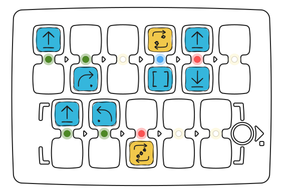
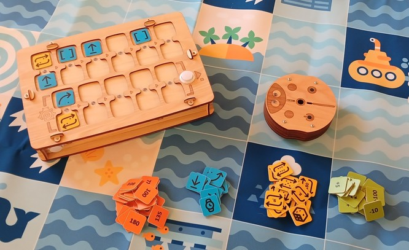
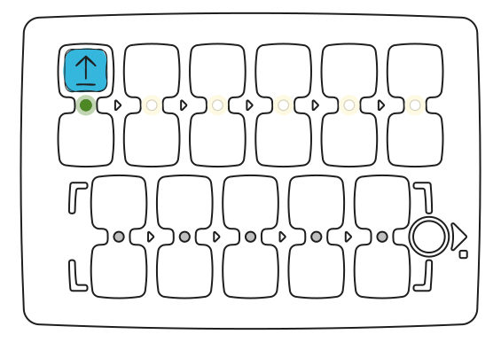

## Veiledning for gjennomføring av timer med barn fra 4 år

PrimaSTEM hjelper barn trinn for trinn med å mestre logisk tenkning, grunnleggende programmering og matematikk. Denne veiledningen hjelper deg med å gjennomføre timer med barn fra 4 år.

### Hvordan det fungerer

Barna programmerer bevegelsene til en liten marihønerobot. Til det legger de kommandobrikker på kontrollpanelet.

- **"Fremover"**: roboten kjører rett frem.
- **"Venstre"**: roboten svinger til venstre.
- **"Høyre"**: roboten svinger til høyre.
- **"Funksjon"** (brikken "[ ]"): erstatter en sekvens av kommandoer.
- **"Gjenta"**: gjentar en kommando eller funksjon flere ganger.

Du legger brikkene på kontrollpanelet og lager på den måten et bevegelsesprogram for roboten. Når programmet er klart, trykker du på knappen, og roboten utfører kommandoene.

### Innhold i veiledningen

- Hvorfor gjennomføre timer i robotikk og programmering
- Hvordan organisere timene under ulike forhold
- Aktiviteter og læringsmål
- Detaljert bruksanvisning
- Beskrivelse av aktiviteter
- Vedlegg
- Om prosjektet og forfatterne

### Dette lærer barna med PrimaSTEM

- Programmere med hendene, uten skjerm
- Forstå at maskiner jobber etter algoritmer
- Planlegge handlinger på forhånd
- Tenke logisk
- Lage sekvenser av kommandoer og funksjoner
- Forstå hva en "bug" (feil i koden) er, og finne feil
- Lære tall, aritmetikk og geometri visuelt

## Hva PrimaSTEM består av

### Hva er i esken

- Marihønerobot
- Kontrollpanel
- Kommandobrikker *
- Aktivitetsveiledning *

(*) Innholdet avhenger av konfigurasjonen.

## Hvorfor gjennomføre timer i programmering og matematikk

Kode, programmering og automatisering har blitt en del av hverdagen vår.

De siste årene har mennesker lært å lage maskiner som gjør ting maskiner ikke kunne før: forstå, snakke, høre, se, svare, skrive.

Eksemplene er mange: selvkjørende biler, robotassistenter for eldre, leveringsroboter og andre.

### Hvorfor lære programmering og robotikk

Når et barn lærer å programmere, lærer det å forstå maskinene rundt oss. Det lærer å gjøre små og dristige ideer om til virkelige prosjekter. Det deler en vanskelig oppgave opp i enkle trinn. Det samarbeider med andre og løser felles oppgaver.

### Født i den digitale tidsalderen

Det kan se ut som om barn og unge er flinke med teknologi. De bruker jo mye digital underholdning.

Men kan de bruke disse verktøyene til å lage noe eget og uttrykke seg? Hva gjør de når de støter på et teknisk problem?

## Hvordan organisere timene

Aktivitetene passer til ulike formål og læringsmiljøer. Alle aktivitetene i veiledningen er nummerert. Nedenfor står det hvilke aktiviteter som passer for dine forhold.

### For hvem

- Barn fra 4 til 8 år.
- Eldre grupper og førskolegrupper i barnehagen, 1. og 2. klasse i grunnskolen.

### Aktiviteter for fritidsordning

Aktivitetene 1, 2, 4, 5, 6, 7, 8, 9, 10.

### Aktiviteter for skolen

Aktivitetene 2, 3, 4, 5, 6, 7, 8, 9, 11, 12.

### Fritidsaktivitet

Gruppen bør ha høyst 12 barn, slik at alle kan delta aktivt.

Vi anbefaler én enhet per 2–3 elever. Slik lærer barna å jobbe i team og å samarbeide.

### Arbeid på skolen

I klasserommet er det best å jobbe med PrimaSTEM i små grupper på 4–6 barn med én lærer.
De andre elevene gjør en annen oppgave med en assistent. Elever i 1.–2. klasse kan for eksempel øve på å tegne robotens vei etter programmet.
I begge tilfeller er det best å ha timene i en flerbrukshall, direkte på gulvet. Du kan også flytte bord og stoler for å frigjøre plass.

**Obs.** Lad batteriene til kontrollpanelet og roboten på forhånd.

## Aktiviteter og læringsmål

| Aktivitet | Algoritme og program | Ruten i etapper | Forutse bevegelse | Løse problem, finne feil | Teamarbeid |
| --- | :---: | :---: | :---: | :---: | :---: |
| 1 |   | X |   | X |   |
| 2 |   |   | X |   | X |
| 3 | X | X |   |   |   |
| 4 | X | X | X |   |   |
| 5 | X | X | X |   | X |
| 6 | X | X | X | X | X |
| 7 | X | X | X | X | X |
| 8 | X |   | X | X |   |
| 9 | X | X | X | X | X |
| 10 | X |   | X | X |   |
| 11 | X | X | X | X | X |
| 12 | X | X | X | X | X |

## Bruksanvisning

### Innhold i anvisningen

- Bli kjent med materialene
- Programmering av en funksjon
- Kart
- Tekniske forklaringer

## Bli kjent med materialene

### Robot

En liten marihønerobot i tre med to øyne.

Den har tre støttepunkter: to hjul og en støtte bak. På dem holder den balansen.

### Grunnleggende kommandoer

| Kommando | Tegning                             | Beskrivelse                                                                                  |
| -------- | ----------------------------------- | -------------------------------------------------------------------------------------------- |
| Fremover |   | Roboten kjører ett felt frem. Det er ett logisk steg, som standard 15 cm.                       |
| Venstre  |      | Roboten svinger 90° til venstre                                                              |
| Høyre    |     | Roboten svinger 90° til høyre                                                                |
| Bakover  |      | Roboten rygger ett felt, altså ett logisk standardsteg                                               |
| Funksjon |  | Roboten utfører kommandoene fra funksjonsraden                                |
| Gjenta N |   | Roboten gjentar kommandoen fra samme dobbelcelle N ganger    |

### Kontrollpanel

På kontrollpanelet styrer du roboten: du legger kommandobrikker i de ledige cellene (D).

Den øverste raden (A) med 6 dobbeltceller, forbundet med en utførelseslinje (E), er hovedprogrammet. Programmet starter i cellen til venstre (D) og slutter over **▶ Start**-knappen (B). Denne knappen sender kommandoene til roboten og starter programmet.

Den nederste raden (C) med 5 dobbeltceller bestemmer bevegelsene for brikken "Funksjon" ("[ ]"). Hver dobbeltcelle har en lysdiode (F). Den lyser når du legger inn en brikke, og blinker når roboten utfører denne kommandoen.

#### Farger på lysdiodene

Når en brikke ligger riktig i cellen, lyser lysdioden grønt.
Når du legger en gjenta-brikke sammen med en bevegelseskommando i dobbelcellen, lyser lysdioden blått.
Når brikkene ligger feil, for eksempel to bevegelseskommandoer i én dobbelcelle, lyser lysdioden rødt. Roboten hopper over denne kommandoen.

### Batteri og av/på-knapp

Roboten og kontrollpanelet går på innebygde batterier. De lades via en USB-C-port. Av/på-knappen (ON/OFF) sitter på toppen av roboten og på forsiden av kontrollpanelet til venstre.

Når roboten eller kontrollpanelet slås på, høres et kort lydsignal.
På et påslått kontrollpanel lyser lysdioden på frontpanelet grønt. På en påslått robot lyser lysdioden ved USB-C-kontakten grønt.

### Trådløs tilkobling

Roboten og kontrollpanelet er koblet sammen via Bluetooth med en rekkevidde på ca. 5 m. Etter at roboten er koblet til kontrollpanelet første gang, fungerer forbindelsen av seg selv. Du trenger ikke å stille inn noe.

> Du kan koble kontrollpanelet til en annen robot (paring).
> 1. Slå på roboten som ennå ikke er paret med kontrollpanelet.
> 2. Slå på kontrollpanelet.
> 3. Hold inne **▶ Start**-knappen på kontrollpanelet i 10 sekunder, til du hører et lydsignal og ser et lyssignal.

### Slik lager og kjører du et program

Programmet ("bevegelsessekvensen") starter til venstre på kontrollpanelet. Det følger de inngraverte pilene ">". Dette er utførelseslinjen, som forbinder dobbeltcellene horisontalt.

Hvis det er en tom celle foran en brikke, hopper roboten over den tomme cellen og utfører kommandoen til brikken.

Hvis en brikke ligger feil, lyser lysdioden rødt, og roboten hopper over denne delen av programmet. Det skjer for eksempel når "Gjenta" ligger i en dobbelcelle uten kommando, eller når to kommandobrikker ligger i én dobbelcelle.

Når programmet er klart, trykker du på **▶ Start**-knappen.

Mens roboten utfører programmet, slukkes lysdiodene på kontrollpanelet én etter én. Lysdioden til den gjeldende kommandoen blinker.

## Programmering av en funksjon

### Slik lager du en funksjon

Brikken "Funksjon" ("[ ]") erstatter en sekvens av kommandoer.

Med den kan du lage lengre programmer og løse vanskeligere oppgaver. For å lage en funksjon legger du bevegelsene i den nederste raden på kontrollpanelet: det er 5 dobbeltceller. Roboten utfører denne raden fra venstre til høyre hver gang den kommer til brikken "Funksjon" i hovedprogrammet (øverst).

I eksempelet nedenfor består funksjonen av en bevegelse rett frem og en sving til høyre. Hovedprogrammet kaller funksjonen 2 ganger. Deretter gjentar brikken "Gjenta 2" funksjonen 2 ganger til.

[Kjør i simulatoren](https://simulator.primastem.com/#top=cfun,cfun,cfun.r002&fn=cfor,crig&s=l1144602&r=225-675-0&run)

Dette får du:

## Kart

### Hvilke kart som passer

I de første timene lærer barna algoritmer, programmering og tall. Til det kjører roboten på et kart med rutenett. Det er best å bruke kart med ruter på 15 cm: så langt kjører roboten i ett standardsteg.

Kart til andre roboter passer også, hvis rutestørrelsen passer for denne roboten.

> Du kan endre standardsteget fra 15 cm til rutestørrelsen på kartet ditt, for eksempel 10 cm, 12,5 cm eller 20 cm. Til det legger du den spesielle brikken "Standardsteg" med et tall i millimeter: 100 for 10 cm, 125 for 12,5 cm, 200 for 20 cm.

Hvis du ikke har kart, lager du et selv. Fest tynn maskeringstape på et flatt bord eller gulv. Du kan også bruke et ark gråpapir (eller tykk bannerduk) og en tusj.

Et sjakkbrettkart eller et tomt kart med ruter brukes til å øve på å kjøre fra ett punkt til et annet. Fargene distraherer ikke.

Et fargekart hjelper deg å fortelle korte historier om robotens reiser. For eksempel: "Marihøna går ut fra huset og går til fjellene gjennom skogen". Klassen kan lage et nytt kart og finne på nye historier om marihønas reiser.

#### Eksempler på kart

Sjakkbrettkart

Fargekart

## Tekniske forklaringer

### Slik er det bygget

Kontrollpanelet og roboten har mikrokontrollere og Li-Ion-batterier. Enhetene er koblet sammen via radio med den standardiserte protokollen Bluetooth.

Robotens kretskort styrer all oppførselen dens. Det styrer to 5V DC-motorer og to flerfargede lysdioder, spiller av lyder, kommuniserer med kontrollpanelet osv.

Kontrollpanelets kretskort gjenkjenner brikkene i cellene, spiller av lyder og styrer 11 flerfargede lysdioder, én for hver dobbelcelle.

Hver brikke har et NFC-klistremerke med en kode for kommandoen. Kontrollpanelet leser koden når du legger brikken i en celle.

Når kontrollpanelet har gjenkjent brikkene og du har startet programmet, sender kontrollpanelet kommandoene til roboten trådløst.

### Egne kommandobrikker

Du kan lage ekstra kommandobrikker, for eksempel "Gjenta 12" eller flere bevegelsesbrikker. Til det trenger du "tomme" brikker med NFC-klistremerker og en telefon med NFC. De fleste typer klistremerker med frekvens 13,56 MHz fungerer.

Videoveiledning finnes på YouTube-kanalen vår: https://www.youtube.com/@primastem

---

## Aktiviteter

### Detaljert beskrivelse av aktiviteter

- **Aktivitet 1**: veien på sjakkbrettet fra punkt A til punkt B
- **Aktivitet 2**: bli kjent med PrimaSTEM
- **Aktivitet 3**: barnet spiller roboten, orientering og algoritme
- **Aktivitet 4**: forutsi robotens vei etter programmet
- **Aktivitet 5**: kommandosekvens i et tilfeldig program
- **Aktivitet 6**: før roboten til fjells med kontrollpanelet
- **Aktivitet 7**: bli kjent med brikken "Funksjon"
- **Aktivitet 8**: rute til målet med funksjon
- **Aktivitet 9**: feilsøking i et program med feil
- **Aktivitet 10**: finn feilen i programmet på papir
- **Aktivitet 11 og 12**: forutsi robotens bevegelser (i aktivitet 12 med brikken "Funksjon")

---

## Aktivitet 1. Veien på sjakkbrettet fra punkt A til punkt B

- **individuelt**
- **15 min**
- **på papir**
- **dokumenter for utskrift**

### Mål

- Planlegge veien via ruter fra punkt A til punkt B på kartet.

Øvelsen varer i 10 minutter med en oppsummering til slutt.

### For utskrift

Skriv ut arket "[Vedlegg 1. Forflytning på kartet](/no/book-1/attachment-1)" til hver elev.

### Øvelse

Barna tegner på rutenettet veien som musa må gå for å komme til osten. Begynn med den venstre øvelsen, den er enklere. Gå så videre til den høyre.

#### Forflytning via ruter

Musa går via rutene i rutenettet. Den kan ikke gå på skrå. Barna må forstå at musas vei er delt inn i etapper: den går én rute av gangen. Da beveger den seg trinnvis.

I eksempelet over er bare den blå veien riktig. Den korte røde veien er feil fordi den går på skrå. Den lange røde veien er feil fordi den ikke fører til ønsket punkt.

### Diskusjon i gruppen

I eksempelet over er alle veiene riktige: på hver av dem kommer musa frem til osten.

Vis barna at hvert barn kan ha tenkt på sin egen vei, og at det ofte finnes flere riktige veier.

#### Noen veier er lengre enn andre

Tell hvor mange ruter musa går til ruten med ost:
- 3 ruter på den grønne veien
- 3 ruter på den grå veien
- 3 ruter på den blå veien
- 13 ruter på den gule veien

#### Den korteste veien

Alle disse veiene er riktige, men musa velger den korteste.

Spør barna: "Hvorfor valgte musa den korteste veien?"

Svarene kan være ulike. Musa vil spare krefter: den er veldig sliten og vil gå minst mulig. Eller musa har dårlig tid: den er veldig sulten og vil komme frem til osten så fort som mulig.

**Merknad til veileder.** Med roboter er det det samme. Vi velger alltid den korteste veien, fordi den er mest effektiv.

#### Flere veier er mulige

Når øvelsen er ferdig, ber du elevene vise veiene de har tegnet. Det finnes alltid flere veier, så elevene foreslår trolig ulike svar, og alle er riktige.

---

## Aktivitet 2. Bli kjent med PrimaSTEM

- **15 min**
- **i gruppe**
- **demonstrasjon**
- **praksis**

### Mål

- Forstå hvordan roboten kan bevege seg.
- Lære at kontrollpanelet styrer roboten.
- Forstå hva kommandobrikkene gjør.

Del elevene inn i små grupper. Sitt ved et lavt bord eller på gulvet. Ta frem kartet med rutenett, kontrollpanelet, roboten og brikkene. Introduser PrimaSTEM for alle elevene, gruppe for gruppe.

### Presentasjon

Vis hver ting på bordet og si ordene som barna trenger.

Først **kartet**. Det er det samme rutenettet som i aktivitet 1, bare større.

Deretter **marihøneroboten**. Den kan kjøre.

Roboten styres av **kontrollpanelet**. Den gjør det brikkene i cellene på kontrollpanelet sier.

**Brikkene** gir kommandoer: kjør rett frem, sving til venstre eller høyre.

### 1. etappe: demonstrasjon

Når barna kjenner ordene, viser du alt selv. Legg en brikke på kontrollpanelet, så ser barna hva som skjer.

| Bilde                                              | Beskrivelse                                                                 |
| -------------------------------------------------- | --------------------------------------------------------------------------- |
|  | Brikken **"Fremover"** flytter roboten én rute frem |

Sett roboten på en hvilken som helst rute på kartet. Legg brikken i den første cellen i programmet, som på skjemaet nedenfor. Trykk deretter på den hvite knappen **▶ Start**.

Roboten kjører én rute frem.

### 2. etappe: gi over styringen

| Bilde                                           | Beskrivelse                                                                                                                                                                             |
| ----------------------------------------------- | --------------------------------------------------------------------------------------------------------------------------------------------------------------------------------------- |
|  | Brikken **"Venstre"** med en pil i en bue svinger roboten til venstre, mot klokka. Som standard er svingen 90 grader. |

Ta brikken "Fremover" bort fra kontrollpanelet og gi barnet brikken "Venstre". La barnet legge den i den første cellen i programmet selv og trykke på den hvite knappen **▶ Start**. Roboten blir stående og tar en kvart omdreining til venstre.

| Bilde                                            | Beskrivelse                                                  |
| ------------------------------------------------ | ------------------------------------------------------------ |
|  | Brikken **"Høyre"** svinger roboten til høyre. |

Be et annet barn bytte ut brikken "Venstre" med brikken "Høyre" og trykke på den hvite knappen **▶ Start**. Roboten blir stående og tar en kvart omdreining til høyre.

Deretter jobber barna med kontrollpanelet etter tur. Gi dem bare 3 brikker: **"Fremover"**, **"Venstre"** og **"Høyre"**.

Når roboten er ferdig med bevegelsen, kan barna trykke på **▶ Start** en gang til og kjøre programmet sitt på nytt.

La barna selv se at brikkene kan ligge i hvilke som helst celler, unntatt to kommandoer i én dobbelcelle. Roboten utfører dem etter tur, fra venstre til høyre.

> For å stoppe programmet trykker du på **▶ Start / Stopp** en gang til mens roboten kjører.

---

## Aktivitet 3. Barnet spiller roboten: orientering og algoritme

- **45 min**
- **i gruppe**
- **spill**
- **kart**

### Mål

- Ta hensyn til hvilken vei roboten ser ved starten av programmet.
- Forutsi robotens bevegelser etter programmet.

### For utskrift

Skriv ut kortene "[Vedlegg 2. Misjonskort](/no/book-1/attachment-2)" til hver elev.

### Prinsippet for spillet

Dette er et rollespill i et åpent rom. Barna forestiller seg at de er roboten på et svart-hvitt felt.

### Regler for spillet

Én elev spiller roboten på kartet. I stedet for kartet kan du bruke et gulv med kvadratisk mønster: tegning, fliser eller ruter av tynn maskeringstape. De andre elevene programmerer roboten etter oppgavekortene.

Barna får ikke vite hvilken vei robot-barnet ser.
De bestemmer selv hvilken vei roboten må se for å fullføre misjonen.

1. Robot-barnet stiller seg på den røde ruten 1. Det skal frem til den grønne ruten 2.
2. Robot-barnet stiller seg på den røde ruten 1. Det skal frem til den lilla ruten 3.
3. Robot-barnet stiller seg på den røde ruten 1. Det skal frem til den blå ruten 4.

> For at kartet skal vare lenger, ber du barnet ta av seg skoene.

### Slutten av spillet

Nå forstår barnet at når man programmerer en bevegelse, må man ta hensyn til hvor roboten står og hvilken vei den ser.

Roboten utfører kommandoen avhengig av hvordan den er vendt. Den kjører rett frem, svinger til venstre eller svinger til høyre, **men alltid ut fra startretningen sin.**

---

## Aktivitet 4. Forutsi robotens vei etter programmet

- **45 min**
- **individuelt**
- **på papir**
- **dokumenter for utskrift**

### Mål

- Ta hensyn til hvilken vei roboten ser i starten.
- Forstå kommandoene i programmet.
- Forutsi robotens bevegelser etter programmet.

### For utskrift

Skriv ut kortene "[Vedlegg 3. Tegn veien etter programmet](/no/book-1/attachment-3)" til hver elev.

Barna får et ark med et program på flere kommandoer. De tegner veien roboten kjører etter dette programmet.

Etter dette programmet kjører roboten tre ganger rett frem:

<Columns cols={2}>
  <Frame>
    
  </Frame>
  <Frame>
    
  </Frame>
</Columns>

[Kjør i simulatoren](https://simulator.primastem.com/#top=cfor,cfor,cfor&s=l1144602&r=75-825-0&m=02&run)

Her er det samme programmet, og roboten kjører også tre ganger rett frem.
Men i starten ser den til høyre. Derfor kjører den tre ruter til høyre:

<Columns cols={2}>
  <Frame>
    
  </Frame>
  <Frame>
    
  </Frame>
</Columns>

[Kjør i simulatoren](https://simulator.primastem.com/#top=cfor,cfor,cfor&s=l1144602&r=75-825-90&m=35&run)

I dette programmet svinger roboten. Først svinger den til høyre, og så kjører den to ruter frem:

<Columns cols={2}>
  <Frame>
    
  </Frame>
  <Frame>
    
  </Frame>
</Columns>

[Kjør i simulatoren](https://simulator.primastem.com/#top=crig,cfor,cfor&s=l1144602&r=75-825-0&m=25&run)

Den siste øvelsen er vanskeligere: roboten skifter retning to ganger. Den kjører én rute rett frem, svinger til høyre og kjører én rute. Så svinger den til venstre og kjører to ruter:

<Columns cols={2}>
  <Frame>
    
  </Frame>
  <Frame>
    
  </Frame>
</Columns>

[Kjør i simulatoren](https://simulator.primastem.com/#top=cfor,crig,cfor,clef,cfor,cfor&s=l1144602&r=75-825-0&m=12&run)

### Merknad til veileder

Denne øvelsen på papir kan være vanskelig.
Hvis et barn har problemer med å forstå robotens svinger og rekkefølgen på bevegelsene, ta frem PrimaSTEM-settet. Be barnet legge programmene fra arkene ut på kontrollpanelet.
Når barna tar på og ser, forstår de bedre.

---

## Aktivitet 5. Kommandosekvens i et tilfeldig program

- **45 min**
- **i gruppe**
- **spill**

### Mål

- Koble kommandoene til bevegelsene roboten utfører.
- Se grensene for kartet.
- Lære å overføre kommandoene til kontrollpanelet.

### Gjennomføring av spillet

1. Sett roboten på en hvilken som helst rute på kartet, helst ved kanten. Velg en hvilken som helst retning.
2. Kast terningen. Flytt roboten med hånden og skriv ned programmet på papir eller en tavle: tegn pilen til kommandoen "Fremover". Hvis roboten går utenfor kanten av kartet, kast terningen på nytt.

3. Gjenta dette, slik at du får 2 programmer på rad. Roboten skal ikke gå utenfor kanten av kartet, så kast terningen på nytt ved behov.

Til slutt har du 2 programmer med "Fremover"-kommandoer på arket. Hvis du utfører dem etter hverandre, kjører roboten det nødvendige antallet ruter mot kanten av kartet.

Eksempel:

<Columns cols={2}>
  <Frame>
    
  </Frame>
  <Frame>
    

      
      
    

  </Frame>
</Columns>

**Utfør de nedskrevne programmene på en ekte PrimaSTEM.**

---

## Aktivitet 6. Før roboten til fjells med kontrollpanelet

- **45 min**
- **i gruppe**
- **praksis**

### Mål

- Dele opp ruten i etapper.
- Lage et program for et bestemt mål.

Til denne aktiviteten trenger du:
- kontrollpanel;
- bevegelsesbrikker: 4 "Fremover", 4 "Venstre" og 4 "Høyre" per gruppe, legg resten av brikkene til side;
- kart og robot.

Del barna inn i grupper på 3 eller 4. Gi hver gruppe et kontrollpanel og et sett med brikker.

### 1. etappe: refleksjon

Marihøneroboten står hjemme, og vi vil føre den til fjells. Skriv et program på tavlen som tar den dit.

> Hvis du ikke har det riktige kartet, tegn stedene på papir, gjerne sammen med barna. Fest dem på kartet med tape.

Spør først barna hvilke ruter de vil føre roboten gjennom for å komme til fjellet. Det er igjen mange muligheter. Vi velger de korteste rutene for å spare energi og tid.

Når veien er valgt, går du gjennom robotens bevegelser med barna, rute for rute.

Skal den kjøre rett frem, svinge til venstre eller svinge til høyre?
Flytt roboten over kartet med hånden og vis hvordan hver kommando flytter den.

### 2. etappe: programmering

Be barna legge ut robotens bevegelser i rekkefølge på kontrollpanelet med kommandobrikkene. Dette programmet skal føre roboten til målet.

**Forventet program:**

### 3. etappe: sjekk

Enhver programmerer med respekt for seg selv sjekker om programmet fungerer. Be barna legge programmet ut på kontrollpanelet og starte det.

<Columns cols={2}>
  <Frame>
    
  </Frame>
  <Frame>
    
  </Frame>
</Columns>

[Kjør i simulatoren](https://simulator.primastem.com/#top=cfor,cfor,crig,cfor&s=l1144602&r=75-825-0&m=13&run)

Kom roboten frem til fjellet? Hvis ikke, hvorfor? La barna selv rette feilene i programmet, hvis det er noen.

---

## Aktivitet 7. Bli kjent med brikken "Funksjon"

- **15 min**
- **i gruppe**
- **demonstrasjon**

### Mål

- Forstå at brikken "Funksjon" kan erstatte andre kommandoer.
- Bli kjent med gjentakelse av en kommandosekvens.

Del elevene inn i små grupper. Sitt ved et lavt bord eller på gulvet. Ta frem kartet, kontrollpanelet, roboten og kommandobrikkene. Gruppene blir kjent med brikken "Funksjon" etter tur.

### 1. etappe: demonstrasjon

Vis barna brikken "Funksjon".

Den erstatter flere bevegelseskommandoer: "Fremover", "Venstre", "Høyre" eller "Bakover". Med den kan du gjenta samme korte programbit flere ganger.

Vis først selv. Lag et program som på tegningen nedenfor.

Når roboten kommer til brikken "Funksjon", utfører den kommandoene fra rammen [-----] nederst på kontrollpanelet. Det er det samme som om kommandoene sto der brikken "Funksjon" står.
I eksempelet vårt kjører roboten to ganger rett frem.

### 2. etappe: gåter

Legg nå til brikken "Høyre" på slutten av hovedprogrammet, som på tegningen nedenfor.

Før du starter, spør barna hva som vil skje. Programmet virker som om det besto av to røde "Fremover"-brikker og én "Høyre"-brikke. Roboten kjører to ruter frem og svinger til høyre, en kvart omdreining.

Til slutt viser du en **løkke**.
Legg ut et program med fire "Funksjon"-brikker, som på tegningen nedenfor.

[Kjør i simulatoren](https://simulator.primastem.com/#top=cfun,cfun,cfun,cfun&fn=cfor,crig&s=l1144602&r=225-675-0&run)

Før du starter, spør barna hva som vil skje. Start så programmet og sjekk.

**Roboten utfører en løkke:**

**Merknad til veileder.** Når barna blir kjent med funksjonen, er det nyttig å se på lysdiodene. De blinker mens programmet kjører. Da ser man hvilken kommando roboten utfører og hvordan den kjører samtidig.

---

## Aktivitet 8. Rute til målet med funksjon

- **45 min**
- **i gruppe**
- **praksis**

### Mål

- Dele opp ruten i etapper.
- Lage et program for et bestemt mål.
- Bruke brikken "Funksjon" i programmet.

Til denne aktiviteten trenger du:
- brikker eller hjemmelagde kort med tegninger av kommandoer: 4 "Fremover", 4 "Venstre", 4 "Høyre" og 4 "Funksjon" per gruppe;
- kart og robot, uten kontrollpanel.

Hvis det er mange barn, del dem inn i grupper på 3 eller 4. Gi hver gruppe kort med tegninger av kommandoer eller brikker fra settet, nøyaktig 4 av hver sort.

### 1. etappe: refleksjon

> Hvis kartet ditt har andre bilder eller ingen, endre oppgaven. Merk 2 punkter (Start og Mål) med en avstand på 4 ruter i en vinkel på 90 grader.

Roboten står ved flagget, og vi vil føre den til ruten "Natt" med skyer. Lag et program med brikken "Funksjon": legg ut brikker eller tegninger av kommandoer på bordet.

Spør først barna hvilke ruter de vil føre roboten gjennom for å komme til fjellet. Fjellet ligger omtrent midt på veien. Det er mange muligheter. Denne gangen velger vi ruter der kommandoene gjentas, slik at brikken "Funksjon" kommer til nytte.

Når veien er valgt, går du gjennom robotens bevegelser med barna, rute for rute. Flytt roboten med hånden og sjekk programmet.

### 2. etappe: det er ikke nok brikker

Be barna legge ut robotens bevegelser i rekkefølge på bordet, med kort eller brikker.

Følg strengt med på antall brikker hver gruppe har: 4 "Fremover", 4 "Venstre", 4 "Høyre" og 4 "Funksjon".

Oi, det er ikke nok brikker! Vi trenger flere "Fremover"-kommandoer. Digital panikk! :)

Minn barna på brikken "Funksjon": den erstatter flere andre brikker.

For eksempel kan den erstatte flere "Fremover"-kommandoer, og roboten kjører frem flere ganger.

Hjelp barna å lage et program med brikken "Funksjon", som på tegningen nedenfor.

Eksempel på rute og programmene til den:

### 3. etappe: sjekk

Hjelp barna å legge programmet ut på kontrollpanelet og sjekke det, som på tegningen:

[Kjør i simulatoren](https://simulator.primastem.com/#top=cfun,clef,cfun&fn=cfor,cfor,cfor,cfor&s=l1144602&r=825-825-0&run)

Kom roboten frem til ruten "Natt"? Hvis ikke, hvorfor?
La barna selv rette feilene i programmet, hvis det er noen.

---

## Aktivitet 9. Feilsøking i et program med feil

- **20 min**
- **i gruppe**
- **praksis**

### Mål

- Finne en feil i programmet ved å følge med på kjøringen.
- Rette feilen i programmet.

Del elevene inn i små grupper. Sitt ved et lavt bord eller på gulvet. Gjør klart kartet med rutenett, kontrollpanelet, roboten og brikkene.
Gruppene feilsøker programmet etter tur.

Roboten skal frem til fjellet langs den grå veien.

Vis barna et program med en feil på kontrollpanelet:

[Kjør i simulatoren](https://simulator.primastem.com/#top=cfor,clef,cfor,cfor,clef,cfor&s=l1144602&r=75-825-90&run)

Etter dette programmet kjører roboten til skogs. Barna starter programmet, leter etter feilen og retter den.

Eksempel på rettet program:

[Kjør i simulatoren](https://simulator.primastem.com/#top=cfor,clef,cfor,cfor,crig,cfor&s=l1144602&r=75-825-90&run)

---

## Aktivitet 10. Finn feilen i programmet på papir

- **20 min**
- **individuelt**
- **på papir**
- **dokumenter for utskrift**

### Mål

- Forutsi robotens bevegelser for å finne en feil i programmet.
- Forstå hvordan man retter en feil i programmet.

Barna får et ark med et program som skal føre roboten fra punkt A til punkt B. Programmet har en feil. Barna leter etter den og prøver å rette den.

### For utskrift

Skriv ut kortene "[Vedlegg 4. Finn og rett feilen i programmet](/no/book-1/attachment-4)" til hver elev.

### 1. etappe: lese programmet

Be først barna tegne robotens vei etter dette programmet. På rutenettet er veien roboten skal kjøre tegnet i blått, og det ønskede ankomstpunktet er markert.

### 2. etappe: finne feilen

Når veien er tegnet, ser vi at roboten ikke kommer frem til målet (det svarte flagget). Den kommer til det røde flagget.
Spør barna hvor roboten gjorde feil. Finn ruten med feilen. I fasiten er den ringet rundt i rødt.

Det finnes 3 typer feil:
- vi tok feil kommando
- vi glemte en kommando
- vi la til en overflødig kommando

### 3. etappe: rette feilen

Til slutt ber du barna rette feilen: skrive et program som fører roboten til det svarte flagget.

**Merknad.** Denne øvelsen på papir kan være vanskelig. Hvis et barn har problemer med å se feilen, ta frem PrimaSTEM. Be barnet legge programmet fra arket ut på kontrollpanelet og starte det. Barna kan for eksempel si "Å, nei!" når roboten svinger feil. Da er det lettere å legge merke til feilen.

#### Eksempel 1
I dette eksempelet er kommandoen på slutten feil.

<Columns cols={2}>
  <Frame>
    
  </Frame>
  <Frame>
    

      
      
    

  </Frame>
</Columns>

#### Eksempel 2
I dette eksempelet er det en overflødig kommando i starten.

<Columns cols={2}>
  <Frame>
    
  </Frame>
  <Frame>
    

      
      
    

  </Frame>
</Columns>

#### Eksempel 3
I dette eksempelet mangler det en kommando i starten.

<Columns cols={2}>
  <Frame>
    
  </Frame>
  <Frame>
    

      
      
    

  </Frame>
</Columns>

---

## Aktivitet 11. Forutsi robotens bevegelser

- **45 min**
- **i gruppe**
- **praksis**

### Mål

- Forutsi robotens bevegelser etter et program uten funksjon.

Ta frem PrimaSTEM-settet uten brikkene "Funksjon". Alle barna spiller samtidig, men bare ett barn jobber med kontrollpanelet.

### 1. Vi programmerer i stillhet

Barna setter etter tur roboten i et hjørne av kartet og legger ut et program på kontrollpanelet, høyst 5 kommandoer.

Når programmet er klart, ber du barnet vente og ikke trykke på knappen ennå.

### 2. Vi tipper

Be de andre barna gjette om roboten kjører utenfor kanten av kartet.

### 3. Vi sjekker

Når alle har tippet, starter du programmet og ser hva som skjer.
Sett så roboten i hjørnet igjen, og neste barn lager sitt program.

---

## Aktivitet 12. Forutsi robotens bevegelser med funksjon

### Mål

- Forutsi robotens bevegelser etter et program med funksjon.

Gjennomfør aktivitet 11 på nytt, men legg brikkene "Funksjon" til i settet.

Da programmerer barna også en funksjon. Alle barna spiller samtidig, men bare ett barn jobber med kontrollpanelet.

---

## Om prosjektet og forfatterne

### Hvem er vi

Selskapet PrimaSTEM har funnet opp og produserer enheten med samme navn. Med den lærer barn fra 4 år programmering og matematikk uten skjerm. Vi holder til i Sør-Frankrike.

Materialene våre er åpne. De hjelper til med å utvikle kreativiteten til barna og de voksne som jobber med dem.

Du finner mer om PrimaSTEM-enheten på dokumentasjonssiden vår på 13 språk: https://docs.primastem.com

### Kontakt

Skriv til oss: info@primastem.com

Nettsiden vår med informasjon og lenker til sosiale medier: https://primastem.com

### Forfattere

**Tilpasning, tekst, illustrasjoner:** Andrei Chanov, 2026.

**Konseptforfattere:** Julie Borgeot / Dorie Bruyas fra Fréquence écoles

#### Lisens for denne veiledningen

Dette verket er lisensiert under CC BY-SA 4.0. For å se en kopi av denne lisensen, besøk https://creativecommons.org/licenses/by-sa/4.0/

**Creative Commons Navngivelse-DelPåSammeVilkår 4.0 Internasjonal**

Denne lisensen krever at gjenbrukere gir kreditt til skaperen. Den tillater gjenbrukere å distribuere, remixe, tilpasse og bygge videre på materialet i ethvert medium eller format, selv for kommersielle formål. Hvis andre remixer, tilpasser eller bygger videre på materialet, må de lisensiere det endrede materialet under identiske vilkår.

---

## Vedlegg

- [Vedlegg 1. Forflytning på kartet](/no/book-1/attachment-1)
- [Vedlegg 2. Misjonskort](/no/book-1/attachment-2)
- [Vedlegg 3. Tegn veien etter programmet](/no/book-1/attachment-3)
- [Vedlegg 4. Finn og rett feilen i programmet](/no/book-1/attachment-4)
