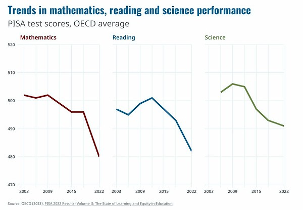

*Kontrollpanel, kommandobrikker, robot og tegningen roboten laget da den kjørte programmet.*

## Hvorfor det trengs

Barn blir tidlig interessert i videospill og elektroniske enheter og lærer raskt å bruke dem.

Foreldre vet at informasjonsteknologi er viktig for barnets utvikling. Samtidig vil de holde en balanse mellom læring og helse.

Forskning viser at tidlig og hyppig interaksjon med skjermer kan redusere kognitive evner og faglige prestasjoner.

*Kilde: Programme for International Student Assessment (PISA), [2022 Results (Volume I)](https://www.oecd-ilibrary.org/education/pisa-2022-results-volume-i_53f23881-en)*

Når små barn bruker skjermer mye, fører det ofte til disse følgene:
- psykologiske vansker,
- spillavhengighet,
- forverring av syn og fysisk helse.

## Mål og oppgaver

Med PrimaSTEM lærer barn fra 4 år programmering, logikk og matematikk **uten skjermer**.

Dette lærer barnet med PrimaSTEM:
- tall,
- romlig orientering,
- algoritmer,
- logisk tenkning,
- grunnleggende programmering,
- aritmetiske operasjoner og progresjoner,
- geometriske begreper.

Hvorfor PrimaSTEM er praktisk:
- det passer til ulike fag og oppgaver,
- timene er interessante og visuelle,
- læringen skjer uten skjermer,
- det passer for førskolebarn og barn i tidlig skolealder,
- det er laget av naturlige materialer.

> 🎯 **Hovedmål.** Barnet utvikler kognitive ferdigheter: det tar på og ser hvordan et program er bygget opp, og forstår hva resultatet av programmet betyr.

## Slik fungerer det

1. Slå på roboten og kontrollpanelet.
2. Legg kommandobrikkene i cellene på kontrollpanelet. Brikkene danner et bevegelsesprogram.
3. Trykk på knappen **▶ Start**, så utfører roboten programmet.

---
**Videopresentasjon:** [youtu.be/Ztq_I1WBiVo](https://youtu.be/Ztq_I1WBiVo)

  <iframe
    src="https://www.youtube.com/embed/Ztq_I1WBiVo?si=a54tevy8tUEQMOva"
    style={{
      position: 'absolute',
      top: 0,
      left: 0,
      width: '100%',
      height: '100%',
    }}
    frameBorder="0"
    allow="accelerometer; autoplay; clipboard-write; encrypted-media; gyroscope; picture-in-picture"
    allowFullScreen
  />

> 📺 Flere instruksjoner og eksempler ligger på kanalen vår [YouTube PrimaSTEM](https://www.youtube.com/@primastem).

## Hvem det passer for

PrimaSTEM er laget for barn og ser ut som et spill. Pedagoger og foreldre kan bruke det fleksibelt. De kan undervise i matematikk, programmering, fysikk, historie og geografi med det. Det eneste som setter grenser, er lærerens eller foreldrenes fantasi og dyktighet.

Barnet får et matematisk og algoritmisk grunnlag. Det er en utmerket forberedelse til skolen og til de første programmeringsspråkene: Scratch, Logo eller Minecraft.

*Eksempel: en spiral. Roboten tegnet den mens programmet endret en variabel i en løkke for hvert steg.*
