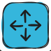

## 🧭 Bevegelse

| Kommando | Brikke | NFC-kode |
| --- | --- | --- |
| Fremover |  | `cfor` |
| Venstre |  | `clef` |
| Høyre |  | `crig` |
| Bakover |  | `cbac` |
| Tilfeldig bevegelse |  | `crnd` |

## 🔁 Gjentakelse & kontroll

| Kommando | Brikke | NFC-kode |
| --- | --- | --- |
| Gjenta 2–999 |  | `r002`–`r999` |
| Gjenta et tilfeldig antall ganger (fra 1 til 6) |  | `rrnd` |
| Funksjon |  | `cfun` |
| Pause (1–999 s; uten tall 1 s) |  | `cwat` |

## 🔢 Tall

| Verdi | NFC-kode |
| --- | --- |
| Tall 1–999 | `n001`–`n999` |

## 🧮 Matematiske operasjoner

| Operasjon | NFC-kode |
| --- | --- |
| Fra +1 til +999 | `a001`–`a999` |
| Fra −1 til −999 | `s001`–`s999` |
| ×N | `m002`–`m999` |
| ÷N | `d002`–`d999` |
| X^N | `e002`–`e999` |
| Kvadratrot av X | `sqrt` |
| Fakultet | `fact` |

Aritmetikken regner fra −5000 til 5000. Divisjon og kvadratrot rundes av til nærmeste hele tall. Hvis det ikke finnes noe svar (over 5000, deling på 0, rot av et negativt tall, fakultet over 6), blinker cellen rødt og tallet forblir som før.

## ⚙️ Innstillinger

| Kommando | NFC-kode |
| --- | --- |
| Kalibrering. Uten tall justerer roboten motorer og gyroskop, det tar ca. 2 minutter. Ikke rør roboten det første halve minuttet. Med brikken `+N` eller `−N` korrigerer roboten svingene etter testen med 32 svinger. Med et vanlig tall virker ikke brikken, cellen lyser rødt. | `ccal` |
| Standardsteg. Angir steglengden for «Fremover» og «Bakover». «Tilfeldig bevegelse» bruker samme lengde (1–999 mm). Uten tall setter brikken steget tilbake til 150 mm. | `clen` |

## 🔧 Avansert

| Kommando | NFC-kode |
| --- | --- |
| Lyd (se [Referanse for lydfiler](/no/sounds_reference)) | `xNNN` |
| Robotfrase. Legg inn `csou` og tallet N, så sier roboten frasen xN fra [lydtabellen](/no/sounds_reference#-robot-fraser-reaksjoner-og-servicemeldinger-x001–x019) | `csou` |
| Volum for kontrollpanelet og roboten (0–100, et tall over 100 gir maks) | `clvl` |

## Hvordan skrive data til en NFC-tag

Du kan lage din egen brikke: skriv en tekstkode på en NFC-tag. Du kan bruke alle tall fra 1 til 999, alle gjentakelser og alle tall for aritmetiske operasjoner.

Installer appen **RFID NFC Reader** eller **NFC Tools** fra Google Play Store på telefonen for å skrive koden.

Videoen viser hvordan du skriver en NFC-tag: [youtu.be/UbKaQxZs8JA](https://youtu.be/UbKaQxZs8JA)

  <iframe
    src="https://www.youtube.com/embed/UbKaQxZs8JA?si=WT8wWYBe_Ql7TovQ"
    style={{
    position: 'absolute',
    top: 0,
    left: 0,
    width: '100%',
    height: '100%',
  }}
    frameBorder="0"
    allow="accelerometer; autoplay; clipboard-write; encrypted-media; gyroscope; picture-in-picture"
    allowFullScreen
  />

