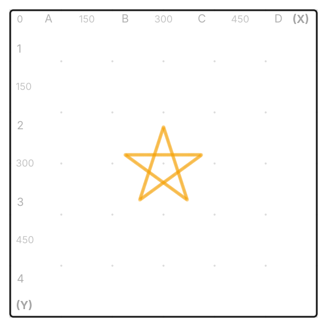

PrimaSTEM lærer barn fra 4 til 10+ år programmering, logikk og matematikk uten skjerm. Denne siden forklarer kort **hvordan enheten fungerer**.

<Note>
**Har du ikke enheten ennå? Prøv den i nettleseren.** Åpne **[nettsimulatoren](https://simulator.primastem.com)**. Det er en fungerende kopi av kontrollpanelet og roboten. Legg ut brikker, trykk på **▶ Start** og se roboten kjøre. Det kan du gjøre mens du leser denne veiledningen.
</Note>

## 1. Hva er i esken

<CardGroup cols={3}>
  <Card title="Robot" icon="bug">
    Robot i tre formet som en marihøne, på to hjul. Tusjholder på toppen. Den har høyttaler, USB-C og Bluetooth.
  </Card>
  <Card title="Kontrollpanel" icon="grid-3x3">
    Kontrollpanelet har parede celler for programmet og flerfargede indikatorer. Det har også ▶ Start/Stopp-knapp, høyttaler, USB-C og Bluetooth.
  </Card>
  <Card title="Kommandobrikker" icon="square-stack">
    Pappkvadrater med NFC-klistremerker. Én brikke gir én kommando i programmet.
  </Card>
</CardGroup>

<Tip>Når du har fått settet, oppdater fastvaren på roboten og kontrollpanelet til nyeste versjon: [slik oppdaterer du](/no/update).</Tip>

## 2. Slå på

<Steps>
  <Step title="Slå på roboten først, så kontrollpanelet" icon="power">
    Hver enhet gir en kort lyd. Det grønne strømlyset betyr at enheten er på.
  </Step>
  <Step title="Hvitt lys: tilkoblet" icon="check">
    Ledige celler på kontrollpanelet lyser **hvitt**, robotens øyne blinker **hvitt**. Du kan begynne.
  </Step>
  <Step title="Lyseblått lys: ingen tilkobling" icon="bluetooth">
    Roboten og kontrollpanelet lyser lyseblått. Hvis tilkoblingen ikke kommer, hold **▶ Start** på kontrollpanelet i **mer enn 10 sekunder**. Etter 5 sekunder kommer et signal: ikke slipp knappen. Enhetene parer seg, og roboten starter på nytt.
  </Step>
</Steps>

**Prøv dette først.** Legg en **Fremover**-brikke i første par, i en av de to cellene. Trykk **▶ Start**. Roboten kjører 15 cm fremover og stopper. *Du har skrevet ditt første program, med én kommando.*

## 3. Hvordan et program fungerer

Kontrollpanelet har **to rader med parede celler**. Legg brikker i cellene som lyser hvitt, så er programmet klart. Trykk **▶ Start**, så utfører roboten det.

<Frame caption="Skjema for kontrollpanelet. Bokstavene A–F forklares under">
  
</Frame>

| Merke | Hva det er |
| :---: | --- |
| **A** | **Hovedprogram**: 6 par celler, roboten kjører dem fra venstre til høyre |
| **B** | **▶ Start / Stopp**: første trykk starter programmet, et trykk mens roboten beveger seg stopper det |
| **C** | **Funksjon**: 5 par celler, «Funksjon»-brikken kaller dem |
| **D** | Én **celle** i et par |
| **E** | **Utførelseslinje** som kobler to celler til et par |
| **F** | **Flerfarget indikator** på hver celle |

**Et par består av to koblede celler.** Topp og bunn spiller ingen rolle. Du legger kommandoen i en av cellene i paret, og gjentakelse, tall eller regning i den andre. Hvis den andre cellen er tom, bruker kommandoen det siste tallet den har fått siden kontrollpanelet ble slått på. Så lenge ingen tall er satt, tar roboten et steg på 15 cm og svinger 90°. Det er nok for små barn.

Indikatorfarger under utførelse:

| ⚪ Hvit | 🟢 Grønn | 🔵 Blå | 🔴 Rød |
| :---: | :---: | :---: | :---: |
| Cellen er ledig | Kommando i paret | Kommando med tall, gjentakelse eller regning | Feil, paret hoppes over |

Roboten hopper over tomme celler og røde par. Indikatoren blinker ved cellen som roboten utfører akkurat nå.

## 4. Brikker etter gruppe

| Gruppe | Hva brikkene gjør |
| --- | --- |
| **Bevegelse** | Fremover, Bakover, Venstre, Høyre |
| **Gjentakelse** | To piler i sirkel, inni prikker fra 2 til 6 (som på en terning, for de små) eller tall. I par med en kommando gjentar de den. |
| **Tall** | Fra `1` til `999`. Bestemmer avstanden i millimeter eller dreievinkelen i grader. |
| **Regning** | `+N` `−N` `×N` `÷N` `√` `^N`. Én brikke har operasjonen og tallet. Den endrer den lagrede verdien for bevegelse eller dreining. Hvis resultatet er negativt, kjører eller svinger roboten i motsatt retning. |
| **Funksjon** | Kaller den nederste raden som underprogram. Med en gjentakelsesbrikke kjøres den nederste raden angitt antall ganger. |
| **Standardsteg** | Servicebrikke. Sammen med et tall endrer den standardsteget. For et rutenett på 10 cm legger du for eksempel tallet 100 (i millimeter). Steget bevares etter avslåing. |

## 5. Standardverdier og lagret verdi

<Note>
**Fremover kjører 150 mm (15 cm), en sving er 90°.** «**Standardsteg**»-brikken endrer standardavstanden og bevarer den etter avslåing. Slik tilpasser kontrollpanelet seg spillkart fra andre roboter.

Mens kontrollpanelet er på, holder hver bevegelseskommando på **sin egen** verdi:

- **et tall** i paret med kommandoen erstatter siste lagrede verdi eller standardverdien;
- **en regnebrikke** endrer den (`+`, `−`, `×`, `÷`, `√`, `^`);
- en **tom** celle i paret beholder siste lagrede verdi eller standardverdien.

Når kontrollpanelet slås av, nullstilles de lagrede verdiene. Standardsteget består.

**Hurtigreferanse:**

| Par på kontrollpanelet | Resultat | Hva som skjedde |
| --- | --- | --- |
| `Fremover` alene | 150 mm (15 cm) | standardverdi |
| `Fremover` og `100` | 100 mm | tallet erstattet verdien |
| `Fremover` og `+50` | 150 mm (var 100, la til 50) | regningen endret verdien |
| `Venstre` alene | 90° | standardverdi |
| `Venstre` og `45` | 45° | tallet erstattet verdien |
| `Venstre` og `−10` | 35° (var 45°, trakk fra 10°) | regningen endret verdien |
</Note>

## 6. Roboten tegner det du programmerer

Prøv disse eksemplene, så ser du hva enheten kan. Sett en tusj midt i roboten: den **tegner** mens den beveger seg.

<CardGroup cols={2}>
  <Card title="Stjerne: tall og gjentakelse">
    <Frame>
      
    </Frame>
    <Frame>
      
    </Frame>
    [Kjør i simulatoren](https://simulator.primastem.com/#top=cfun.r005&fn=cfor,crig.n144&s=l1047402&r=225-283-90&run)
  </Card>
  <Card title="Spiral: regning i en løkke">
    <Frame>
      
    </Frame>
    <Frame>
      
    </Frame>
    [Kjør i simulatoren](https://simulator.primastem.com/#top=cfor.n005,cfun.r036&fn=crig.n030,cfor.a001&s=l1047402&r=296-293-0&run)
  </Card>
</CardGroup>

Flere eksempler finner du på siden [Tegneeksempler](/no/mathdrawings).

## 7. Hvordan undervise med PrimaSTEM

<Tip>
**Innfør kommandobrikker én og én, i denne rekkefølgen:**

1. Fremover
2. Svinger
3. Gjentakelser
4. Funksjon
5. Tall
6. Regning

Gå videre til neste brikke når barnet mestrer den forrige trygt. Den fullstendige planen med 12 økter for de små, med alder, varighet og materialer, finner du i [Bok 1](/no/book-1/book-1).

**Gruppearbeid.** Vi anbefaler ett sett per **2–3 barn**.

**Spillkart.** Spillkartet til enhver annen læringsrobot fungerer. **«Standardsteg»**-brikken med et tall bestemmer cellestørrelsen, for eksempel 100, 120, 150 eller 200 mm.

**Slik får du 10 steg i stedet for 6.** Legg **Funksjon [ ]**-brikken i siste (6.) par i øvre rad og fest den med malertape. Nå kjøres programmet som én kjede: 5 steg øverst og 5 nederst, **10 steg etter hverandre**. Det er praktisk for de små som trenger et lengre program, men ennå er for unge for funksjonsbegrepet.
</Tip>

## 8. Flere muligheter

<CardGroup cols={2}>
  <Card title="Tusj og tegning" icon="pen-line">
    Sett en tusj i roboten: den **tegner** banen sin på papir. Det blir enkle linjer, mangekanter, stjerner, spiraler og fraktaler.
  </Card>
  <Card title="Stemme" icon="volume-2">
    Kontrollpanelet sier hver brikke høyt. Stemmen fungerer **på 21 språk**, blant dem arabisk, finsk, kroatisk og litauisk. Andre språk legger vi til på forespørsel. Stemmen hjelper små barn som ennå ikke leser. Det finnes alfabetbokstaver og steder: Hus, Skole, Butikk, Skog og flere.
  </Card>
  <Card title="Lyd-NFC-klistremerker og spillkart" icon="map">
    Lim NFC-merker på spillkartet ditt og legg inn hvilken som helst tilgjengelig lyd fra telefonen. Roboten har en antenne under. Når roboten stopper på et merke, spiller den av den innspilte lyden.
  </Card>
  <Card title="Åpen NFC-plattform" icon="nfc">
    Lag dine egne brikker. Du trenger en hvilken som helst NFC-tag på 13,56 MHz (billige, selges på alle markedsplasser) og en tekstkode fra dokumentasjonen vår. Skrivingen tar 10 sekunder i den gratis appen NFC Tools på telefonen.
  </Card>
</CardGroup>

## Hva du leser videre

<CardGroup cols={2}>
  <Card title="Enhet og oppsett" icon="book-open" href="/no/usermanual">
    Tekniske spesifikasjoner, paring, kalibrering, sikkerhet.
  </Card>
  <Card title="Lærerveiledning" icon="book" href="/no/teachersguide">
    Pedagogikk, bruk i klasserommet, grunnleggende programmering gjennom lek.
  </Card>
  <Card title="Bok 1. Leksjoner" icon="graduation-cap" href="/no/book-1/book-1">
    12 ferdige leksjoner for små barn, med alder, varighet og utskriftsmateriell.
  </Card>
  <Card title="Kommandobrikker" icon="nfc" href="/no/nfc">
    Alle NFC-koder, for å lage dine egne brikker med telefonen.
  </Card>
  <Card title="Tegneeksempler" icon="pen-line" href="/no/mathdrawings">
    Geometriske figurer, fraktaler, spiraler: programmer og resultater.
  </Card>
  <Card title="Referanse for lydfiler" icon="volume-2" href="/no/sounds_reference">
    Ord (steder og begreper), alfabet, musikknoter, systemlyder. Du trenger den for å lage egne brikker og lyder.
  </Card>
</CardGroup>
