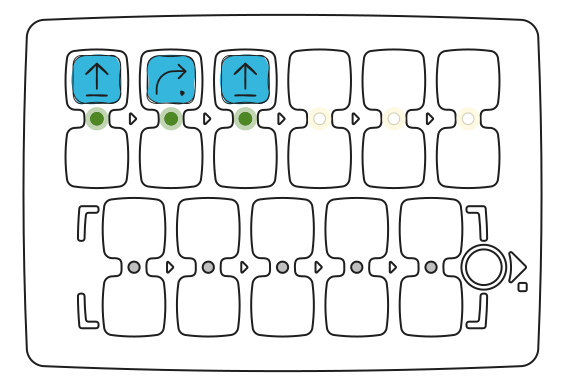
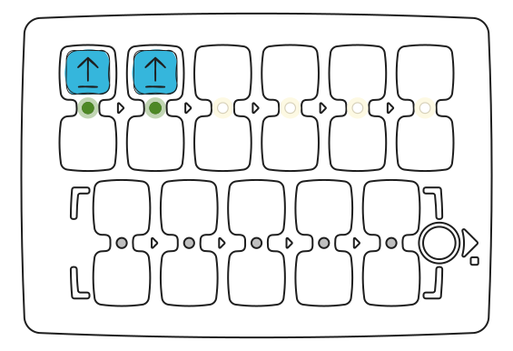
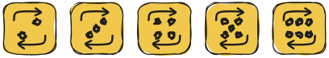

PrimaSTEM lærer barn fra 4 til 12 år å programmere uten datamaskiner, nettbrett eller telefoner. Settet utvikler logikk, programmeringsferdigheter og matematikk.

Med PrimaSTEM blir programmering enkelt og visuelt. Selv små barn forstår hva som skjer: de tar på brikkene med hendene og lærer det grunnleggende i programmering, logikk og matematikk gjennom lek.

Lek med PrimaSTEM utvikler logisk tenkning, algoritmikk, programmering, matematikk og geometri. Den utvikler også kreativitet og sosio-emosjonelle ferdigheter. Settet forbereder barnet på blokkbaserte programmeringsspråk, for eksempel [Scratch](https://en.wikipedia.org/wiki/Scratch_(programming_language)) eller [LOGO](https://en.wikipedia.org/wiki/Logo_(programming_language)).

## Bli kjent med læringssettet

### Hvor kan PrimaSTEM brukes

PrimaSTEM passer for disse aktivitetene:

- Førskoleutdanningssentre
- Barnehager med Montessori-metodikk
- Barneskole
- Hjemmeundervisning
- Spesiale utviklingssentre
- SFO-grupper
- Nybegynner programmeringsklubber
- Barnas utdanningsleirer

### Hva må du vite for å komme i gang

Før du arbeider med settet, les siden [Enhet og oppsett](/no/usermanual) og denne veiledningen. Du trenger ingen programmeringsferdigheter: materialet har alt du trenger for å begynne.

## Forskning og verdi av settet

PrimaSTEM er inspirert av programmeringsspråket [LOGO](https://en.wikipedia.org/wiki/Logo_(programming_language)), skapt av [Seymour Papert](https://en.wikipedia.org/wiki/Seymour_Papert), og av Montessori-pedagogikk. LOGO og skilpadderoboten gjorde programmering visuelt og tilgjengelig for barn.

PrimaSTEM-kommandobrikkene fører denne tilnærmingen videre. Barnet styrer roboten med hendene, uten skjerm og tekst, og forstår med en gang hva det gjør.

Barn ser på roboten, forstår hver kommando og lærer algoritmer i praksis.

Roboten har en viktig egenskap: den har en retning. Barnet setter seg lett i robotens sted og forstår derfor raskere logikken i programmet.

Alle kommandoer er enkle: de sier hvilken retning roboten skal bevege seg i. Når barn lærer roboten å "handle" og "tenke", begynner de å reflektere over egne handlinger og tanker. Derfor blir programmering lettere for dem.

PrimaSTEM-brikkene viser på en visuell og forenklet måte hvordan programmeringsspråk er bygd opp. I begynnelsen er det verken tekst eller tall, bare grunnleggende kommandoer.

### Hvorfor tre

🌱 Kontrollpanelet og roboten er laget av tre (kryssfiner). Barn liker best å leke med leker i tre. De er trygge, varer lenge, og hver av dem får sin egen historie.

## Programmering med PrimaSTEM

PrimaSTEM-brikkene fungerer som instruksjoner i ekte programmeringsspråk. De viser viktige begreper i programmering.

### Algoritmer

En **algoritme** består av presise kommandoer (brikker) som sammen utgjør et program.

### Kø

Kontrollpanelet utfører kommandoene strengt fra venstre mot høyre. Slik ser barna at kommandoene blir utført etter tur.

### Feilretting (debugging)

En feil er enkel å fikse: bytt ut brikken. Slik lærer barnet å finne og rette feil i programmet selv.

### Funksjon

En funksjon (underrutine) består av kommandoer i den nedre raden på kontrollpanelet. Hovedprogrammet kaller den med "**Funksjon**"-brikken.

### Variabel

Kontrollpanelet husker det siste tallet for hver kommando. Fremover, Bakover, Venstre, Høyre og Pause har hver sin egen verdi. En kommando uten tall bruker den lagrede verdien. Dette er en variabel: den har et navn (kommandoen) og en verdi (tallet), og verdien kan endres.

## Anvendelse i andre fag

PrimaSTEM hjelper også med å utvikle andre ferdigheter:

- Kommunikasjon. I gruppelek lærer barn å samarbeide.
- Motorikk. Arbeid med brikker forbedrer koordinasjonen.
- Sosiale ferdigheter. Barn får selvtillit og lærer å løse problemer sammen.
- Matematikk. Barn lærer grunnleggende matematiske begreper.
- Logikk. Barn lærer å bygge sekvenser og forutsi resultater.

> Barnet legger en kjede av brikker og lærer programmering med hender, øyne og hode. Det trykker på **▶ Start**, roboten kjører, og barnet sammenligner resultatet med det det ventet. En slik opplevelse gjør at barnet lærer raskere.

## Bli kjent med roboten og kontrollpanelet

### Roboten

Fortell barna at roboten er vennen deres, og at de kan programmere den. Forklar at den ikke har egne tanker. Den utfører bare instruksjonene deres, som et husholdningsapparat som må slås på.

### Kontrollpanelet

Forklar at kontrollpanelet sender kommandoer til roboten. Vis hvordan du legger ut kommandobrikker og programmerer roboten.

> Hovedprogrammet bygger du i den øvre raden på kontrollpanelet (6 par). Den nedre raden (5 par) er for underrutinen. "**Funksjon**"-kommandoen kaller den.

### Kommandobrikker

Brikkene gir kommandoer til roboten. Du legger dem på kontrollpanelet. Når du trykker på **▶ Start**, utfører roboten programmet. Hver brikke gir én kommando. Slik lærer barn algoritmisk tenkning og lærer å lage programmer. Det er viktig at barna forstår hva roboten gjør ved hver kommando. Da kan de planlegge programmet og forutsi hva roboten gjør. Forklar barna at de ikke må miste eller ødelegge brikkene: uten dem kan roboten ikke bevege seg.

## 1. Første program

### Årsak og virkning

Hovedmålet: vise barna sammenhengen mellom kommando og handling. La barnet legge "Fremover"-brikken i den første cellen på kontrollpanelet og trykke på **▶ Start**. Barnet skal se at brikken og handlingen henger sammen.

### Entydige instruksjoner

Gjenta dette med hver retning (**fremover**, sving **venstre**, sving **høyre**) til barnet kjenner igjen hver brikke.

### Første oppgave

Brett ut spillebrettet eller lag et rutenett med ruter på 15 × 15 cm med tape eller en tusj. Sett roboten på startruten. Be barnet lage et program som får roboten til å kjøre én celle fremover. Hvis barnet valgte feil brikke, sett roboten tilbake og be barnet tenke ut et annet alternativ.

## 2. Program og debugging

### Hendelseskø

Plasser et mål to celler foran roboten.

La barnet lage et program med to brikker som får roboten fram til målet.

### Sekvens av tre brikker

Nå er målet én celle fremover og én celle til høyre.

La barnet selv velge riktig rekkefølge på kommandoene.

Ikke bekymre deg hvis barnet valgte feil brikke. Sett roboten tilbake på start og be barnet tenke over valget sitt og prøve andre alternativer.

### Debugging: finne feilen

Sett målet én rute foran roboten og én rute til venstre for den.

Denne gangen lager du programmet selv og legger med vilje inn en feil sving.

Be barnet finne den feile kommandoen og forutsi hvor roboten havner. La så barnet trykke på **▶ Start** og sjekke gjetningen sin.

Når barnet har sett at programmet er feil, ved å resonnere eller ved å teste, la det bytte den feile kommandoen med den riktige. Slik debugger barnet programmet.

## 3. Program med funksjon

### "Funksjon"-kommando

Når barna kan de grunnleggende kommandoene, vis dem **Funksjon**-kommandobrikken. Den kaller et sett med kommandoer som hovedprogrammet kan gjenta.

> For å forklare hvordan dette fungerer, kan du sammenligne funksjonen med et tårn: under funksjonsbrikken ligger andre kommandoer stablet oppå hverandre. Slik ser barna at én brikke kan romme flere instruksjoner.

Vis et eksempel. Legg først to "Fremover"-brikker i de øvre cellene og kjør programmet. Roboten kjører to celler.

Legg nå de samme to "Fremover"-brikkene i funksjonen (nederste rad), og legg "Funksjon" i hovedprogrammet. Resultatet blir det samme, men nå er en del av programmet skjult i en underrutine.

Lag deretter sekvensen: **Fremover, Fremover, Høyre, Fremover, Fremover**.

Be barna finne delene som gjentar seg, og "skjule" dem i funksjonen. Resultatet skal bli slik: i hovedprogrammet **Funksjon, Høyre, Funksjon**, i nederste rad **Fremover, Fremover**.

[Kjør i simulatoren](https://simulator.primastem.com/#top=cfun,crig,cfun&fn=cfor,cfor&s=l1144602&r=225-825-0&run)

### Løse oppgaver med funksjon

Gi barnet 3 "**Fremover**"-brikker og 2 "**Funksjon**"-brikker.

Oppgaven: kjør 5 celler fremover.

La barnet forstå at denne oppgaven krever en funksjon som gjentar handlingen.

Hvis programmet er feil, sett roboten tilbake på start. Be barnet tenke over hvordan oppgaven kan løses riktig, og prøve andre alternativer.

[Kjør i simulatoren](https://simulator.primastem.com/#top=cfun,cfun,cfor&fn=cfor,cfor&s=l1144602&r=225-825-0&run)

## 4. Tilfeldighet

### "Tilfeldig bevegelse"-kommando

For å forklare tilfeldighet, ta 4 retningsbrikker: "**Fremover**", "**Venstre**", "**Høyre**" og "**Bakover**". Legg dem i en ugjennomsiktig boks eller pose og bland dem. La barna etter tur trekke én brikke uten å se, vise den til gruppen og legge den tilbake. Bruk dette eksempelet til å forklare hva et tilfeldig valg mellom fire muligheter er.

Vis deretter barna "**Tilfeldig bevegelse**"-kommandobrikken.

Forklar at denne brikken gjør nesten det samme som barna gjorde med posen. Den velger tilfeldig en retning og flytter roboten ett steg, altså én celle. Roboten kan flytte seg én celle fremover, til høyre, til venstre eller bakover.

Legg "**Tilfeldig bevegelse**"-brikken i den øvre cellen og kjør programmet flere ganger. Roboten beveger seg forskjellig hver gang.

[Kjør i simulatoren](https://simulator.primastem.com/#top=crnd&s=l1144602&r=375-525-0&run)

Lek med barna: la dem gjette hvor roboten kjører før hver start.

Understrek at dette er **tilfeldighet**, og at du ikke kan gjette retningen hver gang.

Lag et lite spill med "**Tilfeldig bevegelse**"-brikken sammen med barna.

## 5. Løkker (kommandogjentakelser)

### Bli kjent med numeriske løkker

Vis barna gjentakelsesbrikkene. Spør om de kjenner tall, om de har sett en terning og om de har spilt brettspill.

Legg to "Fremover"-brikker i de øvre cellene og kjør programmet. Roboten kjører to celler.

La nå én "Fremover" ligge, og legg "Gjenta 2"-brikken under den. Resultatet blir det samme: handlingen gjentas to ganger.

Legg ut 4 "**Fremover**"-brikker og se på resultatet. Be så barna gjenta den samme bevegelsen på 4 celler med en **gjentakelsesbrikke**.

Oppgaven kan løses på flere måter. En enkel løsning: "**Fremover**" og "Gjenta 4". En annen løsning: "**Fremover**" med "Gjenta 3" og én "**Fremover**" til.

[Kjør i simulatoren](https://simulator.primastem.com/#top=cfor.r003,cfor&s=l1144602&r=225-825-0&run)

### Gjenta en funksjon

Prøv sammen med barna å legge til en gjentakelse på "Funksjon"-kommandoen. Roboten kan for eksempel kjøre i sikksakk: i øvre rad "Funksjon" med "Gjenta 5", i nedre rad "**Fremover**", "**Høyre**", "**Fremover**", "**Venstre**".

Lag først programmet "trinn" i funksjonen: "Fremover", "Høyre", "Fremover", "Venstre". Kjør det.

Legg deretter til "Gjenta 5" på funksjonen. Funksjonen gjentas 5 ganger, og roboten kjører i trinn til høyre og oppover.

[Kjør i simulatoren](https://simulator.primastem.com/#top=cfun.r005&fn=cfor,crig,cfor,clef&s=l1144602&r=75-825-0&run)

Roboten kjører i trappetrinn diagonalt til høyre og opp og lager 5 trinn.

## 6. Tilfeldige tall

### Hva er et tilfeldig tall

Blant brikkene er "Gjenta et tilfeldig antall ganger" (med en terning). Den velger et tilfeldig tall fra 1 til 6. Lek med barna: la dem trekke gjentakelsesbrikker fra en pose.

For å forklare tilfeldige tall, ta 4 gjentakelsesbrikker: "**2**", "**3**", "**4**" og "**5**". Legg dem i en ugjennomsiktig boks eller pose og bland dem. La barna etter tur trekke én brikke uten å se, vise den, si tallet og legge den tilbake. Lek om hvem som trekker det høyeste tallet. Bruk dette eksempelet til å forklare hva et tilfeldig valg mellom fire muligheter er.

Vis deretter barna "**Gjenta et tilfeldig antall ganger**"-brikken. Forklar at den gjør nesten det samme som barna gjorde med posen. Som en terning velger den tilfeldig ett tall fra 1 til 6, og roboten gjentar handlingen så mange ganger.

Legg "**Fremover**"-brikken i den øvre cellen på kontrollpanelet, og "**Gjenta et tilfeldig antall ganger**"-brikken under den. Be barna trykke på **▶ Start**. Sett roboten tilbake på plassen sin. Gjenta flere ganger.

[Kjør i simulatoren](https://simulator.primastem.com/#top=cfor.rrnd&s=l1144702&r=225-975-0&run)

Lek: hvem sin robot kjører lengst.

Gjør barna oppmerksomme på at roboten kjører et tilfeldig antall celler, fra 1 til 6. Understrek at dette er tilfeldighet, og at du ikke kan vite på forhånd hvor langt roboten kjører.

## 7. Tall: avstander og vinkler

### Bli kjent med tall

Hvis det ikke er noe tall i den andre cellen i paret, bruker roboten standardverdiene: den kjører 15 cm fremover og svinger 90°. Tallbrikker endrer disse verdiene.

Eksempel. Legg tallet **200** til "**Fremover**"-kommandoen og se hvor langt roboten kjører. Legg tallet **180** til en sving og se hva som endrer seg.

[Kjør i simulatoren](https://simulator.primastem.com/#top=cfor.n200,crig.n180&s=l1047602&r=450-600-0&run)

> **Viktig.** Kontrollpanelet husker det siste tallet for bevegelses- og svingkommandoer. Hvis en kommando står uten nytt tall, bruker den det lagrede tallet til du slår av kontrollpanelet. Et nytt tall erstatter det lagrede. Steglengden som er satt med «Standardsteg»-brikken, ligger i minnet og blir stående etter omstart. For å få 15 cm tilbake bruker du den brikken med tallet 150. Svingen på 90° kommer tilbake av seg selv etter omstart.

Med ulike tall kjører roboten mer komplekse ruter. Du finner eksempler på siden [Tegneeksempler](/no/mathdrawings).

## 8. Aritmetikk

### Aritmetiske operasjoner

Aritmetikk endrer tallene i programmet for bevegelseskommandoer (Fremover, Bakover, Venstre, Høyre). Slik kan du styre roboten mer fleksibelt.

Når en aritmetikkbrikke ligger i paret, endrer kontrollpanelet det lagrede tallet for kommandoen og sender den nye verdien til roboten.

Eksempel:

[Kjør i simulatoren](https://simulator.primastem.com/#top=cfor.n200,crig,cfor.a100&s=l1047602&r=300-700-0&run)

"Fremover 200": roboten kjører 20 cm. "Fremover +100": roboten kjører 30 cm til. Til sammen 50 cm.

### Oppgave: en voksende spiral

Regning endrer det lagrede tallet, altså variabelen. Bygg programmet: øverste rad Fremover 30 og Funksjon × 20, nederste rad Høyre og Fremover +30. Hver gang funksjonen kalles, blir siden 3 cm lengre.

La barna først gjette: hvor lang blir den femte siden? Kjør så programmet og sjekk. Svar: 15 cm (3 + 3 + 3 + 3 + 3).

[Kjør i simulatoren](https://simulator.primastem.com/#top=cfor.n030,cfun.r020&fn=crig,cfor.a030&s=l1047602&r=450-465-0&run)

<Columns cols={2}>
  <Frame caption="Programmet på kontrollpanelet">
    
  </Frame>
  <Frame caption="Hva roboten tegner">
    
  </Frame>
</Columns>

Det samme programmet i LOGO: [PrimaSTEM og LOGO](/no/logo).

Aritmetikk i en løkke gir tallrekker.

> Hvis tallet blir negativt etter en aritmetisk operasjon, gjør roboten det motsatte: den kjører bakover i stedet for fremover og svinger til høyre i stedet for til venstre.

Du kan bruke addisjon (+), subtraksjon (−), multiplikasjon (*), divisjon (/), kvadratrot (√) og eksponentiering (^).

Du finner mønstereksempler på siden [Tegneeksempler](/no/mathdrawings).

---

## Lek og lær sammen med barna

Du kjenner elevene dine best. Med PrimaSTEM kan du undervise i programmering, logikk og andre fag gjennom lek. Alt avhenger av fantasien din.

Takk for at du valgte PrimaSTEM. [Skriv til oss](/no/contacts) om dine erfaringer og inntrykk, vi ser fram til tilbakemeldingen din.
