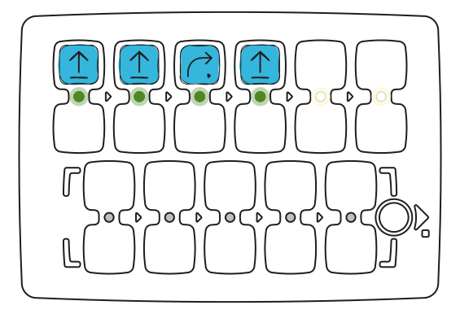

## Przewodnik prowadzenia zajęć z dziećmi od 4 lat

PrimaSTEM pomaga dzieciom krok po kroku opanować logiczne myślenie, podstawy programowania i matematykę. Ten przewodnik pomoże prowadzić zajęcia z dziećmi od 4 lat.

### Jak to działa

Dzieci programują ruchy małego robota-biedronki. W tym celu układają żetony poleceń na pilocie.

- **„Naprzód”**: robot jedzie prosto.
- **„Lewo”**: robot skręca w lewo.
- **„Prawo”**: robot skręca w prawo.
- **„Funkcja”** (żeton „\[ \]”): zastępuje ciąg poleceń.
- **„Powtórzenie”**: powtarza polecenie lub funkcję kilka razy.

Żetony układa się na pilocie i w ten sposób tworzy program ruchu robota. Gdy program jest gotowy, wystarczy nacisnąć przycisk, a robot wykona polecenia.

### Spis treści przewodnika

- Po co prowadzić zajęcia z robotyki i programowania
- Jak zorganizować zajęcia w różnych warunkach
- Ćwiczenia i cele nauczania
- Szczegółowa instrukcja obsługi
- Opis ćwiczeń
- Załączniki
- O projekcie i autorach

### Czego uczy PrimaSTEM

- Programować własnymi rękami, bez ekranu
- Rozumieć, że maszyny działają według algorytmów
- Planować działania z wyprzedzeniem
- Myśleć logicznie
- Układać ciągi poleceń i funkcje
- Rozumieć, czym jest „bug” (błąd w kodzie), i usuwać błędy
- Poznawać liczby, arytmetykę i geometrię w sposób wizualny

## Z czego składa się PrimaSTEM

### Co jest w pudełku

- Robot-biedronka
- Pilot
- Żetony poleceń \*
- Przewodnik do ćwiczeń \*

(\*) Zawartość zależy od wersji zestawu.

## Po co prowadzić zajęcia z programowania i matematyki

Kod, programowanie i automatyzacja stały się częścią naszego codziennego życia.

W ostatnich latach ludzie nauczyli się tworzyć maszyny, które robią rzeczy, jakich wcześniej nie potrafiły: rozumieć, mówić, słyszeć, widzieć, odpowiadać, pisać.

Przykładów jest wiele: samochody autonomiczne, roboty-asystenci dla osób starszych, roboty dostawcze i inne.

### Po co uczyć programowania i robotyki

Gdy dziecko uczy się programować, uczy się rozumieć maszyny, które nas otaczają. Uczy się zamieniać małe i śmiałe pomysły w prawdziwe projekty. Dzieli trudne zadanie na proste kroki. Pracuje razem z innymi i rozwiązuje wspólne problemy.

### Urodzeni w epoce cyfrowej

Może się wydawać, że dzieci i młodzież dobrze znają technologie. Przecież dużo korzystają z cyfrowej rozrywki.

Ale czy potrafią za pomocą tych narzędzi stworzyć coś własnego i się wyrazić? Co robią, gdy napotkają problem techniczny?

## Jak zorganizować zajęcia

Ćwiczenia pasują do różnych celów i środowisk edukacyjnych. W przewodniku wszystkie ćwiczenia są ponumerowane. Poniżej wskazujemy, które ćwiczenia pasują do Państwa warunków.

### Dla kogo

- Dzieci od 4 do 8 lat.
- Starsze grupy i oddziały przedszkolne, klasy 1 i 2 szkoły podstawowej.

### Ćwiczenia na zajęcia pozaszkolne

Ćwiczenia 1, 2, 4, 5, 6, 7, 8, 9, 10.

### Ćwiczenia do szkoły

Ćwiczenia 2, 3, 4, 5, 6, 7, 8, 9, 11, 12.

### Zajęcia pozaszkolne

W grupie najlepiej mieć nie więcej niż 12 dzieci, aby każde mogło aktywnie uczestniczyć.

Zalecamy, aby jedno urządzenie przypadało na 2–3 uczniów. Dzięki temu dzieci uczą się pracować w zespole i rozwijają umiejętności społeczne.

### Praca w szkole

Na lekcji z PrimaSTEM najlepiej utworzyć małe grupy po 4–6 dzieci z jednym nauczycielem. W tym czasie pozostali uczniowie wykonują inne zadanie z pomocnikiem nauczyciela. Uczniowie klas 1–2 mogą na przykład ćwiczyć rysowanie trasy robota według programu. W obu przypadkach najlepiej prowadzić zajęcia w sali wielofunkcyjnej, wprost na podłodze. Można też odsunąć stoły i krzesła, żeby zrobić miejsce.

**Uwaga.** Prosimy wcześniej naładować akumulatory pilota i robota.

## Ćwiczenia i cele nauczania

| Ćwiczenie | Algorytm i program | Trasa na etapy | Przewidywanie ruchu | Rozwiązanie problemu, usuwanie błędów | Praca zespołowa |
| --- | :---: | :---: | :---: | :---: | :---: |
| 1 |   | X |   | X |   |
| 2 |   |   | X |   | X |
| 3 | X | X |   |   |   |
| 4 | X | X | X |   |   |
| 5 | X | X | X |   | X |
| 6 | X | X | X | X | X |
| 7 | X | X | X | X | X |
| 8 | X |   | X | X |   |
| 9 | X | X | X | X | X |
| 10 | X |   | X | X |   |
| 11 | X | X | X | X | X |
| 12 | X | X | X | X | X |

## Instrukcja obsługi

### Spis treści instrukcji

- Wprowadzenie do materiałów
- Programowanie funkcji
- Mapy
- Wyjaśnienia techniczne

## Wprowadzenie do materiałów

### Robot

Mały drewniany robot-biedronka z dwojgiem oczu.

Ma trzy punkty podparcia: dwa koła i podpórkę z tyłu. Na nich utrzymuje równowagę.

### Podstawowe polecenia

| Polecenie | Ilustracja | Opis |
| --- | --- | --- |
| Naprzód |  | Robot jedzie o jedno pole. To jeden logiczny krok, domyślnie 15 cm. |
| Lewo |  | Robot skręca o 90° w lewo |
| Prawo |  | Robot skręca o 90° w prawo |
| Wstecz |  | Robot cofa się o jedno pole, czyli o jeden domyślny logiczny krok |
| Funkcja |  | Robot wykonuje polecenia z rzędu funkcji |
| Powtórzenie N |  | Robot powtarza polecenie z tej samej pary N razy |

### Pilot

Na pilocie sterujesz robotem: wkładasz żetony poleceń do wolnych gniazd (D).

Górny rząd (A) z 6 par gniazd, połączonych linią wykonania (E), to główny program. Program zaczyna się od gniazda po lewej stronie (D) i kończy nad przyciskiem **▶ Start** (B). Ten przycisk wysyła polecenia do robota i uruchamia program.

Dolny rząd (C) z 5 par gniazd określa ruchy dla żetonu „Funkcja” („\[ \]”). Każda para gniazd ma diodę LED (F). Dioda zapala się po włożeniu żetonu i miga, gdy robot wykonuje to polecenie.

#### Kolory diod LED

Gdy żeton leży w gnieździe poprawnie, dioda LED świeci na zielono.
Gdy do polecenia ruchu w parze dodasz powtórzenie, dioda LED świeci na niebiesko.
Gdy żetony leżą niepoprawnie, na przykład dwa polecenia ruchu w jednej parze, świeci czerwona dioda LED. Robot pominie to polecenie.

### Akumulator i przycisk zasilania

Robot i pilot działają na wbudowanych akumulatorach. Ładuje się je przez port USB-C. Przycisk zasilania (ON/OFF) jest na górze robota oraz z przodu pilota, po lewej stronie.

Gdy robot lub pilot się włącza, rozlega się krótki sygnał dźwiękowy.
Przy włączonym pilocie świeci zielona dioda LED z przodu. Przy włączonym robocie świeci zielona dioda LED przy złączu USB-C.

### Komunikacja bezprzewodowa

Robot i pilot są połączone przez Bluetooth, zasięg wynosi około 5 m. Po pierwszym połączeniu robota z pilotem łączność działa sama, nie trzeba jej konfigurować.

> Pilot można połączyć z innym robotem (parowanie urządzeń).
>
> 1. Włączyć robota, który nie jest jeszcze sparowany z pilotem.
> 2. Włączyć pilot.
> 3. Przytrzymać przycisk **▶ Start** na pilocie przez 10 sekund, aż rozlegnie się sygnał dźwiękowy i zaświeci się światło.

### Jak ułożyć i uruchomić program

Program („ciąg ruchów”) zaczyna się po lewej stronie pilota. Biegnie wzdłuż wygrawerowanych strzałek „\>”. To linia wykonania, która łączy pary gniazd poziomo.

Jeśli przed żetonem jest puste gniazdo, robot pominie puste gniazdo i wykona polecenie tego żetonu.

Jeśli żeton leży niepoprawnie, dioda LED świeci na czerwono, a robot pomija tę część programu. Tak się dzieje na przykład wtedy, gdy „Powtórzenie” leży w parze bez polecenia albo gdy w jednej parze leżą dwa żetony poleceń.

Gdy program jest gotowy, naciśnij przycisk **▶ Start**.

Gdy robot wykonuje program, diody LED na pilocie gasną kolejno. Dioda bieżącego polecenia miga.

## Programowanie funkcji

### Jak utworzyć funkcję

Żeton „Funkcja” („\[ \]”) zastępuje ciąg poleceń.

Dzięki niemu można układać dłuższe programy i rozwiązywać trudniejsze zadania. Aby utworzyć funkcję, włóż ruchy do dolnego rzędu pilota: to 5 par gniazd. Robot wykonuje ten rząd od lewej do prawej za każdym razem, gdy w głównym programie (na górze) trafi na żeton „Funkcja”.

W poniższym przykładzie funkcja składa się z jazdy prosto i skrętu w prawo. Program główny wywołuje funkcję 2 razy. Potem żeton „Powtórzenie 2” powtarza funkcję jeszcze 2 razy.

[Uruchom w symulatorze](https://simulator.primastem.com/#top=cfun,cfun,cfun.r002&fn=cfor,crig&s=l1144602&r=225-675-0&run)

Oto wynik:

## Mapy

### Jakie mapy się nadają

Na pierwszych zajęciach dzieci uczą się algorytmów, programowania i liczb. W tym celu robot jeździ po mapie z siatką. Najlepiej wziąć mapę z polami 15 cm: tyle robot pokonuje w jednym kroku domyślnie.

Nadają się też mapy do innych robotów, jeśli wielkość pola pasuje do tego robota.

> Domyślną długość kroku można zmienić z 15 cm na wielkość pola Państwa mapy, na przykład 10 cm, 12,5 cm lub 20 cm. W tym celu należy położyć specjalny żeton „Domyślny krok” z liczbą w milimetrach: 100 dla 10 cm, 125 dla 12,5 cm, 200 dla 20 cm.

Jeśli nie mają Państwo mapy, można zrobić ją samemu. Wystarczy przykleić taśmę malarską na płaski stół lub podłogę. Można też wziąć arkusz brystolu (albo grubą tkaninę bannerową) i marker.

Mapy w szachownicę albo puste mapy z polami służą do ćwiczenia jazdy z jednego punktu do drugiego. Kolory nie rozpraszają.

Kolorowa mapa pomaga opowiadać krótkie historie o podróżach robota. Na przykład: „Biedronka wychodzi z domu i idzie przez las w góry”. Klasa może stworzyć nową mapę i wymyślić nowe historie o podróżach biedronki.

#### Przykłady map

Mapa w szachownicę

Mapa kolorowa

## Wyjaśnienia techniczne

### Jak to jest zbudowane

W pilocie i robocie są mikrokontrolery i akumulatory Li-Ion. Urządzenia łączą się kanałem radiowym przez standardowy protokół Bluetooth.

Płytka drukowana robota odpowiada za całe jego zachowanie. Steruje dwoma silnikami prądu stałego 5 V i dwiema wielokolorowymi diodami LED, odtwarza dźwięki, komunikuje się z pilotem i tak dalej.

Płytka drukowana pilota rozpoznaje żetony w gniazdach, odtwarza dźwięki i steruje 11 wielokolorowymi diodami LED, po jednej dla każdej pary gniazd.

W każdym żetonie jest naklejka NFC z kodem polecenia. Pilot odczytuje ten kod, gdy włożysz żeton do gniazda.

Gdy pilot rozpozna żetony i uruchomisz program, pilot wysyła polecenia do robota drogą bezprzewodową.

### Własne żetony poleceń

Można zrobić dodatkowe żetony poleceń, na przykład „Powtórzenie 12” albo więcej żetonów ruchu. Potrzebne są „puste” żetony z naklejkami NFC i telefon z NFC. Działa większość typów naklejek 13,56 MHz.

Instrukcję wideo znajdą Państwo na naszym kanale YouTube: [https://www.youtube.com/@primastem](https://www.youtube.com/@primastem)

---

## Ćwiczenia

### Szczegółowy opis ćwiczeń

- **Ćwiczenie 1**: droga po szachownicy z punktu A do punktu B
- **Ćwiczenie 2**: wprowadzenie do PrimaSTEM
- **Ćwiczenie 3**: dziecko gra robota, orientacja i algorytm
- **Ćwiczenie 4**: przewidzieć trasę robota według programu
- **Ćwiczenie 5**: ciąg poleceń w losowym programie
- **Ćwiczenie 6**: zaprowadzić robota w góry za pomocą pilota
- **Ćwiczenie 7**: wprowadzenie do żetonu „Funkcja”
- **Ćwiczenie 8**: trasa do celu z funkcją
- **Ćwiczenie 9**: usuwanie błędu w programie
- **Ćwiczenie 10**: znaleźć błąd w programie na papierze
- **Ćwiczenia 11 i 12**: przewidzieć ruchy robota (w ćwiczeniu 12 z żetonem „Funkcja”)

---

## Ćwiczenie 1. Droga po szachownicy z punktu A do punktu B

- **indywidualnie**
- **15 min**
- **na papierze**
- **dokumenty do wydruku**

### Cel

- Zaplanować drogę po polach z punktu A do punktu B na mapie.

Ćwiczenie trwa 10 minut wraz z omówieniem.

### Do wydruku

Prosimy wydrukować dla każdego ucznia arkusz „[Załącznik 1. Poruszanie się po mapie](/pl/book-1/attachment-1)”.

### Ćwiczenie

Dzieci rysują na siatce drogę, którą mysz przejdzie do sera. Należy zacząć od lewego ćwiczenia, bo jest prostsze. Potem przejść do prawego.

#### Poruszanie się po polach

Mysz chodzi po polach siatki. Nie może iść po przekątnej. Dzieci mają zrozumieć, że droga myszy jest podzielona na etapy: mysz przechodzi jedno pole naraz. Mówi się, że idzie krok po kroku.

W powyższym przykładzie poprawna jest tylko niebieska droga. Krótka czerwona droga jest błędna, bo biegnie po przekątnej. Długa czerwona droga jest błędna, bo nie prowadzi do wskazanego punktu.

### Rozmowa w grupie

W powyższym przykładzie wszystkie drogi są poprawne: każdą z nich mysz dochodzi do sera.

Prosimy pokazać dzieciom, że każde mogło wymyślić własną drogę i że poprawnych dróg bywa kilka.

#### Niektóre drogi są dłuższe od innych

Policz, ile pól mysz przechodzi do pola z serem:

- 3 pola na zielonej trasie
- 3 pola na szarej trasie
- 3 pola na niebieskiej trasie
- 13 pól na żółtej trasie

#### Najkrótsza droga

Wszystkie te drogi są poprawne, ale mysz wybierze najkrótszą.

Zapytać dzieci: „Dlaczego mysz wybrała najkrótszą drogę?”

Odpowiedzi może być kilka. Mysz chce oszczędzić siły: jest bardzo zmęczona i chce iść jak najmniej. Albo mysz się spieszy: jest bardzo głodna i chce jak najszybciej dotrzeć do sera.

**Uwaga dla prowadzącego.** Z robotami jest tak samo. Zawsze wybieramy najkrótszą drogę, bo jest wydajniejsza.

#### Możliwych dróg jest kilka

Gdy ćwiczenie się skończy, warto poprosić uczniów, żeby pokazali swoje drogi. Dróg jest zawsze kilka, więc uczniowie najpewniej zaproponują różne odpowiedzi, a wszystkie będą poprawne.

---

## Ćwiczenie 2. Wprowadzenie do PrimaSTEM

- **15 min**
- **w grupie**
- **pokaz**
- **praktyka**

### Cele

- Zrozumieć, jak może poruszać się robot.
- Dowiedzieć się, że robotem steruje pilot.
- Zrozumieć, co robią żetony poleceń.

Prosimy podzielić uczniów na małe grupy. Usiąść przy niskim stole albo na podłodze. Wyjąć mapę z siatką, pilot, robota i żetony. Przedstawić PrimaSTEM wszystkim uczniom, grupa po grupie.

### Prezentacja

Prosimy pokazać każdy przedmiot na stole i nazwać słowa, których dzieci będą potrzebować.

Najpierw **mapa**. To taka sama siatka jak w ćwiczeniu 1, tylko większa.

Potem **robot-biedronka**. Umie jeździć.

Robotem steruje **pilot**. Robot robi to, co zadają żetony w gniazdach pilota.

**Żetony** zadają polecenia: jedź prosto, skręć w lewo albo w prawo.

### 1. etap: pokaz

Gdy dzieci znają już słowa, należy pokazać wszystko samemu. Włożyć żeton do pilota, a dzieci zobaczą, co się dzieje.

| Obraz | Opis |
| --- | --- |
|  | Żeton **„Naprzód”** przesuwa robota o jedno pole |

Postawić robota na dowolnym polu mapy. Włożyć żeton do pierwszego gniazda programu, jak na poniższym schemacie. Potem nacisnąć biały przycisk **▶ Start**.

Robot pojedzie o jedno pole naprzód.

### 2. etap: przekazanie sterowania

| Obraz | Opis |
| --- | --- |
|  | Żeton **„Lewo”** ze strzałką skręcającą łukiem skręca robota w lewo, przeciwnie do ruchu wskazówek zegara. Domyślnie skręt wynosi 90 stopni. |

Wyjąć z pilota żeton „Naprzód” i dać dziecku żeton „Lewo”. Niech samo włoży go do pierwszego gniazda programu i naciśnie biały przycisk **▶ Start**. Robot zostanie w miejscu i obróci się o ćwierć obrotu w lewo.

| Obraz | Opis |
| --- | --- |
|  | Żeton **„Prawo”** skręca robota w prawo. |

Poprosić inne dziecko, żeby zamieniło żeton „Lewo” na żeton „Prawo” i nacisnęło biały przycisk **▶ Start**. Robot zostanie w miejscu i obróci się o ćwierć obrotu w prawo.

Potem dzieci pracują z pilotem po kolei. Należy dać im tylko 3 żetony: **„Naprzód”**, **„Lewo”** i **„Prawo”**.

Gdy robot skończy ruch, dzieci mogą nacisnąć **▶ Start** jeszcze raz i powtórzyć swój program.

Niech dzieci same się przekonają, że żetony można układać w dowolnych gniazdach, poza dwoma poleceniami w jednej parze. Robot wykonuje je kolejno, od lewej do prawej.

> Aby zatrzymać program, naciśnij **▶ Start / Stop** jeszcze raz, gdy robot jedzie.

---

## Ćwiczenie 3. Dziecko gra robota: orientacja i algorytm

- **45 min**
- **w grupie**
- **gra**
- **mapa**

### Cele

- Uwzględnić, w którą stronę patrzy robot na początku programu.
- Przewidywać ruchy robota według programu.

### Do wydruku

Prosimy wydrukować dla każdego ucznia karty „[Załącznik 2. Karty misji](/pl/book-1/attachment-2)”.

### Zasada gry

To gra fabularna na otwartej przestrzeni. Dzieci przedstawiają robota na czarno-białym polu.

### Zasady gry

Jeden uczeń gra robota na mapie. Zamiast mapy może być podłoga ze wzorem w kwadraty: rysunek, płytki albo pola z cienkiej taśmy malarskiej. Pozostali uczniowie programują robota według kart zadań.

Dzieciom nie mówimy, w którą stronę patrzy dziecko-robot.
Same ustalają, w którą stronę robot musi patrzeć, żeby wykonać zadanie.

1. Dziecko-robot staje na czerwonym polu 1. Ma dojść do zielonego pola 2.
2. Dziecko-robot staje na czerwonym polu 1. Ma dojść do fioletowego pola 3.
3. Dziecko-robot staje na czerwonym polu 1. Ma dojść do niebieskiego pola 4.

> Aby mapa służyła dłużej, warto poprosić dziecko o zdjęcie butów.

### Koniec gry

Dziecko już rozumie: gdy programuje się ruch, trzeba brać pod uwagę, gdzie stoi robot i w którą stronę patrzy.

Robot wykonuje polecenie zależnie od tego, jak jest obrócony. Jedzie prosto, skręca w lewo albo skręca w prawo, **ale zawsze od swojego początkowego kierunku.**

---

## Ćwiczenie 4. Przewidywanie trasy robota według programu

- **45 min**
- **indywidualnie**
- **na papierze**
- **dokumenty do wydruku**

### Cele

- Uwzględnić, w którą stronę patrzy robot na początku.
- Rozumieć polecenia programu.
- Przewidywać ruchy robota według programu.

### Do wydruku

Prosimy wydrukować dla każdego ucznia karty „[Załącznik 3. Narysuj trasę według programu](/pl/book-1/attachment-3)”.

Dzieci dostają arkusz z programem z kilku poleceń. Rysują drogę, którą robot przejedzie według tego programu.

W tym programie robot pojedzie trzy razy prosto:

<Columns cols={2}>
  <Frame>
    
  </Frame>
  <Frame>
    
  </Frame>
</Columns>

[Uruchom w symulatorze](https://simulator.primastem.com/#top=cfor,cfor,cfor&s=l1144602&r=75-825-0&m=02&run)

Oto ten sam program i robot też pojedzie trzy razy prosto. Ale na początku patrzy w prawo. Dlatego pojedzie trzy pola w prawo:

<Columns cols={2}>
  <Frame>
    
  </Frame>
  <Frame>
    
  </Frame>
</Columns>

[Uruchom w symulatorze](https://simulator.primastem.com/#top=cfor,cfor,cfor&s=l1144602&r=75-825-90&m=35&run)

W tym programie robot się obraca. Najpierw skręca w prawo, a potem jedzie o dwa pola:

<Columns cols={2}>
  <Frame>
    
  </Frame>
  <Frame>
    
  </Frame>
</Columns>

[Uruchom w symulatorze](https://simulator.primastem.com/#top=crig,cfor,cfor&s=l1144602&r=75-825-0&m=25&run)

Ostatnie ćwiczenie jest trudniejsze: robot dwa razy zmienia kierunek. Jedzie o jedno pole prosto, skręca w prawo i jedzie o jedno pole. Potem skręca w lewo i jedzie o dwa pola:

<Columns cols={2}>
  <Frame>
    
  </Frame>
  <Frame>
    
  </Frame>
</Columns>

[Uruchom w symulatorze](https://simulator.primastem.com/#top=cfor,crig,cfor,clef,cfor,cfor&s=l1144602&r=75-825-0&m=12&run)

### Uwaga dla prowadzącego

To ćwiczenie na papierze może być trudne. Jeśli dziecku trudno zrozumieć obroty robota i kolejność ruchów, należy wziąć zestaw PrimaSTEM. Poprosić dziecko, żeby ułożyło na pilocie programy z arkuszy. Gdy dzieci dotykają i patrzą, rozumieją lepiej.

---

## Ćwiczenie 5. Ciąg poleceń w losowym programie

- **45 min**
- **w grupie**
- **gra**

### Cele

- Powiązać polecenia z ruchami robota.
- Zobaczyć granice mapy.
- Nauczyć się przenosić polecenia na pilot.

### Przebieg gry

1. Postawić robota na dowolnym polu mapy, najlepiej na brzegu. Kierunek wybrać dowolny.
2. Rzucić kostką. Przesunąć robota ręką i zapisać program na kartce albo na tablicy: narysować strzałkę polecenia „Naprzód”. Jeśli robot wyjedzie poza brzeg mapy, rzucić kostką jeszcze raz.
3. Powtórzyć to, aby powstały 2 programy z rzędu. Robot nie może wyjechać poza brzeg mapy, więc w razie potrzeby należy rzucić kostką ponownie.

Na końcu na kartce będą 2 programy z poleceń „Naprzód”. Jeśli wykonać je jeden po drugim, robot przejedzie wymaganą liczbę pól w stronę brzegu mapy.

Przykład:

<Columns cols={2}>
  <Frame>
    
  </Frame>
  <Frame>
    

      
      
    

  </Frame>
</Columns>

**Wykonać zapisane programy na prawdziwym PrimaSTEM.**

---

## Ćwiczenie 6. Zaprowadzić robota w góry za pomocą pilota

- **45 min**
- **w grupie**
- **praktyka**

### Cele

- Podzielić trasę na etapy.
- Ułożyć program z konkretnym celem.

Do tego ćwiczenia potrzebne będą:

- pilot;
- żetony ruchu: po 4 „Naprzód”, 4 „Lewo” i 4 „Prawo” na grupę, pozostałe żetony odłożyć na bok;
- mapa i robot.

Podzielić dzieci na grupy po 3 lub 4 osoby. Dać każdej grupie pilot i zestaw żetonów.

### 1. etap: zastanowienie

Robot-biedronka stoi w domu i chcemy go zaprowadzić w góry. Trzeba napisać na tablicy program, według którego tam dotrze.

> Jeśli nie mają Państwo odpowiedniej mapy, można narysować miejsca na papierze, może razem z dziećmi. Należy przykleić je do mapy taśmą.

Najpierw zapytać dzieci, przez które pola chcą poprowadzić robota w góry. Znów możliwości jest wiele. Wybieramy najkrótsze trasy, żeby oszczędzać energię i czas.

Gdy droga jest wybrana, omówić z dziećmi ruchy robota, pole po polu.

Czy ma jechać prosto, skręcić w lewo, czy skręcić w prawo?
Przesuwać robota po mapie ręką i pokazywać, jak porusza go każde polecenie.

### 2. etap: programowanie

Poprosić dzieci, żeby ułożyły na pilocie z żetonów ruchy robota po kolei. Ten program ma doprowadzić robota do celu.

**Oczekiwany program:**

### 3. etap: sprawdzenie

Każdy szanujący się programista sprawdza, czy program działa. Poprosić dzieci, żeby ułożyły program na pilocie i go uruchomiły.

<Columns cols={2}>
  <Frame>
    
  </Frame>
  <Frame>
    
  </Frame>
</Columns>

[Uruchom w symulatorze](https://simulator.primastem.com/#top=cfor,cfor,crig,cfor&s=l1144602&r=75-825-0&m=13&run)

Czy robot dojechał w góry? Jeśli nie, dlaczego? Pozwolić dzieciom same poprawić błędy w programie, jeśli są.

---

## Ćwiczenie 7. Wprowadzenie do żetonu „Funkcja”

- **15 min**
- **w grupie**
- **pokaz**

### Cele

- Zrozumieć, że żeton „Funkcja” może zastąpić inne polecenia.
- Poznać powtarzanie ciągu poleceń.

Prosimy podzielić uczniów na małe grupy. Usiąść przy niskim stole albo na podłodze. Wyjąć mapę, pilot, robota i żetony poleceń. Grupy po kolei poznają żeton „Funkcja”.

### 1. etap: pokaz

Pokazać dzieciom żeton „Funkcja”.

Zastępuje on kilka poleceń ruchu: „Naprzód”, „Lewo”, „Prawo” lub „Wstecz”. Dzięki niemu można kilka razy powtórzyć ten sam krótki fragment programu.

Najpierw pokazać samemu. Ułożyć program jak na poniższym obrazku.

Gdy robot trafia na żeton „Funkcja”, wykonuje polecenia z ramki \[-----\] na dole pilota. To tak, jakby w miejscu żetonu „Funkcja” leżały te polecenia.
W naszym przykładzie robot pojedzie dwa razy prosto.

### 2. etap: zagadki

Teraz dodać na końcu programu głównego żeton „Prawo”, jak na poniższym rysunku.

Przed uruchomieniem zapytać dzieci, co się stanie. Program działa tak, jakby składał się z dwóch czerwonych żetonów „Naprzód” i jednego żetonu „Prawo”. Robot pojedzie o dwa pola i skręci w prawo o ćwierć obrotu.

Na koniec pokazać **pętlę**.
Ułożyć program z czterech żetonów „Funkcja”, jak na poniższym rysunku.

[Uruchom w symulatorze](https://simulator.primastem.com/#top=cfun,cfun,cfun,cfun&fn=cfor,crig&s=l1144602&r=225-675-0&run)

Przed uruchomieniem zapytać dzieci, co się stanie. Potem uruchomić program i sprawdzić.

**Robot wykonuje pętlę:**

**Uwaga dla prowadzącego.** Gdy dzieci poznają funkcję, warto patrzeć na diody LED. Migają one podczas wykonywania programu. Dzięki temu widać, które polecenie robot wykonuje i jak się przy tym porusza.

---

## Ćwiczenie 8. Trasa do celu z funkcją

- **45 min**
- **w grupie**
- **praktyka**

### Cele

- Podzielić trasę na etapy.
- Ułożyć program z konkretnym celem.
- Użyć w programie żetonu „Funkcja”.

Do tego ćwiczenia potrzebne będą:

- żetony albo domowej roboty karty z rysunkami poleceń: po 4 „Naprzód”, 4 „Lewo”, 4 „Prawo” i 4 „Funkcja” na grupę;
- mapa i robot, bez pilota.

Jeśli dzieci jest dużo, podzielić je na grupy po 3 lub 4 osoby. Dać każdej grupie karty z rysunkami poleceń albo żetony z zestawu, dokładnie po 4 z każdego rodzaju.

### 1. etap: zastanowienie

> Jeśli mapa ma inne obrazki albo ich nie ma, należy zmienić zadanie. Trzeba oznaczyć 2 punkty (Start i Meta) w odległości 4 pól pod kątem 90 stopni.

Robot stoi przy fladze i chcemy go zaprowadzić na pole „Noc” z chmurami. Trzeba ułożyć program z żetonem „Funkcja”: położyć na stole żetony albo rysunki poleceń.

Najpierw zapytać dzieci, przez które pola chcą poprowadzić robota w góry. Góry są mniej więcej w połowie drogi. Możliwości jest wiele. Tym razem wybieramy trasy, w których polecenia się powtarzają, żeby przydał się żeton „Funkcja”.

Gdy droga jest wybrana, omówić z dziećmi ruchy robota, pole po polu. Przesuwać robota ręką i sprawdzić program.

### 2. etap: brakuje żetonów

Poprosić dzieci, żeby ułożyły na stole z kart albo żetonów ruchy robota po kolei.

Pilnować liczby żetonów w każdej grupie: 4 „Naprzód”, 4 „Lewo”, 4 „Prawo” i 4 „Funkcja”.

Ojej, brakuje żetonów! Potrzeba więcej poleceń „Naprzód”. Cyfrowa panika! :)

Przypomnieć dzieciom o żetonie „Funkcja”: zastępuje on kilka innych żetonów.

Na przykład może zastąpić kilka poleceń „Naprzód” i robot pojedzie naprzód kilka razy.

Pomóc dzieciom ułożyć program z żetonem „Funkcja”, jak na obrazku poniżej.

Przykładowa trasa i jej programy:

### 3. etap: sprawdzenie

Pomóc dzieciom ułożyć program na pilocie i go sprawdzić, jak na obrazku:

[Uruchom w symulatorze](https://simulator.primastem.com/#top=cfun,clef,cfun&fn=cfor,cfor,cfor,cfor&s=l1144602&r=825-825-0&run)

Czy robot dojechał do pola „Noc”? Jeśli nie, dlaczego?
Pozwolić dzieciom same poprawić błędy w programie, jeśli są.

---

## Ćwiczenie 9. Usuwanie błędu w programie

- **20 min**
- **w grupie**
- **praktyka**

### Cele

- Znaleźć błąd w programie, obserwując jego wykonanie.
- Poprawić błąd w programie.

Prosimy podzielić uczniów na małe grupy. Usiąść przy niskim stole albo na podłodze. Przygotować mapę z siatką, pilot, robota i żetony.
Grupy po kolei usuwają błąd w programie.

Robot ma dojechać w góry szarą drogą.

Pokazać dzieciom na pilocie program z błędem:

[Uruchom w symulatorze](https://simulator.primastem.com/#top=cfor,clef,cfor,cfor,clef,cfor&s=l1144602&r=75-825-90&run)

Według tego programu robot wjeżdża do lasu. Dzieci uruchamiają program, szukają błędu i go poprawiają.

Przykład poprawionego programu:

[Uruchom w symulatorze](https://simulator.primastem.com/#top=cfor,clef,cfor,cfor,crig,cfor&s=l1144602&r=75-825-90&run)

---

## Ćwiczenie 10. Znajdowanie błędu w programie na papierze

- **20 min**
- **indywidualnie**
- **na papierze**
- **dokumenty do wydruku**

### Cele

- Przewidzieć ruchy robota, żeby znaleźć błąd w programie.
- Zrozumieć, jak poprawić błąd w programie.

Dzieci dostają arkusz z programem, który ma doprowadzić robota z punktu A do punktu B. W programie jest błąd. Dzieci go szukają i próbują poprawić.

### Do wydruku

Prosimy wydrukować dla każdego ucznia karty „[Załącznik 4. Znajdź i popraw błąd w programie](/pl/book-1/attachment-4)”.

### 1. etap: przeczytanie programu

Najpierw poprosić dzieci, żeby narysowały drogę robota według tego programu. Na siatce na niebiesko narysowano drogę, którą robot ma przejechać, i oczekiwany punkt dojścia.

### 2. etap: wskazanie błędu

Gdy droga jest narysowana, widać, że robot nie dojeżdża do mety (czarnej flagi). Dojeżdża do czerwonej flagi.
Zapytać dzieci, w którym miejscu robot się pomylił. Trzeba znaleźć pole z błędem. W rozwiązaniu jest ono zakreślone na czerwono.

Są 3 rodzaje błędów:

- pomyliliśmy polecenie
- zapomnieliśmy o poleceniu
- dodaliśmy zbędne polecenie

### 3. etap: poprawienie błędu

Na koniec poprosić dzieci, żeby poprawiły błąd: napisały program, który doprowadzi robota do czarnej flagi.

**Uwaga.** To ćwiczenie na papierze może być trudne. Jeśli dziecku trudno zobaczyć błąd, należy wziąć PrimaSTEM. Poprosić, żeby dziecko ułożyło program z arkusza na pilocie i go uruchomiło. Dzieci mogą na przykład mówić „O nie!”, gdy robot skręci w złą stronę. Łatwiej wtedy zauważyć błąd.

#### Przykład 1

W tym przykładzie błędne jest polecenie na końcu.

<Columns cols={2}>
  <Frame>
    
  </Frame>
  <Frame>
    

      
      
    

  </Frame>
</Columns>

#### Przykład 2

W tym przykładzie na początku jest zbędne polecenie.

<Columns cols={2}>
  <Frame>
    
  </Frame>
  <Frame>
    

      
      
    

  </Frame>
</Columns>

#### Przykład 3

W tym przykładzie na początku brakuje polecenia.

<Columns cols={2}>
  <Frame>
    
  </Frame>
  <Frame>
    

      
      
    

  </Frame>
</Columns>

---

## Ćwiczenie 11. Przewidywanie ruchów robota

- **45 min**
- **w grupie**
- **praktyka**

### Cele

- Przewidzieć ruchy robota według programu bez funkcji.

Prosimy wziąć zestaw PrimaSTEM bez żetonów „Funkcja”. Gra cała grupa naraz, ale z pilotem pracuje tylko jedno dziecko.

### 1. Programujemy w ciszy

Dzieci po kolei stawiają robota w rogu mapy i układają na pilocie program z najwyżej 5 poleceń.

Gdy program jest gotowy, należy poprosić dziecko, żeby poczekało i jeszcze nie naciskało przycisku.

### 2. Zakłady

Poprosić pozostałe dzieci, żeby zgadły, czy robot wyjedzie poza brzeg mapy.

### 3. Sprawdzenie

Gdy wszyscy obstawią, uruchomić program i zobaczyć, co się stanie.
Potem znów postawić robota w rogu, a kolejne dziecko układa swój program.

---

## Ćwiczenie 12. Przewidywanie ruchów robota z funkcją

### Cele

- Przewidzieć ruchy robota według programu z funkcją.

Prosimy powtórzyć ćwiczenie 11, ale dodać do zestawu żetony „Funkcja”.

Wtedy dzieci programują też funkcję. Gra cała grupa naraz, ale z pilotem pracuje tylko jedno dziecko.

---

## O projekcie i autorach

### Kim jesteśmy

Firma PrimaSTEM stworzyła i produkuje urządzenie o tej samej nazwie. Dzięki niemu dzieci od 4 lat uczą się programowania i matematyki bez ekranu. Mieścimy się na południu Francji.

Nasze materiały są otwarte. Pomagają rozwijać kreatywność dzieci i dorosłych, którzy z nimi pracują.

Więcej o urządzeniu PrimaSTEM znajdą Państwo w serwisie z dokumentacją w 13 językach: [https://docs.primastem.com](https://docs.primastem.com)

### Kontakt

Prosimy pisać do nas: [info@primastem.com](mailto:info@primastem.com)

Nasza strona z informacjami i linkami do mediów społecznościowych: [https://primastem.com](https://primastem.com)

### Autorzy

**Adaptacja, tekst, ilustracje:** Andrei Chanov, 2026.

**Autorki koncepcji:** Julie Borgeot / Dorie Bruyas z Fréquence écoles

#### Licencja tego przewodnika

Ta praca jest udostępniana na licencji CC BY-SA 4.0. Aby zobaczyć kopię tej licencji, prosimy odwiedzić [https://creativecommons.org/licenses/by-sa/4.0/](https://creativecommons.org/licenses/by-sa/4.0/)

**Creative Commons Uznanie autorstwa, na tych samych warunkach 4.0 Międzynarodowe**

Licencja wymaga, aby osoby korzystające z utworu podawały jego twórcę. Pozwala rozpowszechniać, remiksować, adaptować i rozwijać materiał w dowolnym medium i formacie, także w celach komercyjnych. Jeśli inni remiksują, adaptują lub rozwijają materiał, muszą udostępnić zmodyfikowany materiał na identycznych warunkach.

---

## Załączniki

- [Załącznik 1. Poruszanie się po mapie](/pl/book-1/attachment-1)
- [Załącznik 2. Karty misji](/pl/book-1/attachment-2)
- [Załącznik 3. Narysuj trasę według programu](/pl/book-1/attachment-3)
- [Załącznik 4. Znajdź i popraw błąd w programie](/pl/book-1/attachment-4)
