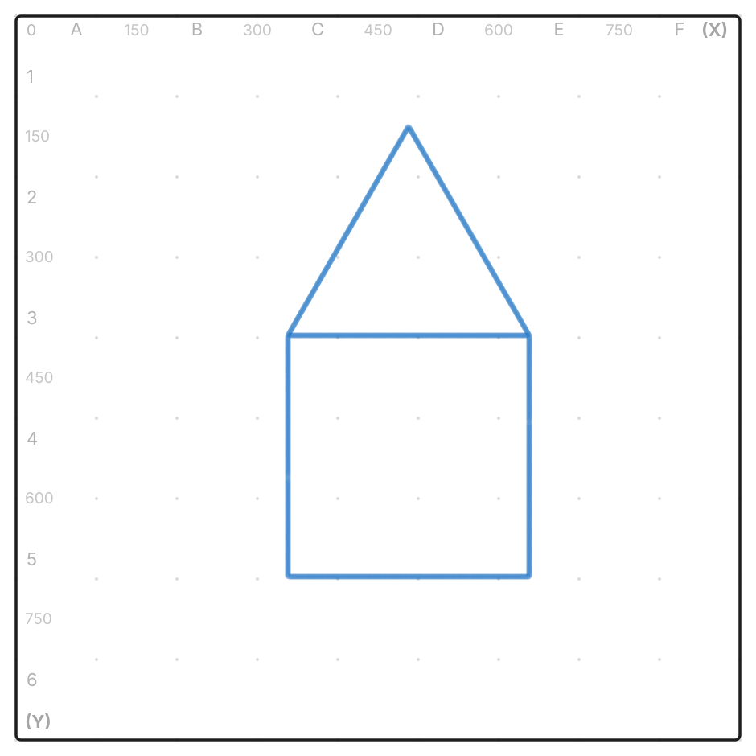
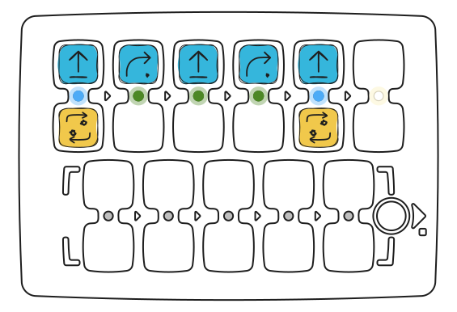

## Wprowadzenie

PrimaSTEM składa się z programowalnego robota, pilota i zestawu żetonów poleceń. Można go używać do profilaktyki i korekcji zaburzeń poznawczych u osób starszych.

### Dla kogo

- Osoby starsze z łagodnymi zaburzeniami poznawczymi
- Osoby po chorobach neurologicznych
- Pacjenci z wczesnymi stadiami chorób neurodegeneracyjnych

### Przeciwwskazania

- Poważne zaburzenia widzenia
- Znaczne zaburzenia ruchowe rąk
- Ciężka demencja
- Ostre zaburzenia psychiczne

## Pierwsze zajęcia

Trwają około 35 minut. Przed rozpoczęciem prosimy przeczytać przeciwwskazania powyżej. Jeśli nie mają Państwo jeszcze urządzenia, wszystkie kroki można wykonać w [symulatorze](https://simulator.primastem.com).

<Steps>
  <Step title="Poznanie zestawu, 10 minut">
    Pokazać robota, pilot i żetony „Naprzód”, „Prawo” i „Lewo”. Uczestnik kładzie na pilocie jeden żeton „Naprzód”, naciska **▶ Start** i patrzy, jak jedzie robot. [Szybki start](/pl/quickstart) wyjaśnia, jak działają pilot i robot.
  </Step>
  <Step title="Pierwsza trasa, 10 minut">
    Wyznaczyć cel dwa–trzy pola od robota. Uczestnik układa żetony, uruchamia program i sprawdza, czy robot dojechał. W symulatorze służy do tego [łatwy labirynt](https://simulator.primastem.com/#s=l1144402&r=75-525-0&m=2101).
  </Step>
  <Step title="Przerwa, 5 minut">
    Po 15–20 minutach pracy potrzebny jest odpoczynek.
  </Step>
  <Step title="Figura, 10 minut">
    Uczestnik układa program, według którego robot objedzie kwadrat. W symulatorze należy otworzyć [zadanie z kwadratem](https://simulator.primastem.com/#sh=square): robot ma przejechać po przerywanym konturze.
  </Step>
</Steps>

Na koniec warto zapytać, co było łatwe, a co trudne. Od odpowiedzi zależy, od czego zacząć następne zajęcia.

## Zasady ogólne

Z wiekiem i w chorobach neurodegeneracyjnych może pogarszać się pamięć. Trudniej jest myśleć abstrakcyjnie, uczyć się i tworzyć. Zajęcia z PrimaSTEM w formie gry ćwiczą różne funkcje poznawcze i pomagają spowolnić te procesy.

### Jak organizować zajęcia

- Jedne zajęcia trwają 30–45 minut.
- Zajęcia odbywają się 2–3 razy w tygodniu.
- Uczestnicy pracują pojedynczo lub w małych grupach po 2–4 osoby.
- Po każdych 15–20 minutach pracy potrzebna jest przerwa 5–10 minut.

### Jak prowadzić zajęcia

1. Zwiększaj trudność zadań stopniowo.
2. Uwzględniaj cechy i ograniczenia każdego uczestnika.
3. Twórz życzliwą atmosferę.
4. Przeplataj różne rodzaje ćwiczeń.
5. Zawsze mów uczestnikowi, co mu się udało, i chwal go.

## Co ćwiczą zajęcia

### Funkcje poznawcze

- Aktywność intelektualna
- Myślenie przestrzenne i pamięć
- Pamięć wzrokowa i słuchowo-werbalna
- Myślenie logiczne i rachunek w pamięci
- Planowanie i kontrola własnych działań
- Widzenie peryferyjne

### Kontakty i nastrój

- Zajęcia podtrzymują osobisty potencjał i aktywność społeczną.
- Uczestnik może wyrazić siebie.
- Uczestnikowi łatwiej rozmawiać z innymi.
- Zajęcia poprawiają nastrój.

## Ćwiczenia i gry

### 1. Pierwsze ćwiczenia (okres oswajania)

- Poznać żetony poleceń.
- Przeprowadzić robota po linii prostej.
- Wykonać proste skręty.
- Ułożyć krótką sekwencję poleceń.

**Materiały**

- [Szybki start](/pl/quickstart)
- [Książka 1](/pl/book-1/book-1), ćwiczenie 2

### 2. Trening myślenia przestrzennego

#### Trasa

- Znaleźć najkrótszą drogę.
- Ominąć przeszkody.
- Ułożyć trasę z losowego zestawu żetonów poleceń.
- Przejść trasę według zadanego algorytmu.
- Wybrać poprawną trasę spośród kilku.
- Zbudować trasę powrotną.

#### Poziomy trudności

1. Znaleźć punkt końcowy na podstawie zadanej trasy.
2. Wybrać poprawną trasę z listy.
3. Znaleźć punkt startowy na podstawie znanego punktu końcowego.

#### Znane pomieszczenia

- Odtworzyć znane pomieszczenie: pokoje w domu lub korytarze.
- Zaplanować trasę po pomieszczeniu.
- Przejść labirynt.

**Materiały**

- Labirynty w symulatorze: [łatwy](https://simulator.primastem.com/#s=l1144402&r=75-525-0&m=2101), [średni](https://simulator.primastem.com/#s=l1144502&r=75-675-0&m=400113232131), [trudny](https://simulator.primastem.com/#s=l1144602&r=75-825-0&m=0014243444540212223242). Robot stoi w rogu, flaga oznacza cel.
- [Załącznik 1. Poruszanie się po mapie](/pl/book-1/attachment-1)
- [Załącznik 2. Karty misji](/pl/book-1/attachment-2)
- [Książka 1](/pl/book-1/book-1), ćwiczenie 4: przewidzieć, gdzie zatrzyma się robot.
- [Załącznik 3. Narysuj trasę według programu](/pl/book-1/attachment-3)

### 3. Trening planowania

- Ułożyć algorytm codziennych czynności:
  - „Jestem w sklepie: kupuję według listy”
  - „Szykuję się do wyjścia z domu: co robię po kolei”
- Pracować z kartami z obrazkami przedmiotów i czynności.

**Materiały**

- [Załącznik 2. Karty misji](/pl/book-1/attachment-2)
- [Załącznik 4. Znajdź i popraw błąd w programie](/pl/book-1/attachment-4)

### 4. Trening pamięci przestrzennej

- Zapamiętać trasę i ją powtórzyć. Trasę można pokazać albo powiedzieć na głos.
- Użyć technik mnemotechnicznych, na przykład metody Cycerona.
- Zagrać w „Memo”: znaleźć i zapamiętać pary kart.

**Materiały**

- [Schody w symulatorze](https://simulator.primastem.com/#top=cfun.r004&fn=cfor,crig,cfor,clef&s=l1144502&r=75-675-0&run): należy obejrzeć, jak jedzie robot, zamknąć okno i ułożyć trasę na pilocie z pamięci.

### 5. Gry matematyczne

- Labirynt matematyczny: robot idzie po polach z przykładami.
- Trasa arytmetyczna: w każdym kroku dodać lub odjąć tę samą liczbę.

**Materiały**

- [Przewodnik dla nauczyciela](/pl/teachersguide), rozdział „8. Arytmetyka”.
- [Przykłady rysunków](/pl/mathdrawings), grupa „Spirale”: każdy krok rośnie o tę samą liczbę.

### 6. Gry słowne

- Znaleźć przysłowia na planszy.
- Ułożyć wyrazy z rozsypanych liter.
- Ułożyć trasę według obrazków z określonymi dźwiękami.

**Materiały**

- [Spis plików audio](/pl/sounds_reference): pilot wymawia żetony, litery i nazwy miejsc w 21 językach.

### 7. Gry z ołówkiem (rysowanie)

#### Dyktanda graficzne

- Ułożyć algorytm na podstawie rysunku.
- Dorysować symetryczną połowę.
- Znaleźć i poprawić błąd w algorytmie.
- Narysować odbicie lustrzane.
- Obrócić figurę o 90°.
- Narysować wzory i ornamenty za pomocą pętli.

**Materiały**

- Objechać figurę po konturze w symulatorze: [kwadrat](https://simulator.primastem.com/#sh=square), [trójkąt](https://simulator.primastem.com/#sh=triangle), [domek](https://simulator.primastem.com/#sh=house), [gwiazda](https://simulator.primastem.com/#sh=star).
- [Przykłady rysunków](/pl/mathdrawings): każdy program jest obok gotowego rysunku.

### 8. Gry komunikacyjne

#### Rywalizacja

- Zebrać jak najwięcej żetonów bonusowych.
- Zagrać z robotem w grę w stylu „Monopoly”.
- Zagrać w grę słowną z szukaniem liter.
- Zagrać w grę planszową „Labirynt” we dwoje.

**Materiały**

- Łamigłówki dla par i grup są niżej, w części „Łamigłówki”.

## Łamigłówki

Zadania przy stole, w parach lub małych grupach. Robota należy postawić na dużym arkuszu papieru i włożyć marker. Robot jedzie 15 cm na krok i skręca o 90°. Odpowiedź jest ukryta pod każdym zadaniem. Link do symulatora jest dla prowadzącego, żeby wcześniej sprawdzić zadanie.

### Zgadywanie rysunku

Prowadzący układa program na pilocie i nie mówi, co powstanie. Robot rysuje, a uczestnicy próbują pierwsi odgadnąć rysunek. Kto zgadnie, dostaje punkt. Więcej programów jest w [Przykłady rysunków](/pl/mathdrawings).

[Uruchom w symulatorze](https://simulator.primastem.com/#top=cfor.n300,crig.n120,cfor,crig,cfor,cfun.r003&fn=clef,cfor&s=l1047602&r=338-397-30&run)

<Columns cols={2}>
  <Frame caption="Program na pilocie">
    
  </Frame>
</Columns>

<Accordion title="Odpowiedź">
  Domek.

  <Columns cols={2}>
    <Frame caption="Co narysuje robot">
      
    </Frame>
  </Columns>
</Accordion>

### Zamiana jednego żetonu

Robot rysuje schodki. Zamienić jeden żeton tak, żeby robot narysował kwadrat.

[Uruchom w symulatorze](https://simulator.primastem.com/#top=cfun.r004&fn=cfor,crig,cfor,clef&s=l1144502&r=75-675-0&run)

<Columns cols={2}>
  <Frame caption="Program na pilocie">
    
  </Frame>
  <Frame caption="Co narysuje robot">
    
  </Frame>
</Columns>

<Accordion title="Odpowiedź">
  W dolnym rzędzie zamienić „Lewo” na „Prawo”. Robot objedzie kwadrat dwa razy.

  [Uruchom w symulatorze](https://simulator.primastem.com/#top=cfun.r004&fn=cfor,crig,cfor,crig&s=l1144502&r=75-675-0&run)

  <Columns cols={2}>
    <Frame caption="Program na pilocie">
      
    </Frame>
    <Frame caption="Co narysuje robot">
      
    </Frame>
  </Columns>
</Accordion>

### Zgadywanie programu

Prowadzący układa program tak, żeby uczestnicy nie widzieli pilota. Robot zaczyna w lewym dolnym punkcie, patrzy w górę i rysuje odwrócone U. Uczestnicy układają program, który narysuje taki sam kształt, i sprawdzają go na robocie.

<Columns cols={2}>
  <Frame caption="Co narysuje robot">
    
  </Frame>
</Columns>

<Accordion title="Odpowiedź">
  „Naprzód” ×2, „Prawo”, „Naprzód”, „Prawo”, „Naprzód” ×2. Dobry jest każdy program, który daje taki sam rysunek.

  [Uruchom w symulatorze](https://simulator.primastem.com/#top=cfor.r002,crig,cfor,crig,cfor.r002&s=l1144402&r=225-525-0&run)

  <Columns cols={2}>
    <Frame caption="Program na pilocie">
      
    </Frame>
  </Columns>
</Accordion>

### To samo

Oto dwa programy. Czy robot narysuje według nich to samo? Najpierw uczestnicy się spierają, potem sprawdzają: uruchamiają oba programy z tego samego miejsca.

<Columns cols={2}>
  <Frame caption="Program 1">
    
  </Frame>
  <Frame caption="Program 2">
    
  </Frame>
</Columns>

<Accordion title="Odpowiedź">
  Tak. Trzy skręty „Prawo” ustawiają robota tak samo jak jeden skręt „Lewo”.

  [Uruchom w symulatorze: Program 1](https://simulator.primastem.com/#top=cfor.r002,crig.r003,cfor&s=l1144402&r=375-525-0&run) · [Uruchom w symulatorze: Program 2](https://simulator.primastem.com/#top=cfor.r002,clef,cfor&s=l1144402&r=375-525-0&run)

  <Columns cols={2}>
    <Frame caption="Co narysuje robot">
      
    </Frame>
  </Columns>
</Accordion>

### Do domu

Zaznaczyć ołówkiem punkt startu. Robot odjechał od niego według tego programu. Ułożyć program, który zawróci go na start.

[Uruchom w symulatorze](https://simulator.primastem.com/#top=cfor.r002,crig,cfor&s=l1144402&r=75-525-0&run)

<Columns cols={2}>
  <Frame caption="Program na pilocie">
    
  </Frame>
  <Frame caption="Co narysuje robot">
    
  </Frame>
</Columns>

<Accordion title="Odpowiedź">
  „Prawo” ×2, „Naprzód”, „Lewo”, „Naprzód” ×2. Inne rozwiązanie: „Wstecz”, „Prawo”, „Naprzód” ×2.

  [Uruchom w symulatorze](https://simulator.primastem.com/#top=crig.r002,cfor,clef,cfor.r002&s=l1144402&r=225-225-90&m=03&run)

  <Columns cols={2}>
    <Frame caption="Program na pilocie">
      
    </Frame>
    <Frame caption="Co narysuje robot">
      
    </Frame>
  </Columns>
</Accordion>

## Jak ocenić wynik

### Co śledzić

- Regularnie sprawdzaj funkcje poznawcze testami.
- Obserwuj, jak uczestnik wykonuje zadania z zajęć na zajęcia.
- Pytaj uczestników, co im się podobało, a co nie.
- Prowadź dziennik zajęć.

### Oznaki sukcesu

- Uczestnik lepiej wykonuje zadania.
- Uczestnik radzi sobie z trudniejszymi ćwiczeniami.
- Uczestnik sam dobrze ocenia zajęcia.
- Uczestnik stosuje umiejętności w codziennym życiu.

## Jak dostosować program

### Do każdego uczestnika

- Uwzględniaj ograniczenia fizyczne.
- Dobieraj tempo zajęć.
- Zmieniaj zadania zgodnie z zainteresowaniami uczestnika.
- Ułóż dla uczestnika własny plan, jak stopniowo zwiększać trudność.

### Praca w grupie

- Twórz grupy według poziomu umiejętności.
- Dodawaj do zajęć rywalizację.
- Zachęcaj do wzajemnej pomocy.
- Twórz komfortową atmosferę do rozmów.