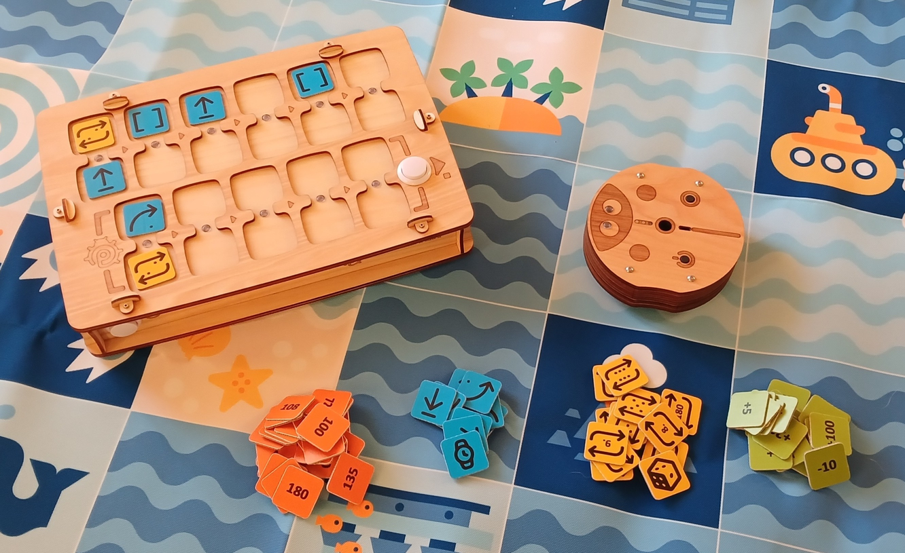
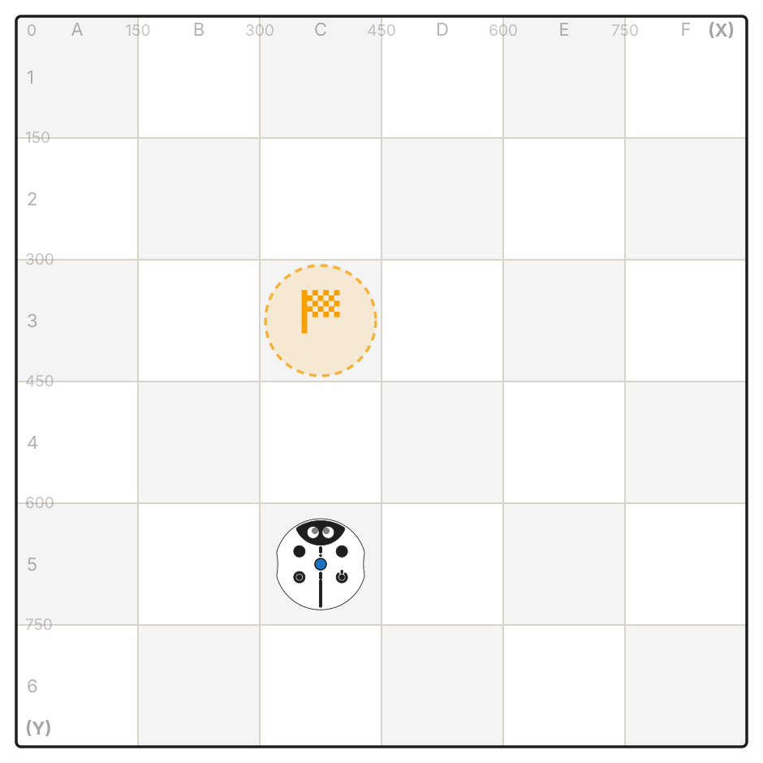
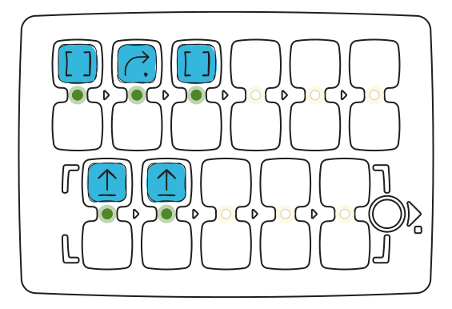
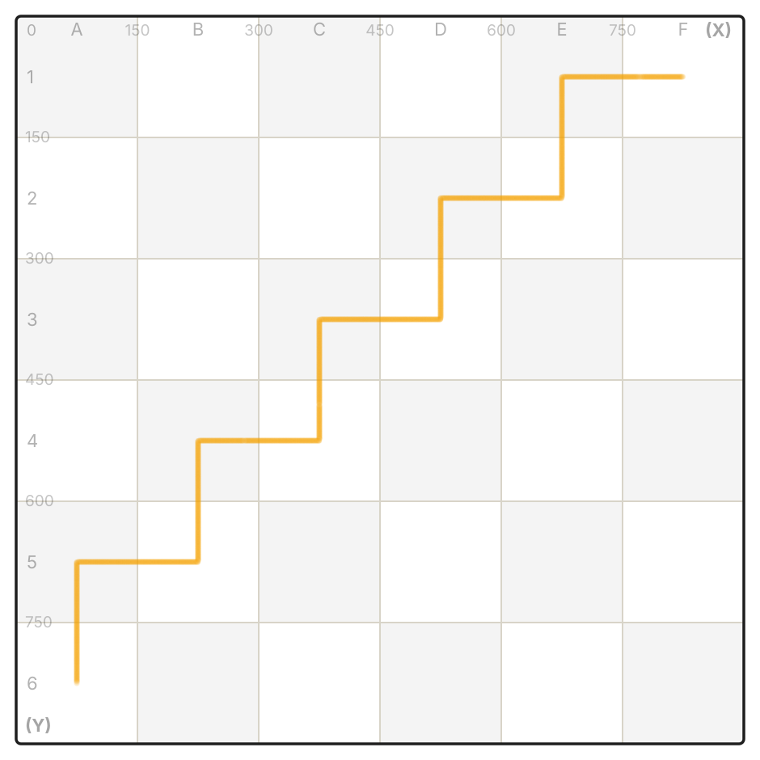
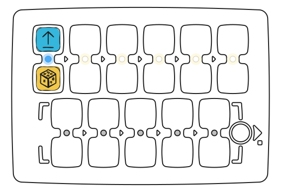

PrimaSTEM uczy dzieci w wieku od 4 do 12 lat programowania bez komputerów, tabletów i telefonów. Zestaw rozwija logikę, umiejętności programistyczne i matematykę.

Z PrimaSTEM programowanie staje się dla dzieci proste i namacalne. Nawet najmłodsze dzieci rozumieją, co się dzieje: dotykają żetonów i opanowują podstawy programowania, logiki i matematyki w zabawie.

Zabawa z PrimaSTEM rozwija myślenie logiczne, algorytmikę, programowanie, matematykę i geometrię. Rozwija też kreatywność i kompetencje społeczno-emocjonalne. Zestaw przygotowuje dziecko do blokowych języków programowania, na przykład [Scratch](https://en.wikipedia.org/wiki/Scratch_\(programming_language\)) czy [LOGO](https://en.wikipedia.org/wiki/Logo_\(programming_language\)).

## Poznajemy zestaw edukacyjny

### Gdzie można używać PrimaSTEM

PrimaSTEM sprawdza się w takich zajęciach:

- ośrodki edukacji przedszkolnej;
- przedszkola pracujące metodą Montessori;
- szkoła podstawowa;
- edukacja domowa;
- ośrodki wspierające rozwój dzieci ze specjalnymi potrzebami;
- zajęcia pozalekcyjne;
- kluby programowania dla początkujących;
- dziecięce obozy edukacyjne.

### Co trzeba wiedzieć na start

Przed pracą z zestawem prosimy przeczytać stronę [Urządzenie i konfiguracja](/pl/usermanual) i ten przewodnik. Umiejętności programistyczne nie są potrzebne: materiały zawierają wszystko, czego trzeba na start.

## Badania i wartość zestawu

PrimaSTEM czerpie z języka programowania [LOGO](https://en.wikipedia.org/wiki/Logo_\(programming_language\)), który stworzył [Seymour Papert](https://en.wikipedia.org/wiki/Seymour_Papert), oraz z pedagogiki Montessori. LOGO i robot-żółw sprawiły, że programowanie stało się dla dzieci zrozumiałe i dostępne.

Żetony poleceń PrimaSTEM kontynuują to podejście. Dziecko steruje robotem rękami, bez ekranu i tekstu, i od razu rozumie, co robi.

Dzieci obserwują robota, rozumieją każde polecenie i opanowują algorytmy w praktyce.

Robot ma ważną cechę: ma kierunek. Dziecko łatwo stawia się na miejscu robota i dlatego szybciej rozumie logikę programu.

Wszystkie polecenia są proste: mówią, w którą stronę ma jechać robot. Gdy dziecko uczy robota „działać” i „myśleć”, zastanawia się nad własnymi działaniami i myślami. Dlatego programowanie przychodzi mu łatwiej.

Żetony PrimaSTEM pokazują w prosty i obrazowy sposób, jak działają języki programowania. Na początku nauki nie ma tekstów ani liczb, są tylko podstawowe polecenia.

### Dlaczego drewno

🌱 Pilot i robot są zrobione z drewna (sklejki). Dzieci wolą bawić się drewnianymi zabawkami. Są bezpieczne, służą długo, a każda ma swoją historię.

## Programowanie z PrimaSTEM

Żetony PrimaSTEM działają jak instrukcje w prawdziwych językach programowania. Pokazują ważne pojęcia programowania.

### Algorytmy

**Algorytm** składa się z precyzyjnych poleceń (żetonów), które razem tworzą program.

### Kolejka

Pilot wykonuje polecenia ściśle od lewej do prawej. Dzieci widzą w ten sposób, że polecenia wykonują się po kolei.

### Poprawianie błędów (debugowanie)

Błąd łatwo naprawić: wystarczy wymienić żeton. Tak dziecko uczy się samo szukać i poprawiać błędy w programie.

### Funkcja

Funkcja (podprogram) składa się z poleceń w dolnym rzędzie pilota. Program główny wywołuje ją żetonem „**Funkcja**”.

### Zmienna

Pilot pamięta ostatnią liczbę każdego polecenia. Naprzód, Wstecz, Lewo, Prawo i Pauza przechowują każde swoją wartość. Polecenie bez liczby bierze zapamiętaną wartość. To jest zmienna: ma nazwę (polecenie) i wartość (liczbę), a wartość można zmieniać.

## Zastosowanie w innych przedmiotach

PrimaSTEM pomaga rozwijać także inne umiejętności:

- Komunikacja. W zabawie w grupie dzieci uczą się współpracy.
- Motoryka. Praca z żetonami poprawia koordynację.
- Umiejętności społeczne. Dzieci uczą się pewności siebie i wspólnego rozwiązywania problemów.
- Matematyka. Dzieci poznają podstawowe pojęcia matematyczne.
- Logika. Dzieci uczą się układać ciągi i przewidywać wynik.

> Dziecko układa łańcuch żetonów i opanowuje programowanie dotykiem, wzrokiem i myślą. Naciska **▶ Start**, robot jedzie, a dziecko porównuje wynik ze swoim przewidywaniem. Takie doświadczenie przyspiesza naukę.

## Poznajemy robota i pilota

### Robot

Prosimy powiedzieć dzieciom, że robot jest ich przyjacielem i mogą go programować. Prosimy wyjaśnić, że robot nie ma własnych myśli. Wykonuje tylko ich instrukcje, jak sprzęt domowy, który trzeba włączyć.

### Pilot

Prosimy wyjaśnić, że pilot przekazuje polecenia robotowi. Prosimy pokazać, jak układać żetony poleceń i programować robota.

> Program główny układa się w górnym rzędzie pilota (6 par). Dolny rząd (5 par) jest na podprogram, który wywołuje polecenie „**Funkcja**”.

### Żetony poleceń

Żetony to polecenia dla robota, które kładzie się na pilocie. Po naciśnięciu **▶ Start** robot wykonuje program. Każdy żeton to jedno polecenie. Tak dzieci uczą się myślenia obliczeniowego i układania programów. Ważne, żeby dzieci rozumiały, co zrobi robot po każdym poleceniu. Wtedy potrafią zaplanować program i przewidzieć działania robota. Prosimy powiedzieć dzieciom, że żetonów nie wolno gubić ani niszczyć: bez nich robot nie ruszy.

## 1. Pierwszy program

### Przyczyna i skutek

Główny cel: pokazać dzieciom związek między poleceniem a działaniem. Niech dziecko położy żeton „Naprzód” w pierwszym polu pilota i naciśnie **▶ Start**. Dziecko powinno zobaczyć, że żeton i działanie są ze sobą związane.

### Jednoznaczne instrukcje

Prosimy powtórzyć to dla każdego kierunku (**naprzód**, skręt w **lewo**, skręt w **prawo**), aż dziecko będzie rozpoznawać każdy żeton.

### Pierwsze zadanie

Prosimy rozłożyć planszę do gry albo zrobić siatkę z polami 15 × 15 cm z taśmy lub markerem. Postawić robota na polu startowym. Poprosić dziecko, żeby ułożyło program, po którym robot przejedzie jedno pole naprzód. Jeśli dziecko wybrało zły żeton, cofnąć robota i zachęcić je do zastanowienia się nad innym rozwiązaniem.

## 2. Program i debugowanie

### Kolejka zdarzeń

Cel należy postawić dwa pola przed robotem.

Niech dziecko ułoży program z dwóch żetonów, który doprowadzi robota do celu.

### Ciąg trzech żetonów

Tym razem cel leży jedno pole naprzód i jedno pole w prawo.

Niech dziecko samo wybierze właściwą kolejność poleceń.

Nie ma powodu się martwić, jeśli dziecko wybrało zły żeton. Wystarczy ustawić robota z powrotem na starcie i poprosić dziecko, żeby zastanowiło się nad swoim wyborem i spróbowało innych rozwiązań.

### Debugowanie: szukanie błędu

Cel należy postawić jedno pole przed robotem i jedno pole na lewo od niego.

Tym razem program układają Państwo sami i celowo wstawiają do niego błędny skręt.

Poprosić dziecko, żeby znalazło błędne polecenie i przewidziało, dokąd dojedzie robot. Potem niech dziecko naciśnie **▶ Start** i sprawdzi swoją hipotezę.

Gdy dziecko upewni się, rozumowaniem albo sprawdzeniem, że program jest błędny, niech zamieni błędne polecenie na właściwe. Tak dziecko debuguje program.

## 3. Program z funkcją

### Polecenie „Funkcja”

Gdy dzieci opanują podstawowe polecenia, prosimy pokazać im żeton **Funkcja**. Wywołuje on zestaw poleceń, który program główny może powtarzać.

> Żeby wyjaśnić, jak to działa, mogą Państwo porównać funkcję do wieży: pod żetonem funkcji leżą jedno po drugim inne polecenia. Tak dzieci widzą, że w jednym żetonie mieści się kilka instrukcji.

Prosimy pokazać przykład. Najpierw położyć dwa żetony „Naprzód” w górnych polach i uruchomić program. Robot przejedzie dwa pola.

Teraz położyć te same dwa żetony „Naprzód” w funkcji (dolny rząd), a w programie głównym położyć „Funkcję”. Wynik jest ten sam, ale część programu jest teraz ukryta w podprogramie.

Następnie ułożyć ciąg: **Naprzód, Naprzód, Prawo, Naprzód, Naprzód**.

Poprosić dzieci, żeby znalazły powtarzające się części i „schowały” je w funkcji. Powinno wyjść tak: w programie głównym **Funkcja, Prawo, Funkcja**, w dolnym rzędzie **Naprzód, Naprzód**.

[Uruchom w symulatorze](https://simulator.primastem.com/#top=cfun,crig,cfun&fn=cfor,cfor&s=l1144602&r=225-825-0&run)

### Rozwiązywanie zadań z funkcją

Prosimy dać dziecku 3 żetony „**Naprzód**” i 2 żetony „**Funkcja**”.

Zadanie: przesunąć robota o 5 pól naprzód.

Niech dziecko samo zrozumie, że do tego zadania potrzebna jest funkcja, która powtarza działanie.

Jeśli program jest błędny, ustawić robota z powrotem na starcie. Poprosić dziecko, żeby zastanowiło się nad poprawnym rozwiązaniem i wypróbowało inne warianty.

[Uruchom w symulatorze](https://simulator.primastem.com/#top=cfun,cfun,cfor&fn=cfor,cfor&s=l1144602&r=225-825-0&run)

## 4. Losowość

### Polecenie „Losowy ruch”

Żeby wyjaśnić losowość, prosimy wziąć 4 żetony kierunków: „**Naprzód**”, „**Lewo**”, „**Prawo**” i „**Wstecz**”. Włożyć je do nieprzezroczystego pudełka lub worka i wymieszać. Niech dzieci po kolei wyciągają 1 żeton bez zaglądania, pokazują go grupie i odkładają z powrotem. Na tym przykładzie wyjaśnić, czym jest losowy wybór z czterech możliwości.

Następnie pokazać dzieciom żeton „**Losowy ruch**”.

Należy wyjaśnić, że ten żeton robi prawie to samo, co dzieci robiły z workiem. Losowo wybiera kierunek i przesuwa robota o jeden krok, czyli o jedno pole. Robot może przejechać 1 pole naprzód, w prawo, w lewo albo wstecz.

Położyć żeton „**Losowy ruch**” w górnym polu i uruchomić program kilka razy. Za każdym razem robot ruszy inaczej.

[Uruchom w symulatorze](https://simulator.primastem.com/#top=crnd&s=l1144602&r=375-525-0&run)

Warto pobawić się z dziećmi: niech przed każdym uruchomieniem zgadują, dokąd pojedzie robot.

Należy podkreślić, że to jest **losowość** i nie da się za każdym razem odgadnąć kierunku.

Można razem z dziećmi wymyślić małą grę z żetonem „**Losowy ruch**”.

## 5. Pętle (powtarzanie poleceń)

### Poznajemy pętle liczbowe

Pokazać dzieciom żetony powtórzeń. Zapytać, czy znają liczby, czy widziały kostkę do gry i czy grały w gry planszowe.

Położyć dwa żetony „Naprzód” w górnych polach i uruchomić program. Robot przejedzie dwa pola.

Teraz zostawić jeden „Naprzód” i położyć pod nim żeton „Powtórzenie 2”. Wynik jest ten sam: działanie powtórzy się dwa razy.

Położyć 4 żetony „**Naprzód**” i obejrzeć wynik. Potem poprosić dzieci, żeby powtórzyły ten ruch na 4 pola za pomocą żetonu **powtórzenia**.

Zadanie można rozwiązać na różne sposoby. Prosty wariant: „**Naprzód**” i „Powtórzenie 4”. Inny wariant: „**Naprzód**” z „Powtórzeniem 3” i jeszcze jeden „**Naprzód**”.

[Uruchom w symulatorze](https://simulator.primastem.com/#top=cfor.r003,cfor&s=l1144602&r=225-825-0&run)

### Powtórzenie funkcji

Prosimy spróbować z dziećmi dodać powtórzenie do polecenia „Funkcja”. Na przykład robot może jechać zygzakiem: w górnym rzędzie „Funkcja” z „Powtórzeniem 5”, w dolnym rzędzie „**Naprzód**”, „**Prawo**”, „**Naprzód**”, „**Lewo**”.

Najpierw ułożyć w funkcji program „schodek”: „Naprzód”, „Prawo”, „Naprzód”, „Lewo”. Uruchomić go.

Potem dodać do funkcji „Powtórzenie 5”. Funkcja powtórzy się 5 razy, a robot pojedzie schodkami w prawo i do góry.

[Uruchom w symulatorze](https://simulator.primastem.com/#top=cfun.r005&fn=cfor,crig,cfor,clef&s=l1144602&r=75-825-0&run)

Robot pojedzie schodkami po przekątnej w prawo i do góry i zrobi 5 stopni.

## 6. Liczby losowe

### Czym jest liczba losowa

Wśród żetonów jest „Powtórz losową liczbę razy” (z kostką). Wybiera on losową liczbę od 1 do 6. Można pobawić się z dziećmi: niech wyciągają żetony powtórzeń z worka.

Żeby wyjaśnić liczbę losową, prosimy wziąć 4 żetony powtórzeń: „**2**”, „**3**”, „**4**” i „**5**”. Włożyć je do nieprzezroczystego pudełka lub worka i wymieszać. Niech dzieci po kolei wyciągają 1 żeton bez zaglądania, pokazują go, mówią liczbę i odkładają z powrotem. Można zagrać: kto wylosuje większą liczbę. Na tym przykładzie wyjaśnić, czym jest losowy wybór z czterech możliwości.

Następnie pokazać dzieciom żeton „**Powtórz losową liczbę razy**”. Należy wyjaśnić, że robi on prawie to samo, co dzieci robiły z workiem. Jak kostka do gry, losowo wybiera jedną liczbę od 1 do 6, a robot powtarza działanie tyle razy.

Położyć żeton „**Naprzód**” w górnym polu pilota, a pod nim żeton „**Powtórz losową liczbę razy**”. Poprosić dzieci, żeby nacisnęły **▶ Start**. Ustawić robota z powrotem na miejscu. Powtórzyć kilka razy.

[Uruchom w symulatorze](https://simulator.primastem.com/#top=cfor.rrnd&s=l1144702&r=225-975-0&run)

Można zagrać: czyj robot zajedzie dalej.

Prosimy zwrócić uwagę dzieci, że robot przejeżdża losową liczbę pól, od 1 do 6. Należy podkreślić, że to jest losowość i nie da się z góry wiedzieć, jak daleko robot dojedzie.

## 7. Liczby: odległości i kąty

### Poznajemy liczby

Jeśli w drugim polu pary nie ma liczby, robot używa wartości domyślnych: jedzie 15 cm naprzód i obraca się o 90°. Te wartości zmieniają żetony liczb.

Przykład. Dodać liczbę **200** do polecenia „**Naprzód**” i zobaczyć, jak daleko pojedzie robot. Dodać liczbę **180** do obrotu i zobaczyć, co się zmieni.

[Uruchom w symulatorze](https://simulator.primastem.com/#top=cfor.n200,crig.n180&s=l1047602&r=450-600-0&run)

> **Ważne.** Pilot zapamiętuje ostatnią liczbę dla poleceń ruchu i obrotu. Jeśli polecenie stoi bez nowej liczby, bierze zapamiętaną, aż do wyłączenia pilota. Nowa liczba zastępuje zapamiętaną. Długość kroku ustawioną żetonem „Domyślny krok” pilot pamięta także po ponownym uruchomieniu. Aby wrócić do 15 cm, należy użyć żetonu „Domyślny krok” z liczbą 150. Obrót o 90° wraca sam po ponownym uruchomieniu.

Z różnymi liczbami robot pokonuje bardziej złożone trasy. Przykłady znajdą Państwo na stronie [Przykłady rysunków](/pl/mathdrawings).

## 8. Arytmetyka

### Działania arytmetyczne

Arytmetyka zmienia liczby w programie dla poleceń ruchu (Naprzód, Wstecz, Lewo, Prawo). Dzięki temu robotem można sterować bardziej elastycznie.

Gdy w parze leży żeton działania, pilot zmienia zapamiętaną liczbę polecenia i wysyła robotowi nową wartość.

Przykład:

[Uruchom w symulatorze](https://simulator.primastem.com/#top=cfor.n200,crig,cfor.a100&s=l1047602&r=300-700-0&run)

„Naprzód 200”: robot jedzie 20 cm. „Naprzód \+100”: robot jedzie jeszcze 30 cm. Razem 50 cm.

### Zadanie: rosnąca spirala

Działania arytmetyczne zmieniają zapamiętaną liczbę, czyli zmienną. Należy ułożyć program: w górnym rzędzie Naprzód 30 i Funkcja × 20, w dolnym Prawo i Naprzód +30. Przy każdym wywołaniu funkcji bok wydłuża się o 3 cm.

Poprosić dzieci, żeby najpierw przewidziały: jak długi będzie piąty bok? Potem uruchomić program i sprawdzić. Odpowiedź: 15 cm (3 + 3 + 3 + 3 + 3).

[Uruchom w symulatorze](https://simulator.primastem.com/#top=cfor.n030,cfun.r020&fn=crig,cfor.a030&s=l1047602&r=450-465-0&run)

<Columns cols={2}>
  <Frame caption="Program na pilocie">
    
  </Frame>
  <Frame caption="Co narysuje robot">
    
  </Frame>
</Columns>

Ten sam program w języku LOGO: [PrimaSTEM i LOGO](/pl/logo).

Arytmetyka w pętli daje progresje.

> Jeśli po działaniu liczba jest ujemna, robot robi odwrotny ruch: jedzie wstecz zamiast naprzód i skręca w prawo zamiast w lewo.

Dostępne są dodawanie (\+), odejmowanie (−), mnożenie (\*), dzielenie (/), pierwiastek kwadratowy (√) i potęgowanie (^).

Przykłady wzorów znajdą Państwo na stronie [Przykłady rysunków](/pl/mathdrawings).

---

## Prosimy bawić się i uczyć razem z dziećmi

Najlepiej znają Państwo swoich uczniów. Z PrimaSTEM można w zabawie uczyć programowania, logiki i innych przedmiotów. Wszystko zależy od Państwa wyobraźni.

Dziękujemy, że wybrali Państwo PrimaSTEM. [Prosimy napisać do nas](/pl/contacts) o swoich doświadczeniach i wrażeniach, czekamy na opinie.
