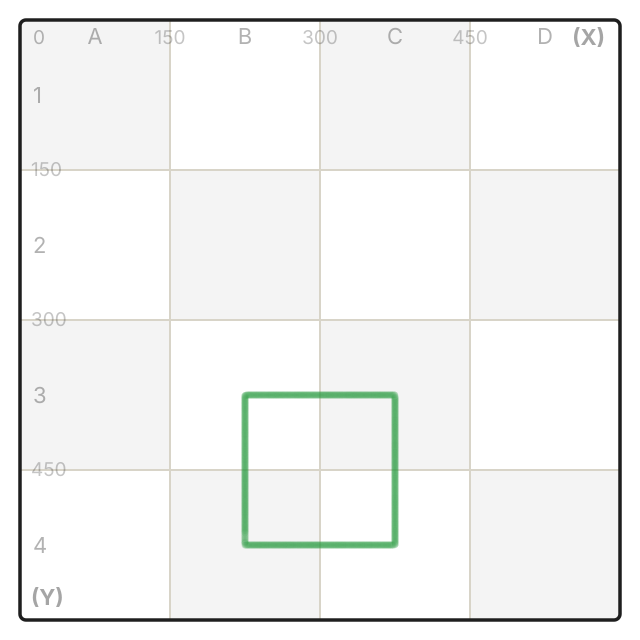

## Dane techniczne i zawartość zestawu

- Robot do zabawy
- Pilot robota
- Żetony poleceń, wartości i działań arytmetycznych, z których układa się programy

> Zawartość zestawu i wygląd mogą się nieco różnić. Prosimy sprawdzić je przy zakupie.

### Robot do zabawy

Wymiary: D=120 mm, H=44 mm.

Robot ma przycisk zasilania, diody LED, głośnik, przycisk funkcyjny i port USB-C do ładowania akumulatora.

Na środku robota można zamontować pisak o średnicy do 10 mm. Wtedy robot rysuje proste kształty podczas jazdy.

Wygląd może się nieco różnić w zależności od wersji. Funkcje pozostają takie same.

### Pilot

Wymiary: L=317 mm, W=217 mm, H=62 mm.

Pilot ma 11 par gniazd na żetony poleceń i wartości. 6 par u góry służy do programu głównego, 5 par na dole do podprogramu.

Pilot ma dwa przyciski. Lewy włącza pilota. Prawy, **▶ Start / Stop**, uruchamia i zatrzymuje program.

Należy włożyć żetony poleceń i wartości do gniazd i nacisnąć **▶ Start**. Robot wykona program. Diody LED między gniazdami pokazują, które polecenie jest wykonywane.

Jeśli żeton leży nieprawidłowo, na przykład żeton wartości bez polecenia, przy gnieździe zapala się czerwona dioda. Program działa przy tym dalej.

Pilot ma port USB-C do ładowania i głośnik.

### Żetony

Wymiary: 33 × 33 mm.

W zestawie są żetony, z których układa się programy. Każdy żeton zadaje jedno polecenie o jasnym znaczeniu. Kolejność żetonów określa, co zrobi robot.

Są trzy rodzaje żetonów: **polecenia**, **wartości** i **działania arytmetyczne**.

#### Żetony poleceń

Z tych żetonów układa się program:

- **Naprzód**: robot jedzie do przodu (domyślnie 15 cm).
- **Prawo**: robot obraca się o 90° zgodnie z ruchem wskazówek zegara.
- **Lewo**: robot obraca się o 90° przeciwnie do ruchu wskazówek zegara.
- **Wstecz**: robot jedzie do tyłu (domyślnie 15 cm).
- **Funkcja**: robot wykonuje podprogram z dolnego rzędu pilota.
- **Losowy ruch**: robot robi jeden krok naprzód lub wstecz albo obraca się o 90° w lewo lub w prawo i od razu robi krok naprzód. Długość kroku jest równa domyślnemu krokowi. Obrotu w miejscu bez kroku nie ma.
- **Pauza**: robot stoi N sekund (1–999 s; bez liczby 1 s).
- **Żetony powtórzeń (pętle)**: mają kropki od 2 do 6 albo znak powtórzenia z liczbą w środku. Żeton z kostką zadaje losową liczbę powtórzeń od 1 do 6.

> Żetony liczb i działań arytmetycznych rozszerzają program. Za ich pomocą można powtórzyć polecenie albo zmienić kąt lub odległość.

#### Żetony wartości

Są żetony kąta i odległości: 30°, 36°, 45° i ich wielokrotności (60°, 72° itd.). Kąty podaje się w stopniach, odległości w milimetrach. Domyślnie robot obraca się o 90° i jedzie 150 mm (15 cm).

#### Żetony działań arytmetycznych

Zmieniają wartości poleceń ruchu:

- Dodawanie (\+)
- Odejmowanie (−)
- Mnożenie (\*)
- Dzielenie (/)
- Pierwiastek kwadratowy (√)
- Potęga (^)
- Silnia (!)

Arytmetyka liczy w zakresie od −5000 do 5000. W tych przypadkach pole mignie na czerwono, a liczba się nie zmieni:
- wynik jest większy niż 5000 lub mniejszy niż −5000;
- dzielenie przez 0;
- pierwiastek z liczby ujemnej;
- silnia z liczby większej niż 6.

Dzielenie i pierwiastek zaokrąglają wynik do najbliższej liczby całkowitej. Na przykład 150 ÷ 4 daje 37,5, robot bierze 38. 20 ÷ 3 daje 6,67, robot bierze 7. √50 daje 7,07, robot bierze 7. Dokładną połowę zaokrągla się w stronę od zera: 37,5 do 38, −2,5 do −3.

## Łączenie pilota z robotem

Najpierw prosimy włączyć robota, potem pilota.

Przed połączeniem prosimy postawić robota na płaskiej powierzchni. Dopóki połączenia nie ma, robot i pilot świecą na błękitno. Po połączeniu diody LED zaświecą się na biało.

Aby sprawdzić połączenie, należy włożyć żeton „Naprzód” i nacisnąć **▶ Start**.

Jeśli połączenia nie ma, prosimy uruchomić oba urządzenia ponownie albo je naładować. W pobliżu silnych źródeł pola elektromagnetycznego (telefon komórkowy, punkt dostępu Wi-Fi) połączenie może na chwilę zanikać.

> **Po aktualizacji oprogramowania** może być potrzebne ponowne parowanie urządzeń. Należy włączyć robota, potem pilota. Potem nacisnąć i przytrzymać **▶ Start** na pilocie dłużej niż 10 sekund. W 5. sekundzie zabrzmi krótki sygnał: nie należy puszczać przycisku. W 10. sekundzie zacznie się parowanie.

### Sterowanie robotem przez przechylanie pilota

Gdy pilot połączy się z robotem, mogą Państwo sterować robotem bez żetonów: wystarczy przechylać pilota. Działa to, dopóki w gniazdach nie ma żetonów i nie nacisnęli Państwo jeszcze **▶ Start**.

- Najpierw należy położyć pilota płasko na sekundę. Do tego czasu robot nie reaguje na przechylenia.
- Po przechyleniu pilota od siebie robot przejedzie 15 cm do przodu. Do siebie: 15 cm do tyłu.
- Po przechyleniu w lewo lub w prawo robot obróci się o 90° w tę samą stronę.
- Przy każdym kroku pilot krótko piszczy.
- Dopóki pilot jest przechylony, robot robi krok za krokiem. Po ustawieniu pilota z powrotem poziomo robot dokończy bieżący krok i się zatrzyma.
- Przechylać należy wyraźnie, o więcej niż 20°. Przy lekkim drżeniu ręki robot nie ruszy.

Sterowanie przechylaniem wyłącza się, gdy tylko włożą Państwo żeton do gniazda albo nacisną **▶ Start**. Włącza się znowu, gdy pilot ponownie połączy się z robotem, na przykład po wyłączeniu i włączeniu robota.

## Jak to działa

Aby zaprogramować ruch, należy włożyć do gniazd pilota żetony poleceń, na przykład „Naprzód”, „Lewo”, „Funkcja”. Do poleceń można dodać liczbę powtórzeń, kąty, odległości i działania arytmetyczne.

Gniazda są połączone w pary „mostkami” ze wskaźnikami. Do jednego gniazda pary wkłada się polecenie, do drugiego wartość lub powtórzenie.

_Poniżej przykład programu z pętlą: powtarza ona ten sam fragment programu. Robot jedzie po kwadracie:_

<Columns cols={2}>
  <Frame>
    
  </Frame>
  <Frame>
    
  </Frame>
</Columns>

[Uruchom w symulatorze](https://simulator.primastem.com/#top=cfor,crig,cfun.r003&fn=cfor,crig&s=l1144402&r=225-525-0&run)

Polecenia wkłada się najpierw do górnego rzędu pilota (6 par). Robot wykonuje je od lewej do prawej. Puste gniazda i błędy robot pomija. Błąd to na przykład dwa polecenia w jednej parze albo wartość bez polecenia.

Kolejność żetonów określa, jak pojedzie robot.

Aby uruchomić program, należy nacisnąć **▶ Start**.

Domyślnie:

- „Naprzód” przejeżdża 15 cm.
- „Lewo” i „Prawo” obracają robota o 90°.
- Pętle (powtórzenia) powtarzają polecenie kilka razy.
- „Funkcja” wywołuje podprogram z dolnego rzędu pilota (5 par).
- Podprogram można wywołać kilka razy: wystarczy włożyć żeton powtórzenia do pary z „Funkcją” (przykład wyżej).

### Ważne funkcje

- Program można **zatrzymać**, naciskając ponownie **▶ Start** w trakcie ruchu.
- Pilot pamięta ostatnią **ustawioną wartość** (odległość lub kąt) każdego polecenia ruchu do wyłączenia zasilania. Na przykład jeśli „Naprzód” dostało 200, wszystkie kolejne „Naprzód” też przejadą 200 mm.
- Wartości po działaniach arytmetycznych też są zapamiętywane.
- **Domyślny krok** zmienia żeton serwisowy „Domyślny krok”. Zmienia on krok dla „Naprzód” i „Wstecz”. Na przykład dla 12,5 cm należy włożyć go z liczbą 125. Wartość zostaje po wyłączeniu zasilania. Pasują liczby od 1 do 999. Bez liczby żeton przywraca 150 mm. Z działaniem arytmetycznym albo zerem pole mignie na czerwono, a krok się nie zmieni.
- Pilot i robot **wyłączają się same**, jeśli przez 15 minut nic się nie dzieje.
- Gdy robot czeka na polecenie, mruga oczami. Widać wtedy, że jest włączony i gotowy.
- **Gdy krótko nacisną Państwo przycisk robota**, robot odczyta żeton pod sobą i powie, co to jest.
- **Wszystkie dźwięki robota** wyłączą i włączą Państwo, przytrzymując przycisk robota przez 5 sekund. Należy poczekać na krótki sygnał i puścić przycisk. Robot mignie na czerwono, jeśli dźwięk się wyłączył, i na zielono, jeśli się włączył.
- **Dźwięk pilota** wyłączą i włączą Państwo, przytrzymując **▶ Start** przez 5 sekund. Należy poczekać na krótki sygnał i puścić przycisk. Gdy program jest wykonywany, przytrzymanie nie działa.
- **Po aktualizacji oprogramowania** robot może potrzebować kalibracji ruchu.
- **Reset ustawień robota**: należy przytrzymać przycisk robota przez 10 sekund (więcej w sekcji „Kalibracja robota”).
- **Parowanie pilota z robotem** może być potrzebne po aktualizacji oprogramowania. Należy przytrzymać **▶ Start** na pilocie dłużej niż 10 sekund. Sygnał w 5. sekundzie oznacza, że trzeba trzymać dalej.

### Kalibracja robota

- Przed kalibracją prosimy zaktualizować robota i pilota do najnowszej stabilnej wersji oprogramowania na [update.primastem.com](https://update.primastem.com) ([jak zaktualizować](/pl/update)). Na starym oprogramowaniu kalibracja może wyjść niedokładna.
- Najpierw należy uruchomić żeton „Kalibracja” bez liczby. Robot sprawdzi biegunowość silników, usunie luzy i ustawi jazdę po linii prostej. Trwa to do 2 minut. Przez pierwsze pół minuty robot musi stać nieruchomo, prosimy go nie dotykać. Przycisk robota w tym czasie nie działa.
- Potem należy skalibrować kąty obrotu. Na blacie należy zaznaczyć dokładne ustawienie robota. Potrzeba 32 obrotów o 90° w prawo: należy zbudować program z żetonów „Powtórzenie 8” i „Prawo” i uruchomić go cztery razy. Robot powinien wykonać osiem pełnych obrotów (90 × 32 = 2880°) i wrócić do pierwotnego ustawienia.
- Należy ocenić odchylenie od znaku i wprowadzić poprawkę żetonem „Kalibracja” z liczbą. Jeśli robot zatrzymał się przed znakiem, należy dodać „+”, na przykład „Kalibracja” i „+5”. Jeśli przekroczył znak, należy dodać „−”, na przykład „Kalibracja” i „−5”. Potem należy nacisnąć **▶ Start**. Liczba mówi, o ile stopni robot pomylił się łącznie we wszystkich 32 obrotach. Robot przyjmuje liczby do 180. Jeśli liczba jest większa albo robot nie może zapisać poprawki, pole mignie na czerwono. Zwykła liczba bez „+” lub „−” przy „Kalibracji” nie działa: pole mignie na czerwono.
- Powtarzać, aż robot wróci dokładnie do pierwotnego ustawienia.
- Kalibracja zostaje po wyłączeniu zasilania.
- Uwaga! Reset kalibracji: należy przytrzymać przycisk robota przez 10 sekund, światła mrugną na czerwono, zielono, niebiesko i biało. Reset kasuje wszystkie kalibracje, głośność i wyłączony dźwięk. Po resecie należy wyłączyć i włączyć robota, a potem powtórzyć kalibrację od początku.

<Accordion title="Kalibracja pierwszej wersji urządzenia (MVP) z robotem o średnicy 10 cm" icon="rectangle-terminal">
  Ten sposób dotyczy tylko pierwszej wersji (MVP). W nowym oprogramowaniu „Kalibracja” ze zwykłą liczbą nie działa, pole mignie na czerwono.

  1. Aby skalibrować żyroskop, należy postawić robota na poziomej powierzchni, włożyć żeton „Kalibracja” do pilota i nacisnąć **▶ Start**.
  2. Aby skalibrować odległość, należy zmierzyć, ile robot naprawdę przejechał po poleceniu „Naprzód”. Potem należy włożyć „Kalibracja” oraz żeton z potrzebną wartością i nacisnąć **▶ Start**. Wartość można zapisać na dowolnym żetonie NFC telefonem z NFC: tekstem w postaci nXXX (na przykład n095 dla 95 mm). Potem robot będzie przejeżdżał dokładną odległość.
</Accordion>

### Programowanie żetonów NFC

Mogą Państwo zmieniać żetony albo **tworzyć własne**: polecenia, liczby lub działania arytmetyczne. Potrzebny jest telefon z NFC i aplikacja do odczytu i zapisu znaczników, na przykład „NFC Tools”. Kod zapisuje się na pustym znaczniku NFC zwykłym tekstem z 4 znaków.

## Ważne

Wszystkie ostrzeżenia dotyczące bezpieczeństwa i informacje prawne znajdą Państwo na stronie [Instrukcja obsługi](/pl/safety).

> Zestaw **nie jest przeznaczony dla dzieci poniżej 4 lat**. Zawiera drobne elementy, **można się nimi zadławić**! Używać **wyłącznie pod nadzorem dorosłych**!

W urządzeniach są akumulatory litowo-jonowe. **Należy je ładować tylko pod nadzorem dorosłych**, przez standardowy zasilacz USB 5 V i kabel USB-C.

Ładowanie pilota i robota przez 1 godzinę wystarcza na 1–2 lekcje. Pełne naładowanie (2–3 godziny) wystarcza na 3 lekcje po 30–45 minut. Z czasem pojemność akumulatorów może spadać. Można je wymienić na nowe akumulatory Li-ion 16340.

Jeśli zestaw długo leży nieużywany, należy ładować akumulatory **raz na 2–3 miesiące**. Po głębokim rozładowaniu akumulatory mogą się zepsuć i trzeba będzie je wymienić.

**Nie otwierać urządzenia** samodzielnie. Jeśli się zepsuło albo trzeba wymienić akumulatory, należy skontaktować się ze sprzedawcą lub serwisem elektroniki.

Zestaw należy przechowywać, używać i ładować w suchym pomieszczeniu w temperaturze od \+5 do \+35 °C. Należy chronić go przed bezpośrednim słońcem, cieczami, kurzem i nagłymi zmianami temperatury lub wilgotności: od nich skrapla się woda.

Urządzenie należy chronić przed wstrząsami i drganiami. Należy je przewozić i przechowywać w oryginalnym opakowaniu w temperaturze od \+5 do \+35 °C, chroniąc przed uszkodzeniami i wilgocią.

Więcej o pracy z PrimaSTEM przeczytają Państwo w [Przewodniku dla nauczyciela](/pl/teachersguide).
