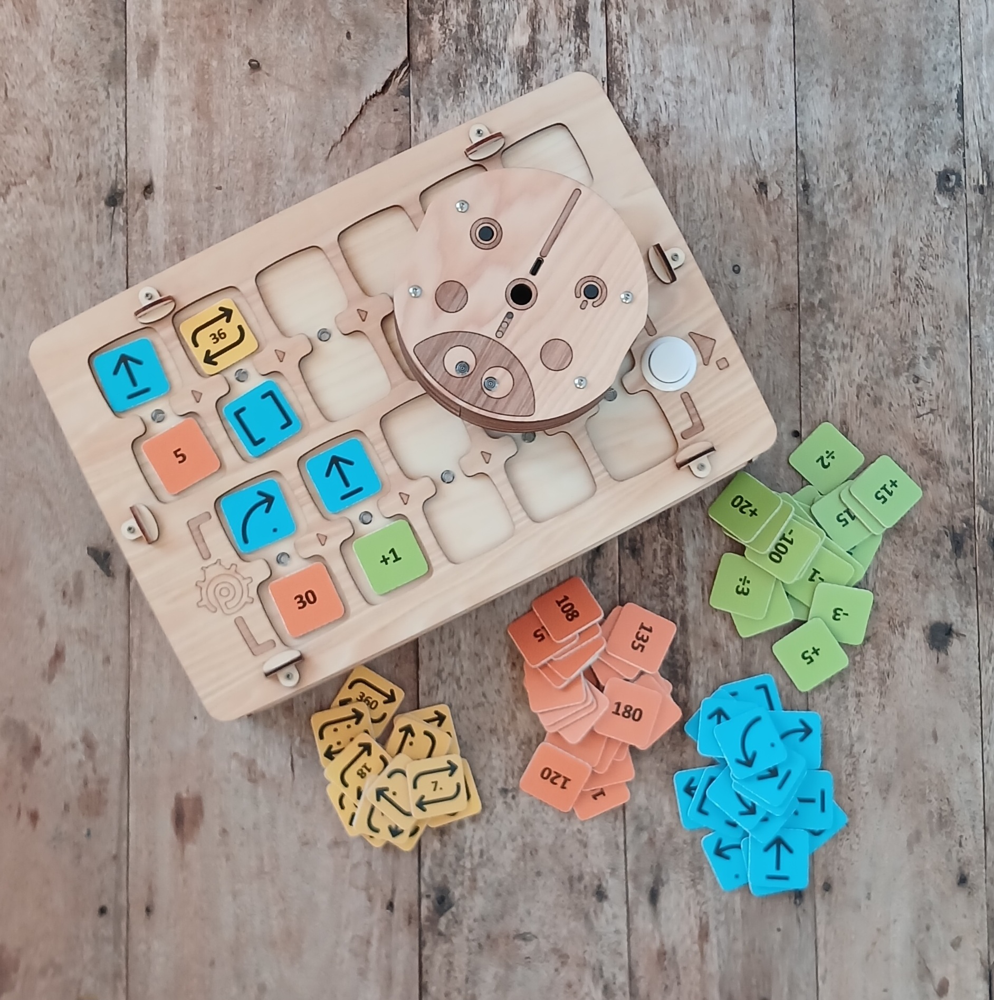
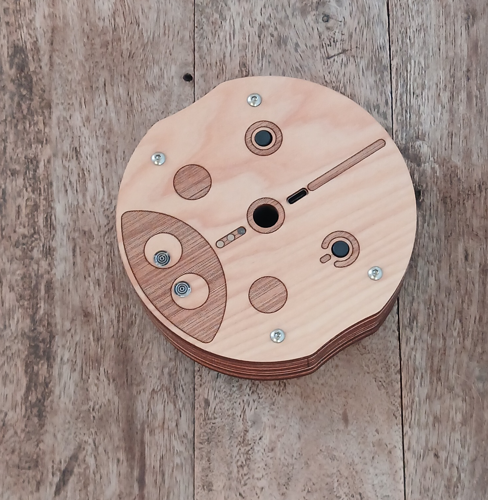
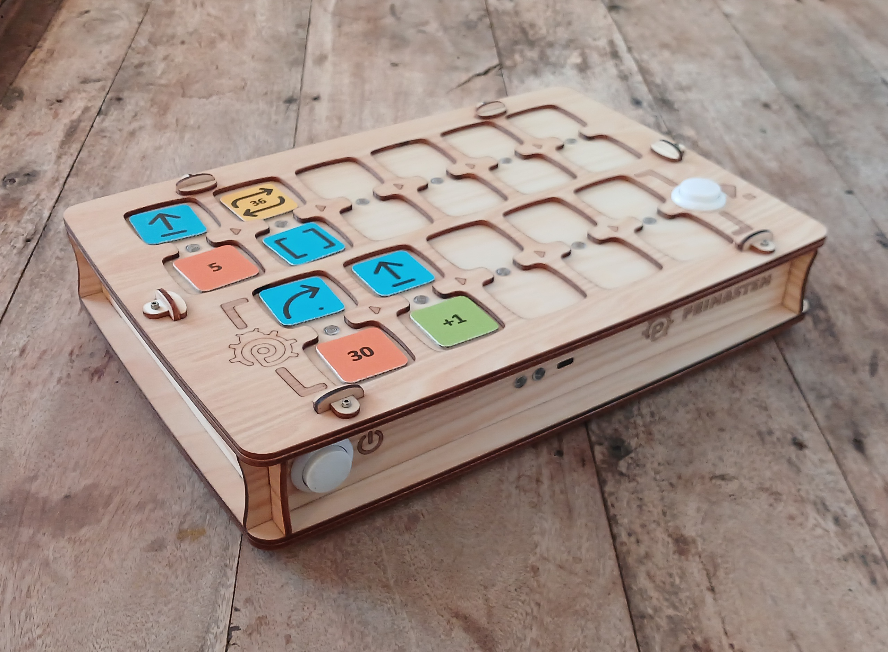
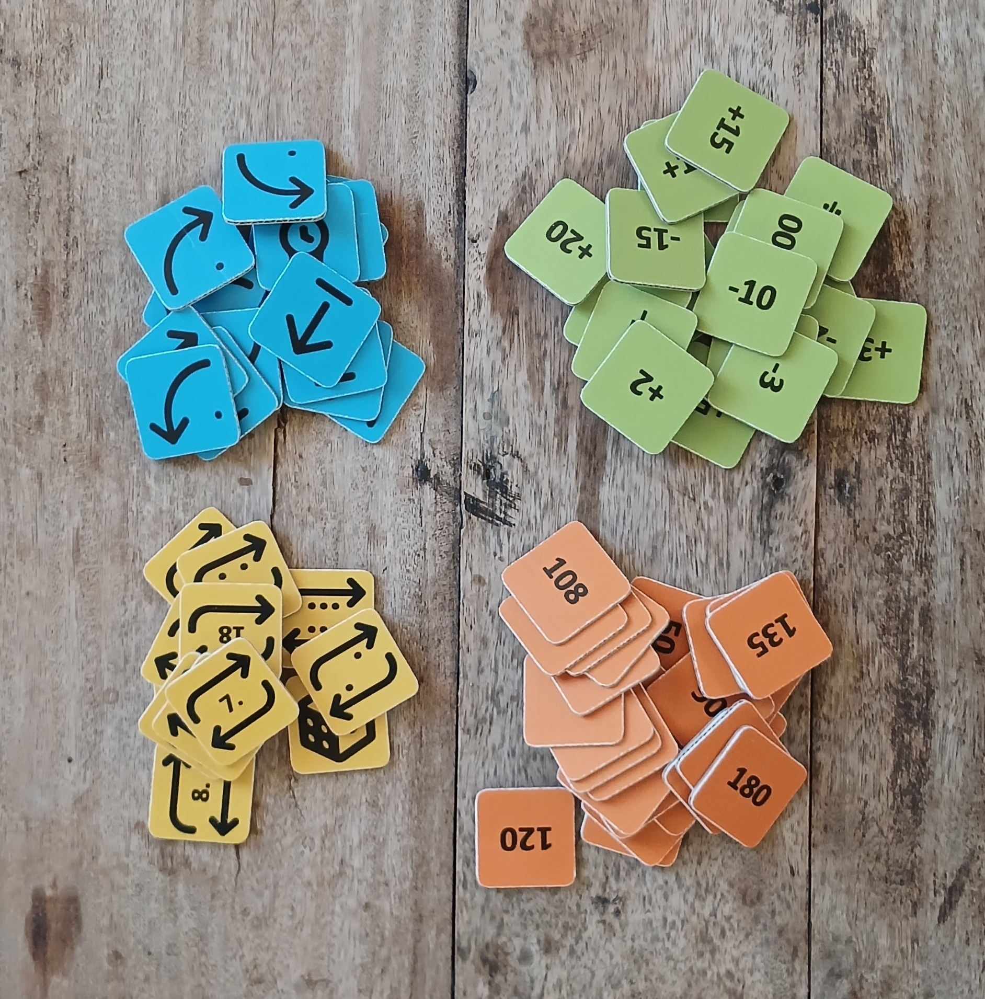
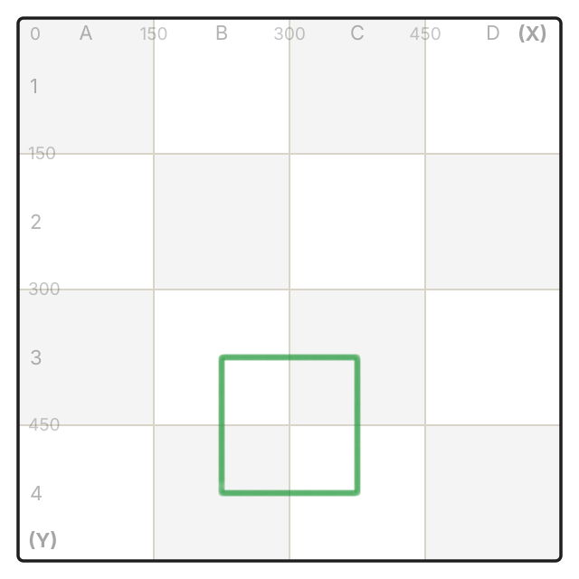
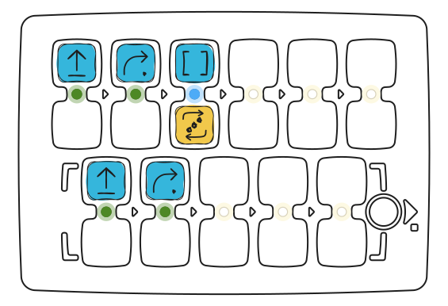

## Dane techniczne i zawartość zestawu

- Robot do zabawy
- Pilot robota
- Żetony poleceń, wartości i działań arytmetycznych do tworzenia programów

> Zawartość zestawu i wygląd mogą się nieznacznie różnić. Prosimy sprawdzić je przy zakupie.

### Robot do zabawy

Wymiary: D=125 mm, H=44 mm.

Robot ma przycisk zasilania, diody LED, głośnik, przycisk funkcyjny i port USB-C do ładowania akumulatora.

Na środku robota można zamontować pisak o średnicy do 10 mm, aby podczas jazdy rysował proste kształty.

Wygląd może się nieznacznie różnić w zależności od wersji, ale podstawowe działanie pozostaje takie samo.

### Pilot

Wymiary: L=317 mm, W=217 mm, H=62 mm.

Pilot ma 11 podwójnych gniazd na żetony poleceń i wartości: 6 na program główny (górna część), 5 na podprogram (dolna część). Pilot ma dwa przyciski: po lewej — zasilanie, po prawej — **▶ Start / Stop**, który uruchamia i zatrzymuje program.

Po włożeniu żetonów poleceń i wartości do gniazd i naciśnięciu **▶ Start** robot uruchomi program. Aktywne polecenia podświetlają diody LED między gniazdami.

Jeśli żeton jest włożony nieprawidłowo, pilot sygnalizuje to czerwoną diodą, ale program działa dalej (na przykład gdy żeton wartości leży bez polecenia).

Pilot ma port USB-C do ładowania i głośnik do odtwarzania dźwięków.

### Żetony instrukcji

Wymiary: LxW=33 mm.

W zestawie są żetony do tworzenia programów. Każdy żeton to polecenie o jasnym znaczeniu i instrukcji. Kolejność bloków określa zachowanie robota.

Żetony dzielą się na **polecenia**, **wartości** i **działania arytmetyczne**.

#### Żetony poleceń

Podstawowe bloki do układania programu sterującego:

- **Naprzód** — ruch do przodu (domyślnie 15 cm)
- **Prawo** — obrót o 90° zgodnie z ruchem wskazówek zegara
- **Lewo** — obrót o 90° przeciwnie do ruchu wskazówek zegara
- **Wstecz** — ruch do tyłu (domyślnie 15 cm)
- **Funkcja** — wykonuje podprogram z dolnej części pilota
- **Losowy ruch** — jeden krok naprzód lub wstecz albo obrót o 90° w lewo lub w prawo i od razu krok naprzód o domyślnej długości kroku (obrotu w miejscu bez kroku nie ma)
- **Pauza** — robot stoi N sekund (1–999 s; bez liczby 1 s)
- **Żetony powtórzeń (pętle)** - Żetony z liczbami od 2 do 6 (według liczby kropek) i piktogramy powtórzenia z liczbą w środku. Żeton z kostką oznacza losową liczbę powtórzeń od 1 do 6.

> Żetony wartości liczbowych i działań arytmetycznych służą też do rozszerzania możliwości programowania: na przykład do powtarzania polecenia albo zmiany kąta lub odległości ruchu.

#### Żetony wartości

Żetony kąta i odległości: 30°, 36°, 45°, a także ich wielokrotności (60°, 72° itd.). Kąty podane są w stopniach, odległości w milimetrach. Domyślnie — 90° i 150 mm (15 cm).

#### Żetony działań arytmetycznych

Zmieniają parametry poleceń ruchu:

- Dodawanie (\+)
- Odejmowanie (−)
- Mnożenie (\*)
- Dzielenie (/)
- Pierwiastek kwadratowy (√)
- Potęga (^)
- Silnia (!)

Arytmetyka liczy w zakresie od −5000 do 5000. Pole mignie na czerwono, a liczba się nie zmieni, jeśli wynik jest większy niż 5000 lub mniejszy niż −5000 albo jeśli wykonywane jest dzielenie przez 0, pierwiastek z liczby ujemnej lub silnia z liczby większej niż 6. Dzielenie i pierwiastek zaokrąglają wynik do najbliższej liczby całkowitej: 150 ÷ 4 = 37,5 → 38, 20 ÷ 3 = 6,67 → 7, √50 = 7,07 → 7. Dokładną połowę zaokrągla się w stronę od zera: 37,5 → 38, −2,5 → −3.

## Łączenie pilota z robotem

Zalecamy włączyć najpierw robota, potem pilota.

Przed połączeniem prosimy postawić robota na płaskiej powierzchni: po sparowaniu diody LED zaświecą się na biało. Dopóki połączenia nie ma, robot i pilot świecą na błękitno.

Aby sprawdzić połączenie, należy włożyć żeton „Naprzód” i nacisnąć **▶ Start**.

Jeśli połączenia nie ma, prosimy uruchomić oba urządzenia ponownie albo je naładować. Połączenie może na chwilę zaniknąć w pobliżu silnych źródeł pola elektromagnetycznego (telefon komórkowy, hotspot WiFi).

> **Po aktualizacji oprogramowania urządzenia** może być potrzebne ponowne parowanie: należy włączyć robota, potem pilota, nacisnąć i przytrzymać przycisk **▶ Start** na pilocie dłużej niż 10 sekund. W 5. sekundzie zabrzmi krótki sygnał: nie puszczać przycisku, trzymać dalej. W 10. sekundzie zacznie się parowanie.

### Sterowanie robotem przez przechylanie pilota

Gdy tylko pilot połączy się z robotem, mogą Państwo sterować robotem bez żetonów, przechylając pilota. Działa to, dopóki w pilocie nie ma żetonów, a przycisk **▶ Start** nie został jeszcze naciśnięty.

- Najpierw należy położyć pilota płasko na sekundę. Do tego czasu robot nie reaguje na przechylenia.
- Przechylenie pilota od siebie: robot przejedzie 15 cm do przodu. Do siebie: 15 cm do tyłu.
- Przechylenie w lewo lub w prawo: robot obróci się o 90° w tę samą stronę.
- Przy każdym kroku pilot krótko piszczy.
- Dopóki pilot jest przechylony, robot robi krok za krokiem. Po ustawieniu pilota z powrotem poziomo robot dokończy bieżący krok i się zatrzyma.
- Przechylać należy wyraźnie, o więcej niż 20°. Przy lekkim drżeniu ręki robot nie ruszy.

Sterowanie przechylaniem wyłącza się, gdy tylko zostanie włożony żeton albo naciśnięty **▶ Start**. Włącza się znowu, gdy pilot ponownie połączy się z robotem, na przykład po wyłączeniu i włączeniu robota.

## Jak to działa?

Aby zaprogramować ruch, należy wkładać żetony poleceń do gniazd pilota (na przykład „Naprzód”, „Lewo”, „Funkcja” itd.). Można ustawiać wartości poleceń i liczbę powtórzeń, a także kąt, odległość i działania arytmetyczne.

Aby włożyć polecenie razem z wartością (powtórzeniem), gniazda są połączone „mostkami” ze wskaźnikami.

_Poniżej przykład programu z pętlą, która powtarza podobny fragment kodu. Program wyznacza robotowi trasę w kształcie kwadratu:_

<Columns cols={2}>
  <Frame>
    
  </Frame>
  <Frame>
    
  </Frame>
</Columns>

[Uruchom w symulatorze](https://simulator.primastem.com/#top=cfor,crig,cfun.r003&fn=cfor,crig&s=l1144402&r=225-525-0&run)

Polecenia układa się najpierw w górnej części pilota (6 gniazd) i wykonuje od lewej do prawej. Puste gniazda i błędy są pomijane (na przykład dwa polecenia w jednym bloku albo wartość bez polecenia).

Kolejność bloków określa ruch robota.

Aby uruchomić program, należy nacisnąć **▶ Start**.

Domyślnie:

- „Naprzód” — 15 cm.
- „Lewo/Prawo” — 90°.
- Pętle (powtórzenia) powtarzają polecenie kilka razy.
- „Funkcja” wywołuje podprogram z dolnej części pilota (5 gniazd).
- Podprogram można wywołać kilka razy w pętli, dodając do „Funkcji” żeton powtórzenia (przykład wyżej).

### Ważne funkcje:

- Wykonywanie programu można **przerwać**, naciskając **▶ Start** ponownie w trakcie ruchu.
- Pilot pamięta ostatnią **ustawioną wartość** (odległość/kąt) polecenia ruchu do wyłączenia zasilania: na przykład jeśli „Naprzód” = „200”, wszystkie kolejne polecenia „Naprzód” są wykonywane z tą wartością.
- Wartości po działaniach arytmetycznych też są zapamiętywane.
- **Domyślny krok** można zmienić żetonem serwisowym „Domyślny krok”, który zmienia krok dla poleceń Naprzód i Wstecz: na przykład dla 12,5 cm należy włożyć żeton „Domyślny krok” z wartością 125. Wartość zapisuje się po wyłączeniu zasilania. Pasują liczby od 1 do 999. Żeton bez liczby przywraca 150 mm. Z działaniem arytmetycznym albo zerem pole mignie na czerwono, a krok się nie zmieni.
- Pilot i robot **wyłączają się automatycznie**, jeśli przez 15 minut nic się nie dzieje.
- Gdy robot czeka na polecenie, mruga oczami: widać wtedy, że jest włączony i gotowy.
- **Krótkie naciśnięcie przycisku robota**: robot odczyta żeton pod sobą i powie, co to jest.
- **Wszystkie dźwięki robota** wyłączą i włączą Państwo, przytrzymując przycisk robota przez 5 sekund: należy poczekać na krótki sygnał i puścić. Robot mignie na czerwono, jeśli dźwięk się wyłączył, i na zielono, jeśli się włączył.
- **Dźwięk pilota** wyłączą i włączą Państwo, przytrzymując przycisk **▶ Start** przez 5 sekund: należy poczekać na krótki sygnał i puścić. Gdy program jest wykonywany, przytrzymanie nie działa.
- **Po aktualizacji oprogramowania** może być potrzebna kalibracja ruchu robota.
- **Reset ustawień robota**: należy przytrzymać przycisk robota przez 10 sekund (więcej w sekcji „Kalibracja robota”).
- **Parowanie pilota z robotem** może być potrzebne po aktualizacji oprogramowania urządzenia. Należy przytrzymać przycisk **▶ Start** na pilocie dłużej niż 10 sekund: sygnał w 5. sekundzie oznacza, że trzeba trzymać dalej.

### Kalibracja robota:

- Przed kalibracją prosimy zaktualizować robota i pilota do najnowszej stabilnej wersji oprogramowania na [update.primastem.com](https://update.primastem.com) ([jak zaktualizować](/pl/update)). Kalibracja na starym oprogramowaniu może być niedokładna.
- Najpierw należy uruchomić żeton „Kalibracja” bez liczby: robot sprawdza biegunowość silników, usuwa luzy i ustawia jazdę po linii prostej. Żeton działa do 2 minut. Przez pierwsze pół minuty robot musi stać nieruchomo, prosimy go nie dotykać. Przycisk robota w tym czasie nie działa.
- Potem należy skalibrować kąty obrotu. Na blacie zaznaczyć dokładne ustawienie robota. Potrzeba 32 obrotów o 90° w prawo: zbudować program „Powtórzenie 8 + Prawo” i uruchomić go cztery razy. Robot powinien wykonać osiem pełnych obrotów (90×32 = 2880°) i wrócić do pierwotnego ustawienia.
- Ocenić odchylenie od znaku i wprowadzić poprawkę żetonem „Kalibracja” plus żeton z liczbą: jeśli robot zatrzymał się przed znakiem, dodać „+” (na przykład „Kalibracja” + „+5”); jeśli przekroczył znak, dodać „−” (na przykład „Kalibracja” + „−5”), potem nacisnąć **▶ Start**. Liczba mówi, o ile stopni robot pomylił się łącznie we wszystkich 32 obrotach. Robot przyjmuje liczby do 180. Jeśli liczba jest większa albo robot nie może zapisać poprawki, pole mignie na czerwono. Zwykła liczba bez „+” lub „−” przy „Kalibracji” nie działa: pole mignie na czerwono.
- Powtarzać, aż robot wróci dokładnie do pierwotnego ustawienia.
- Kalibracja zapisuje się po wyłączeniu zasilania.
- Uwaga! Reset kalibracji: należy przytrzymać przycisk robota przez 10 sekund, światła mrugną na czerwono, zielono, niebiesko i biało. Reset kasuje wszystkie kalibracje, głośność i wyłączony dźwięk. Po resecie wyłączyć i włączyć robota, a potem powtórzyć kalibrację od początku.

<Accordion title="Kalibracja pierwszej wersji urządzenia (MVP) z robotem o średnicy 10 cm" icon="rectangle-terminal">
  Ten sposób dotyczy tylko pierwszej wersji (MVP). W nowym oprogramowaniu „Kalibracja” ze zwykłą liczbą nie działa, pole mignie na czerwono.

  1. Aby skalibrować żyroskop, należy postawić robota na poziomej powierzchni, włożyć żeton „Kalibracja” do pilota i nacisnąć **▶ Start**.
  2. Aby skalibrować odległość ruchu, należy zmierzyć rzeczywistą drogę przy poleceniu „Naprzód”, włożyć „Kalibracja” oraz żeton z potrzebną wartością, potem nacisnąć **▶ Start**. Wartość można zapisać na dowolnym cyfrowym żetonie NFC telefonem z NFC jako tekst w postaci nXXX (na przykład n095 dla 95 mm). Potem odległość ruchu robota będzie dokładna.\*
</Accordion>

### Programowanie żetonów NFC

Mogą Państwo zmieniać żetony albo **tworzyć własne** - polecenia, wartości cyfrowe lub działania arytmetyczne - za pomocą telefonu z NFC i programu do odczytu i zapisu znaczników, na przykład „NFC Tools”. Wartość można zapisać na pustym cyfrowym znaczniku NFC (żetonie) telefonem z NFC jako zwykły tekst w postaci 4 znaków.

## Ważne!

Pełne ostrzeżenia dotyczące bezpieczeństwa i informacje prawne znajdą Państwo na stronie [Instrukcja obsługi](/pl/safety).

> Zestaw **nie jest przeznaczony dla dzieci poniżej 4 lat** i zawiera drobne elementy — **ryzyko zadławienia**! Używać **wyłącznie pod nadzorem dorosłych**!

Urządzenie zawiera akumulatory Li-ion. **Ładować tylko pod nadzorem dorosłych** za pomocą standardowego zasilacza USB 5V i kabla USB-C.

Ładowanie pilota i robota (1 godzina) wystarcza na 1–2 lekcje; pełne naładowanie (2–3 godziny) — na 3 lekcje po 30–45 minut. Z czasem pojemność akumulatorów może spadać; można je wymienić na nowe akumulatory Li-ion 16340.

Jeśli zestaw nie jest używany przez dłuższy czas, należy ładować akumulatory **raz na 2-3 miesiące**. Przy głębokim rozładowaniu akumulatory mogą ulec uszkodzeniu i wymagać wymiany.

**Nie otwierać urządzenia** samodzielnie — w razie usterki lub potrzeby wymiany akumulatorów należy skontaktować się ze sprzedawcą lub wyspecjalizowanym serwisem elektroniki.

Zestaw należy przechowywać, używać i ładować w suchym pomieszczeniu w temperaturze \+5…\+35°C. Należy unikać bezpośredniego światła słonecznego, cieczy, kurzu oraz nagłych zmian temperatury lub wilgotności, które mogą powodować skraplanie się wody.

Należy unikać wstrząsów i drgań. Urządzenie przewozić i przechowywać w oryginalnym opakowaniu w temperaturze \+5…\+35°C, chroniąc je przed uszkodzeniami mechanicznymi i wilgocią.

P.S.: PrimaSTEM to praktyczne narzędzie do nauki programowania, rozwijania twórczego myślenia i logiki. Szczegółowe informacje o funkcjach znajdą Państwo w **Przewodniku dla nauczyciela**.
