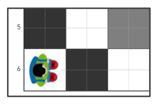

---
## Зелёная миссия

Дойди до зелёной точки по этой программе:

---

Решение зелёной миссии. На виде сверху ребёнок-робот смотрит вверх.

---
## Фиолетовая миссия

Дойди до фиолетовой точки по этой программе:

---

Решение фиолетовой миссии. На виде сверху ребёнок-робот смотрит вниз.

---
## Синяя миссия

Дойди до синей точки по этой программе:

---

Решение синей миссии. На виде сверху ребёнок-робот смотрит вправо.

