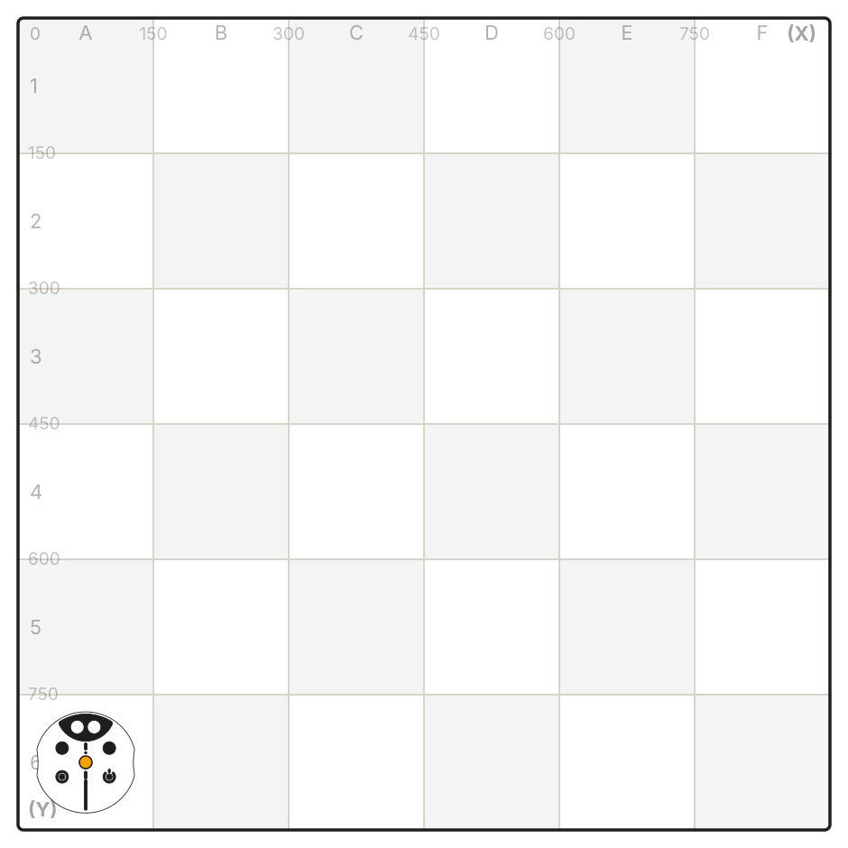

---
## Программа А

Проследи путь, по которому робот поедет с этой программой.

<Columns cols={2}>
  <Frame>
    
  </Frame>
  <Frame>
    
  </Frame>
  <Frame>
    
  </Frame>
</Columns>

---
## Программа Б

Проследи путь, по которому робот поедет с этой программой.

<Columns cols={2}>
  <Frame>
    
  </Frame>
  <Frame>
    
  </Frame>
</Columns>

<Columns cols={2}>
  <Frame>
    
  </Frame>
  <Frame>
    
  </Frame>
</Columns>

