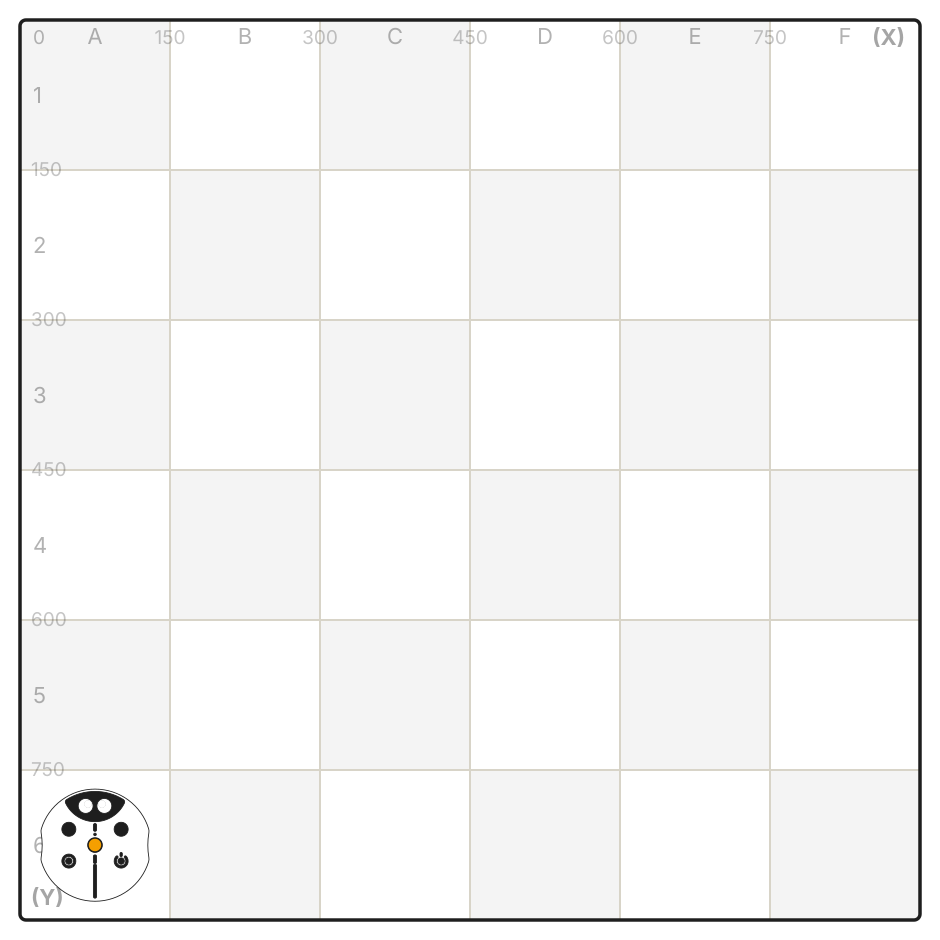
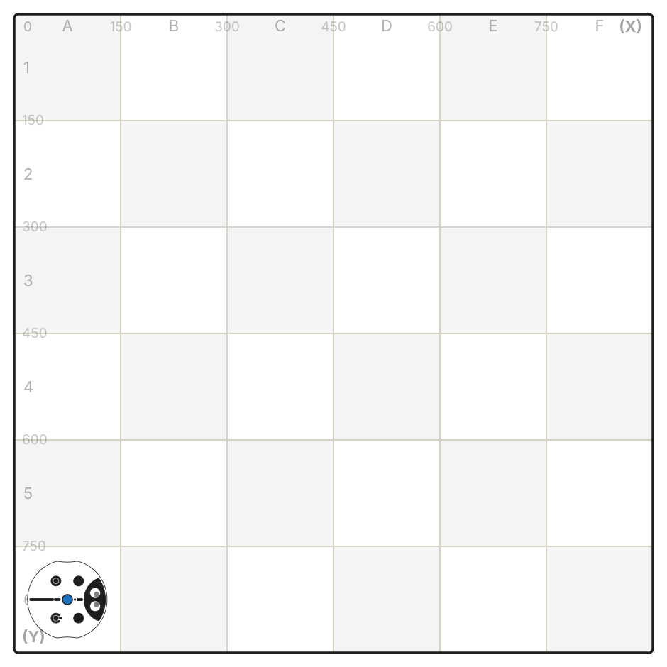

---
## Проследите путь по которому робот будет двигаться с этой программой. А.

<Columns cols={2}>
  <Frame>
    
  </Frame>
  <Frame>
    
  </Frame>
  <Frame>
    
  </Frame>
</Columns>

---
## Проследите путь по которому робот будет двигаться с этой программой. Б.

<Columns cols={2}>
  <Frame>
    
  </Frame>
  <Frame>
    
  </Frame>
</Columns>

<Columns cols={2}>
  <Frame>
    
  </Frame>
  <Frame>
    
  </Frame>
</Columns>

