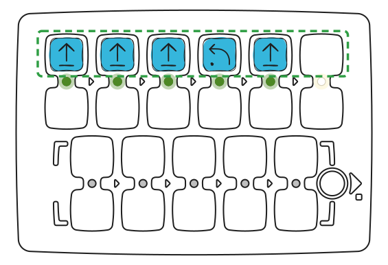
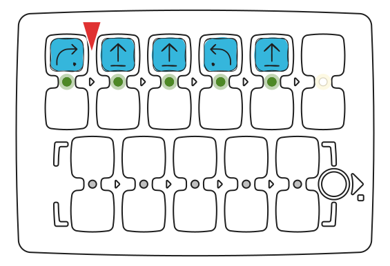
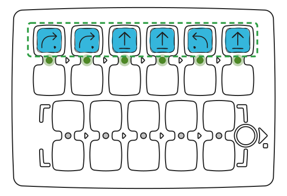

## Руководство по проведению занятий с детьми от 4 лет

PrimaSTEM помогает детям шаг за шагом освоить логическое мышление, основы программирования и математики. Это руководство поможет вам проводить занятия с детьми от 4 лет.

### Как это работает

Дети программируют движения маленького робота-божьей коровки. Для этого они кладут фишки-команды на пульт управления.

- **«Вперёд»**: робот едет прямо.
- **«Влево»**: робот поворачивает налево.
- **«Вправо»**: робот поворачивает направо.
- **«Функция»** (фишка «[ ]»): заменяет последовательность команд.
- **«Повтор»**: повторяет команду или функцию несколько раз.

Вы кладёте фишки на пульт и так составляете программу движения робота. Когда программа готова, нажмите кнопку, и робот выполнит команды.

### Содержание руководства

- Зачем проводить занятия по робототехнике и программированию
- Как организовать занятия в разных условиях
- Занятия и цели обучения
- Подробная инструкция по использованию
- Описание занятий
- Приложения
- О проекте и авторах

### Чему учит PrimaSTEM

- Программировать руками, без экрана
- Понимать, что машины работают по алгоритмам
- Планировать действия заранее
- Мыслить логически
- Составлять последовательности команд и функции
- Понимать, что такое «баг» (ошибка в коде), и находить ошибки
- Наглядно изучать числа, арифметику и геометрию

## Из чего состоит PrimaSTEM

### Что в коробке

- Робот-божья коровка
- Пульт управления
- Фишки-команды *
- Руководство по занятиям *

(*) Состав зависит от комплектации.

## Зачем проводить занятия по программированию и математике

Код, программирование и автоматизация стали частью нашей повседневной жизни.

В последние годы люди научились создавать машины, которые делают то, чего машины раньше не умели: понимать, говорить, слышать, видеть, отвечать, писать.

Примеров много: беспилотные автомобили, роботы-помощники для пожилых людей, роботы-доставщики и другие.

### Зачем учить программированию и робототехнике

Когда ребёнок учится программировать, он учится понимать машины вокруг нас. Он учится превращать маленькие и смелые идеи в настоящие проекты. Он разбивает сложную задачу на простые шаги. Он работает вместе с другими и решает общие задачи.

### Рождённые в цифровую эпоху

Может показаться, что дети и подростки хорошо разбираются в технологиях. Они ведь много пользуются цифровыми развлечениями.

Но умеют ли они создавать с помощью этих инструментов что-то своё и выражать себя? Что они делают, когда сталкиваются с технической проблемой?

## Как организовать занятия

Занятия подходят для разных целей и условий обучения. Все занятия в руководстве пронумерованы. Ниже указано, какие занятия подходят для ваших условий.

### Для кого

- Дети от 4 до 8 лет.
- Старшие и подготовительные группы детского сада, 1-й и 2-й классы начальной школы.

### Занятия для внеклассной работы

Занятия 1, 2, 4, 5, 6, 7, 8, 9, 10.

### Занятия для школы

Занятия 2, 3, 4, 5, 6, 7, 8, 9, 11, 12.

### Внеклассная работа

В группе лучше не больше 12 детей, чтобы каждый мог активно участвовать.

Рекомендуем давать одно устройство на 2–3 ученика. Так дети учатся работать в команде и общаться.

### Работа в школе

На уроке лучше работать с PrimaSTEM небольшими группами по 4–6 детей с одним учителем.
Другие ученики в это время выполняют другое задание с помощником воспитателя. Ученики 1–2 классов могут, например, тренироваться рисовать путь робота по программе.
В обоих случаях лучше заниматься в многоцелевом зале, прямо на полу. Можно также сдвинуть столы и стулья, чтобы освободить место.

**Внимание.** Заранее зарядите аккумуляторы пульта и робота.

## Занятия и цели обучения

| Занятие | Алгоритм и программа | Маршрут по этапам | Предвидеть движение | Решить задачу, найти ошибку | Работа в команде |
| ------- | :-------------------------------------: | :--------------------------: | :---------------------: | :---------------------------------: | :------------------------------: |
| 1       |                                         |               X              |                         |                  X                  |                                  |
| 2       |                                         |                              |            X            |                                     |                 X                |
| 3       |                    X                    |               X              |                         |                                     |                                  |
| 4       |                    X                    |               X              |            X            |                                     |                                  |
| 5       |                    X                    |               X              |            X            |                                     |                 X                |
| 6       |                    X                    |               X              |            X            |                  X                  |                 X                |
| 7       |                    X                    |               X              |            X            |                  X                  |                 X                |
| 8       |                    X                    |                              |            X            |                  X                  |                                  |
| 9       |                    X                    |               X              |            X            |                  X                  |                 X                |
| 10      |                    X                    |                              |            X            |                  X                  |                                  |
| 11      |                    X                    |               X              |            X            |                  X                  |                 X                |
| 12      |                    X                    |               X              |            X            |                  X                  |                 X                |

## Инструкция по использованию

### Содержание инструкции

- Знакомство с материалами
- Программирование функции
- Карты
- Технические пояснения

## Знакомство с материалами

### Робот

Маленький деревянный робот-божья коровка с двумя глазами.

У него три точки опоры: два колеса и подставка сзади. На них он держит равновесие.

### Основные команды

| Команда | Рисунок                             | Описание                                                                                     |
| ------- | ----------------------------------- | -------------------------------------------------------------------------------------------- |
| Вперёд  |   | Робот проезжает одну клетку. Это логический шаг, по умолчанию 15 см.              |
| Влево   |      | Робот поворачивается на 90° налево                                                           |
| Вправо  |     | Робот поворачивается на 90° направо                                                          |
| Назад   |      | Робот едет назад на одну клетку, то есть на логический шаг по умолчанию                                |
| Функция |  | Робот выполняет команды из ряда функции                    |
| Повтор N |   | Робот повторяет команду из той же пары N раз      |

### Пульт управления

На пульте вы управляете роботом: кладёте фишки-команды в свободные ячейки (D).

Верхний ряд (A) из 6 пар ячеек, связанных линией выполнения (E), это основная программа. Программа начинается с левой ячейки (D) и заканчивается над кнопкой **▶ Старт** (B). Эта кнопка отправляет команды роботу и запускает программу.

Нижний ряд (C) из 5 пар ячеек задаёт движения для фишки «Функция» («[ ]»). У каждой пары есть светодиод (F). Он загорается, когда вы кладёте фишку, и мигает, когда робот выполняет эту команду.

#### Цвета светодиодов

Если фишка лежит в ячейке правильно, светодиод горит зелёным.
Если в пару к команде движения положить повтор, светодиод горит синим.
Если фишки лежат неправильно, например две команды движения в одной паре, горит красный светодиод. Робот пропустит эту команду.

### Аккумулятор и кнопка включения

Робот и пульт работают от встроенных аккумуляторов. Они заряжаются через порт USB-C. Кнопка включения (ON/OFF) есть на роботе сверху и на пульте спереди слева.

Когда робот или пульт включается, звучит короткий сигнал.
У включённого пульта горит зелёный светодиод на передней панели. У включённого робота горит зелёный светодиод около разъёма USB-C.

### Беспроводная связь

Робот и пульт связаны по Bluetooth, радиус действия около 5 м. После первого подключения робота к пульту связь работает сама, настраивать её не нужно.

> Пульт можно соединить с другим роботом (сопрячь устройства).
> 1. Включите робота, который ещё не сопряжён с пультом.
> 2. Включите пульт.
> 3. Удерживайте на пульте кнопку **▶ Старт** 10 секунд, пока не прозвучит сигнал и не загорится свет.

### Как составить и запустить программу

Программа («последовательность движений») начинается слева на пульте. Она идёт по выгравированным стрелкам «>». Это линия выполнения, она соединяет пары ячеек по горизонтали.

Если перед фишкой есть пустая ячейка, робот пропустит пустую ячейку и выполнит команду этой фишки.

Если фишка лежит неправильно, светодиод горит красным, и робот пропустит эту часть программы. Так бывает, например, когда «Повтор» лежит в паре без команды или в одной паре лежат две фишки-команды.

Когда программа готова, нажмите кнопку **▶ Старт**.

Пока робот выполняет программу, светодиоды на пульте гаснут по очереди. Светодиод текущей команды мигает.

## Программирование функции

### Как создать функцию

Фишка «Функция» («[ ]») заменяет последовательность команд.

С ней можно составлять более длинные программы и решать более сложные задачи. Чтобы создать функцию, положите движения в нижний ряд пульта: это 5 пар ячеек. Робот выполняет этот ряд слева направо каждый раз, когда встречает фишку «Функция» в основной программе (сверху).

В примере ниже функция состоит из движения прямо и поворота направо. Основная программа вызывает функцию 2 раза. Затем фишка «Повтор 2» повторяет функцию ещё 2 раза.

[Запустить в симуляторе](https://simulator.primastem.com/#top=cfun,cfun,cfun.r002&fn=cfor,crig&s=l1144602&r=225-675-0&run)

Что получится:

## Карты

### Какие карты подходят

На первых занятиях дети изучают алгоритмы, программирование и числа. Для этого робот ездит по карте с сеткой. Лучше брать карту с клетками 15 см: столько робот проезжает за один шаг по умолчанию.

Подойдут и карты для других роботов, если размер клеток подходит этому роботу.

> Шаг по умолчанию можно изменить с 15 см на размер клетки вашей карты, например 10 см, 12,5 см или 20 см. Для этого положите служебную фишку «Шаг по умолчанию» с числом в миллиметрах: 100 для 10 см, 125 для 12,5 см, 200 для 20 см.

Если карты нет, сделайте её сами. Наклейте тонкий бумажный скотч на ровный стол или пол. Можно также взять лист ватмана (или плотную баннерную ткань) и маркер.

Шахматная карта или пустая карта с клетками нужна, чтобы учиться ездить из одной точки в другую. Цвета на ней не отвлекают.

Цветная карта помогает рассказывать короткие истории о путешествиях робота. Например: «Божья коровка выходит из дома и идёт в горы через лес». Класс может сделать новую карту и придумать новые истории о путешествиях божьей коровки.

#### Примеры карт

Шахматная карта

Цветная карта

## Технические пояснения

### Как это устроено

В пульте и роботе стоят микроконтроллеры и аккумуляторы Li-Ion. Устройства связаны по радио через стандартный протокол Bluetooth.

Плата робота управляет всем его поведением. Она управляет двумя двигателями постоянного тока 5V и двумя многоцветными светодиодами, воспроизводит звуки, связывается с пультом и т. д.

Плата пульта распознаёт фишки в ячейках, воспроизводит звуки и управляет 11 многоцветными светодиодами, по одному на каждую пару ячеек.

В каждой фишке есть NFC-стикер с кодом команды. Пульт читает этот код, когда фишку кладут в ячейку.

Когда пульт распознал фишки и вы запустили программу, пульт отправляет команды роботу по беспроводной связи.

### Свои фишки-команды

Можно сделать дополнительные фишки-команды, например «Повтор 12» или ещё фишки движения. Для этого нужны «пустые» фишки с NFC-стикерами и телефон с NFC. Подходит большинство типов стикеров с частотой 13,56 МГц.

Видеоинструкция есть на нашем канале YouTube: https://www.youtube.com/@primastem

---

## Занятия

### Подробное описание занятий

- **Занятие 1**: путь по шахматной доске из точки А в точку Б
- **Занятие 2**: знакомство с PrimaSTEM
- **Занятие 3**: ребёнок играет робота, ориентация и алгоритм
- **Занятие 4**: предсказать путь робота по программе
- **Занятие 5**: последовательность команд в случайной программе
- **Занятие 6**: отвести робота в горы с помощью пульта
- **Занятие 7**: знакомство с фишкой «Функция»
- **Занятие 8**: маршрут к цели с функцией
- **Занятие 9**: отладка программы с ошибкой
- **Занятие 10**: найти ошибку в программе на бумаге
- **Занятия 11 и 12**: предсказать движения робота (в занятии 12 с фишкой «Функция»)

---

## Занятие 1. Путь по шахматной доске из точки А в точку Б

- **индивидуально**
- **15 мин**
- **на бумаге**
- **документы для печати**

### Цель

- Спланировать путь по клеткам из точки А в точку Б на карте.

Упражнение длится 10 минут вместе с подведением итогов.

### Для печати

Распечатайте для каждого ученика лист «[Приложение 1. Перемещение по карте](/ru/book-1/attachment-1)».

### Упражнение

Дети рисуют на сетке путь, по которому мышь доберётся до сыра. Начните с левого упражнения, оно проще. Потом переходите к правому.

#### Перемещение по клеткам

Мышь ходит по клеткам сетки. По диагонали ходить нельзя. Дети должны понять, что путь мыши делится на этапы: за один раз она проходит одну клетку. Так движутся пошагово.

В примере выше верен только синий путь. Короткий красный путь неверен, потому что идёт по диагонали. Длинный красный путь неверен, потому что не ведёт в нужную точку.

### Обсуждение в группе

В примере выше все пути верны: по каждому из них мышь добирается до сыра.

Покажите детям, что каждый мог придумать свой путь и что правильных путей бывает несколько.

#### Некоторые пути длиннее других

Посчитайте, сколько клеток проходит мышь до клетки с сыром:
- 3 клетки по зелёному маршруту
- 3 клетки по серому маршруту
- 3 клетки по синему маршруту
- 13 клеток по жёлтому маршруту

#### Самый короткий путь

Все эти пути верны, но мышь выберет самый короткий.

Спросите детей: «Почему мышь выбрала самый короткий путь?»

Ответы могут быть разными. Мышь хочет сберечь силы: она очень устала и хочет пройти как можно меньше. Или мышь торопится: она очень голодна и хочет скорее добраться до сыра.

**Примечание для ведущего.** С роботами так же. Мы всегда выбираем самый короткий путь, потому что он эффективнее.

#### Возможны несколько путей

Когда упражнение закончится, попросите учеников показать свои пути. Путей всегда несколько, поэтому ученики, скорее всего, предложат разные ответы, и все они будут правильными.

---

## Занятие 2. Знакомство с PrimaSTEM

- **15 мин**
- **в группе**
- **демонстрация**
- **практика**

### Цели

- Понять, как может двигаться робот.
- Узнать, что роботом управляет пульт.
- Понять, что делают фишки-команды.

Разделите учеников на небольшие группы. Сядьте за низкий стол или на пол. Достаньте карту с сеткой, пульт, робота и фишки. Познакомьте с PrimaSTEM всех учеников, группу за группой.

### Презентация

Покажите каждый предмет на столе и назовите слова, которые понадобятся детям.

Сначала **карта**. Это такая же сетка, как на занятии 1, только больше.

Затем **робот-божья коровка**. Он умеет ездить.

Роботом управляет **пульт**. Робот делает то, что задают фишки в ячейках пульта.

**Фишки** задают команды: ехать прямо, повернуть налево или направо.

### 1-й этап: демонстрация

Когда дети узнали слова, покажите всё сами. Положите фишку на пульт, и дети увидят, что происходит.

| Изображение                                        | Описание                                                                    |
| -------------------------------------------------- | --------------------------------------------------------------------------- |
|  | Фишка **«Вперёд»** двигает робота на одну клетку |

Поставьте робота на любую клетку карты. Положите фишку в первую ячейку программы, как на схеме ниже. Затем нажмите белую кнопку **▶ Старт**.

Робот проедет одну клетку вперёд.

### 2-й этап: передайте управление

| Изображение                                     | Описание                                                                                                                                                                                |
| ----------------------------------------------- | --------------------------------------------------------------------------------------------------------------------------------------------------------------------------------------- |
|  | Фишка **«Влево»** со стрелкой по дуге поворачивает робота налево, против часовой стрелки. По умолчанию поворот равен 90 градусам. |

Уберите с пульта фишку «Вперёд» и дайте ребёнку фишку «Влево». Пусть он сам положит её в первую ячейку программы и нажмёт белую кнопку **▶ Старт**. Робот останется на месте и повернётся на четверть оборота налево.

| Изображение                                      | Описание                                                     |
| ------------------------------------------------ | ------------------------------------------------------------ |
|  | Фишка **«Вправо»** поворачивает робота направо. |

Попросите другого ребёнка заменить фишку «Влево» на фишку «Вправо» и нажать белую кнопку **▶ Старт**. Робот останется на месте и повернётся на четверть оборота направо.

Потом дети по очереди работают с пультом. Дайте им только 3 фишки: **«Вперёд»**, **«Влево»** и **«Вправо»**.

Когда робот закончит движение, дети могут ещё раз нажать **▶ Старт** и повторить свою программу.

Пусть дети убедятся, что фишки можно класть в любые ячейки, кроме двух команд в одной паре. Робот выполняет их по очереди, слева направо.

> Чтобы остановить программу, нажмите **▶ Старт / Стоп** ещё раз, пока робот едет.

---

## Занятие 3. Ребёнок играет робота: ориентация и алгоритм

- **45 мин**
- **в группе**
- **игра**
- **карта**

### Цели

- Учитывать, куда смотрит робот в начале программы.
- Предсказывать движения робота по программе.

### Для печати

Распечатайте для каждого ученика карточки «[Приложение 2. Карточки миссий](/ru/book-1/attachment-2)».

### Принцип игры

Это ролевая игра на свободном месте. Дети изображают робота на чёрно-белом поле.

### Правила игры

Один ученик играет робота на карте. Вместо карты подойдёт пол с квадратным узором: рисунок, плитка или клетки из тонкого скотча. Другие ученики программируют его по карточкам с заданиями.

Детям не говорят, куда смотрит ребёнок-робот.
Они сами определяют, куда он должен смотреть, чтобы выполнить миссию.

1. Ребёнок-робот встаёт на красную клетку 1. Ему нужно дойти до зелёной клетки 2.
2. Ребёнок-робот встаёт на красную клетку 1. Ему нужно дойти до фиолетовой клетки 3.
3. Ребёнок-робот встаёт на красную клетку 1. Ему нужно дойти до синей клетки 4.

> Чтобы карта прослужила дольше, попросите ребёнка снять обувь.

### Конец игры

Теперь ребёнок понимает: когда программируешь движение, нужно учитывать, где стоит робот и куда он смотрит.

Робот выполняет команду в зависимости от того, куда он повёрнут. Он едет прямо, поворачивает налево или направо, **но всегда от своего начального направления.**

---

## Занятие 4. Предсказать путь робота по программе

- **45 мин**
- **индивидуально**
- **на бумаге**
- **документы для печати**

### Цели

- Учитывать, куда смотрит робот в начале.
- Понимать команды программы.
- Предсказывать движения робота по программе.

### Для печати

Распечатайте для каждого ученика карточки «[Приложение 3. Нарисуй путь по программе](/ru/book-1/attachment-3)».

Дети получают лист с программой из нескольких команд. Они рисуют путь, который робот проедет по этой программе.

По этой программе робот проедет вперёд три раза:

<Columns cols={2}>
  <Frame>
    
  </Frame>
  <Frame>
    
  </Frame>
</Columns>

[Запустить в симуляторе](https://simulator.primastem.com/#top=cfor,cfor,cfor&s=l1144602&r=75-825-0&m=02&run)

Здесь та же программа, и робот тоже проедет вперёд три раза.
Но в начале он смотрит направо. Поэтому он проедет три клетки вправо:

<Columns cols={2}>
  <Frame>
    
  </Frame>
  <Frame>
    
  </Frame>
</Columns>

[Запустить в симуляторе](https://simulator.primastem.com/#top=cfor,cfor,cfor&s=l1144602&r=75-825-90&m=35&run)

В этой программе робот поворачивается. Сначала он поворачивает направо, потом проезжает две клетки:

<Columns cols={2}>
  <Frame>
    
  </Frame>
  <Frame>
    
  </Frame>
</Columns>

[Запустить в симуляторе](https://simulator.primastem.com/#top=crig,cfor,cfor&s=l1144602&r=75-825-0&m=25&run)

Последнее упражнение сложнее: робот дважды меняет направление. Он проезжает одну клетку прямо, поворачивает направо и проезжает одну клетку. Потом он поворачивает налево и проезжает две клетки:

<Columns cols={2}>
  <Frame>
    
  </Frame>
  <Frame>
    
  </Frame>
</Columns>

[Запустить в симуляторе](https://simulator.primastem.com/#top=cfor,crig,cfor,clef,cfor,cfor&s=l1144602&r=75-825-0&m=12&run)

### Примечание для ведущего

Это упражнение на бумаге может оказаться трудным.
Если ребёнку трудно понять повороты робота и порядок движений, возьмите набор PrimaSTEM. Попросите ребёнка выложить на пульте программы с листов.
Когда дети трогают и смотрят, они понимают лучше.

---

## Занятие 5. Последовательность команд в случайной программе

- **45 мин**
- **в группе**
- **игра**

### Цели

- Связать команды с движениями робота.
- Увидеть границы карты.
- Научиться переносить команды на пульт управления.

### Проведение игры

1. Поставьте робота на любую клетку карты, лучше у края. Направление выберите любое.
2. Бросьте кубик. Передвиньте робота рукой и запишите программу на бумаге или доске: нарисуйте стрелку команды «Вперёд». Если робот выходит за край карты, бросьте кубик ещё раз.

3. Повторите это, чтобы получилось 2 программы подряд. Робот не должен выйти за край карты, поэтому при необходимости бросайте кубик ещё раз.

В итоге на листе будут 2 программы из команд «Вперёд». Если выполнить их одну за другой, робот проедет нужное число клеток к краю карты.

Пример:

<Columns cols={2}>
  <Frame>
    
  </Frame>
  <Frame>
    

      
      
    

  </Frame>
</Columns>

**Выполните записанные программы на настоящем PrimaSTEM.**

---

## Занятие 6. Отвести робота в горы с помощью пульта

- **45 мин**
- **в группе**
- **практика**

### Цели

- Разбить маршрут на этапы.
- Составить программу для определённой цели.

Для этого занятия понадобятся:
- пульт управления;
- фишки движения: 4 «Вперёд», 4 «Влево» и 4 «Вправо» на группу, остальные фишки уберите;
- карта и робот.

Разделите детей на группы по 3 или 4 человека. Дайте каждой группе пульт и набор фишек.

### 1-й этап: размышление

Робот-божья коровка стоит дома, и мы хотим отвести его в горы. Нужно написать на доске программу, по которой он туда доберётся.

> Если нужной карты нет, нарисуйте места на бумаге, можно вместе с детьми. Прикрепите их к карте скотчем.

Сначала спросите детей, по каким клеткам они хотят провести робота к горе. Вариантов снова много. Мы выбираем самые короткие маршруты, чтобы сберечь энергию и время.

Когда путь выбран, разберите с детьми движения робота клетка за клеткой.

Должен ли он ехать прямо, повернуть налево или повернуть направо?
Двигайте робота по карте рукой и показывайте, как его перемещает каждая команда.

### 2-й этап: программирование

Попросите детей выложить на пульте фишками движения робота по порядку. Эта программа должна привести робота к цели.

**Ожидаемая программа:**

### 3-й этап: проверка

Любой уважающий себя программист проверяет, работает ли программа. Попросите детей выложить программу на пульте и запустить её.

<Columns cols={2}>
  <Frame>
    
  </Frame>
  <Frame>
    
  </Frame>
</Columns>

[Запустить в симуляторе](https://simulator.primastem.com/#top=cfor,cfor,crig,cfor&s=l1144602&r=75-825-0&m=13&run)

Доехал ли робот до горы? Если нет, то почему? Дайте детям самим исправить ошибки в программе, если они есть.

---

## Занятие 7. Знакомство с фишкой «Функция»

- **15 мин**
- **в группе**
- **демонстрация**

### Цели

- Понять, что фишка «Функция» может заменять другие команды.
- Познакомиться с повторением последовательности команд.

Разделите учеников на небольшие группы. Сядьте за низкий стол или на пол. Достаньте карту, пульт, робота и фишки-команды. Группы по очереди знакомятся с фишкой «Функция».

### 1-й этап: демонстрация

Покажите детям фишку «Функция».

Она заменяет несколько команд движения: «Вперёд», «Влево», «Вправо» или «Назад». С ней можно несколько раз повторить один и тот же короткий кусок программы.

Сначала покажите сами. Составьте программу, как на рисунке ниже.

Когда робот встречает фишку «Функция», он выполняет команды из рамки [-----] в нижней части пульта. Это то же самое, как если бы вместо фишки «Функция» стояли эти команды.
В нашем примере робот проедет вперёд два раза.

### 2-й этап: загадки

Теперь добавьте фишку «Вправо» в конец основной программы, как на рисунке ниже.

Перед запуском спросите детей, что произойдёт. Программа работает так, как если бы в ней стояли две красные фишки «Вперёд» и одна фишка «Вправо». Робот проедет две клетки и повернёт направо на четверть оборота.

В конце покажите **цикл**.
Выложите программу из четырёх фишек «Функция», как на рисунке ниже.

[Запустить в симуляторе](https://simulator.primastem.com/#top=cfun,cfun,cfun,cfun&fn=cfor,crig&s=l1144602&r=225-675-0&run)

Перед запуском спросите детей, что произойдёт. Затем запустите программу и проверьте.

**Робот выполняет цикл:**

**Примечание для ведущего.** Когда дети знакомятся с функцией, полезно смотреть на светодиоды. Они мигают во время выполнения программы. Так видно, какую команду робот выполняет и как он при этом едет.

---

## Занятие 8. Маршрут к цели с функцией

- **45 мин**
- **в группе**
- **практика**

### Цели

- Разбить маршрут на этапы.
- Составить программу для определённой цели.
- Использовать фишку «Функция» в программе.

Для этого занятия понадобятся:
- фишки или самодельные карточки с рисунками команд: 4 «Вперёд», 4 «Влево», 4 «Вправо» и 4 «Функция» на группу;
- карта и робот, без пульта.

Если детей много, разделите их на группы по 3 или 4 человека. Дайте каждой группе карточки с рисунками команд или фишки из набора, ровно по 4 каждого вида.

### 1-й этап: размышление

> Если на вашей карте другие картинки или их нет, измените задание. Отметьте 2 точки (Старт и Финиш) на расстоянии 4 клеток под углом 90 градусов.

Робот стоит у флага, и мы хотим отвести его на клетку «Ночь» с облаками. Нужно составить программу с фишкой «Функция»: выложить на столе фишки или рисунки команд.

Сначала спросите детей, по каким клеткам они хотят провести робота к горе. Гора стоит примерно на середине пути. Вариантов много. На этот раз мы выбираем маршруты, где команды повторяются, чтобы пригодилась фишка «Функция».

Когда путь выбран, разберите с детьми движения робота клетка за клеткой. Двигайте робота рукой и проверьте программу.

### 2-й этап: не хватает фишек

Попросите детей выложить на столе карточками или фишками движения робота по порядку.

Строго следите за числом фишек у каждой группы: 4 «Вперёд», 4 «Влево», 4 «Вправо» и 4 «Функция».

Ой, фишек не хватает! Нужно больше команд «Вперёд». Цифровая паника! :)

Напомните детям про фишку «Функция»: она заменяет несколько других фишек.

Например, она может заменить несколько команд «Вперёд», и робот проедет вперёд несколько раз.

Помогите детям составить программу с фишкой «Функция», как на рисунке ниже.

Пример маршрута и его программы:

### 3-й этап: проверка

Помогите детям выложить программу на пульте и проверить её, как на рисунке:

[Запустить в симуляторе](https://simulator.primastem.com/#top=cfun,clef,cfun&fn=cfor,cfor,cfor,cfor&s=l1144602&r=825-825-0&run)

Доехал ли робот до клетки «Ночь»? Если нет, то почему?
Дайте детям самим исправить ошибки в программе, если они есть.

---

## Занятие 9. Отладка программы с ошибкой

- **20 мин**
- **в группе**
- **практика**

### Цели

- Найти ошибку в программе, наблюдая за её выполнением.
- Исправить ошибку в программе.

Разделите учеников на небольшие группы. Сядьте за низкий стол или на пол. Подготовьте карту с сеткой, пульт, робота и фишки.
Группы по очереди отлаживают программу.

Робот должен доехать до горы по серому пути.

Покажите детям на пульте программу с ошибкой:

[Запустить в симуляторе](https://simulator.primastem.com/#top=cfor,clef,cfor,cfor,clef,cfor&s=l1144602&r=75-825-90&run)

По этой программе робот едет в лес. Дети запускают программу, ищут ошибку и исправляют её.

Пример исправленной программы:

[Запустить в симуляторе](https://simulator.primastem.com/#top=cfor,clef,cfor,cfor,crig,cfor&s=l1144602&r=75-825-90&run)

---

## Занятие 10. Найти ошибку в программе на бумаге

- **20 мин**
- **индивидуально**
- **на бумаге**
- **документы для печати**

### Цели

- Предсказать движения робота, чтобы найти ошибку в программе.
- Понять, как исправить ошибку в программе.

Дети получают лист с программой, которая должна привести робота из точки А в точку Б. В программе есть ошибка. Дети ищут её и пробуют исправить.

### Для печати

Распечатайте для каждого ученика карточки «[Приложение 4. Найди и исправь ошибку в программе](/ru/book-1/attachment-4)».

### 1-й этап: прочитать программу

Сначала попросите детей нарисовать путь робота по этой программе. Синим на сетке нарисован путь, по которому должен проехать робот, и нужная точка прибытия.

### 2-й этап: определить ошибку

Когда путь нарисован, видно, что робот не доезжает до финиша (чёрного флага). Он приезжает к красному флагу.
Спросите детей, где робот ошибся. Нужно найти клетку с ошибкой. В решении она обведена красным.

Ошибки бывают трёх типов:
- мы ошиблись с командой
- мы забыли команду
- мы добавили лишнюю команду

### 3-й этап: исправить ошибку

Наконец, попросите детей исправить ошибку: написать программу, которая доведёт робота до чёрного флага.

**Примечание.** Это упражнение на бумаге может оказаться трудным. Если ребёнку трудно увидеть ошибку, возьмите PrimaSTEM. Попросите выложить программу с листа на пульте и запустить её. Например, пусть дети говорят «О, нет!», когда робот сворачивает не туда. Так легче заметить ошибку.

#### Пример 1
В этом примере неверна команда в конце.

<Columns cols={2}>
  <Frame>
    
  </Frame>
  <Frame>
    

      
      
    

  </Frame>
</Columns>

#### Пример 2
В этом примере в начале есть лишняя команда.

<Columns cols={2}>
  <Frame>
    
  </Frame>
  <Frame>
    

      
      
    

  </Frame>
</Columns>

#### Пример 3
В этом примере в начале не хватает команды.

<Columns cols={2}>
  <Frame>
    
  </Frame>
  <Frame>
    

      
      
    

  </Frame>
</Columns>

---

## Занятие 11. Предсказать движения робота

- **45 мин**
- **в группе**
- **практика**

### Цели

- Предсказать движения робота по программе без функции.

Возьмите набор PrimaSTEM без фишек «Функция». Играют все дети сразу, но с пультом работает только один ребёнок.

### 1. Программируем молча

Дети по очереди ставят робота в угол карты и выкладывают на пульте программу, не больше 5 команд.

Когда программа готова, попросите ребёнка подождать и пока не нажимать кнопку.

### 2. Делаем ставки

Попросите остальных детей угадать, выедет ли робот за край карты.

### 3. Проверяем

Когда все сделали ставки, запустите программу и посмотрите, что будет.
Затем снова поставьте робота в угол, и следующий ребёнок составляет свою программу.

---

## Занятие 12. Предсказать движения робота с функцией

### Цели

- Предсказать движения робота по программе с функцией.

Проведите занятие 11 ещё раз, но добавьте в набор фишки «Функция».

Так дети будут программировать и функцию. Играют все дети сразу, но с пультом работает только один ребёнок.

---

## О проекте и авторах

### Кто мы

Компания PrimaSTEM придумала и производит одноимённое устройство. С ним дети от 4 лет учатся программированию и математике без экрана. Мы находимся на юге Франции.

Наши материалы открыты. Они помогают развивать творчество детей и взрослых, которые занимаются с ними.

Больше об устройстве PrimaSTEM есть на сайте документации на 13 языках: https://docs.primastem.com

### Контакты

Пишите нам: info@primastem.com

Наш сайт с информацией и ссылками на соцсети: https://primastem.com

### Авторы

**Адаптация, текст, иллюстрации:** Андрей Чанов, 2026.

**Авторы концепции:** Julie Borgeot / Dorie Bruyas из Fréquence écoles

#### Лицензия этого руководства

This work is licensed under CC BY-SA 4.0. To view a copy of this license, visit https://creativecommons.org/licenses/by-sa/4.0/

**Creative Commons Attribution-ShareAlike 4.0 International**

This license requires that reusers give credit to the creator. It allows reusers to distribute, remix, adapt, and build upon the material in any medium or format, even for commercial purposes. If others remix, adapt, or build upon the material, they must license the modified material under identical terms.

---

## Приложения

- [Приложение 1. Перемещение по карте](/ru/book-1/attachment-1)
- [Приложение 2. Карточки миссий](/ru/book-1/attachment-2)
- [Приложение 3. Нарисуй путь по программе](/ru/book-1/attachment-3)
- [Приложение 4. Найди и исправь ошибку в программе](/ru/book-1/attachment-4)
