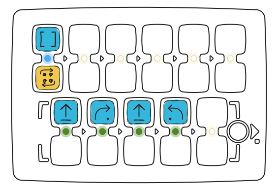
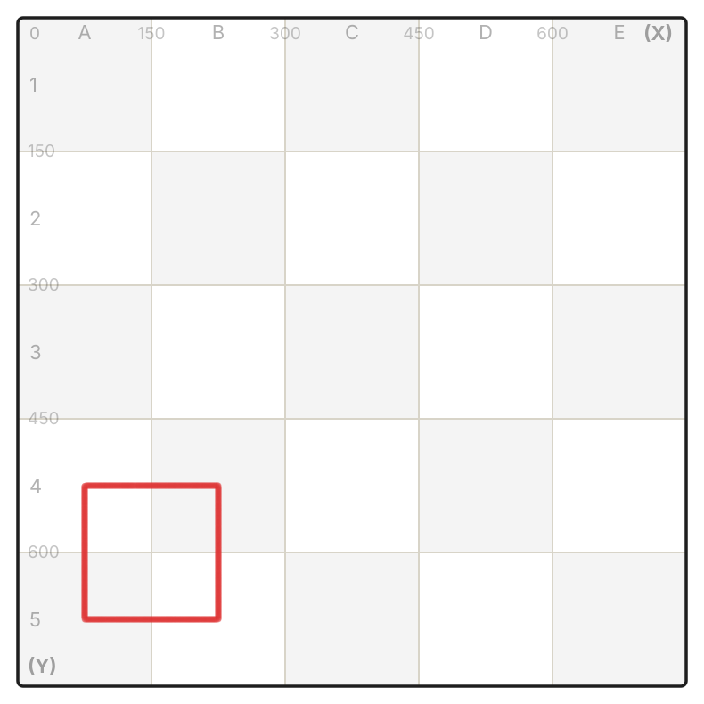

## Введение

PrimaSTEM состоит из программируемого робота, пульта управления и набора фишек-команд. С ним можно предупреждать и корректировать когнитивные нарушения у пожилых людей.

### Кому подходит

- Пожилым людям с лёгкими когнитивными нарушениями
- Людям, которые перенесли неврологические заболевания
- Пациентам на ранних стадиях нейродегенеративных заболеваний

### Противопоказания

- Тяжёлые нарушения зрения
- Выраженные двигательные нарушения рук
- Тяжёлая деменция
- Острые психические расстройства

## Первое занятие

Занятие длится около 35 минут. Перед началом прочитайте противопоказания выше. Если устройства пока нет, все шаги можно пройти в [симуляторе](https://simulator.primastem.com).

<Steps>
  <Step title="Знакомство, 10 минут">
    Покажите робота, пульт и фишки «Вперёд», «Вправо» и «Влево». Участник кладёт на пульт одну фишку «Вперёд», нажимает **▶ Старт** и смотрит, как едет робот. Как устроены пульт и робот, описано в разделе [Быстрый старт](/ru/quickstart).
  </Step>
  <Step title="Первый маршрут, 10 минут">
    Поставьте цель в двух-трёх клетках от робота. Участник раскладывает фишки, запускает программу и проверяет, доехал ли робот. В симуляторе для этого есть [лёгкий лабиринт](https://simulator.primastem.com/#s=l1144402&r=75-525-0&m=2101).
  </Step>
  <Step title="Перерыв, 5 минут">
    После 15–20 минут работы нужен отдых.
  </Step>
  <Step title="Фигура, 10 минут">
    Участник составляет программу, по которой робот обведёт квадрат. В симуляторе откройте [задание с квадратом](https://simulator.primastem.com/#sh=square): робот должен пройти по пунктирному контуру.
  </Step>
</Steps>

В конце спросите, что далось легко, а что было трудно. От ответа зависит, с чего начать следующее занятие.

## Общие принципы

С возрастом и при нейродегенеративных заболеваниях может ухудшаться память. Человеку становится труднее мыслить абстрактно, учиться и творить. Занятия с PrimaSTEM в игровой форме тренируют разные когнитивные функции и помогают замедлить эти процессы.

### Как организовать занятия

- Одно занятие длится 30–45 минут.
- Занятия проходят 2–3 раза в неделю.
- Занимаются по одному или малыми группами по 2–4 человека.
- После каждых 15–20 минут работы нужен перерыв на 5–10 минут.

### Как проводить занятия

1. Усложняйте задания постепенно.
2. Учитывайте особенности и ограничения каждого участника.
3. Создавайте доброжелательную атмосферу.
4. Чередуйте разные типы упражнений.
5. Всегда говорите участнику, что получилось, и хвалите его.

## Что тренируют занятия

### Когнитивные функции

- Интеллектуальная активность
- Пространственное мышление и память
- Зрительная и слухоречевая память
- Логическое мышление и устный счёт
- Планирование и контроль своих действий
- Периферическое зрение

### Общение и настроение

- Занятия поддерживают личностный потенциал и социальную активность.
- Участник может выразить себя.
- Участнику легче общаться с другими.
- Занятия поднимают настроение.

## Тренировки и игры

### 1. Первые упражнения (период привыкания)

- Познакомиться с фишками-командами.
- Провести робота по прямой.
- Выполнить простые повороты.
- Составить короткую последовательность команд.

**Материалы**

- [Быстрый старт](/ru/quickstart)
- [Книга 1](/ru/book-1/book-1), занятие 2

### 2. Тренировка пространственного мышления

#### Маршрут

- Найти кратчайший путь.
- Обойти препятствия.
- Составить маршрут из случайного набора фишек-команд.
- Пройти по заданному алгоритму.
- Выбрать правильный маршрут из нескольких вариантов.
- Построить обратный маршрут.

#### Уровни сложности

1. Найти конечную точку по заданному маршруту.
2. Выбрать правильный маршрут из списка.
3. Найти начальную точку по известной конечной.

#### Знакомые помещения

- Построить модель знакомого помещения: комнаты или коридора дома.
- Спланировать маршрут по помещению.
- Пройти лабиринт.

**Материалы**

- Лабиринты в симуляторе: [лёгкий](https://simulator.primastem.com/#s=l1144402&r=75-525-0&m=2101), [средний](https://simulator.primastem.com/#s=l1144502&r=75-675-0&m=400113232131), [сложный](https://simulator.primastem.com/#s=l1144602&r=75-825-0&m=0014243444540212223242). Робот стоит в углу, флажок отмечает цель.
- [Приложение 1 - Перемещение по карте](/ru/book-1/attachment-1)
- [Приложение 2 - Карточки миссий](/ru/book-1/attachment-2)
- [Книга 1](/ru/book-1/book-1), занятие 4: предсказать, куда приедет робот.
- [Приложение 3 - Нарисуй путь для заданной последовательности](/ru/book-1/attachment-3)

### 3. Тренировка планирования

- Составить алгоритм повседневных дел:
    - «Я в магазине: купить по списку»
    - «Собираюсь выйти на улицу: что нужно сделать»
- Работать с карточками, на которых нарисованы предметы и действия.

**Материалы**

- [Приложение 2 - Карточки миссий](/ru/book-1/attachment-2)
- [Приложение 4 - Найти и исправить ошибку в программе](/ru/book-1/attachment-4)

### 4. Тренировка пространственной памяти

- Запомнить маршрут и повторить его. Маршрут можно показать или назвать вслух.
- Использовать мнемотехники, например метод Цицерона.
- Сыграть в «Мемо»: найти и запомнить парные карточки.

**Материалы**

- [Лесенка в симуляторе](https://simulator.primastem.com/#top=cfun.r004&fn=cfor,crig,cfor,clef&s=l1144502&r=75-675-0&run): посмотрите, как едет робот, закройте окно и выложите маршрут на пульте по памяти.

### 5. Математические игры

- Математический лабиринт: робот идёт по клеткам с примерами.
- Арифметический маршрут: на каждом шаге прибавить или вычесть одно и то же число.

**Материалы**

- [Руководство для учителя](/ru/teachersguide), раздел «8. Арифметика».
- [Примеры рисунков](/ru/mathdrawings), группа «Спирали»: каждый шаг растёт на одно и то же число.

### 6. Словесные игры

- Найти пословицы на поле.
- Составить слова из разбросанных букв.
- Построить маршрут по картинкам с заданными звуками.

**Материалы**

- [Справочник аудиофайлов](/ru/sounds_reference): пульт озвучивает фишки, буквы и названия мест на 21 языке.

### 7. Игры с карандашом (рисование)

#### Графические диктанты

- Составить алгоритм по рисунку.
- Дорисовать симметричную половину.
- Найти и исправить ошибку в алгоритме.
- Нарисовать зеркальное отражение.
- Повернуть фигуру на 90°.
- Нарисовать узоры и орнаменты с помощью циклов.

**Материалы**

- Обвести фигуру по контуру в симуляторе: [квадрат](https://simulator.primastem.com/#sh=square), [треугольник](https://simulator.primastem.com/#sh=triangle), [домик](https://simulator.primastem.com/#sh=house), [звезда](https://simulator.primastem.com/#sh=star).
- [Примеры рисунков](/ru/mathdrawings): рядом с каждой программой готовый рисунок.

### 8. Коммуникативные игры

#### Соревнования

- Собрать как можно больше бонусных жетонов
- Игра в духе «Монополии» с роботом
- Словесная игра с поиском букв
- Настольная игра «Лабиринт» для двух игроков

**Материалы**

- Головоломки для пары или группы собраны ниже, в разделе «Головоломки».

## Головоломки

Задачи для работы за столом в паре или в группе. Положите робота на большой лист бумаги и вставьте маркер. Шаг робота 15 см, поворот 90°. Ответ спрятан под каждой задачей. Ссылка на симулятор нужна ведущему, чтобы проверить задачу заранее.

### Крокодил

Ведущий выкладывает на пульт программу и не говорит, что получится. Робот рисует, а участники стараются первыми угадать рисунок. Кто угадал, получает очко. Другие программы есть в разделе [Примеры рисунков](/ru/mathdrawings).

[Запустить в симуляторе](https://simulator.primastem.com/#top=cfor.n300,crig.n120,cfor,crig,cfor,cfun.r003&fn=clef,cfor&s=l1047602&r=338-397-30&run)

<Columns cols={2}>
  <Frame caption="Программа на пульте">
    
  </Frame>
</Columns>

<Accordion title="Ответ">
  Домик.

  <Columns cols={2}>
    <Frame caption="Что нарисует робот">
      
    </Frame>
  </Columns>
</Accordion>

### Переложи одну фишку

Робот рисует лесенку. Замените одну фишку так, чтобы он нарисовал квадрат.

[Запустить в симуляторе](https://simulator.primastem.com/#top=cfun.r004&fn=cfor,crig,cfor,clef&s=l1144502&r=75-675-0&run)

<Columns cols={2}>
  <Frame caption="Программа на пульте">
    
  </Frame>
  <Frame caption="Что нарисует робот">
    
  </Frame>
</Columns>

<Accordion title="Ответ">
  В нижнем ряду замените «Влево» на «Вправо». Робот обойдёт квадрат два раза.

  [Запустить в симуляторе](https://simulator.primastem.com/#top=cfun.r004&fn=cfor,crig,cfor,crig&s=l1144502&r=75-675-0&run)

  <Columns cols={2}>
    <Frame caption="Программа на пульте">
      
    </Frame>
    <Frame caption="Что нарисует робот">
      
    </Frame>
  </Columns>
</Accordion>

### Угадай программу

Ведущий выкладывает программу так, чтобы участники не видели пульт. Робот начинает в нижней левой точке, смотрит вверх и рисует букву П. Участники составляют программу, которая нарисует такую же букву, и проверяют её на роботе.

<Columns cols={2}>
  <Frame caption="Что нарисует робот">
    
  </Frame>
</Columns>

<Accordion title="Ответ">
  «Вперёд» ×2, «Вправо», «Вперёд», «Вправо», «Вперёд» ×2. Подходит любая программа, после которой рисунок совпадает.

  [Запустить в симуляторе](https://simulator.primastem.com/#top=cfor.r002,crig,cfor,crig,cfor.r002&s=l1144402&r=225-525-0&run)

  <Columns cols={2}>
    <Frame caption="Программа на пульте">
      
    </Frame>
  </Columns>
</Accordion>

### Одно и то же

Вот две программы. Нарисует ли робот по ним одно и то же? Сначала участники спорят, потом проверяют: запускают обе программы с одного места.

<Columns cols={2}>
  <Frame caption="Программа 1">
    
  </Frame>
  <Frame caption="Программа 2">
    
  </Frame>
</Columns>

<Accordion title="Ответ">
  Да. После трёх поворотов «Вправо» робот смотрит туда же, куда после одного поворота «Влево».

  [Запустить в симуляторе: Программа 1](https://simulator.primastem.com/#top=cfor.r002,crig.r003,cfor&s=l1144402&r=375-525-0&run) · [Запустить в симуляторе: Программа 2](https://simulator.primastem.com/#top=cfor.r002,clef,cfor&s=l1144402&r=375-525-0&run)

  <Columns cols={2}>
    <Frame caption="Что нарисует робот">
      
    </Frame>
  </Columns>
</Accordion>

### Домой

Отметьте точку старта карандашом. Робот уехал от неё по этой программе. Составьте программу, которая вернёт его на старт.

[Запустить в симуляторе](https://simulator.primastem.com/#top=cfor.r002,crig,cfor&s=l1144402&r=75-525-0&run)

<Columns cols={2}>
  <Frame caption="Программа на пульте">
    
  </Frame>
  <Frame caption="Что нарисует робот">
    
  </Frame>
</Columns>

<Accordion title="Ответ">
  «Вправо» ×2, «Вперёд», «Влево», «Вперёд» ×2. Есть и другое решение: «Назад», «Вправо», «Вперёд» ×2.

  [Запустить в симуляторе](https://simulator.primastem.com/#top=crig.r002,cfor,clef,cfor.r002&s=l1144402&r=225-225-90&m=03&run)

  <Columns cols={2}>
    <Frame caption="Программа на пульте">
      
    </Frame>
    <Frame caption="Что нарисует робот">
      
    </Frame>
  </Columns>
</Accordion>

## Как оценить результат

### Что отслеживать

- Регулярно проверяйте когнитивные функции тестами.
- Следите, как участник выполняет задания от занятия к занятию.
- Спрашивайте участников, что им понравилось и что нет.
- Ведите дневник занятий.

### Признаки успеха

- Участник лучше выполняет задания.
- Участник справляется с более сложными упражнениями.
- Участник сам хорошо оценивает занятия.
- Участник применяет навыки в повседневной жизни.

## Как адаптировать программу

### Под каждого участника

- Учитывайте физические ограничения.
- Подбирайте темп занятий.
- Меняйте задания под интересы участника.
- Составьте для участника свой план, как усложнять задания.

### Работа в группе

- Собирайте группы по уровню возможностей.
- Добавляйте в занятия соревнование.
- Поощряйте взаимопомощь.
- Создавайте комфортную обстановку для общения.
