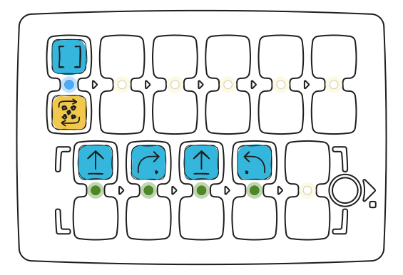

PrimaSTEM учит детей от 4 до 12 лет программировать без компьютеров, планшетов и телефонов. Набор развивает логику, навыки программирования и математику.

С PrimaSTEM программирование становится простым и наглядным. Даже малыши понимают, что происходит: они трогают фишки руками и осваивают основы программирования, логики и математики в игре.

Игра с PrimaSTEM развивает логическое мышление, алгоритмику, программирование, математику и геометрию. Она развивает и творчество, и социально-эмоциональные навыки. Набор готовит ребёнка к блочным языкам программирования, например [Scratch](https://en.wikipedia.org/wiki/Scratch_(programming_language)) или [LOGO](https://en.wikipedia.org/wiki/Logo_(programming_language)).

## Знакомство с обучающим набором

### Где можно использовать PrimaSTEM

PrimaSTEM подходит для таких занятий:

- центры дошкольного образования;
- детские сады, где работают по методике Монтессори;
- начальная школа;
- домашнее обучение;
- специальные центры развития;
- группы продлённого дня;
- начальные кружки программирования;
- детские образовательные лагеря.

### Что нужно знать для начала

Перед работой с набором прочитайте страницу [Устройство и настройка](/ru/usermanual) и это руководство. Навыки программирования не нужны: в материалах есть всё, чтобы начать.

## Исследования и ценность набора

PrimaSTEM вдохновлён языком программирования [LOGO](https://en.wikipedia.org/wiki/Logo_(programming_language)), который создал [Сеймур Пейперт](https://en.wikipedia.org/wiki/Seymour_Papert), и педагогикой Монтессори. LOGO и робот-черепашка сделали программирование для детей наглядным и доступным.

Фишки-команды PrimaSTEM продолжают этот подход. Ребёнок управляет роботом руками, без экрана и текста, и сразу понимает, что делает.

Дети смотрят на робота, понимают каждую команду и осваивают алгоритмы на практике.

У робота есть важное свойство: у него есть направление. Ребёнок легко представляет себя на месте робота и поэтому быстрее понимает логику программы.

Все команды простые: они говорят, в какую сторону роботу двигаться. Когда дети учат робота «действовать» и «думать», они начинают осмысливать свои действия и мысли. Поэтому программирование даётся им легче.

Фишки PrimaSTEM наглядно и упрощённо показывают, как устроены языки программирования. В начале обучения нет ни текста, ни чисел, только базовые команды.

### Почему дерево

🌱 Пульт и робот сделаны из дерева (фанеры). Детям приятнее играть с деревянными игрушками. Они безопасны, служат долго, и у каждой появляется своя история.

## Программирование с PrimaSTEM

Фишки PrimaSTEM работают как инструкции настоящих языков программирования. На них видны важные понятия программирования.

### Алгоритмы

**Алгоритм** состоит из точных команд (фишек), которые вместе составляют программу.

### Очередь

Пульт выполняет команды строго слева направо. Так дети видят, что команды выполняются по очереди.

### Исправление ошибок (отладка)

Ошибку легко исправить: достаточно заменить фишку. Так ребёнок учится сам искать и исправлять ошибки в программе.

### Функция

Функция (подпрограмма) состоит из команд в нижнем ряду пульта. Основная программа вызывает её фишкой «**Функция**».

### Переменная

Пульт запоминает последнее число каждой команды. Вперёд, Назад, Влево, Вправо и Пауза хранят каждая своё значение. Команда без числа берёт запомненное. Это переменная: у неё есть имя (команда) и значение (число), и значение можно менять.

## Применение в других предметах

PrimaSTEM помогает развивать и другие навыки:

- Общение. В групповой игре дети учатся сотрудничать.
- Моторика. Работа с фишками улучшает координацию.
- Социальные навыки. Дети учатся уверенности и учатся решать задачи вместе.
- Математика. Дети осваивают базовые математические понятия.
- Логика. Дети учатся строить последовательности и предсказывать результат.

> Ребёнок выкладывает цепочку из фишек и осваивает программирование руками, глазами и головой. Он нажимает **▶ Старт**, робот едет, и ребёнок сравнивает результат со своим ожиданием. Такой опыт ускоряет обучение.

## Знакомство с роботом и пультом

### Робот

Расскажите детям, что робот их друг и его можно программировать. Объясните, что своих мыслей у него нет. Он выполняет только их инструкции, как бытовая техника, которую надо включить.

### Пульт управления

Объясните, что пульт передаёт команды роботу. Покажите, как раскладывать фишки-команды и программировать робота.

> Основную программу собирают в верхнем ряду пульта (6 пар). Нижний ряд (5 пар) нужен для подпрограммы, её вызывает команда «**Функция**».

### Фишки-команды

Фишки задают команды для робота, их кладут на пульт. После нажатия **▶ Старт** робот выполняет программу. Каждая фишка задаёт одну команду. Так дети учатся вычислительному мышлению и учатся составлять программы. Важно, чтобы дети понимали, что сделает робот по каждой команде. Тогда они смогут планировать программу и предсказывать действия робота. Объясните детям, что фишки нельзя терять или портить: без них робот не сможет двигаться.

## 1. Первая программа

### Причина и следствие

Главная цель: показать детям связь между командой и действием. Пусть ребёнок положит фишку «Вперёд» в первую ячейку пульта и нажмёт **▶ Старт**. Ребёнок должен увидеть, что фишка и действие связаны.

### Однозначные инструкции

Повторите это с каждым направлением (**вперёд**, поворот **влево**, поворот **вправо**), пока ребёнок не научится узнавать каждую фишку.

### Первая задача

Разложите игровое поле или сделайте сетку с клеткой 15 × 15 см из скотча или маркером. Поставьте робота на стартовую клетку. Попросите ребёнка составить программу, чтобы робот проехал одну клетку вперёд. Если ребёнок выбрал не ту фишку, верните робота и предложите подумать над другим вариантом.

## 2. Программа и отладка

### Очередь событий

Поставьте цель на две клетки впереди робота.

Пусть ребёнок составит программу из двух фишек, чтобы робот доехал до цели.

### Последовательность из трёх фишек

Теперь цель на одну клетку впереди и на одну справа.

Пусть ребёнок сам выберет правильный порядок команд.

Не волнуйтесь, если ребёнок выбрал не ту фишку. Верните робота на старт и попросите ребёнка подумать о своём выборе и попробовать другие варианты.

### Отладка: поиск ошибки

Поставьте цель на одну клетку впереди робота и на одну клетку слева от него.

Теперь программу составьте вы и специально поставьте в неё неверный поворот.

Попросите ребёнка найти неверную команду и предсказать, куда приедет робот. Потом пусть ребёнок нажмёт **▶ Старт** и проверит свою догадку.

Когда ребёнок убедится, что программа неправильная, рассуждением или проверкой, пусть он заменит неверную команду на верную. Так он отладит программу.

## 3. Программа с функцией

### Команда «Функция»

Когда дети освоили основные команды, покажите фишку-команду **Функция**. Она вызывает набор команд, который основная программа может повторять.

> Чтобы объяснить, как это работает, сравните функцию с башней: под фишкой функции одна за другой сложены другие команды. Так дети видят, что в одну фишку можно поместить несколько инструкций.

Покажите пример. Сначала положите две фишки «Вперёд» в верхние ячейки и запустите программу. Робот проедет две клетки.

Теперь положите те же две «Вперёд» в функцию (нижний ряд), а в основную программу положите «Функцию». Результат тот же, но часть программы теперь спрятана в подпрограмму.

Затем соберите последовательность: **Вперёд, Вперёд, Вправо, Вперёд, Вперёд**.

Попросите детей найти повторяющиеся части и «спрятать» их в функцию. Должно получиться так: в основной программе **Функция, Вправо, Функция**, в нижнем ряду **Вперёд, Вперёд**.

[Запустить в симуляторе](https://simulator.primastem.com/#top=cfun,crig,cfun&fn=cfor,cfor&s=l1144602&r=225-825-0&run)

### Решение задач с функцией

Дайте ребёнку 3 фишки «**Вперёд**» и 2 фишки «**Функция**».

Задача: проехать вперёд на 5 клеток.

Пусть ребёнок поймёт, что для этой задачи нужна функция, которая повторяет действие.

Если программа неправильная, верните робота на старт. Попросите ребёнка подумать, как правильно решить задачу, и попробовать другие варианты.

[Запустить в симуляторе](https://simulator.primastem.com/#top=cfun,cfun,cfor&fn=cfor,cfor&s=l1144602&r=225-825-0&run)

## 4. Случайность

### Команда «Случайное движение»

Чтобы объяснить случайность, возьмите 4 фишки направления: «**Вперёд**», «**Влево**», «**Вправо**» и «**Назад**». Положите их в непрозрачную коробку или мешочек и перемешайте. Пусть дети по очереди не глядя вытаскивают одну фишку, показывают её группе и кладут обратно. На этом примере объясните, что такое случайный выбор из четырёх вариантов.

Затем покажите детям фишку-команду «**Случайное движение**».

Объясните, что эта фишка делает почти то же, что дети делали с мешочком. Она случайно выбирает направление и проводит робота на один шаг, то есть на одну клетку. Робот может переместиться на одну клетку вперёд, вправо, влево или назад.

Положите фишку «**Случайное движение**» в верхнюю ячейку и запустите программу несколько раз. Робот каждый раз поедет по-разному.

[Запустить в симуляторе](https://simulator.primastem.com/#top=crnd&s=l1144602&r=375-525-0&run)

Поиграйте с детьми: пусть угадывают, куда поедет робот, перед каждым запуском.

Подчеркните, что это **случайность** и угадать направление каждый раз нельзя.

Придумайте вместе с детьми небольшую игру с фишкой «**Случайное движение**».

## 5. Циклы (повторы команд)

### Знакомство с числовыми циклами

Покажите детям фишки повторов. Спросите, знают ли они числа, видели ли игральный кубик и играли ли в настольные игры.

Положите две фишки «Вперёд» в верхние ячейки и запустите программу. Робот проедет две клетки.

Теперь оставьте одну «Вперёд» и положите под неё фишку «Повтор 2». Результат тот же: действие повторится дважды.

Положите 4 фишки «**Вперёд**» и посмотрите на результат. Потом попросите детей повторить это движение на 4 клетки с помощью фишки **повтора**.

Задачу можно решить по-разному. Простой вариант: «**Вперёд**» и «Повтор 4». Другой вариант: «**Вперёд**» с «Повтором 3» и ещё одна «**Вперёд**».

[Запустить в симуляторе](https://simulator.primastem.com/#top=cfor.r003,cfor&s=l1144602&r=225-825-0&run)

### Повтор функции

Попробуйте с детьми добавить повтор к команде «Функция». Например, робот может ехать зигзагом: в верхнем ряду «Функция» с «Повтором 5», в нижнем ряду «**Вперёд**», «**Вправо**», «**Вперёд**», «**Влево**».

Сначала соберите в функции программу «ступенька»: «Вперёд», «Вправо», «Вперёд», «Влево». Запустите её.

Затем добавьте к функции «Повтор 5». Функция повторится 5 раз, и робот поедет ступеньками вправо и вверх.

[Запустить в симуляторе](https://simulator.primastem.com/#top=cfun.r005&fn=cfor,crig,cfor,clef&s=l1144602&r=75-825-0&run)

Робот поедет лесенкой по диагонали вправо и вверх и сделает 5 ступенек.

## 6. Случайные числа

### Что такое случайное число

Среди фишек есть «Повтор случайное число раз» (с кубиком). Она выбирает случайное число от 1 до 6. Поиграйте с детьми: пусть вытаскивают фишки повторов из мешочка.

Чтобы объяснить случайное число, возьмите 4 фишки повторов: «**2**», «**3**», «**4**» и «**5**». Положите их в непрозрачную коробку или мешочек и перемешайте. Пусть дети по очереди не глядя вытаскивают одну фишку, показывают её, называют число и кладут обратно. Поиграйте, кто вытащит большее число. На этом примере объясните, что такое случайный выбор из четырёх вариантов.

Затем покажите детям фишку «**Повтор случайное число раз**». Объясните, что она делает почти то же, что дети делали с мешочком. Как игральный кубик, она случайно выбирает одно число от 1 до 6, и робот повторяет действие столько раз.

Положите фишку «**Вперёд**» в верхнюю ячейку пульта, а под неё фишку «**Повтор случайное число раз**». Попросите детей нажать **▶ Старт**. Верните робота на место. Повторите несколько раз.

[Запустить в симуляторе](https://simulator.primastem.com/#top=cfor.rrnd&s=l1144702&r=225-975-0&run)

Поиграйте: чей робот проедет дальше.

Обратите внимание детей, что робот проезжает случайное число клеток, от 1 до 6. Подчеркните, что это случайность и заранее узнать, как далеко проедет робот, нельзя.

## 7. Числа: расстояния и углы

### Знакомство с числами

Если во второй ячейке пары нет числа, робот использует значения по умолчанию: едет вперёд на 15 см и поворачивает на 90°. Эти значения меняют фишки чисел.

Пример. Добавьте к команде **«Вперёд»** число **200** и посмотрите, как далеко проедет робот. Добавьте число **180** к повороту и посмотрите, что изменится.

[Запустить в симуляторе](https://simulator.primastem.com/#top=cfor.n200,crig.n180&s=l1047602&r=450-600-0&run)

> **Важно.** Пульт запоминает последнее число для команд движения и поворота. Если команда стоит без нового числа, она берёт запомненное, пока пульт не выключат. Новое число заменяет запомненное. Длину шага, заданную фишкой «Шаг по умолчанию», пульт помнит и после перезапуска. Вернуть 15 см можно фишкой «Шаг по умолчанию» с числом 150. Поворот 90° после перезапуска возвращается сам.

С разными числами робот проезжает более сложные маршруты. Примеры есть на странице [Примеры рисунков](/ru/mathdrawings).

## 8. Арифметика

### Арифметические операции

Арифметика меняет числа в программе для команд движения (Вперёд, Назад, Влево, Вправо). Так роботом можно управлять гибче.

Когда в паре стоит арифметическая фишка, пульт меняет запомненное число команды и отправляет роботу новое значение.

Пример:

[Запустить в симуляторе](https://simulator.primastem.com/#top=cfor.n200,crig,cfor.a100&s=l1047602&r=300-700-0&run)

«Вперёд 200»: робот проезжает 20 см. «Вперёд +100»: робот проезжает ещё 30 см. Всего 50 см.

### Задание: растущая спираль

Арифметика меняет запомненное число, то есть переменную. Соберите программу: в верхнем ряду Вперёд 30 и Функция × 20, в нижнем Вправо и Вперёд +30. При каждом вызове функции сторона становится на 3 см длиннее.

Попросите детей сначала предсказать: какой длины будет пятая сторона? Потом запустите и проверьте. Ответ: 15 см (3 + 3 + 3 + 3 + 3).

[Запустить в симуляторе](https://simulator.primastem.com/#top=cfor.n030,cfun.r020&fn=crig,cfor.a030&s=l1047602&r=450-465-0&run)

<Columns cols={2}>
  <Frame caption="Программа на пульте">
    
  </Frame>
  <Frame caption="Что нарисует робот">
    
  </Frame>
</Columns>

Эта же программа на языке LOGO: [PrimaSTEM и LOGO](/ru/logo).

Арифметика в цикле даёт прогрессии.

> Если после арифметики число стало отрицательным, робот делает обратное действие: едет назад вместо вперёд и поворачивает направо вместо налево.

Доступны сложение (+), вычитание (−), умножение (*), деление (/), корень из числа (√) и возведение в степень (^).

Примеры узоров есть на странице [Примеры рисунков](/ru/mathdrawings).

---

## Играйте и учитесь вместе с детьми

Вы знаете своих учеников лучше всех. С PrimaSTEM можно учить программированию, логике и другим предметам в игре. Всё зависит от вашей фантазии.

Спасибо, что выбрали PrimaSTEM. [Напишите нам](/ru/contacts) о своём опыте и впечатлениях, мы ждём ваших отзывов.
