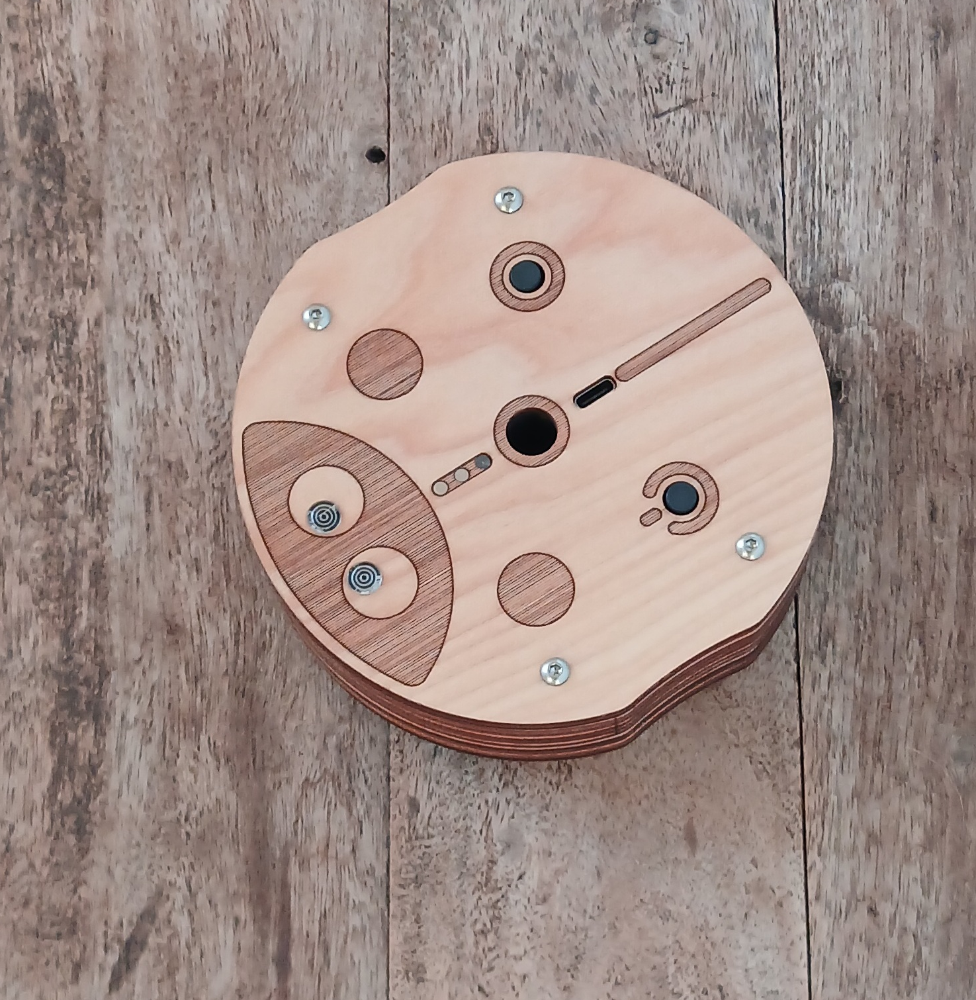
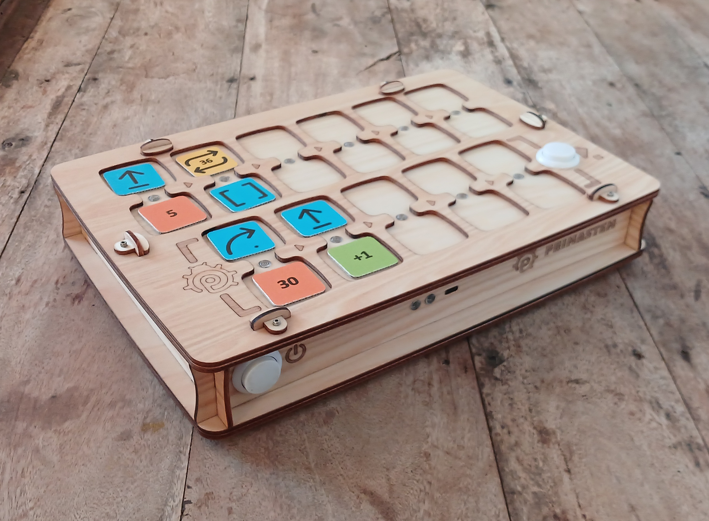

## Технические характеристики и комплектация

- Игровой робот
- Пульт управления роботом
- Фишки команд, значений и арифметических операций, из которых собирают программу

> Комплектация и внешний вид могут немного меняться. Уточните при покупке.

### Игровой робот

Размеры: D=120 мм, H=44 мм.

У робота есть кнопка включения, светодиоды, динамик, функциональная кнопка и разъём USB-C для зарядки аккумулятора.

В центр робота можно вставить маркер диаметром до 10 мм. Тогда робот рисует простые фигуры на ходу.

Внешний вид может немного отличаться в разных комплектациях. Функции остаются те же.

### Пульт управления

Размеры: L=317 мм, W=217 мм, H=62 мм.

На пульте 11 парных ячеек для фишек команд и значений. 6 пар сверху для основной программы, 5 пар снизу для подпрограммы.

На пульте две кнопки. Левая включает пульт. Правая, **▶ Старт / Стоп**, запускает и останавливает программу.

Разложите фишки команд и значений по ячейкам и нажмите **▶ Старт**. Робот выполнит программу. Светодиоды между ячейками показывают, какая команда выполняется.

Если фишка лежит неправильно, например фишка значения без команды, у ячейки загорается красный светодиод. Программа при этом продолжается.

У пульта есть разъём USB-C для зарядки и динамик.

### Фишки

Размеры: 33 × 33 мм.

В наборе есть фишки, из которых собирают программу. Каждая фишка задаёт одну команду с понятным смыслом. Порядок фишек определяет, что сделает робот.

Фишки бывают трёх видов: **команды**, **значения** и **арифметика**.

#### Фишки команд

Из этих фишек составляют программу:

- **Вперёд**: робот едет вперёд (по умолчанию 15 см).
- **Вправо**: робот поворачивает на 90° по часовой стрелке.
- **Влево**: робот поворачивает на 90° против часовой стрелки.
- **Назад**: робот едет назад (по умолчанию 15 см).
- **Функция**: робот выполняет подпрограмму из нижнего ряда пульта.
- **Пауза**: робот стоит N секунд (1–999 с; без числа 1 с).
- **Случайное движение**: робот делает один шаг вперёд или назад либо поворачивает на 90° влево или вправо и сразу делает шаг вперёд. Длина шага равна шагу по умолчанию. Поворота на месте без шага не бывает.
- **Фишки повторов (циклов)**: на них точки от 2 до 6 или значок повтора с числом внутри. Фишка с кубиком задаёт случайное число повторов от 1 до 6.

> Фишки чисел и арифметики расширяют программу. С ними можно повторить команду или изменить угол и расстояние.

#### Фишки значений

Есть фишки углов и расстояний: 30°, 36°, 45° и кратные им (60°, 72° и другие). Углы задаются в градусах, расстояния в миллиметрах. По умолчанию робот поворачивает на 90° и едет на 150 мм (15 см).

#### Фишки арифметических операций

Они меняют значения команд движения:

- Сложение (+)
- Вычитание (−)
- Умножение (*)
- Деление (/)
- Корень из числа (√)
- Степень (^)
- Факториал (!)

Арифметика считает в пределах от −5000 до 5000. В этих случаях ячейка мигнёт красным, а число не изменится:
- ответ больше 5000 или меньше −5000;
- деление на 0;
- корень из отрицательного числа;
- факториал числа больше 6.

Деление и корень округляются до ближайшего целого. Например, 150 ÷ 4 даёт 37,5, робот берёт 38. 20 ÷ 3 даёт 6,67, робот берёт 7. √50 даёт 7,07, робот берёт 7. Ровно половина округляется от нуля: 37,5 до 38, −2,5 до −3.

## Соединение пульта и робота

Сначала включите робота, затем пульт.

Поставьте робота на ровную поверхность до соединения. Пока связи нет, робот и пульт светятся голубым. Когда связь появилась, светодиоды становятся белыми.

Проверьте соединение: положите фишку «Вперёд» и нажмите **▶ Старт**.

Если связи нет, перезапустите оба устройства или зарядите их. Рядом с источниками сильного электромагнитного поля (мобильный телефон, точка Wi-Fi) связь может ненадолго пропадать.

> **После обновления прошивки** устройства, возможно, придётся соединить заново. Включите робота, затем пульт. Нажмите и удерживайте **▶ Старт** на пульте больше 10 секунд. На 5-й секунде прозвучит короткий сигнал: не отпускайте кнопку. На 10-й секунде начнётся сопряжение.

### Управление наклоном пульта

Когда пульт соединился с роботом, роботом можно управлять без фишек: просто наклоняйте пульт. Это работает, пока в ячейках нет фишек и вы ещё не нажали **▶ Старт**.

- Сначала положите пульт ровно на секунду. Пока он не полежит ровно, робот на наклоны не отвечает.
- Наклоните пульт от себя, и робот проедет 15 см вперёд. На себя: 15 см назад.
- Наклоните влево или вправо, и робот повернётся на 90° в ту же сторону.
- На каждый шаг пульт коротко пищит.
- Пока пульт наклонён, робот делает шаг за шагом. Верните пульт ровно, и робот закончит текущий шаг и остановится.
- Наклоняйте заметно, больше чем на 20°. Если рука слегка дрожит, робот не поедет.

Управление наклоном выключается, как только в ячейку положили фишку или вы нажали **▶ Старт**. Оно снова включится, когда пульт заново соединится с роботом, например после выключения и включения робота.

## Как это работает

Чтобы запрограммировать движение, разложите по ячейкам пульта фишки команд, например «Вперёд», «Влево», «Функция». К командам можно добавить число повторов, углы, расстояния и арифметические операции.

Ячейки соединены в пары «мостиками» с индикаторами. В одну ячейку пары кладут команду, в другую значение или повтор.

*Ниже пример программы с циклом: он повторяет одинаковый участок программы. Робот проезжает по квадрату:*

<Columns cols={2}>
  <Frame>
    
  </Frame>
  <Frame>
    
  </Frame>
</Columns>

[Запустить в симуляторе](https://simulator.primastem.com/#top=cfor,crig,cfun.r003&fn=cfor,crig&s=l1144402&r=225-525-0&run)

Сначала команды кладут в верхний ряд пульта (6 пар). Робот выполняет их слева направо. Пустые ячейки и ошибки робот пропускает. Ошибка, например, две команды в одной паре или значение без команды.

Порядок фишек определяет, как поедет робот.

Нажмите **▶ Старт**, чтобы запустить программу.

По умолчанию:
- «Вперёд» проезжает 15 см.
- «Влево» и «Вправо» поворачивают на 90°.
- Повторы (циклы) повторяют команду несколько раз.
- «Функция» вызывает подпрограмму из нижнего ряда пульта (5 пар).
- Подпрограмму можно вызвать несколько раз: положите фишку повтора в пару к «Функции» (пример выше).

### Важные функции

- **Остановить** программу можно, если снова нажать **▶ Старт** во время движения.
- Пульт помнит последнее **заданное значение** (расстояние или угол) для каждой команды движения, пока его не выключат. Например, если «Вперёд» получила 200, все следующие «Вперёд» тоже проедут 200 мм.
- Значения после арифметики тоже сохраняются.
- **Шаг по умолчанию** меняет служебная фишка «Шаг по умолчанию». Она меняет шаг для «Вперёд» и «Назад». Например, для 12,5 см положите её с числом 125. Значение сохраняется после выключения. Подходят числа от 1 до 999. Без числа фишка возвращает 150 мм. С арифметикой или нулём ячейка мигнёт красным, а шаг не изменится.
- Пульт и робот **выключаются сами**, если 15 минут ничего не происходит.
- Пока робот ждёт команду, он моргает глазами. Так видно, что он включён и готов.
- **Коротко нажмите кнопку робота**, и он прочитает фишку под собой и назовёт её.
- **Все звуки робота** выключаются и включаются, если удерживать кнопку робота 5 секунд. Дождитесь короткого сигнала и отпустите. Робот мигнёт красным, если звук выключился, и зелёным, если включился.
- **Звук пульта** выключается и включается, если удерживать **▶ Старт** 5 секунд. Дождитесь короткого сигнала и отпустите. Пока программа выполняется, удержание не работает.
- **После обновления прошивки** роботу может понадобиться калибровка движения.
- **Сброс настроек робота**: удерживайте кнопку робота 10 секунд (подробнее в разделе «Калибровка робота»).
- **Сопряжение пульта и робота** бывает нужно после обновления прошивки. Удерживайте **▶ Старт** на пульте больше 10 секунд. Сигнал на 5-й секунде значит, что держать нужно дальше.

### Калибровка робота

- Перед калибровкой обновите робота и пульт до последней стабильной прошивки на [update.primastem.com](https://update.primastem.com) ([как обновить](/ru/update)). На старой прошивке калибровка может получиться неточной.
- Сначала выполните фишку «Калибровка» без числа. Робот проверит полярность моторов, уберёт люфты и настроит прямое движение. Это занимает до 2 минут. Первые полминуты робот должен стоять неподвижно, не трогайте его. Кнопка робота в это время не работает.
- Затем откалибруйте углы поворота. Отметьте на столе точное направление робота. Нужно 32 поворота по 90° по часовой стрелке: соберите программу «Повтор 8» и «Вправо» и выполните её четыре раза. Робот должен сделать восемь полных оборотов (90 × 32 = 2880°) и вернуться в исходное направление.
- Посмотрите, насколько робот отклонился от метки, и внесите поправку фишкой «Калибровка» с числом. Если робот не доходит до метки, добавьте «+», например «Калибровка» и «+5». Если проходит дальше, добавьте «−», например «Калибровка» и «−5». Затем нажмите **▶ Старт**. Число показывает, на сколько градусов робот ошибся за все 32 поворота вместе. Робот принимает число до 180. Если число больше или робот не смог сохранить поправку, ячейка мигнёт красным. Простое число без «+» или «−» рядом с «Калибровкой» не работает: ячейка мигнёт красным.
- Повторяйте, пока робот не будет точно возвращаться в исходное направление.
- Калибровка сохраняется после выключения.
- Внимание! Сброс калибровки: удерживайте кнопку робота 10 секунд, огни мигнут красным, зелёным, синим и белым. Сброс стирает все калибровки, громкость и выключенный звук. После сброса выключите и включите робота, затем повторите калибровку с начала.

<Accordion icon="rectangle-terminal" title="Калибровка первой версии устройства (MVP) с роботом диаметром 10 см">
Этот способ подходит только для первой версии (MVP). На новых прошивках «Калибровка» с простым числом не работает, ячейка мигнёт красным.

1. Чтобы откалибровать гироскоп, поставьте робота на горизонтальную поверхность, положите фишку «Калибровка» в пульт и нажмите **▶ Старт**.
2. Чтобы откалибровать расстояние, измерьте, сколько робот на самом деле проехал по команде «Вперёд». Положите фишку «Калибровка» и фишку с нужным значением, затем нажмите **▶ Старт**. Значение можно записать на любую NFC-фишку телефоном с NFC: текстом вида nXXX (например, n095 для 95 мм). После этого робот будет проезжать точное расстояние.
</Accordion>

### Программирование NFC-фишек

Вы можете изменить фишки или **сделать свои**: команды, числа или арифметические операции. Нужен телефон с NFC и приложение для чтения и записи меток, например «NFC Tools». Код записывают на чистую NFC-метку простым текстом из 4 символов.

## Важно

Все предупреждения по безопасности и нормативная информация собраны на странице [Руководство пользователя](/ru/safety).

> Комплект **не предназначен для детей младше 4 лет**. В нём есть мелкие детали, **ими можно подавиться**! Используйте **только под присмотром** взрослых!

В устройствах стоят литий-ионные аккумуляторы. **Заряжайте их только под присмотром** взрослых, через стандартный USB 5 В и кабель USB-C.

Зарядки пульта и робота за 1 час хватает на 1–2 урока. Полного заряда (2–3 часа) хватает на 3 урока по 30–45 минут. Со временем ёмкость аккумуляторов может снижаться. Их можно заменить на новые 16340 Li-ion.

Если набор долго лежит без дела, заряжайте аккумуляторы **раз в 2–3 месяца**. После глубокого разряда аккумуляторы могут выйти из строя, и их придётся заменить.

**Не вскрывайте устройство** сами. Если оно сломалось или нужно заменить аккумуляторы, обратитесь к продавцу или в мастерскую по ремонту электроники.

Храните, используйте и заряжайте комплект в сухом помещении при температуре от +5 до +35 °C. Берегите его от прямого солнца, жидкостей, пыли и резких перепадов температуры или влажности: от них появляется конденсат.

Берегите устройство от ударов и вибрации. Перевозите и храните его в оригинальной упаковке при температуре от +5 до +35 °C, защищая от повреждений и влаги.

Подробнее о работе с PrimaSTEM читайте в [Руководстве для учителя](/ru/teachersguide).
