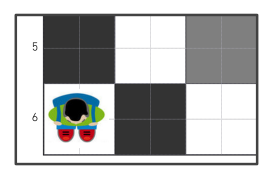

---
## Grön mission

Gå till den gröna punkten genom att följa följande program:

---

Lösning: Grön mission. Vy ovanifrån — «robot-barnet» tittar uppåt.

---
## Lila mission

Nå den lila punkten genom att följa följande program:

---

Lösning: Lila mission. Vy ovanifrån — «robot-barnet» tittar nedåt.

---
## Blå mission

Nå den blå punkten genom att följa följande program.

---

Lösning: Blå mission. Vy ovanifrån — «robot-barnet» tittar åt höger.

