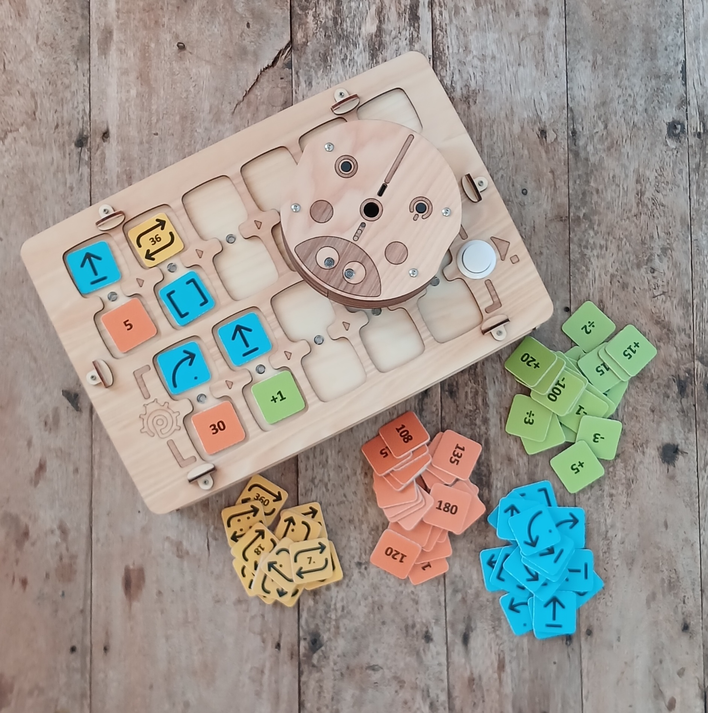
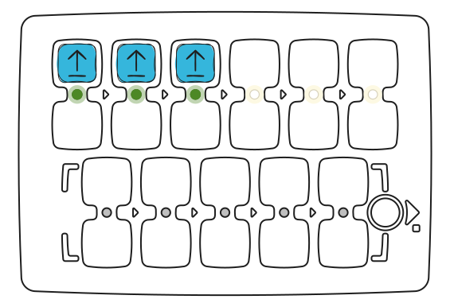
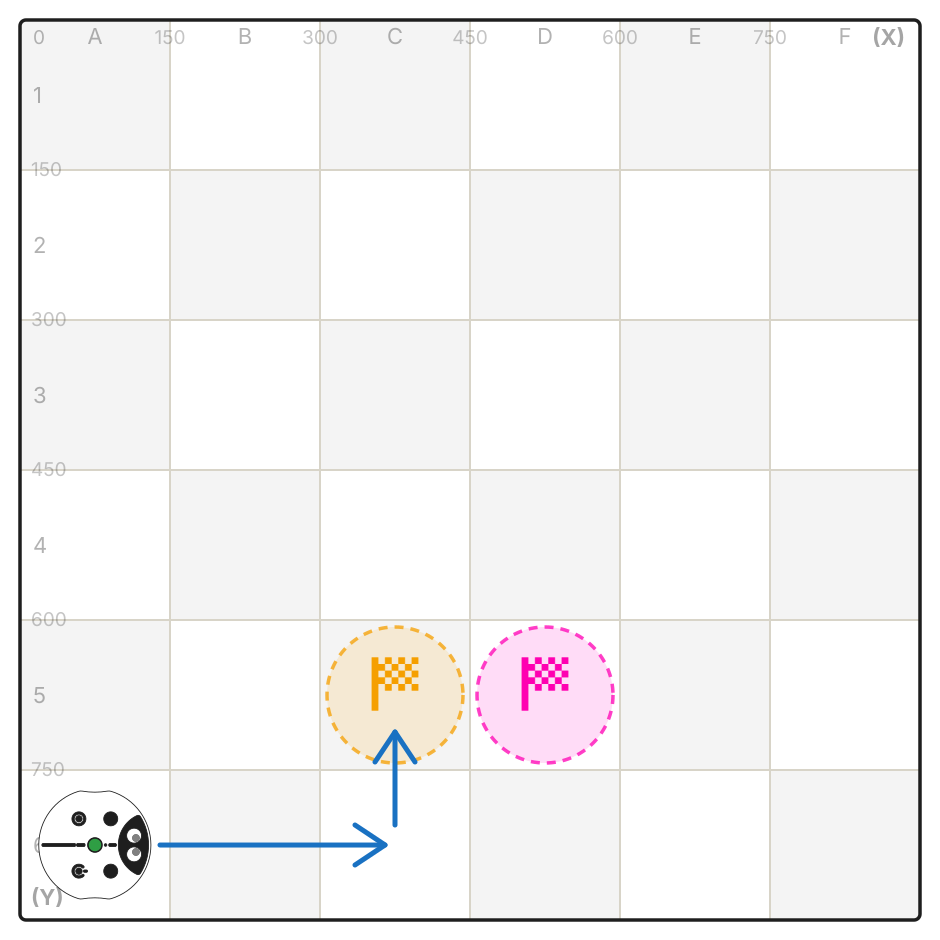
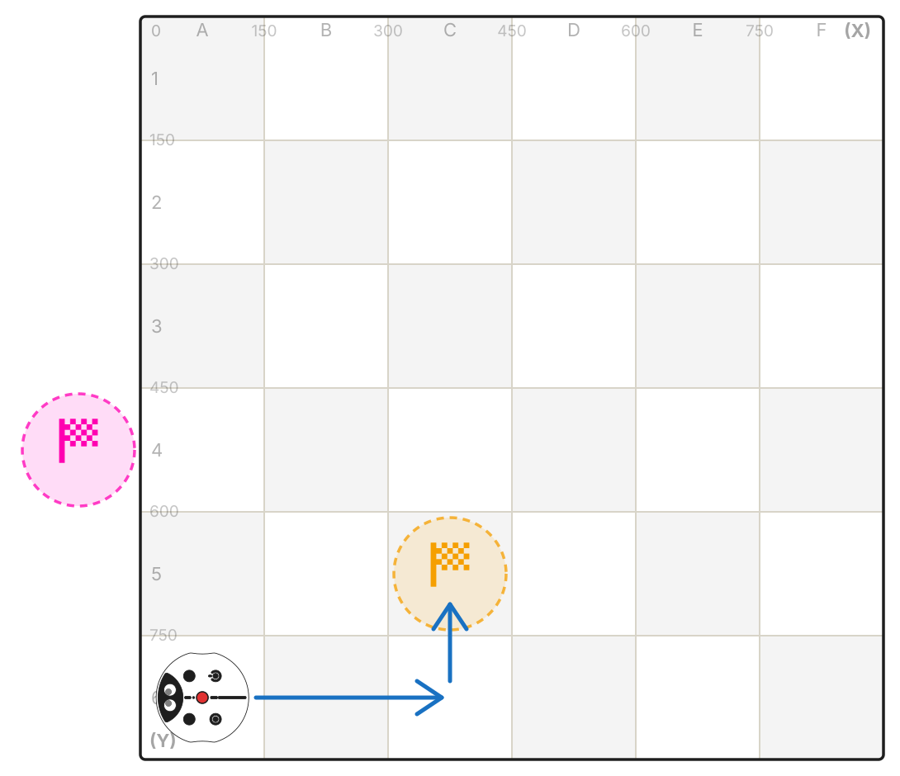

## Vägledning för genomförande av lektioner med barn från 4 år

PrimaSTEM hjälper barn att steg för steg bemästra logiskt tänkande, grunderna i programmering och matematik. Denna vägledning hjälper dig att hålla lektioner med barn från 4 år.

### Så fungerar det

Barnen programmerar rörelserna hos en liten nyckelpigerobot. För det lägger de kommandobrickor på kontrollpanelen.

- **"Framåt"**: roboten kör rakt fram.
- **"Vänster"**: roboten svänger åt vänster.
- **"Höger"**: roboten svänger åt höger.
- **"Funktion"** (brickan "[ ]"): ersätter en sekvens av kommandon.
- **"Upprepa"**: upprepar ett kommando eller en funktion flera gånger.

Du lägger brickorna på kontrollpanelen och gör på så sätt ett rörelseprogram för roboten. När programmet är klart trycker du på knappen, och roboten utför kommandona.

### Innehåll i vägledningen

- Varför hålla lektioner i robotik och programmering
- Hur du organiserar lektionerna under olika förhållanden
- Aktiviteter och lärandemål
- Detaljerad bruksanvisning
- Beskrivning av aktiviteter
- Bilagor
- Om projektet och författarna

### Det här lär sig barnen med PrimaSTEM

- Programmera med händerna, utan skärm
- Förstå att maskiner arbetar efter algoritmer
- Planera handlingar i förväg
- Tänka logiskt
- Skapa sekvenser av kommandon och funktioner
- Förstå vad en "bugg" (fel i koden) är, och hitta fel
- Lära sig tal, aritmetik och geometri visuellt

## Vad PrimaSTEM består av

### Vad finns i lådan

- Nyckelpigerobot
- Kontrollpanel
- Kommandobrickor *
- Aktivitetsvägledning *

(*) Innehållet beror på konfigurationen.

## Varför hålla lektioner i programmering och matematik

Kod, programmering och automatisering har blivit en del av vår vardag.

Under de senaste åren har människor lärt sig att skapa maskiner som gör saker som maskiner inte kunde förut: förstå, tala, höra, se, svara, skriva.

Exemplen är många: självkörande bilar, robotassistenter för äldre, leveransrobotar och andra.

### Varför lära ut programmering och robotik

När ett barn lär sig programmera lär det sig förstå maskinerna omkring oss. Det lär sig förvandla små och dristiga idéer till verkliga projekt. Det delar upp en svår uppgift i enkla steg. Det samarbetar med andra och löser gemensamma uppgifter.

### Födda i den digitala tidsåldern

Det kan verka som om barn och unga är duktiga på teknik. De använder ju mycket digital underhållning.

Men kan de använda de här verktygen för att skapa något eget och uttrycka sig? Vad gör de när de stöter på ett tekniskt problem?

## Hur du organiserar lektionerna

Aktiviteterna passar för olika syften och lärmiljöer. Alla aktiviteter i vägledningen är numrerade. Nedan står det vilka aktiviteter som passar dina förutsättningar.

### För vem

- Barn från 4 till 8 år.
- Äldre grupper och förskolegrupper i förskolan, 1:a och 2:a klass i grundskolan.

### Aktiviteter för fritidsverksamhet

Aktiviteterna 1, 2, 4, 5, 6, 7, 8, 9, 10.

### Aktiviteter för skolan

Aktiviteterna 2, 3, 4, 5, 6, 7, 8, 9, 11, 12.

### Fritidsaktivitet

Gruppen bör ha högst 12 barn, så att alla kan delta aktivt.

Vi rekommenderar en enhet per 2–3 elever. Så lär sig barnen att arbeta i team och samarbeta.

### Arbete i skolan

I klassrummet är det bäst att arbeta med PrimaSTEM i små grupper om 4–6 barn med en lärare.
De andra eleverna gör under tiden en annan uppgift med en assistent. Elever i 1:an och 2:an kan till exempel öva på att rita robotens väg enligt programmet.
I båda fallen är det bäst att ha lektionerna i en flerbrukshall, direkt på golvet. Du kan också flytta bord och stolar för att frigöra yta.

**Obs.** Ladda batterierna till kontrollpanelen och roboten i förväg.

## Aktiviteter och lärandemål

| Aktivitet | Algoritm och program | Rutten i etapper | Förutse rörelse | Lösa problem, hitta fel | Teamarbete |
| --- | :---: | :---: | :---: | :---: | :---: |
| 1 |   | X |   | X |   |
| 2 |   |   | X |   | X |
| 3 | X | X |   |   |   |
| 4 | X | X | X |   |   |
| 5 | X | X | X |   | X |
| 6 | X | X | X | X | X |
| 7 | X | X | X | X | X |
| 8 | X |   | X | X |   |
| 9 | X | X | X | X | X |
| 10 | X |   | X | X |   |
| 11 | X | X | X | X | X |
| 12 | X | X | X | X | X |

## Bruksanvisning

### Innehåll i anvisningen

- Bekantskap med materialen
- Programmering av en funktion
- Kartor
- Tekniska förklaringar

## Bekantskap med materialen

### Robot

En liten nyckelpigerobot i trä med två ögon.

Den har tre stödpunkter: två hjul och ett stöd baktill. På dem håller den balansen.

### Grundläggande kommandon

| Kommando | Ritning                             | Beskrivning                                                                                  |
| -------- | ----------------------------------- | -------------------------------------------------------------------------------------------- |
| Framåt   |   | Roboten kör en ruta framåt. Det är ett logiskt steg, som standard 15 cm.                     |
| Vänster  |      | Roboten svänger 90° till vänster                                                             |
| Höger    |     | Roboten svänger 90° till höger                                                               |
| Bakåt    |      | Roboten backar en ruta, alltså ett logiskt standardsteg                                     |
| Funktion |  | Roboten utför kommandona från funktionsraden                                 |
| Upprepa N |   | Roboten upprepar kommandot från samma dubbelcell N gånger   |

### Kontrollpanel

På kontrollpanelen styr du roboten: du lägger kommandobrickor i de lediga cellerna (D).

Den övre raden (A) med 6 dubbelceller, förbundna med en utförandelinje (E), är huvudprogrammet. Programmet startar i cellen till vänster (D) och slutar ovanför **▶ Start**-knappen (B). Den knappen skickar kommandona till roboten och startar programmet.

Den nedre raden (C) med 5 dubbelceller bestämmer rörelserna för brickan "Funktion" ("[ ]"). Varje dubbelcell har en lysdiod (F). Den lyser när du lägger in en bricka och blinkar när roboten utför det kommandot.

#### Lysdiodernas färger

När en bricka ligger rätt i cellen lyser lysdioden grönt.
När du lägger en upprepa-bricka tillsammans med ett rörelsekommando i dubbelcellen lyser lysdioden blått.
När brickorna ligger fel, till exempel två rörelsekommandon i en dubbelcell, lyser lysdioden rött. Roboten hoppar över det kommandot.

### Batteri och strömbrytare

Roboten och kontrollpanelen drivs av inbyggda batterier. De laddas via en USB-C-port. Strömbrytaren (ON/OFF) sitter ovanpå roboten och på framsidan av kontrollpanelen till vänster.

När roboten eller kontrollpanelen slås på hörs en kort ljudsignal.
På en påslagen kontrollpanel lyser lysdioden på frontpanelen grönt. På en påslagen robot lyser lysdioden vid USB-C-kontakten grönt.

### Trådlös anslutning

Roboten och kontrollpanelen är anslutna via Bluetooth med en räckvidd på ca 5 m. Efter att roboten har anslutits till kontrollpanelen första gången fungerar förbindelsen av sig själv. Du behöver inte ställa in något.

> Du kan ansluta kontrollpanelen till en annan robot (parkoppling).
> 1. Slå på roboten som ännu inte är parkopplad med kontrollpanelen.
> 2. Slå på kontrollpanelen.
> 3. Håll inne **▶ Start**-knappen på kontrollpanelen i 10 sekunder, tills du hör en ljudsignal och ser en ljussignal.

### Så skapar och kör du ett program

Programmet ("rörelsesekvensen") startar till vänster på kontrollpanelen. Det följer de graverade pilarna ">". Det är utförandelinjen, som förbinder dubbelcellerna horisontellt.

Om det finns en tom cell före en bricka hoppar roboten över den tomma cellen och utför brickans kommando.

Om en bricka ligger fel lyser lysdioden rött, och roboten hoppar över den här delen av programmet. Det händer till exempel när "Upprepa" ligger i en dubbelcell utan kommando, eller när två kommandobrickor ligger i en dubbelcell.

När programmet är klart trycker du på **▶ Start**-knappen.

Medan roboten utför programmet släcks lysdioderna på kontrollpanelen en efter en. Lysdioden för det aktuella kommandot blinkar.

## Programmering av en funktion

### Så skapar du en funktion

Brickan "Funktion" ("[ ]") ersätter en sekvens av kommandon.

Med den kan du göra längre program och lösa svårare uppgifter. För att skapa en funktion lägger du rörelserna i den nedre raden på kontrollpanelen: det är 5 dubbelceller. Roboten utför den raden från vänster till höger varje gång den kommer till brickan "Funktion" i huvudprogrammet (överst).

I exemplet nedan består funktionen av en rörelse rakt fram och en sväng åt höger. Huvudprogrammet anropar funktionen 2 gånger. Sedan upprepar brickan "Upprepa 2" funktionen ytterligare 2 gånger.

[Kör i simulatorn](https://simulator.primastem.com/#top=cfun,cfun,cfun.r002&fn=cfor,crig&s=l1144602&r=225-675-0&run)

Så här blir det:

## Kartor

### Vilka kartor som passar

På de första lektionerna lär sig barnen algoritmer, programmering och tal. För det kör roboten på en karta med rutnät. Det är bäst att använda kartor med rutor på 15 cm: så långt kör roboten i ett standardsteg.

Kartor för andra robotar går också bra, om rutstorleken passar den här roboten.

> Du kan ändra standardsteget från 15 cm till rutstorleken på din karta, till exempel 10 cm, 12,5 cm eller 20 cm. Lägg då den speciella brickan "Standardsteg" med ett tal i millimeter: 100 för 10 cm, 125 för 12,5 cm, 200 för 20 cm.

Om du inte har någon karta, gör en själv. Fäst tunn maskeringstejp på ett plant bord eller golv. Du kan också använda ett ark ritpapper (eller tjockt bannermaterial) och en penna.

En schackrutig karta eller en tom karta med rutor används för att öva på att köra från en punkt till en annan. Färgerna distraherar inte.

En färgkarta hjälper dig att berätta korta historier om robotens resor. Till exempel: "Nyckelpigan går hemifrån och går till bergen genom skogen". Klassen kan göra en ny karta och hitta på nya historier om nyckelpigans resor.

#### Exempel på kartor

Schackrutig karta

Färgkarta

## Tekniska förklaringar

### Så är det uppbyggt

Kontrollpanelen och roboten har mikrokontroller och Li-Ion-batterier. Enheterna är anslutna via radio med standardprotokollet Bluetooth.

Robotens kretskort styr hela dess beteende. Det styr två 5V DC-motorer och två flerfärgade lysdioder, spelar upp ljud, kommunicerar med kontrollpanelen etc.

Kontrollpanelens kretskort känner igen brickorna i cellerna, spelar upp ljud och styr 11 flerfärgade lysdioder, en för varje dubbelcell.

Varje bricka har ett NFC-klistermärke med en kod för kommandot. Kontrollpanelen läser koden när du lägger brickan i en cell.

När kontrollpanelen har känt igen brickorna och du har startat programmet skickar kontrollpanelen kommandona till roboten trådlöst.

### Egna kommandobrickor

Du kan skapa extra kommandobrickor, till exempel "Upprepa 12" eller fler rörelsebrickor. För det behöver du "tomma" brickor med NFC-klistermärken och en telefon med NFC. De flesta typer av klistermärken med frekvensen 13,56 MHz fungerar.

Videoinstruktion finns på vår YouTube-kanal: https://www.youtube.com/@primastem

---

## Aktiviteter

### Detaljerad beskrivning av aktiviteter

- **Aktivitet 1**: vägen på schackbrädet från punkt A till punkt B
- **Aktivitet 2**: bekantskap med PrimaSTEM
- **Aktivitet 3**: barnet spelar roboten, orientering och algoritm
- **Aktivitet 4**: förutse robotens väg enligt programmet
- **Aktivitet 5**: kommandosekvens i ett slumpmässigt program
- **Aktivitet 6**: för roboten till bergen med kontrollpanelen
- **Aktivitet 7**: bekantskap med brickan "Funktion"
- **Aktivitet 8**: rutt till målet med funktion
- **Aktivitet 9**: felsökning i ett program med fel
- **Aktivitet 10**: hitta felet i programmet på papper
- **Aktivitet 11 och 12**: förutse robotens rörelser (i aktivitet 12 med brickan "Funktion")

---

## Aktivitet 1. Vägen på schackbrädet från punkt A till punkt B

- **individuellt**
- **15 min**
- **på papper**
- **dokument för utskrift**

### Mål

- Planera vägen via rutor från punkt A till punkt B på kartan.

Övningen varar i 10 minuter med en sammanfattning efteråt.

### För utskrift

Skriv ut bladet "[Bilaga 1. Förflyttning på kartan](/sv/book-1/attachment-1)" till varje elev.

### Övning

Barnen ritar på rutnätet den väg som musen går för att komma till osten. Börja med den vänstra övningen, den är enklare. Gå sedan vidare till den högra.

#### Förflyttning via rutor

Musen går via rutorna i rutnätet. Den får inte gå diagonalt. Barnen ska förstå att musens väg är uppdelad i etapper: den går en ruta i taget. Då rör den sig stegvis.

I exemplet ovan är bara den blå vägen korrekt. Den korta röda vägen är fel eftersom den går diagonalt. Den långa röda vägen är fel eftersom den inte leder till önskad punkt.

### Diskussion i grupp

I exemplet ovan är alla vägar korrekta: på varje väg kommer musen fram till osten.

Visa barnen att varje barn kan ha tänkt på sin egen väg, och att det ofta finns flera korrekta vägar.

#### Vissa vägar är längre än andra

Räkna hur många rutor musen går till rutan med ost:
- 3 rutor på den gröna vägen
- 3 rutor på den grå vägen
- 3 rutor på den blå vägen
- 13 rutor på den gula vägen

#### Den kortaste vägen

Alla dessa vägar är korrekta, men musen väljer den kortaste.

Fråga barnen: "Varför valde musen den kortaste vägen?"

Svaren kan vara olika. Musen vill spara krafter: den är väldigt trött och vill gå så lite som möjligt. Eller musen har bråttom: den är väldigt hungrig och vill komma fram till osten så snabbt som möjligt.

**Notering till ledare.** Med robotar är det precis detsamma. Vi väljer alltid den kortaste vägen, eftersom den är effektivast.

#### Flera vägar är möjliga

När övningen är klar ber du eleverna visa sina vägar. Det finns alltid flera vägar, så eleverna föreslår troligen olika svar, och alla är korrekta.

---

## Aktivitet 2. Bekantskap med PrimaSTEM

- **15 min**
- **i grupp**
- **demonstration**
- **praktik**

### Mål

- Förstå hur roboten kan röra sig.
- Lära sig att kontrollpanelen styr roboten.
- Förstå vad kommandobrickorna gör.

Dela in eleverna i små grupper. Sitt vid ett lågt bord eller på golvet. Ta fram kartan med rutnät, kontrollpanelen, roboten och brickorna. Presentera PrimaSTEM för alla elever, grupp för grupp.

### Presentation

Visa varje sak på bordet och säg de ord som barnen behöver.

Först **kartan**. Det är samma rutnät som i aktivitet 1, bara större.

Sedan **nyckelpigeroboten**. Den kan köra.

Roboten styrs av **kontrollpanelen**. Den gör det som brickorna i cellerna på kontrollpanelen säger.

**Brickorna** ger kommandon: kör rakt fram, sväng åt vänster eller höger.

### 1:a etappen: demonstration

När barnen kan orden visar du allt själv. Lägg en bricka på kontrollpanelen, så ser barnen vad som händer.

| Bild                                               | Beskrivning                                                                 |
| -------------------------------------------------- | --------------------------------------------------------------------------- |
|  | Brickan **"Framåt"** flyttar roboten en ruta framåt |

Placera roboten på valfri ruta på kartan. Lägg brickan i den första cellen i programmet, som på schemat nedan. Tryck sedan på den vita knappen **▶ Start**.

Roboten kör en ruta framåt.

### 2:a etappen: lämna över styrningen

| Bild                                            | Beskrivning                                                                                                                                                                             |
| ----------------------------------------------- | --------------------------------------------------------------------------------------------------------------------------------------------------------------------------------------- |
|  | Brickan **"Vänster"** med en pil i en båge svänger roboten åt vänster, moturs. Som standard är svängen 90 grader. |

Ta bort brickan "Framåt" från kontrollpanelen och ge barnet brickan "Vänster". Låt barnet själv lägga den i den första cellen i programmet och trycka på den vita knappen **▶ Start**. Roboten står kvar och tar en kvarts varv åt vänster.

| Bild                                             | Beskrivning                                                   |
| ------------------------------------------------ | ------------------------------------------------------------- |
|  | Brickan **"Höger"** svänger roboten åt höger. |

Be ett annat barn byta ut brickan "Vänster" mot brickan "Höger" och trycka på den vita knappen **▶ Start**. Roboten står kvar och tar en kvarts varv åt höger.

Sedan arbetar barnen med kontrollpanelen i tur och ordning. Ge dem bara 3 brickor: **"Framåt"**, **"Vänster"** och **"Höger"**.

När roboten har kört klart kan barnen trycka på **▶ Start** en gång till och köra sitt program igen.

Låt barnen själva se att brickorna kan ligga i vilka celler som helst, utom två kommandon i en dubbelcell. Roboten utför dem i tur och ordning, från vänster till höger.

> För att stoppa programmet trycker du på **▶ Start / Stopp** en gång till medan roboten kör.

---

## Aktivitet 3. Barnet spelar roboten: orientering och algoritm

- **45 min**
- **i grupp**
- **lek**
- **karta**

### Mål

- Ta hänsyn till vart roboten tittar vid starten av programmet.
- Förutse robotens rörelser enligt programmet.

### För utskrift

Skriv ut korten "[Bilaga 2. Missionskort](/sv/book-1/attachment-2)" till varje elev.

### Lekens princip

Det här är ett rollspel i ett öppet utrymme. Barnen föreställer sig att de är roboten på ett svartvitt fält.

### Regler för leken

En elev spelar roboten på kartan. I stället för kartan kan du använda ett golv med kvadratiskt mönster: ritning, kakel eller rutor av tunn maskeringstejp. De andra eleverna programmerar roboten med hjälp av uppdragskorten.

Barnen får inte veta vart robot-barnet tittar.
De bestämmer själva vart roboten måste titta för att klara uppdraget.

1. Robot-barnet ställer sig på den röda rutan 1. Det ska fram till den gröna rutan 2.
2. Robot-barnet ställer sig på den röda rutan 1. Det ska fram till den lila rutan 3.
3. Robot-barnet ställer sig på den röda rutan 1. Det ska fram till den blå rutan 4.

> För att kartan ska hålla längre ber du barnet ta av sig skorna.

### Slut på leken

Nu förstår barnet att när man programmerar en förflyttning måste man ta hänsyn till var roboten står och vart den tittar.

Roboten utför kommandot beroende på hur den är vänd. Den kör rakt fram, svänger åt vänster eller svänger åt höger, **men alltid utifrån sin startriktning.**

---

## Aktivitet 4. Förutse robotens väg enligt programmet

- **45 min**
- **individuellt**
- **på papper**
- **dokument för utskrift**

### Mål

- Ta hänsyn till vart roboten tittar i starten.
- Förstå kommandona i programmet.
- Förutse robotens rörelser enligt programmet.

### För utskrift

Skriv ut korten "[Bilaga 3. Rita vägen efter programmet](/sv/book-1/attachment-3)" till varje elev.

Barnen får ett blad med ett program på flera kommandon. De ritar den väg som roboten kör enligt programmet.

Enligt det här programmet kör roboten tre gånger rakt fram:

<Columns cols={2}>
  <Frame>
    
  </Frame>
  <Frame>
    
  </Frame>
</Columns>

[Kör i simulatorn](https://simulator.primastem.com/#top=cfor,cfor,cfor&s=l1144602&r=75-825-0&m=02&run)

Här är samma program, och roboten kör också tre gånger rakt fram.
Men i början tittar den åt höger. Därför kör den tre rutor åt höger:

<Columns cols={2}>
  <Frame>
    
  </Frame>
  <Frame>
    
  </Frame>
</Columns>

[Kör i simulatorn](https://simulator.primastem.com/#top=cfor,cfor,cfor&s=l1144602&r=75-825-90&m=35&run)

I det här programmet svänger roboten. Först svänger den åt höger, och sedan kör den två rutor framåt:

<Columns cols={2}>
  <Frame>
    
  </Frame>
  <Frame>
    
  </Frame>
</Columns>

[Kör i simulatorn](https://simulator.primastem.com/#top=crig,cfor,cfor&s=l1144602&r=75-825-0&m=25&run)

Den sista övningen är svårare: roboten byter riktning två gånger. Den kör en ruta rakt fram, svänger åt höger och kör en ruta. Sedan svänger den åt vänster och kör två rutor:

<Columns cols={2}>
  <Frame>
    
  </Frame>
  <Frame>
    
  </Frame>
</Columns>

[Kör i simulatorn](https://simulator.primastem.com/#top=cfor,crig,cfor,clef,cfor,cfor&s=l1144602&r=75-825-0&m=12&run)

### Notering till ledare

Den här övningen på papper kan vara svår.
Om ett barn har svårt att förstå robotens svängar och ordningen på rörelserna, ta fram PrimaSTEM-setet. Be barnet lägga programmen från bladen på kontrollpanelen.
När barnen tar på och tittar förstår de bättre.

---

## Aktivitet 5. Kommandosekvens i ett slumpmässigt program

- **45 min**
- **i grupp**
- **lek**

### Mål

- Koppla kommandona till de rörelser som roboten utför.
- Se kartans gränser.
- Lära sig att överföra kommandona till kontrollpanelen.

### Genomförande av leken

1. Placera roboten på valfri ruta på kartan, helst vid kanten. Välj valfri riktning.
2. Kasta tärningen. Flytta roboten med handen och skriv ner programmet på papper eller en rittavla: rita pilen för kommandot "Framåt". Om roboten går utanför kartans kant, kasta tärningen på nytt.

3. Upprepa detta, så att du får 2 program i rad. Roboten ska inte gå utanför kartans kant, så kasta tärningen på nytt vid behov.

Till slut har du 2 program med "Framåt"-kommandon på bladet. Om du utför dem efter varandra kör roboten det nödvändiga antalet rutor mot kartans kant.

Exempel:

<Columns cols={2}>
  <Frame>
    
  </Frame>
  <Frame>
    

      
      
    

  </Frame>
</Columns>

**Utför de nedskrivna programmen på en riktig PrimaSTEM.**

---

## Aktivitet 6. För roboten till bergen med kontrollpanelen

- **45 min**
- **i grupp**
- **praktik**

### Mål

- Dela upp rutten i etapper.
- Göra ett program för ett bestämt mål.

För den här aktiviteten behöver du:
- kontrollpanel;
- rörelsebrickor: 4 "Framåt", 4 "Vänster" och 4 "Höger" per grupp, lägg resten av brickorna åt sidan;
- karta och robot.

Dela in barnen i grupper om 3 eller 4. Ge varje grupp en kontrollpanel och en uppsättning brickor.

### 1:a etappen: reflektion

Nyckelpigeroboten står hemma, och vi vill föra den till bergen. Skriv ett program på tavlan som tar den dit.

> Om du inte har rätt karta, rita platserna på papper, gärna tillsammans med barnen. Fäst dem på kartan med tejp.

Fråga först barnen vilka rutor de vill föra roboten genom för att komma till berget. Det finns återigen många möjligheter. Vi väljer de kortaste rutterna för att spara energi och tid.

När vägen är vald går du igenom robotens rörelser med barnen, ruta för ruta.

Ska den köra rakt fram, svänga åt vänster eller svänga åt höger?
Flytta roboten över kartan med handen och visa hur varje kommando flyttar den.

### 2:a etappen: programmering

Be barnen lägga ut robotens rörelser i ordning på kontrollpanelen med kommandobrickorna. Det här programmet ska föra roboten till målet.

**Förväntat program:**

### 3:e etappen: kontroll

Alla programmerare med självaktning kontrollerar om programmet fungerar. Be barnen lägga ut programmet på kontrollpanelen och starta det.

<Columns cols={2}>
  <Frame>
    
  </Frame>
  <Frame>
    
  </Frame>
</Columns>

[Kör i simulatorn](https://simulator.primastem.com/#top=cfor,cfor,crig,cfor&s=l1144602&r=75-825-0&m=13&run)

Kom roboten fram till berget? Om inte, varför? Låt barnen själva rätta felen i programmet, om det finns några.

---

## Aktivitet 7. Bekantskap med brickan "Funktion"

- **15 min**
- **i grupp**
- **demonstration**

### Mål

- Förstå att brickan "Funktion" kan ersätta andra kommandon.
- Bekanta sig med upprepning av en kommandosekvens.

Dela in eleverna i små grupper. Sitt vid ett lågt bord eller på golvet. Ta fram kartan, kontrollpanelen, roboten och kommandobrickorna. Grupperna bekantar sig med brickan "Funktion" i tur och ordning.

### 1:a etappen: demonstration

Visa barnen brickan "Funktion".

Den ersätter flera rörelsekommandon: "Framåt", "Vänster", "Höger" eller "Bakåt". Med den kan du upprepa samma korta programdel flera gånger.

Visa först själv. Gör ett program som på ritningen nedan.

När roboten kommer till brickan "Funktion" utför den kommandona från ramen [-----] längst ner på kontrollpanelen. Det är samma sak som om kommandona låg där brickan "Funktion" ligger.
I vårt exempel kör roboten två gånger rakt fram.

### 2:a etappen: gåtor

Lägg nu till brickan "Höger" i slutet av huvudprogrammet, som på ritningen nedan.

Innan du startar, fråga barnen vad som kommer att hända. Programmet fungerar som om det bestod av två röda "Framåt"-brickor och en "Höger"-bricka. Roboten kör två rutor framåt och svänger åt höger, ett kvarts varv.

Till slut visar du en **loop**.
Lägg ut ett program med fyra "Funktion"-brickor, som på ritningen nedan.

[Kör i simulatorn](https://simulator.primastem.com/#top=cfun,cfun,cfun,cfun&fn=cfor,crig&s=l1144602&r=225-675-0&run)

Innan du startar, fråga barnen vad som kommer att hända. Starta sedan programmet och kontrollera.

**Roboten utför en loop:**

**Notering till ledare.** När barnen bekantar sig med funktionen är det bra att titta på lysdioderna. De blinkar medan programmet körs. Då ser man vilket kommando roboten utför och hur den kör samtidigt.

---

## Aktivitet 8. Rutt till målet med funktion

- **45 min**
- **i grupp**
- **praktik**

### Mål

- Dela upp rutten i etapper.
- Göra ett program för ett bestämt mål.
- Använda brickan "Funktion" i programmet.

För den här aktiviteten behöver du:
- brickor eller hemgjorda kort med ritningar av kommandon: 4 "Framåt", 4 "Vänster", 4 "Höger" och 4 "Funktion" per grupp;
- karta och robot, utan kontrollpanel.

Om det är många barn, dela in dem i grupper om 3 eller 4. Ge varje grupp kort med ritningar av kommandon eller brickor från setet, exakt 4 av varje sort.

### 1:a etappen: reflektion

> Om din karta har andra bilder eller inga, ändra uppgiften. Markera 2 punkter (Start och Mål) med ett avstånd på 4 rutor i en vinkel på 90 grader.

Roboten står vid flaggan, och vi vill föra den till rutan "Natt" med moln. Gör ett program med brickan "Funktion": lägg ut brickor eller ritningar av kommandon på bordet.

Fråga först barnen vilka rutor de vill föra roboten genom för att komma till berget. Berget ligger ungefär mitt på vägen. Det finns många möjligheter. Den här gången väljer vi rutter där kommandona upprepas, så att brickan "Funktion" kommer till nytta.

När vägen är vald går du igenom robotens rörelser med barnen, ruta för ruta. Flytta roboten med handen och kontrollera programmet.

### 2:a etappen: det räcker inte med brickor

Be barnen lägga ut robotens rörelser i ordning på bordet, med kort eller brickor.

Håll strikt koll på antalet brickor som varje grupp har: 4 "Framåt", 4 "Vänster", 4 "Höger" och 4 "Funktion".

Oj, det räcker inte med brickor! Vi behöver fler "Framåt"-kommandon. Digital panik! :)

Påminn barnen om brickan "Funktion": den ersätter flera andra brickor.

Den kan till exempel ersätta flera "Framåt"-kommandon, och roboten kör framåt flera gånger.

Hjälp barnen att göra ett program med brickan "Funktion", som på ritningen nedan.

Exempel på rutt och dess program:

### 3:e etappen: kontroll

Hjälp barnen att lägga ut programmet på kontrollpanelen och kontrollera det, som på ritningen:

[Kör i simulatorn](https://simulator.primastem.com/#top=cfun,clef,cfun&fn=cfor,cfor,cfor,cfor&s=l1144602&r=825-825-0&run)

Kom roboten fram till rutan "Natt"? Om inte, varför?
Låt barnen själva rätta felen i programmet, om det finns några.

---

## Aktivitet 9. Felsökning i ett program med fel

- **20 min**
- **i grupp**
- **praktik**

### Mål

- Hitta ett fel i programmet genom att följa körningen.
- Rätta felet i programmet.

Dela in eleverna i små grupper. Sitt vid ett lågt bord eller på golvet. Förbered kartan med rutnät, kontrollpanelen, roboten och brickorna.
Grupperna felsöker programmet i tur och ordning.

Roboten ska fram till berget längs den grå vägen.

Visa barnen ett program med ett fel på kontrollpanelen:

[Kör i simulatorn](https://simulator.primastem.com/#top=cfor,clef,cfor,cfor,clef,cfor&s=l1144602&r=75-825-90&run)

Enligt det här programmet kör roboten till skogen. Barnen startar programmet, letar efter felet och rättar det.

Exempel på rättat program:

[Kör i simulatorn](https://simulator.primastem.com/#top=cfor,clef,cfor,cfor,crig,cfor&s=l1144602&r=75-825-90&run)

---

## Aktivitet 10. Hitta felet i programmet på papper

- **20 min**
- **individuellt**
- **på papper**
- **dokument för utskrift**

### Mål

- Förutse robotens rörelser för att hitta ett fel i programmet.
- Förstå hur man rättar ett fel i programmet.

Barnen får ett blad med ett program som ska föra roboten från punkt A till punkt B. Programmet har ett fel. Barnen letar efter det och försöker rätta det.

### För utskrift

Skriv ut korten "[Bilaga 4. Hitta och rätta till felet i programmet](/sv/book-1/attachment-4)" till varje elev.

### 1:a etappen: läsa programmet

Be först barnen rita robotens väg enligt det här programmet. På rutnätet är den väg som roboten ska köra ritad i blått, och den önskade ankomstpunkten är markerad.

### 2:a etappen: hitta felet

När vägen är ritad ser vi att roboten inte kommer fram till målet (den svarta flaggan). Den kommer till den röda flaggan.
Fråga barnen var roboten gjorde fel. Hitta rutan med felet. I facit är den inringad i rött.

Det finns 3 typer av fel:
- vi tog fel kommando
- vi glömde ett kommando
- vi lade till ett överflödigt kommando

### 3:e etappen: rätta felet

Till slut ber du barnen rätta felet: skriva ett program som för roboten till den svarta flaggan.

**Notering.** Den här övningen på papper kan vara svår. Om ett barn har svårt att se felet, ta fram PrimaSTEM. Be barnet lägga programmet från bladet på kontrollpanelen och starta det. Barnen kan till exempel säga "Åh, nej!" när roboten svänger fel. Då är det lättare att upptäcka felet.

#### Exempel 1
I det här exemplet är kommandot på slutet fel.

<Columns cols={2}>
  <Frame>
    
  </Frame>
  <Frame>
    

      
      
    

  </Frame>
</Columns>

#### Exempel 2
I det här exemplet finns ett överflödigt kommando i början.

<Columns cols={2}>
  <Frame>
    
  </Frame>
  <Frame>
    

      
      
    

  </Frame>
</Columns>

#### Exempel 3
I det här exemplet saknas ett kommando i början.

<Columns cols={2}>
  <Frame>
    
  </Frame>
  <Frame>
    

      
      
    

  </Frame>
</Columns>

---

## Aktivitet 11. Förutse robotens rörelser

- **45 min**
- **i grupp**
- **praktik**

### Mål

- Förutse robotens rörelser enligt ett program utan funktion.

Ta fram PrimaSTEM-setet utan brickorna "Funktion". Alla barn spelar samtidigt, men bara ett barn arbetar med kontrollpanelen.

### 1. Vi programmerar i tystnad

Barnen placerar i tur och ordning roboten i ett hörn av kartan och lägger ut ett program på kontrollpanelen, högst 5 kommandon.

När programmet är klart ber du barnet vänta och inte trycka på knappen än.

### 2. Vi satsar

Be de andra barnen gissa om roboten kör utanför kartans kant.

### 3. Vi kontrollerar

När alla har satsat startar du programmet och ser vad som händer.
Sätt sedan roboten i hörnet igen, och nästa barn gör sitt program.

---

## Aktivitet 12. Förutse robotens rörelser med funktion

### Mål

- Förutse robotens rörelser enligt ett program med funktion.

Genomför aktivitet 11 igen, men lägg till brickorna "Funktion" i setet.

Då programmerar barnen också en funktion. Alla barn spelar samtidigt, men bara ett barn arbetar med kontrollpanelen.

---

## Om projektet och författarna

### Vilka är vi

Företaget PrimaSTEM har skapat och tillverkar enheten med samma namn. Med den lär sig barn från 4 år programmering och matematik utan skärm. Vi finns i södra Frankrike.

Våra material är öppna. De hjälper till att utveckla kreativiteten hos barnen och de vuxna som arbetar med dem.

Du hittar mer om PrimaSTEM-enheten på vår dokumentationssida på 13 språk: https://docs.primastem.com

### Kontakt

Skriv till oss: info@primastem.com

Vår webbplats med information och länkar till sociala medier: https://primastem.com

### Författare

**Anpassning, text, illustrationer:** Andrei Chanov, 2026.

**Konceptförfattare:** Julie Borgeot / Dorie Bruyas från Fréquence écoles

#### Licens för denna vägledning

Detta verk är licensierat under CC BY-SA 4.0. För att se en kopia av denna licens, besök https://creativecommons.org/licenses/by-sa/4.0/

**Creative Commons Erkännande-DelaLika 4.0 Internationell**

Denna licens kräver att återanvändare ger erkännande till skaparen. Den tillåter återanvändare att distribuera, remixa, anpassa och bygga vidare på materialet i vilket medium eller format som helst, även för kommersiella ändamål. Om andra remixar, anpassar eller bygger vidare på materialet måste de licensiera det ändrade materialet under identiska villkor.

---

## Bilagor

- [Bilaga 1. Förflyttning på kartan](/sv/book-1/attachment-1)
- [Bilaga 2. Missionskort](/sv/book-1/attachment-2)
- [Bilaga 3. Rita vägen efter programmet](/sv/book-1/attachment-3)
- [Bilaga 4. Hitta och rätta till felet i programmet](/sv/book-1/attachment-4)
