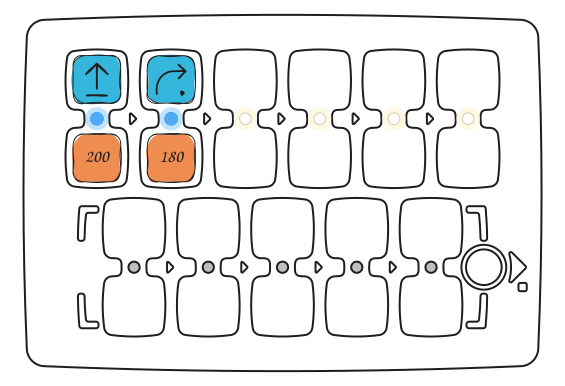

PrimaSTEM lär barn från 4 till 12 år att programmera utan datorer, surfplattor eller telefoner. Satsen utvecklar logik, programmeringsfärdigheter och matematik.

Med PrimaSTEM blir programmering enkel och visuell. Även små barn förstår vad som händer: de tar på brickorna med händerna och lär sig grunderna i programmering, logik och matematik genom lek.

Att leka med PrimaSTEM utvecklar logiskt tänkande, algoritmik, programmering, matematik och geometri. Leken utvecklar också kreativitet och socio-emotionella färdigheter. Satsen förbereder barnet för blockbaserade programmeringsspråk, till exempel [Scratch](https://en.wikipedia.org/wiki/Scratch_(programming_language)) eller [LOGO](https://en.wikipedia.org/wiki/Logo_(programming_language)).

## Lär känna utbildningssatsen

### Var kan PrimaSTEM användas

PrimaSTEM passar för de här verksamheterna:

- Förskoleutbildningscentrum
- Förskolor med Montessori-metodik
- Grundskola
- Hemundervisning
- Specialiserade utvecklingscentrum
- Fritidsgrupper
- Nybörjarprogrammeringsklubbar
- Barns utbildningsläger

### Vad behöver du veta för att komma igång

Innan du arbetar med satsen, läs sidan [Enhet och inställningar](/sv/usermanual) och den här handledningen. Du behöver inga programmeringskunskaper: materialet innehåller allt du behöver för att börja.

## Forskning och värdet av satsen

PrimaSTEM är inspirerat av programmeringsspråket [LOGO](https://en.wikipedia.org/wiki/Logo_(programming_language)), skapat av [Seymour Papert](https://en.wikipedia.org/wiki/Seymour_Papert), och av Montessori-pedagogik. LOGO och sköldpaddsroboten gjorde programmering visuell och tillgänglig för barn.

PrimaSTEM-kommandobrickorna för det här arbetssättet vidare. Barnet styr roboten med händerna, utan skärm och text, och förstår direkt vad det gör.

Barn tittar på roboten, förstår varje kommando och lär sig algoritmer i praktiken.

Roboten har en viktig egenskap: den har en riktning. Barnet sätter sig lätt in i robotens läge och förstår därför snabbare programmets logik.

Alla kommandon är enkla: de säger åt vilket håll roboten ska röra sig. När barn lär roboten att "agera" och "tänka" börjar de reflektera över sina egna handlingar och tankar. Därför blir programmering lättare för dem.

PrimaSTEM-brickor visar på ett visuellt och förenklat sätt hur programmeringsspråk är uppbyggda. I början finns varken text eller siffror, bara grundläggande kommandon.

### Varför trä

🌱 Kontrollpanelen och roboten är gjorda av trä (plywood). Barn tycker mer om att leka med leksaker i trä. De är säkra, håller länge och var och en får sin egen historia.

## Programmering med PrimaSTEM

PrimaSTEM-brickor fungerar som instruktioner i riktiga programmeringsspråk. De visar viktiga begrepp inom programmering.

### Algoritmer

En **algoritm** består av precisa kommandon (brickor) som tillsammans bildar ett program.

### Kö

Kontrollpanelen utför kommandona strikt från vänster till höger. Så ser barnen att kommandona utförs i tur och ordning.

### Felkorrigering (debugging)

Ett fel är lätt att åtgärda: byt helt enkelt ut brickan. Så lär sig barnet att själv hitta och rätta fel i programmet.

### Funktion

En funktion (underrutin) består av kommandon i den nedre raden på kontrollpanelen. Huvudprogrammet anropar den med "**Funktion**"-brickan.

### Variabel

Kontrollpanelen minns det senaste talet för varje kommando. Framåt, Bakåt, Vänster, Höger och Paus har var sitt eget värde. Ett kommando utan tal använder det sparade värdet. Det här är en variabel: den har ett namn (kommandot) och ett värde (talet), och värdet kan ändras.

## Tillämpning i andra ämnen

PrimaSTEM hjälper också till att utveckla andra färdigheter:

- Kommunikation. I gruppleken lär sig barnen att samarbeta.
- Motorik. Arbete med brickor förbättrar koordinationen.
- Sociala färdigheter. Barn får självförtroende och lär sig lösa problem tillsammans.
- Matematik. Barn lär sig grundläggande matematiska begrepp.
- Logik. Barn lär sig bygga sekvenser och förutsäga resultat.

> Barnet lägger en kedja av brickor och lär sig programmering med händer, ögon och huvud. Barnet trycker på **▶ Start**, roboten kör och barnet jämför resultatet med vad det förväntade sig. En sådan upplevelse gör att barnet lär sig snabbare.

## Lär känna roboten och kontrollpanelen

### Roboten

Berätta för barnen att roboten är deras vän och att de kan programmera den. Förklara att den inte har några egna tankar. Den utför bara deras instruktioner, som en hushållsapparat som måste slås på.

### Kontrollpanelen

Förklara att kontrollpanelen skickar kommandon till roboten. Visa hur man lägger kommandobrickor och programmerar roboten.

> Huvudprogrammet bygger du i den övre raden på kontrollpanelen (6 par). Den nedre raden (5 par) är för underrutinen. "**Funktion**"-kommandot anropar den.

### Kommandobrickor

Brickorna ger kommandon till roboten. Du lägger dem på kontrollpanelen. När du trycker på **▶ Start** utför roboten programmet. Varje bricka ger ett kommando. Så lär sig barn datalogiskt tänkande och lär sig bygga program. Det är viktigt att barnen förstår vad roboten gör vid varje kommando. Då kan de planera programmet och förutsäga vad roboten gör. Förklara för barnen att de inte får tappa bort eller skada brickorna: utan dem kan roboten inte röra sig.

## 1. Första programmet

### Orsak och verkan

Huvudmålet: att visa barnen sambandet mellan kommando och handling. Låt barnet lägga "Framåt"-brickan i den första cellen på kontrollpanelen och trycka på **▶ Start**. Barnet ska se att brickan och handlingen hör ihop.

### Entydiga instruktioner

Upprepa detta med varje riktning (**framåt**, sväng **vänster**, sväng **höger**) tills barnet känner igen varje bricka.

### Första uppgiften

Bred ut spelbrädet eller gör ett rutnät med rutor på 15 × 15 cm med tejp eller en tuschpenna. Ställ roboten på startrutan. Be barnet göra ett program som får roboten att köra en cell framåt. Om barnet valde fel bricka, ställ tillbaka roboten och be barnet tänka ut ett annat alternativ.

## 2. Program och debugging

### Händelsekö

Placera ett mål två celler framför roboten.

Låt barnet göra ett program med två brickor som tar roboten till målet.

### Sekvens av tre brickor

Nu ligger målet en cell framåt och en cell till höger.

Låt barnet själv välja rätt ordning på kommandona.

Oroa dig inte om barnet valde fel bricka. Ställ tillbaka roboten på start och be barnet tänka över sitt val och prova andra alternativ.

### Debugging: hitta felet

Placera målet en ruta framför roboten och en ruta till vänster om den.

Den här gången gör du programmet själv och lägger med flit in en felaktig sväng.

Be barnet hitta det felaktiga kommandot och förutsäga var roboten hamnar. Låt sedan barnet trycka på **▶ Start** och kontrollera sin gissning.

När barnet har sett att programmet är fel, genom att resonera eller testa, låt det byta det felaktiga kommandot mot det rätta. Så debuggar barnet programmet.

## 3. Program med funktion

### "Funktion"-kommando

När barnen kan de grundläggande kommandona, visa dem **Funktion**-kommandobrickan. Den anropar en uppsättning kommandon som huvudprogrammet kan upprepa.

> För att förklara hur detta fungerar kan du jämföra funktionen med ett torn: under funktionsbrickan ligger andra kommandon staplade på varandra. Så ser barnen att en bricka kan rymma flera instruktioner.

Visa ett exempel. Lägg först två "Framåt"-brickor i de övre cellerna och kör programmet. Roboten kör två celler.

Lägg nu samma två "Framåt"-brickor i funktionen (nedre raden) och lägg "Funktion" i huvudprogrammet. Resultatet blir detsamma, men nu är en del av programmet dold i en underrutin.

Gör sedan sekvensen: **Framåt, Framåt, Höger, Framåt, Framåt**.

Be barnen hitta de delar som upprepas och "gömma" dem i funktionen. Resultatet ska bli så här: i huvudprogrammet **Funktion, Höger, Funktion**, i nedre raden **Framåt, Framåt**.

[Kör i simulatorn](https://simulator.primastem.com/#top=cfun,crig,cfun&fn=cfor,cfor&s=l1144602&r=225-825-0&run)

### Lösa uppgifter med funktion

Ge barnet 3 "**Framåt**"-brickor och 2 "**Funktion**"-brickor.

Uppgiften: kör 5 celler framåt.

Låt barnet förstå att uppgiften kräver en funktion som upprepar handlingen.

Om programmet är fel, ställ tillbaka roboten på start. Be barnet tänka över hur uppgiften kan lösas rätt och prova andra alternativ.

[Kör i simulatorn](https://simulator.primastem.com/#top=cfun,cfun,cfor&fn=cfor,cfor&s=l1144602&r=225-825-0&run)

## 4. Slumpmässighet

### "Slumpmässig rörelse"-kommando

För att förklara slumpmässighet, ta 4 riktningsbrickor: "**Framåt**", "**Vänster**", "**Höger**" och "**Bakåt**". Lägg dem i en ogenomskinlig låda eller påse och blanda dem. Låt barnen i tur och ordning dra en bricka utan att titta, visa den för gruppen och lägga tillbaka den. Förklara med det här exemplet vad ett slumpmässigt val mellan fyra möjligheter är.

Visa sedan barnen "**Slumpmässig rörelse**"-kommandobrickan.

Förklara att den här brickan gör nästan samma sak som barnen gjorde med påsen. Den väljer en riktning slumpmässigt och flyttar roboten ett steg, alltså en cell. Roboten kan flytta sig en cell framåt, åt höger, åt vänster eller bakåt.

Lägg "**Slumpmässig rörelse**"-brickan i den övre cellen och kör programmet flera gånger. Roboten rör sig olika varje gång.

[Kör i simulatorn](https://simulator.primastem.com/#top=crnd&s=l1144602&r=375-525-0&run)

Lek med barnen: låt dem gissa vart roboten kör före varje start.

Betona att detta är **slumpmässighet** och att du inte kan gissa riktningen varje gång.

Hitta på en liten lek med "**Slumpmässig rörelse**"-brickan tillsammans med barnen.

## 5. Loopar (kommandoupprepningar)

### Lär känna numeriska loopar

Visa barnen upprepningsbrickorna. Fråga om de kan siffror, om de har sett en tärning och om de har spelat brädspel.

Lägg två "Framåt"-brickor i de övre cellerna och kör programmet. Roboten kör två celler.

Låt nu en "Framåt" ligga kvar och lägg brickan "Upprepa 2" under den. Resultatet blir detsamma: handlingen upprepas två gånger.

Lägg 4 "**Framåt**"-brickor och titta på resultatet. Be sedan barnen upprepa samma rörelse på 4 celler med en **upprepningsbricka**.

Uppgiften kan lösas på flera sätt. En enkel lösning: "**Framåt**" och "Upprepa 4". En annan lösning: "**Framåt**" med "Upprepa 3" och ytterligare en "**Framåt**".

[Kör i simulatorn](https://simulator.primastem.com/#top=cfor.r003,cfor&s=l1144602&r=225-825-0&run)

### Upprepa en funktion

Försök tillsammans med barnen att lägga till en upprepning på "Funktion"-kommandot. Roboten kan till exempel köra i sicksack: i övre raden "Funktion" med "Upprepa 5", i nedre raden "**Framåt**", "**Höger**", "**Framåt**", "**Vänster**".

Gör först programmet "trappsteg" i funktionen: "Framåt", "Höger", "Framåt", "Vänster". Kör det.

Lägg sedan till "Upprepa 5" på funktionen. Funktionen upprepas 5 gånger och roboten kör i trappsteg åt höger och uppåt.

[Kör i simulatorn](https://simulator.primastem.com/#top=cfun.r005&fn=cfor,crig,cfor,clef&s=l1144602&r=75-825-0&run)

Roboten kör i trappsteg diagonalt åt höger och uppåt och gör 5 trappsteg.

## 6. Slumpmässiga tal

### Vad är ett slumpmässigt tal

Bland brickorna finns "Upprepa ett slumpmässigt antal gånger" (med en tärning). Den väljer ett slumpmässigt tal från 1 till 6. Lek med barnen: låt dem dra upprepningsbrickor ur en påse.

För att förklara slumpmässiga tal, ta 4 upprepningsbrickor: "**2**", "**3**", "**4**" och "**5**". Lägg dem i en ogenomskinlig låda eller påse och blanda dem. Låt barnen i tur och ordning dra en bricka utan att titta, visa den, säga talet och lägga tillbaka den. Lek vem som drar det högsta talet. Förklara med det här exemplet vad ett slumpmässigt val mellan fyra möjligheter är.

Visa sedan barnen "**Upprepa ett slumpmässigt antal gånger**"-brickan. Förklara att den gör nästan samma sak som barnen gjorde med påsen. Som en tärning väljer den slumpmässigt ett tal från 1 till 6, och roboten upprepar handlingen så många gånger.

Lägg "**Framåt**"-brickan i den övre cellen på kontrollpanelen och "**Upprepa ett slumpmässigt antal gånger**"-brickan under den. Be barnen trycka på **▶ Start**. Ställ tillbaka roboten på sin plats. Upprepa flera gånger.

[Kör i simulatorn](https://simulator.primastem.com/#top=cfor.rrnd&s=l1144702&r=225-975-0&run)

Lek: vems robot kör längst.

Gör barnen uppmärksamma på att roboten kör ett slumpmässigt antal celler, från 1 till 6. Betona att detta är slumpmässighet och att du inte kan veta i förväg hur långt roboten kör.

## 7. Tal: avstånd och vinklar

### Lär känna tal

Om det inte finns något tal i den andra cellen i paret använder roboten standardvärdena: den kör 15 cm framåt och svänger 90°. Talbrickor ändrar de här värdena.

Exempel. Lägg till talet **200** till "**Framåt**"-kommandot och se hur långt roboten kör. Lägg till talet **180** till en sväng och se vad som ändras.

[Kör i simulatorn](https://simulator.primastem.com/#top=cfor.n200,crig.n180&s=l1047602&r=450-600-0&run)

> **Viktigt.** Kontrollpanelen minns det senaste talet för rörelse- och svängkommandon. Om ett kommando står utan nytt tal använder det det sparade talet tills du stänger av kontrollpanelen. Ett nytt tal ersätter det sparade. Steglängden som anges med «Standardsteg»-brickan ligger kvar i minnet efter en omstart. För att få tillbaka 15 cm använder du den brickan med talet 150. Svängen på 90° kommer tillbaka av sig själv efter en omstart.

Med olika tal kör roboten mer komplexa banor. Exempel finns på sidan [Ritexempel](/sv/mathdrawings).

## 8. Aritmetik

### Aritmetiska operationer

Aritmetik ändrar talen i programmet för rörelsekommandon (Framåt, Bakåt, Vänster, Höger). Så kan du styra roboten mer flexibelt.

När en aritmetikbricka ligger i paret ändrar kontrollpanelen det sparade talet för kommandot och skickar det nya värdet till roboten.

Exempel:

[Kör i simulatorn](https://simulator.primastem.com/#top=cfor.n200,crig,cfor.a100&s=l1047602&r=300-700-0&run)

"Framåt 200": roboten kör 20 cm. "Framåt +100": roboten kör ytterligare 30 cm. Totalt 50 cm.

### Uppgift: en växande spiral

Räkning ändrar det sparade talet, alltså variabeln. Bygg programmet: övre raden Framåt 30 och Funktion × 20, nedre raden Höger och Framåt +30. Varje gång funktionen anropas blir sidan 3 cm längre.

Låt barnen först gissa: hur lång blir den femte sidan? Kör sedan programmet och kontrollera. Svar: 15 cm (3 + 3 + 3 + 3 + 3).

[Kör i simulatorn](https://simulator.primastem.com/#top=cfor.n030,cfun.r020&fn=crig,cfor.a030&s=l1047602&r=450-465-0&run)

<Columns cols={2}>
  <Frame caption="Programmet på kontrollpanelen">
    
  </Frame>
  <Frame caption="Vad roboten ritar">
    
  </Frame>
</Columns>

Samma program i LOGO: [PrimaSTEM och LOGO](/sv/logo).

Aritmetik i en loop ger talföljder.

> Om talet blir negativt efter en aritmetisk operation gör roboten det motsatta: den kör bakåt i stället för framåt och svänger åt höger i stället för åt vänster.

Du kan använda addition (+), subtraktion (−), multiplikation (*), division (/), kvadratrot (√) och exponentiering (^).

Mönsterexempel finns på sidan [Ritexempel](/sv/mathdrawings).

---

## Lek och lär tillsammans med barnen

Du känner dina elever bäst. Med PrimaSTEM kan du undervisa i programmering, logik och andra ämnen genom lek. Allt beror på din fantasi.

Tack för att du valde PrimaSTEM. [Skriv till oss](/sv/contacts) om dina erfarenheter och intryck, vi ser fram emot din feedback.
