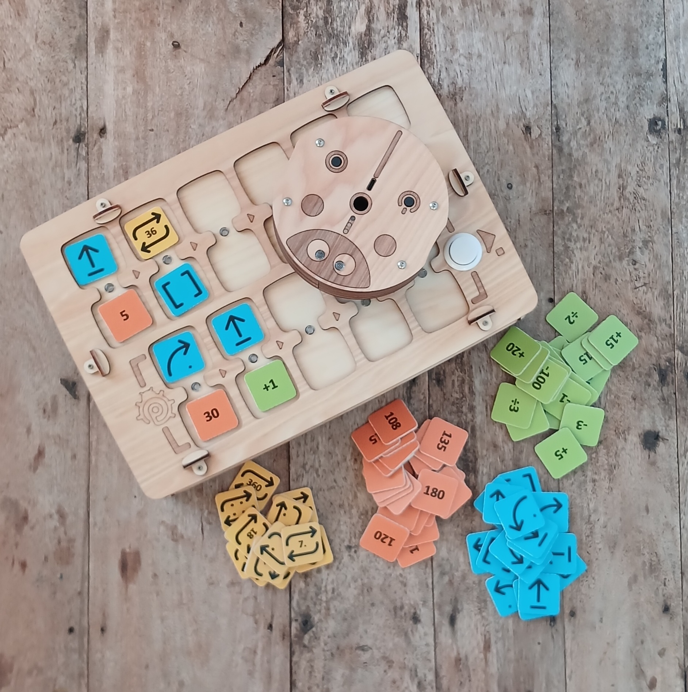
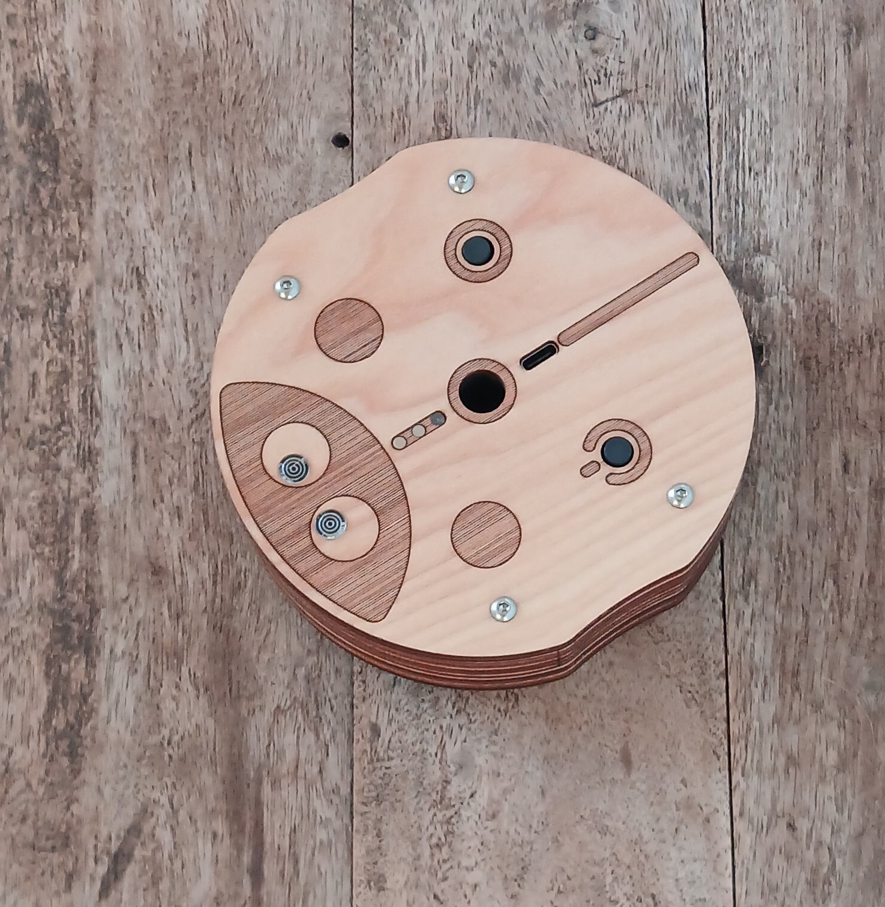
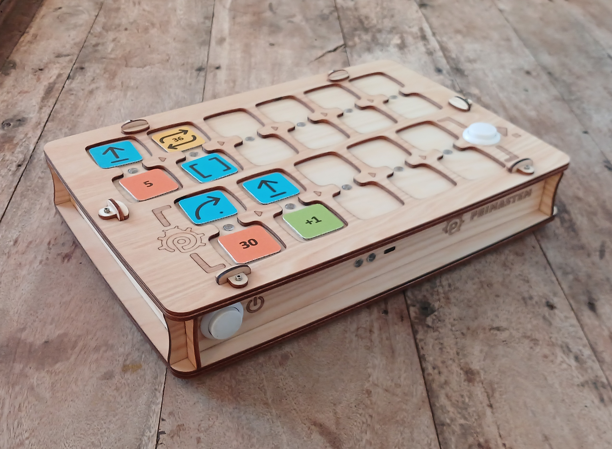
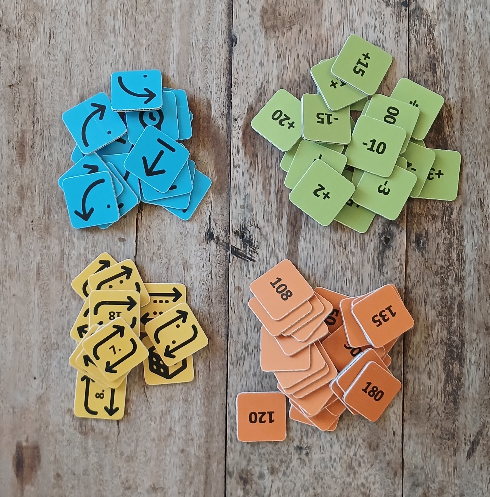
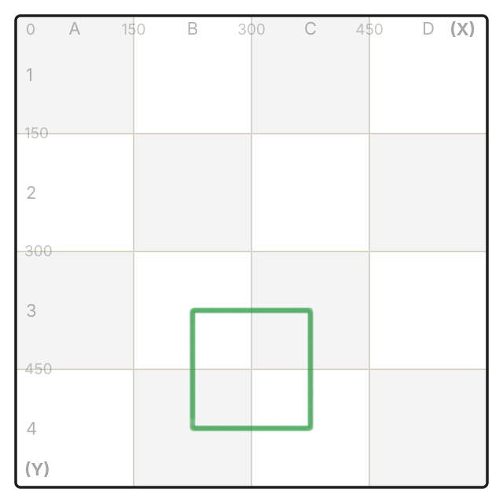
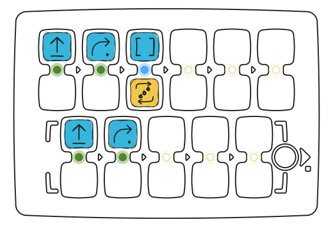

## Tekniska Specifikationer och Paketinnehåll

- Lekrobot
- Kontrollpanel för robot
- Kommando-, värde- och aritmetiska operationsbrickor för att skapa program

> Paketinnehåll och utseende kan variera något. Vänligen kontrollera vid köp.

### Lekrobot

Dimensioner: D=125 mm, H=44 mm.

Roboten är utrustad med en strömknapp, LED-lampor, en högtalare, en funktionsknapp och en USB-C-port för laddning av batteriet.

En markör med diameter på upp till 10 mm kan installeras i mitten av roboten för att rita enkla former under rörelse.

Utseendet kan variera något beroende på konfiguration, men huvudfunktionaliteten behålls.

### Kontrollpanel

Dimensioner: L=317 mm, W=217 mm, H=62 mm.

Kontrollpanelen innehåller 11 dubbla fack för insättning av kommando- och värdebrickor: 6 för huvudprogrammet (övre delen), 5 för underprogrammet (nedre delen).
Kontrollpanelen har två knappar: till vänster — ström, till höger — **▶ Start / Stopp** för att starta och stoppa programmet.

Efter att du har placerat kommando- och värdebrickor i facken, tryck **▶ Start**: roboten kommer att köra programmet. Aktiva kommandon belyses av LED-lampor mellan facken.

Om en bricka är felaktigt installerad signalerar kontrollpanelen med en röd LED, men programmet fortsätter (till exempel när en värdebricka installeras utan kommando).

Kontrollpanelen är utrustad med en USB-C-port för laddning och en högtalare för ljuduppspelning.

### Instruktionsbrickor

Dimensioner: LxW=33 mm.

Setet inkluderar brickor för att skapa program.
Varje bricka är ett kommando med en tydlig betydelse och instruktion. Sekvensen av block bestämmer robotens beteende.

Brickorna är indelade i **kommandon**, **värden** och **aritmetiska**.

#### Kommandobrickor

Grundläggande block för att komponera kontrollprogrammet:

- **Framåt** — rörelse framåt (15 cm som standard)
- **Höger** — sväng 90° medurs
- **Vänster** — sväng 90° moturs
- **Bakåt** — rörelse bakåt (15 cm som standard)
- **Funktion** — kör underprogrammet från den nedre delen av kontrollpanelen
- **Slumpmässig Rörelse** — en av åtgärderna för att flytta roboten: Framåt, Vänster, Höger eller Bakåt (på "standardsteg")
- **Upprepningsbrickor (Loopar)** - Brickor med siffror från 2 till 6 (efter antalet prickar) och upprepningspiktogram med siffran inuti. Brickan med en tärning betyder ett slumpmässigt antal upprepningar från 1 till 6.

> Numeriska värde- och aritmetikbrickor används också för att utöka programmeringen: till exempel att upprepa ett kommando eller ändra rörelsevinkel/distans.

#### Värdebrickor

Vinkel- och distansbrickor: 30°, 36°, 45°, samt multipler (60°, 72°, etc.).
Vinklar i grader, distanser i millimeter.
Som standard — 90° och 150 mm (15 cm).

#### Aritmetiska Operationsbrickor

Ändrar parametrarna för rörelsekommandon:

- Addition (+)
- Subtraktion (−)
- Multiplikation (*)
- Division (/)
- Kvadratrot (√)
- Potens (^)
- Fakultet (!)

Aritmetiken räknar mellan −5000 och 5000. Om svaret blir större än 5000 eller mindre än −5000, om du delar med 0, tar roten ur ett negativt tal eller fakulteten av ett tal större än 6, blinkar facket rött och talet ändras inte. Division sker utan decimaler: 150 ÷ 4 = 37.

## Anslutning mellan Kontrollpanel och Robot

Det rekommenderas att först slå på roboten, sedan kontrollpanelen.

Placera roboten på en plan yta före anslutning: efter parkoppling blir LED-lamporna vita. Medan anslutning saknas lyser roboten och kontrollpanelen ljusblått.

Kontrollera anslutningen: installera brickan "Framåt" och tryck **▶ Start**.

Om det inte finns någon anslutning, starta om båda enheterna eller ladda dem. Tillfällig anslutningsförlust kan uppstå nära starka elektromagnetiska fältkällor (mobiltelefon, WiFi-punkt).

> **Efter uppdatering av enheternas programvara** kan parkoppling krävas: slå på roboten, sedan kontrollpanelen, tryck och håll **▶ Start**-knappen på kontrollpanelen i mer än 10 sekunder. Vid 5:e sekunden hörs en kort signal: släpp inte, fortsätt hålla. Vid 10:e sekunden startar parkopplingen.

## Hur Fungerar Det?

För att programmera rörelse, installera kommandobrickor i kontrollpanelens fack (till exempel "Framåt", "Vänster", "Funktion" etc.).
Du kan ställa in kommandovärden och antal upprepningar, samt värden för vinklar, distanser och aritmetiska operationer.

För gemensam installation av ett kommando och värde (upprepning) är facken förenade med "broar" med indikatorer.

  *Nedan visas ett program som använder en loop som exempel för att upprepa en liknande kodsektion. Programmet skapar en kvadratisk rörelserutt för roboten:*

<Columns cols={2}>
  <Frame>
    
  </Frame>
  <Frame>
    
  </Frame>
</Columns>

[Kör i simulatorn](https://simulator.primastem.com/#top=cfor,crig,cfun.r003&fn=cfor,crig&s=l1144402&r=225-525-0&run)

Kommandon installeras först i den övre delen av kontrollpanelen (6 fack) och körs från vänster till höger. Tomma fack eller fel ignoreras (till exempel två kommandon i ett block eller ett värde utan kommando).

Sekvensen av block bestämmer robotens rörelse.

Tryck **▶ Start** för att starta programmet.

Som standard:
- "Framåt" — 15 cm.
- "Vänster/Höger" — 90°.
- Loopar (upprepningar) upprepar kommandot flera gånger.
- "Funktion" anropar underprogrammet från den nedre delen av kontrollpanelen (5 fack).
- Du kan anropa ett underprogram flera gånger via en loop genom att lägga till en upprepningsbricka till "Funktion" (exempel visas ovan).

### Viktiga Funktioner:

- **Avbryt** programkörningen genom att trycka **▶ Start** igen under rörelse.
- Kontrollpanelen kommer ihåg det senaste **inställda värdet** (distans/vinkel) för rörelsekommandot tills avstängning: till exempel, om "Framåt" = "200", körs alla efterföljande "Framåt"-kommandon med detta värde.
- Värden efter aritmetik sparas också.
- Ändra "**standarddistans**" kan göras med en servicebricka: till exempel, för 12,5 cm, installera brickan "Standarddistans" med värdet 125. Värdet sparas efter avstängning. Tal från 1 till 999 fungerar. Brickan utan tal återställer 150 mm. Med aritmetik eller noll blinkar facket rött och steget förblir detsamma.
- Kontrollpanelen och roboten **stängs av automatiskt** om ingenting händer på 15 minuter.
- Om roboten inte används på 1–3 minuter gör den små rörelser för att signalera att den är aktiv och redo.
- **Kort tryck på robotknappen**: roboten läser brickan under sig och säger vad det är.
- **Alla robotens ljud** kan slås av och på genom att hålla robotknappen i 5 sekunder: vänta på den korta signalen och släpp. Roboten blinkar rött om ljudet stängdes av och grönt om det slogs på.
- **Kontrollpanelens ljud** kan slås av och på genom att hålla **▶ Start**-knappen i 5 sekunder: vänta på den korta signalen och släpp. Medan ett program körs fungerar det inte.
- **Efter en programvaruuppdatering** kan kalibrering av robotrörelse behövas.
- **Återställning av robotens inställningar**: håll robotknappen i 10 sekunder (mer i avsnittet «Robotkalibrering»).
- **Parkoppling av kontrollpanel och robot** kan vara nödvändig efter uppdatering av enheternas programvara. Håll **▶ Start**-knappen på kontrollpanelen i mer än 10 sekunder: signalen vid 5:e sekunden betyder att du ska fortsätta hålla.

### Robotkalibrering:

- Kör först brickan «Kalibrering» utan siffra: roboten mäter motorpolariteten, tar bort glappet och ställer in rörelse rakt fram. Brickan arbetar i upp till 2 minuter. Den första halvminuten måste roboten stå stilla, rör den inte. Robotknappen fungerar inte under tiden.
- Kalibrera sedan svängvinklarna. Markera robotens exakta riktning på bordsytan. Det behövs 16 svängar på 90° medurs: skapa programmet «Upprepning 8 + högersväng» och kör det två gånger. Roboten ska göra fyra hela varv (90×16 = 1440°) och återgå till sin ursprungliga riktning.
- Bedöm avvikelsen från markeringen och korrigera med brickan «Kalibrering» och en sifferbricka: om roboten stannar före markeringen, lägg till «+» (till exempel «Kalibrering» + «+5»); om den går förbi, lägg till «−» (till exempel «Kalibrering» + «−5»), sedan **▶ Start**. Talet anger hur många grader roboten missade under alla 16 svängar tillsammans. Mer än 90 tar roboten inte emot. Ett vanligt tal utan «+» eller «−» tillsammans med «Kalibrering» fungerar inte: facket blinkar rött.
- Upprepa tills roboten återgår exakt till sin ursprungliga riktning.
- Kalibreringen sparas efter avstängning.
- Observera! Återställning av kalibreringen: håll robotknappen i 10 sekunder, lamporna blinkar rött, grönt, blått och vitt. Återställningen raderar alla kalibreringar, volymen och avstängt ljud. Stäng sedan av och slå på roboten och gör om kalibreringen från början.

<Accordion icon="rectangle-terminal" title="Kalibrering av första enhetsversionen (MVP) med robot på 10 cm i diameter">
Det här sättet gäller bara den första versionen (MVP). På nya firmwareversioner fungerar «Kalibrering» med ett vanligt tal inte, facket blinkar rött.

1. För att kalibrera gyroskopet, placera roboten på en horisontell yta, sätt in brickan "Kalibrering" i kontrollpanelen och tryck **▶ Start**.
2. För att kalibrera rörelsedistans, mät den faktiska banan med kommandot "Framåt", installera "Kalibrering" och brickan med nödvändigt värde, sedan **▶ Start**. Du kan skriva värdet till vilket digitalt NFC-chip som helst med hjälp av en mobiltelefon med NFC som text i formen nXXX (till exempel, n095 för 95 mm). Efter detta kommer robotens rörelsedistans att vara exakt.*
</Accordion>

### Programmering av NFC-brickor

Du kan ändra eller **skapa dina egna brickor** - kommandon, digitala värden eller aritmetiska operationer med hjälp av en telefon med NFC och ett program för läsning-skrivning av taggar, till exempel "NFC Tools". Du kan skriva ett värde till en tom digital NFC-tagg - chip med hjälp av en mobiltelefon med NFC som enkel text i form av 4 tecken.

## Viktigt!

Alla säkerhetsvarningar och regelverksinformation finns på sidan [Bruksanvisning](/sv/safety).

> Setet **är inte avsett för barn under 4 år** och innehåller små delar — **kvävningsrisk**! Använd **endast under uppsikt** av vuxna!

Enheten innehåller Li-ion-batterier. **Ladda endast under uppsikt** av vuxna med standard USB 5V och USB-C-kabel.

Laddning av kontrollpanel och robot (1 timme) räcker för 1–2 lektioner; full laddning (2–3 timmar) — för 3 lektioner på 30–45 minuter. Över tid kan batterikapaciteten minska, utbyte mot nya 16340 Li-ion-batterier är möjligt.

Om setet inte används på länge, ladda batterierna **varje 2-3 månad**. Vid djup urladdning kan batterierna skadas och behöva bytas ut.

**Öppna inte enheten** själv — vid fel eller behov av batteribyte, kontakta säljaren eller specialställen för elektronikreparation.

Förvara, använd och ladda setet i ett torrt rum vid en temperatur på +5…+35°C. Undvik direkt solljus, vätskor, damm och plötsliga temperatur- eller fuktighetsförändringar som kan orsaka kondens.

Undvik stötar och vibrationer. Transportera och förvara enheten i originalförpackningen vid en temperatur på +5…+35°C, skyddad från mekanisk skada och fukt.

p.s.: PrimaSTEM är ett praktiskt verktyg för att lära sig programmering, som utvecklar kreativt tänkande och logik.
Detaljerad information om funktionalitet finns i **Lärarhandledningen**.

